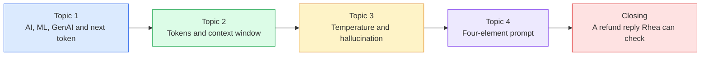
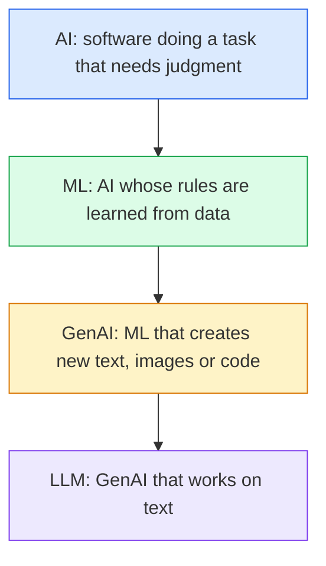
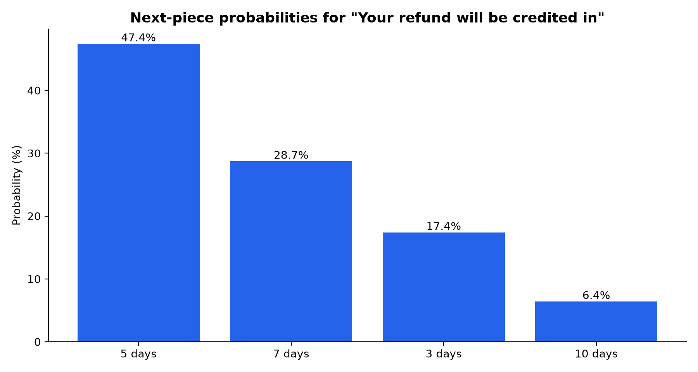
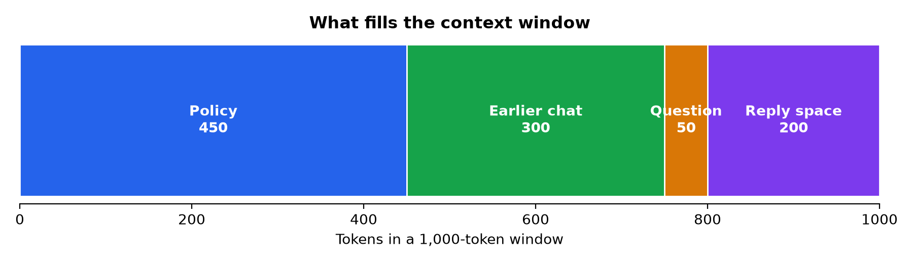
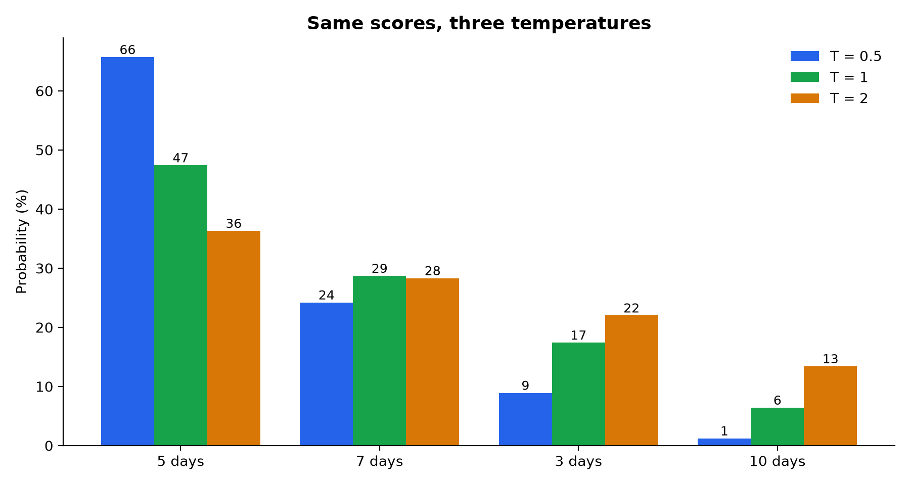

# Lecture Script: How AI and LLMs Work with Prompts

---

## Agenda

The lecture runs as four topics. Each topic ends with a quiz.

| Topic | What we do | Learning objectives covered | Minutes |
|:-:|:--|:--|:-:|
| 1 | Place AI, ML and GenAI, then see how a reply is built word by word | Compare AI, machine learning and generative AI by what each term covers Describe next-token prediction as the mechanism that produces an LLM response | 25 |
| 2 | Split text into tokens and count what the model can hold | Describe how a tokenizer splits text into subword tokens Explain what a context window limits and what counts against it | 25 |
| 3 | Turn the temperature dial and catch a confident wrong answer | Predict how raising temperature changes the variability of an output Explain why a model can produce fluent text that is factually wrong | 30 |
| 4 | Write a prompt with four elements and try it live | State the four elements of a well-formed prompt: task, context, format and constraints | 25 |
| — | Closing: Outcome & Summary | | 15 |
| | **Total** | | **120** |

> **🎯 Instructor Note** Pace: keep the AI, ML and GenAI comparison in Topic 1 brisk. Spend the extra minutes on temperature and on the live prompt in Topic 4.
> Topic 4 runs live in a free chat tool (ChatGPT, Claude or Gemini). Replies differ on every run, so learners fill the tables from what they see.

---

## Scenario

**A single risk.** A Myntra-style fashion app in Bengaluru lets its support team use a free chat tool to draft replies. The risk sits in one sentence the tool might write.

> "Your refund will be credited within 2 hours."

The app's real rule is 5 to 7 working days. A customer who reads "2 hours" will wait two hours, then call, then post a complaint.

> **🎯 Instructor Note** The company is only the setting. Do not claim it uses a chat tool or these rules. The refund rule, the probabilities and the token counts are invented for teaching.

---

## Problem Statement

Rhea works in customer support. A customer asks, "When will my refund arrive?" Rhea types the question into a chat tool and pastes the reply without reading it. The reply sounds polished and says "within 2 hours". The real rule is 5 to 7 working days. Two days later the customer is angry, and Rhea cannot explain why a tool that sounds so sure was wrong.

> **How does a chat tool build its reply, why can that reply be fluent and wrong, and how do we write a prompt that gets a reply we can check?**

> **🎯 Instructor Note** Poll: "If a reply is well written, is it more likely to be correct?" Give learners 30 seconds to respond in chat. Reveal the answer in the Closing.

---

## What We Will Use

Three free chat tools: ChatGPT, Claude and Gemini. The mentor runs each prompt live. Learners compare what they see with the tables below.

| Topic | Ideas | In one line |
|:-:|:--|:--|
| 1 | AI, ML, GenAI, next-token prediction | Three nested terms, and a model that picks the next piece of text |
| 2 | Token, tokenizer, context window | Text is cut into pieces, and a fixed number of pieces fit at once |
| 3 | Temperature, hallucination | A dial for variety, and the reason a fluent answer can be false |
| 4 | Task, context, format, constraints | Four parts that make a prompt clear |

---

## How: Walking Through Rhea's Refund Reply

---

## Topic 1: Place AI, ML and GenAI, then see how a reply is built word by word `25 min`

> **What exactly is the tool that wrote "within 2 hours"?**

### Example: Three nested terms

> **How do AI, machine learning and generative AI relate to each other?**

**Artificial intelligence (AI)** is any software that does a task that normally needs human judgment. **Machine learning (ML)** is AI that learns its rules from data instead of being given every rule. **Generative AI (GenAI)** is ML that creates new content such as text, images or code. Each term sits inside the one before it.

| Example at the app | AI | ML | GenAI |
|:--|:-:|:-:|:-:|
| A rule: "if order value is above Rs 5,000, flag for check" | Yes | No | No |
| A model that learned from past returns which orders are likely to be returned | Yes | Yes | No |
| A chat tool that writes a new reply to a customer | Yes | Yes | Yes |

> **Result** The first row is AI without learning. The second row learns from data but does not create text. Only the third row is GenAI, and it is the kind Rhea used.

> **🎯 Instructor Note** Ask learners to type where "a spam filter that learned from past emails" fits. Expected: AI and ML, not GenAI.

### Example: A reply is built one token at a time

> **How does a chat tool decide what to write next?**

A **large language model (LLM)** is a GenAI model trained on very large amounts of text. It works by **next-token prediction**: given the text so far, it scores every possible next piece of text, picks one, adds it and repeats. It does not look up a fact. It continues the pattern.

The scores below are invented for teaching. The text so far is "Your refund will be credited in".

| Next piece of text | Probability |
|:--|:-:|
| 5 days | 47.4% |
| 7 days | 28.7% |
| 3 days | 17.4% |
| 10 days | 6.4% |

#### Logic Explanation

- The model picks one row, adds it to the text, and asks the same question again for the next piece.
- Nothing in this table says what the real refund rule is. The probabilities only say which continuation is common.

> **Result** A reply is a chain of small choices. A fluent chain can still land on a wrong number.

### Quiz 1

**Question:** Which statement describes next-token prediction?

**Options:**
- A) The model searches a database and copies the matching answer
- B) The model scores possible next pieces of text, picks one and repeats
- C) The model asks a human to check each sentence
- D) The model writes the whole reply at once, then checks it

**Correct Answer:** B

**Explanation:**
- **A)** An LLM does not copy from a lookup table. It builds text from learned patterns.
- **B)** Correct. It scores the candidates, picks one, adds it and asks again.
- **C)** No human is involved while the reply is generated.
- **D)** The reply is built piece by piece. There is no separate full draft and check.

---

## Topic 2: Split text into tokens and count what the model can hold `25 min`

> **What is a "piece of text", and how many pieces can the tool keep in view?**

### Example: How a tokenizer cuts a sentence

> **How is "Refundable orders get refunds" cut into pieces?**

A **token** is a piece of text the model reads as one unit. A **tokenizer** cuts text into tokens, often as whole words, parts of words ("subwords") or punctuation. Rare or long words split into smaller known parts.

The split below is an illustration invented for teaching. Each real tool has its own tokenizer, so the exact cuts and counts differ.

| Text | Illustrative tokens | Count |
|:--|:--|:-:|
| Refundable | Refund + able | 2 |
| orders | orders | 1 |
| get | get | 1 |
| refunds | refund + s | 2 |
| **Whole sentence** | | **6** |

> **Result** Six tokens for four words. A word is not a token. Common words are often one token. Long or rare words split into parts.

> **🎯 Instructor Note** Ask learners to guess the count for "Unrefundable". Expected: more than one token, likely 3 (un + refund + able). Say again that real splits differ by tool.

### Example: What fills the context window

> **What counts against the model's memory for one chat?**

The **context window** is the maximum number of tokens the model can use at once. It counts everything: your instructions, the earlier messages in the chat and the reply being written. Anything beyond the limit is cut or ignored.

Invented for teaching: a window of 1,000 tokens.

| Part of the chat | Tokens |
|:--|:-:|
| Support policy pasted by Rhea | 450 |
| Earlier messages in the chat | 300 |
| Rhea's new question | 50 |
| Left for the reply | 200 |
| **Window** | **1,000** |

$$\boxed{ \text{space left for the reply} = \text{window} - \text{policy} - \text{earlier messages} - \text{new question} }$$

$$1000 - 450 - 300 - 50 = 200$$

> **Result** Only 200 tokens are left for the answer. Pasting a longer policy would leave less room for the reply.

### Extending it: Paste a longer policy

> **If the pasted policy grows to 700 tokens, how much room is left?**

> **🎯 Instructor Note** Ask learners to type the number in chat. Expected: $1000 - 700 - 300 - 50 = -50$, so the policy no longer fits and something is cut.

> **Result** The total would be 1,050 tokens, which is 50 over the window. The tool must drop text, so older parts of the chat may be forgotten.

> **Common mistake** Thinking the window only counts the question. Fix: count the whole chat and the reply too.

### Quiz 2

**Question:** A window is 1,000 tokens. The chat holds 600 tokens and the new question is 100 tokens. How many tokens are left for the reply?

**Options:**
- A) 400
- B) 900
- C) 1,700
- D) 300

**Correct Answer:** D

**Explanation:**
- **A)** 400 ignores the 100-token question. $1000 - 600 = 400$ leaves out one part.
- **B)** 900 subtracts only the question and forgets the 600-token chat.
- **C)** 1,700 adds the numbers. A window is a limit, so the parts are subtracted from it.
- **D)** Correct. $1000 - 600 - 100 = 300$.

---

## Topic 3: Turn the temperature dial and catch a confident wrong answer `30 min`

> **Why does the same question give a different reply each time, and why was the "2 hours" reply so sure of itself?**

### Example: Raising the temperature

> **What happens to the next-piece probabilities when temperature goes up?**

**Temperature** is a setting that controls how much the choice varies. Low temperature sharpens the scores, so the top choice wins most of the time. High temperature flattens them, so less likely choices get picked more often.

$$p_i = \frac{e^{s_i / T}}{\sum_j e^{s_j / T}}$$

Here $s_i$ is the invented score of one choice and $T$ is the temperature. We use scores 2.0, 1.5, 1.0 and 0.0 for "5 days", "7 days", "3 days" and "10 days". All values were recomputed in Python.

**Predict before running: What will happen?**

> **🎯 Instructor Note** Expected: at $T = 0.5$ the top choice grows, and at $T = 2$ the four choices come closer. Common wrong guess: higher temperature makes the model "more accurate".

| Next piece | $T = 0.5$ | $T = 1$ | $T = 2$ |
|:--|:-:|:-:|:-:|
| 5 days | 65.7% | 47.4% | 36.3% |
| 7 days | 24.2% | 28.7% | 28.3% |
| 3 days | 8.9% | 17.4% | 22.0% |
| 10 days | 1.2% | 6.4% | 13.4% |

> **Result** Going from $T = 0.5$ to $T = 2$ cuts the top choice from 65.7% to 36.3%. The unlikely "10 days" grows from 1.2% to 13.4%. Higher temperature means more variety, not more truth.

### Extending it: Run the same prompt twice, live

> **Do two runs of the same question give the same words?**

> **🎯 Instructor Note** Mentor: in a free chat tool, ask "Suggest a subject line for a refund-delay email" twice in two new chats. Learners note which words differ. Do not predict the exact replies.

| Run | Subject line the tool wrote | Same wording as run 1? |
|:-:|:--|:-:|
| 1 | Learners write it here | |
| 2 | Learners write it here | Yes or No |

> **Result** Differences between runs come from the random pick at each token. A tool with a higher temperature setting would differ more.

### Example: Why a fluent answer can be wrong

> **Why did the tool say "within 2 hours" with no hint of doubt?**

A **hallucination** is a reply that sounds right but states something false or unsupported. The model was trained to continue text in a likely way. It was not built to check facts. If it never saw the app's refund rule, it still writes a smooth sentence in the usual style of refund replies.

| What the model has | What the model lacks |
|:--|:--|
| Patterns of how refund replies read | The app's real refund rule |
| Words like "credited within" | A way to check "2 hours" against a record |
| A confident tone | A signal that tells it when it is guessing |

> **Result** The reply was fluent because the model is good at style. It was wrong because the rule was never given to it.

> **Common mistake** Trusting a reply because it reads well. Fix: check every number, date and policy against a source you own.

### Quiz 3

**Question:** Rhea raises the temperature from low to high. What is the most likely change?

**Options:**
- A) The replies become more accurate
- B) The replies become identical every time
- C) The replies vary more from run to run
- D) The context window grows

**Correct Answer:** C

**Explanation:**
- **A)** Temperature controls variety, not accuracy.
- **B)** Low temperature moves towards the same reply. High temperature does the opposite.
- **C)** Correct. A flatter distribution means less likely pieces are picked more often.
- **D)** The window is a fixed limit of the model. Temperature does not change it.

---

## Topic 4: Write a prompt with four elements and try it live `25 min`

> **How should Rhea ask, so the reply uses her policy and can be checked?**

### Example: Weak prompt and four-element prompt

> **What is missing from "When will my refund arrive?"**

A well-formed prompt has four elements.

| Element | What it says | Example for Rhea |
|:--|:--|:--|
| Task | What you want done | Write a reply to a customer asking about a refund |
| Context | The facts the model needs | Policy: refund in 5 to 7 working days after pickup. Return picked up on 12 March 2026 |
| Format | How the answer should look | 3 short sentences, then one line starting "Policy:" |
| Constraints | Limits and rules | Use only the policy given. Do not promise a date outside it. Under 60 words |

> **Result** The weak prompt has only a task. The four-element prompt gives the model the rule, so it has less need to guess.

### Extending it: Run both prompts live

> **Does the four-element prompt give a reply Rhea can check?**

> **🎯 Instructor Note** Mentor: run both prompts live in ChatGPT, Claude or Gemini. Learners fill the table. Do not predict the wording. Replies differ on every run.

| Check | Weak prompt reply | Four-element reply |
|:--|:-:|:-:|
| Does it say 5 to 7 working days? | Yes or No | Yes or No |
| Does it invent a rule that is not in the policy? | Yes or No | Yes or No |
| Does it fit in 60 words? | Yes or No | Yes or No |
| Does it end with a "Policy:" line? | Yes or No | Yes or No |

> **Result** Learners compare the two columns. A reply that passes all four checks is one Rhea can verify against the policy line.

> **Common mistake** Writing a long context but no constraint. Fix: add "use only the policy given" so the model does not add facts.

### Extending it: Add one element at a time

> **Which element changes the reply most?**

> **🎯 Instructor Note** Mentor: start with the task only, then add context, then format, then constraints. Ask learners which step changed the reply most. Answers vary. There is no single correct order.

### Quiz 4

**Question:** Which prompt contains all four elements?

**Options:**
- A) "Write a refund reply. Policy: 5 to 7 working days. Use 3 sentences. Use only this policy."
- B) "Write a refund reply. Policy: 5 to 7 working days."
- C) "Write a refund reply."
- D) "You are a helpful assistant. Be nice."

**Correct Answer:** A

**Explanation:**
- **A)** Correct. Task (write a reply), context (the policy), format (3 sentences) and constraints (use only this policy).
- **B)** It has a task and context. Format and constraints are missing.
- **C)** It has a task only.
- **D)** It sets a tone but has no task, no context and no format.

---

## Closing: Outcome & Summary `15 min`

Back to Rhea. We answer the Problem Statement using each topic once.

> **1. What kind of tool wrote the reply? (Topic 1)**

A GenAI tool, specifically an LLM. It built the reply by next-token prediction, one piece at a time.

> **2. How much could it hold? (Topic 2)**

Only what fits in its context window. The policy, the earlier chat and the reply all count against that limit.

> **3. Why was the reply fluent and wrong? (Topic 3)**

It chose likely words, not checked facts. Temperature changes how much the picks vary, but it never adds the app's real rule.

> **4. How does Rhea ask next time? (Topic 4)**

With a task, the policy as context, a format and constraints. Then she checks the reply against the policy line.

### Outcome

| | Rhea's first prompt | Rhea's four-element prompt |
|:--|:-:|:-:|
| Task | Yes | Yes |
| Context (the policy) | No | Yes |
| Format | No | Yes |
| Constraints | No | Yes |
| Can she check the reply? | No | Yes |

> **Therefore,** A chat tool builds replies token by token inside a limited context window. It can sound sure and still be wrong, so Rhea gives it the policy, a format and limits, then checks the answer herself.

> **🎯 Instructor Note** Reveal the poll: no. A well-written reply is not more likely to be correct, because fluency comes from style and not from checking facts.

### Summary

| Learning objective | Takeaway |
|:--|:--|
| Compare AI, ML and GenAI | AI is the widest term. ML learns from data. GenAI creates new content |
| Next-token prediction | The model scores the next piece, picks one and repeats |
| Tokenizer and tokens | Text is cut into pieces, and one word can be several tokens |
| Context window | A fixed limit that counts the prompt, the chat history and the reply |
| Temperature | Higher temperature gives more varied output, not more accurate output |
| Hallucination | Fluent text can be false because the model continues patterns and does not check facts |
| Four prompt elements | Task, context, format and constraints |
| **Practical value** | Every AI reply you use at work should come from a clear prompt and be checked against a source you trust |

---

# Launch the Feedback Poll

> **🎯 Instructor Note** Reminder: launch the feedback poll now to collect learner feedback.

