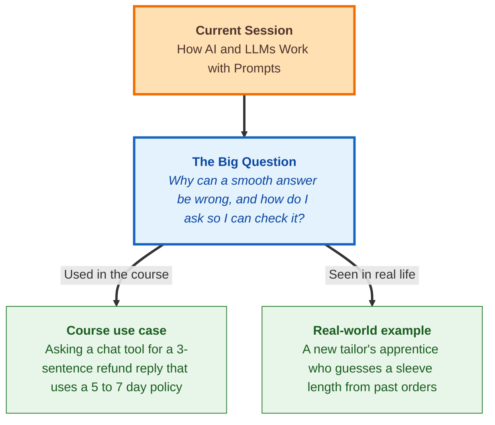

## How AI and LLMs Work with Prompts

### Mental Map

---

### What You'll Learn

Have you ever wondered how an apprentice can sound sure about a measurement he never took?

By the end of this session, you will be able to:

- **Describe** how a reply gets built one small piece at a time.
- **Explain** why a confident answer, like a 24-inch sleeve guess, can still be wrong.
- **Predict** what happens to the variety of replies when a boldness dial goes up.
- **Calculate** how much room is left when a helper keeps only 5 notes in mind.
- **Compare** a rule book, a helper who learns from orders and a helper who invents new designs.
- **Write** a request with 4 parts, so a helper has less to guess.

> **Topics you will meet:** AI vs ML vs GenAI, next-token prediction, tokens, context and temperature, hallucination, four elements of a prompt, trying the four prompt elements in a free chat tool.
>
> Join the session to learn each of these in detail.

---

### Why You Are Learning This Topic

Mr. Qureshi runs a tailor shop in a lane near the station. His new apprentice, Bilal, has watched 500 orders.

A customer asks for a kurta "like last time". Bilal guesses a 24-inch sleeve, the usual length. He sounds sure.

The customer's real sleeve is 26 inches. Bilal never opened the measurement card.

A **prompt** means the written request you give an AI tool to say what you want.

In this course, you will write prompts for free chat tools and check each reply.

> **Think about it:** If Bilal had read the customer's card first, would he still need to guess?

---

### The Tailor Shop Puzzle

Mr. Qureshi chalks four facts on the shop board.

| Fact | Value |
|:----------:|:----------:|
| Orders Bilal has watched | 500 |
| Usual kurta sleeve length | 24 inches |
| This customer's real sleeve length | 26 inches |
| Notes Bilal can hold in his head at once | 5 orders |

**What you want to happen:**

- Bilal asks for the card before he guesses.
- Bilal keeps the right 5 notes in mind.
- Bilal gives a reply that Mr. Qureshi can check.

> **Wonder about this:**
>
> - Why did Bilal sound sure when the card was never read?
> - What happens to the first note when a sixth order arrives?

---

### Think It Through

There is no wrong first try. Keep your guesses for the session.

**1. Bilal holds 5 notes. A sixth order arrives. What happens to the first note?**
Hint: Picture a notepad with room for 5 lines.

**2. Which request gives Bilal more to work with: "Make it quick" or "Make a cotton kurta, 26-inch sleeve, ready Friday"?**
Hint: Count the facts each one gives.

**3. On a bold day, Bilal tries a new collar. On a careful day, he copies the usual. Which day gives you the same shirt twice?**
Hint: Think about which day repeats the past.

---

### One Question to Carry Into the Session

> **What makes an answer sound sure, and what makes it right?**
>
> Which fact would you hand Bilal before he starts to stitch?
