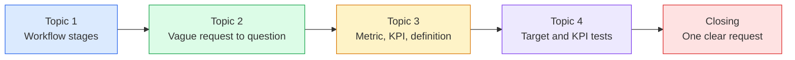
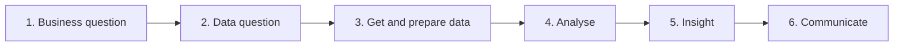
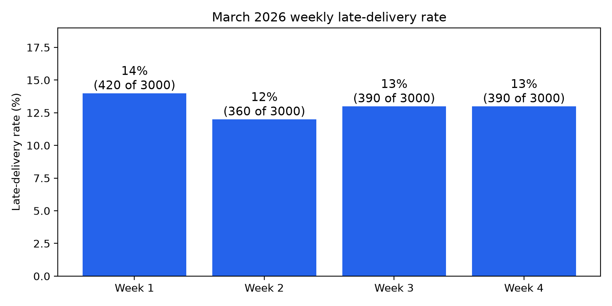
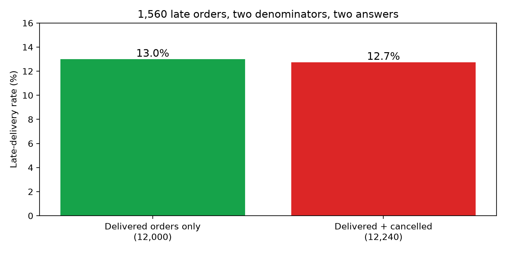
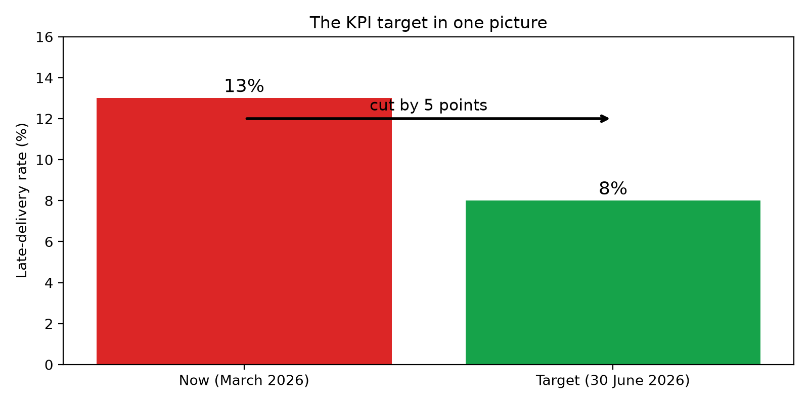
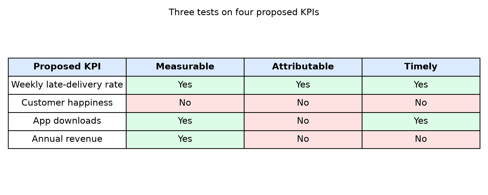

# Lecture Script: Analytics Workflow with Metrics and KPIs

---

## Agenda

The lecture runs as four topics. Each topic ends with a quiz.

| Topic | What we do | Learning objectives covered | Minutes |
|:-:|:--|:--|:-:|
| 1 | Follow one request through the analytics workflow | Describe the stages of an analytics workflow from business question to communicated insight | 20 |
| 2 | Turn a vague request into a data question | Rewrite a vague business request as a question the data can answer | 25 |
| 3 | Separate metrics from KPIs and define one | Classify a measure as a metric or a KPI by whether it tracks a stated business objective Write a metric definition stating numerator, denominator, population and time window | 30 |
| 4 | Set a KPI target and test a KPI | Write a KPI target stating the metric, a number and a date Evaluate a proposed KPI against being measurable, attributable and timely | 30 |
| — | Closing: Outcome & Summary | | 15 |
| | **Total** | | **120** |

> **🎯 Instructor Note** Pace: keep Topic 1 brisk, since it only names the stages. Spend the extra minutes on the four parts of a metric definition in Topic 3 and on the three KPI tests in Topic 4.
> No software is needed. Learners write their answers in chat or on paper.

---

## Scenario

**Before and after.** A BigBasket-style grocery app in Bengaluru has one meeting and two very different outcomes.

| | Before the analysis | After the analysis |
|:--|:--|:--|
| What the head of operations says | "Customers seem unhappy. Fix delivery." | "Cut the late-delivery rate from 13% to 8% by 30 June 2026." |
| What the analyst can do with it | Nothing clear | Pull data, check weekly, report progress |

> **🎯 Instructor Note** The company is only the setting. Do not claim it uses these numbers. All numbers are invented for teaching. March 2026 is the month being studied.

---

## Problem Statement

Kavya is a data analyst. The head of operations tells her, "Customers seem unhappy. Fix delivery." Kavya opens a dashboard and builds a chart of average delivery time. Two weeks later she presents it. The head says, "That is not what I meant." Two weeks are gone, and nobody knows if delivery got better.

Last session you learned that a prompt works better with a clear task, context, format and constraints. A business request needs the same clarity before anyone touches data.

> **How do we turn "customers seem unhappy" into a question, a measure and a target that the whole team can check?**

> **🎯 Instructor Note** Poll: "Is 'average delivery time' a metric, a KPI, or both?" Give learners 30 seconds to respond in chat. Reveal the answer in the Closing.

---

## What We Will Use

No software today. We use five ideas and one small table of March 2026 numbers.

| Topic | Ideas | In one line |
|:-:|:--|:--|
| 1 | Analytics workflow | Six stages from a business question to a message people act on |
| 2 | Data question | A question with a measure, a group and a time window |
| 3 | Metric, KPI, metric definition | A metric counts something. A KPI is a metric tied to a stated objective |
| 4 | KPI target, three tests | A KPI target has a metric, a number and a date. A good KPI is measurable, attributable and timely |

March 2026 numbers (invented for teaching): 4 weeks, 3,000 delivered orders per week, 240 cancelled orders in the month.

| Week | Delivered orders | Late orders | Late rate |
|:-:|:-:|:-:|:-:|
| 1 | 3,000 | 420 | $14\%$ |
| 2 | 3,000 | 360 | $12\%$ |
| 3 | 3,000 | 390 | $13\%$ |
| 4 | 3,000 | 390 | $13\%$ |
| **Month** | **12,000** | **1,560** | **$13\%$** |

---

## How: Walking Through Kavya's Request

---

## Topic 1: Follow one request through the analytics workflow `20 min`

> **Where did Kavya's two weeks go?**

### Example: The six stages

> **What stages should her work have gone through?**

An **analytics workflow** is the path from a business question to an insight people can use. It has six stages.

| Stage | What happens | Kavya's example |
|:-:|:--|:--|
| 1 | Name what the business wants | "Customers seem unhappy. Fix delivery." |
| 2 | Turn it into a question the data can answer | "What share of March orders arrived late?" |
| 3 | Get the data and clean it | Pull 12,000 delivered orders, drop 240 cancelled orders |
| 4 | Work out the numbers | 1,560 late orders out of 12,000 |
| 5 | Say what the numbers mean | 13% of orders are late, and the rate has not moved in 4 weeks |
| 6 | Share it so someone acts | One slide: "13% late. Target 8%." |

#### Logic Explanation

- **Stage 1 to 2** is where Kavya skipped ahead. She went from "unhappy customers" to a chart without choosing a question.
- **Stage 3** removes orders that never reached a customer. Cancelled orders cannot be late.
- **Stage 5 to 6** turns $\frac{1560}{12000} = 0.13$ into a sentence a manager can act on.

> **Result** Kavya's chart came from Stage 4 with no Stage 2. That is why her work missed the point.

### Extending it: Place each action in its stage

> **Which stage is each action?**

> **🎯 Instructor Note** Read the three actions and ask learners to type a stage number. Expected: "Remove the 240 cancelled orders" is 3, "Present one slide to the head" is 6, "Decide the real question is about lateness" is 2.

> **Result** Every action belongs to one stage. If an action cannot be placed, the work has no clear question.

### Quiz 1

**Question:** Which stage comes right after "Get and prepare data"?

**Options:**
- A) Business question
- B) Communicate
- C) Analyse
- D) Data question

**Correct Answer:** C

**Explanation:**
- **A)** The business question is Stage 1. It starts the workflow.
- **B)** Communicate is Stage 6, the last stage.
- **C)** Correct. Once the data is ready, you analyse it to get the numbers.
- **D)** The data question is Stage 2. It comes before the data is collected.

---

## Topic 2: Turn a vague request into a data question `25 min`

> **Stage 2 was the missing stage. How do we do it?**

### Example: "Customers seem unhappy. Fix delivery."

> **What is wrong with this request, and what question can the data answer?**

A vague request hides four choices: which customers, which measure, compared with what, and over what time. A data question states all four.

| Part | Vague request | Data question |
|:--|:--|:--|
| Who | "Customers" | Delivered orders in Bengaluru |
| What | "Unhappy", "Fix delivery" | Orders delivered after the promised slot |
| Compared with | Nothing | Share of all delivered orders |
| When | Nothing | March 2026 |

> **Result** "What share of delivered Bengaluru orders in March 2026 arrived after the promised slot?" The answer is $\frac{1560}{12000} = 13\%$.

#### Logic Explanation

- The new question has a measure (late orders), a group (delivered Bengaluru orders), a base (all delivered orders) and a period (March 2026).
- Two analysts reading it will pull the same data and get the same number.

### Extending it: Rewrite a second request

> **"We should look at our best customers." What is the data question?**

> **🎯 Instructor Note** Ask learners to write their version in chat. Accept any version with the four parts. Sample: "Which 100 customers placed the most delivered orders between 1 January and 31 March 2026?"

> **Result** "Best" became a count of delivered orders, "customers" became 100 people, and "look at" became a ranked list for a stated period.

> **Common mistake** Keeping words like "best", "unhappy" or "slow" in the question. Fix: replace each one with a count, a share or a time.

### Quiz 2

**Question:** Which request is already a question the data can answer?

**Options:**
- A) "Improve the customer experience."
- B) "What share of Bengaluru orders in March 2026 used a coupon?"
- C) "Make delivery better."
- D) "Find out why people are leaving."

**Correct Answer:** B

**Explanation:**
- **A)** "Experience" has no measure, group or time.
- **B)** Correct. It names a share, a group (Bengaluru orders) and a period (March 2026).
- **C)** "Better" is not a number, and no period is given.
- **D)** "Leaving" and "why" are open. No measure or period is stated.

---

## Topic 3: Separate metrics from KPIs and define one `30 min`

> **Kavya now asks the right question. Which number should the team watch?**

### Example: Metric or KPI?

> **Which of these measures track the objective "Deliver groceries on time"?**

A **metric** is any measure you can count. A **KPI** (key performance indicator) is a metric that tracks a stated business objective. The test is one question: which stated objective does this measure track?

| Measure | Tracks the objective "Deliver groceries on time"? | Metric or KPI |
|:--|:-:|:-:|
| Orders per week | No | Metric |
| Average basket value | No | Metric |
| Late-delivery rate | Yes | KPI |
| App opens per day | No | Metric |

> **Result** All four are metrics. Only the late-delivery rate is also a KPI for this objective.

> **🎯 Instructor Note** This sets up the poll. "Average delivery time" tracks "Deliver groceries on time" only if the objective says so. Do not reveal the poll answer yet.

### Extending it: Write the metric definition

> **What exactly is "late-delivery rate"?**

A metric definition has four parts, and each one removes a disagreement.

$$\boxed{ \text{late-delivery rate} = \frac{\text{orders delivered after the promised slot}}{\text{all delivered orders}} }$$

| Part | Late-delivery rate |
|:--|:--|
| Numerator | Orders delivered after the end of the promised slot |
| Denominator | All delivered orders |
| Population | Bengaluru orders, cancelled orders excluded |
| Time window | One calendar week, Monday to Sunday |

For March 2026: $\frac{1560}{12000} = 13.0\%$.

> **Result** With these four parts, any analyst gets the same 13.0%.

### Extending it: See what a loose definition does

> **What if one analyst keeps the 240 cancelled orders in the denominator?**

> **🎯 Instructor Note** Ask for a prediction first. Expected: a smaller rate. The same 1,560 late orders are divided by a bigger base.

$$\frac{1560}{12000 + 240} = \frac{1560}{12240} \approx 12.7\%$$

> **Result** The same orders give 13.0% or 12.7%, depending on the population. The definition decides the number.

> **Common mistake** Leaving out the population or the time window. Fix: write all four parts before sharing the number.

### Quiz 3

**Question:** Which part of a metric definition says "delivered Bengaluru orders, cancelled orders excluded"?

**Options:**
- A) Numerator
- B) Denominator only
- C) Time window
- D) Population

**Correct Answer:** D

**Explanation:**
- **A)** The numerator is the count on top, here the late orders.
- **B)** The denominator is the base count. The population says which orders are allowed into both counts.
- **C)** The time window is the period, such as one calendar week.
- **D)** Correct. The population says who or what is included.

---

## Topic 4: Set a KPI target and test a KPI `30 min`

> **The KPI is chosen. How do we say how much it has to improve, and is it the right KPI?**

### Example: Write the KPI target

> **What does "fix delivery" become as a target?**

A **KPI target** has three parts: the metric, a number and a date.

| Part | Example |
|:--|:--|
| Metric | Weekly late-delivery rate |
| Number | 8% (from 13%) |
| Date | 30 June 2026 |

"Reduce the weekly late-delivery rate from 13% to 8% by 30 June 2026."

The gap is $13\% - 8\% = 5$ percentage points.

> **Result** Anyone can check this target on 30 June 2026 against one number.

### Extending it: Test four proposed KPIs

> **Which proposed KPIs pass the three tests: measurable, attributable and timely?**

**Measurable** means a number can be calculated from data you have. **Attributable** means the team being judged can change it. **Timely** means the number arrives often enough to act on.

> **🎯 Instructor Note** Fixed facts for the exercise: there is no agreed survey question for "happiness". The survey runs once a quarter. Revenue is reported once a year. The delivery team does not run app marketing.

| Proposed KPI | Measurable | Attributable | Timely | Why |
|:--|:-:|:-:|:-:|:--|
| Weekly late-delivery rate | Yes | Yes | Yes | Counted from orders, driven by delivery, available every week |
| Customer happiness | No | No | No | No agreed question, many causes, quarterly survey |
| App downloads | Yes | No | Yes | Counted daily, but delivery does not drive downloads |
| Annual revenue | Yes | No | No | Many teams drive it, and it arrives once a year |

> **Result** Only the weekly late-delivery rate passes all three tests.

> **Common mistake** Picking a KPI because it is easy to find on a dashboard. Fix: run the three tests first.

### Quiz 4

**Question:** Which is a complete KPI target?

**Options:**
- A) Reduce the weekly late-delivery rate from 13% to 8% by 30 June 2026
- B) Improve the late-delivery rate
- C) Reach 8% late deliveries
- D) Late-delivery rate by 30 June 2026

**Correct Answer:** A

**Explanation:**
- **A)** Correct. It has the metric, a number (8%) and a date (30 June 2026).
- **B)** It names the metric but gives no number and no date.
- **C)** It has a number but no date, and "late deliveries" is not a defined metric.
- **D)** It has a metric and a date but no number to reach.

---

## Closing: Outcome & Summary `15 min`

Back to Kavya. We answer the Problem Statement using each topic once.

> **1. Which stages was Kavya missing? (Topic 1)**

Stage 2. She went from the business question straight to analysis.

> **2. What is the data question? (Topic 2)**

"What share of delivered Bengaluru orders in March 2026 arrived after the promised slot?"

> **3. What is the KPI and how is it defined? (Topic 3)**

The late-delivery rate: late delivered orders divided by all delivered orders, Bengaluru, cancelled excluded, per calendar week. March 2026 gives $\frac{1560}{12000} = 13\%$.

> **4. What is the target and does the KPI pass? (Topic 4)**

Reduce the weekly late-delivery rate from 13% to 8% by 30 June 2026. The KPI is measurable, attributable and timely.

### Outcome

| | Kavya's first request | Kavya's final request |
|:--|:--|:--|
| Question | "Customers seem unhappy" | Share of late delivered orders, March 2026 |
| Measure | Average delivery time (unstated objective) | Weekly late-delivery rate |
| Target | None | 8% by 30 June 2026 |
| Can the team check it? | No | Yes |

> **Therefore,** A request becomes useful once it has a data question, a defined KPI and a target with a number and a date. Kavya can now start work, and the head of operations can check progress weekly.

> **🎯 Instructor Note** Reveal the poll: average delivery time is a metric. It becomes a KPI only if the stated objective is about delivery time. Here the objective is "on time", so the late-delivery rate is the KPI.

### Summary

| Learning objective | Takeaway |
|:--|:--|
| Analytics workflow | Six stages from business question to communicated insight |
| Rewrite a vague request | Replace each vague word with a measure, a group, a base and a period |
| Metric or KPI | A KPI is a metric that tracks a stated business objective |
| Metric definition | Numerator, denominator, population and time window |
| KPI target | Metric, a number and a date |
| Evaluate a KPI | Measurable, attributable and timely |
| **Practical value** | Every request you receive at work can be turned into a question, a KPI and a target before you open any data |

---

# Launch the Feedback Poll

> **🎯 Instructor Note** Reminder: launch the feedback poll now to collect learner feedback.
