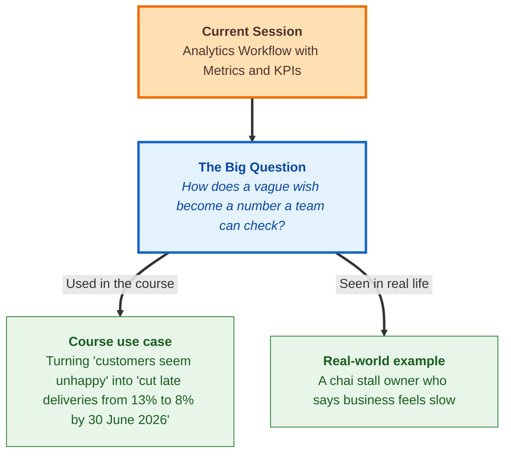

## Analytics Workflow with Metrics and KPIs

### Mental Map

---

### What You'll Learn

Have you ever wondered how a stall owner knows whether business is slow in fact, or only feels slow?

By the end of this session, you will be able to:

- **Describe** the 6 stages that take a stall owner's worry to a message people act on.
- **Apply** a 4-part check to turn "business feels slow" into a question that numbers can answer.
- **Differentiate** a number you only count from a number tied to a goal.
- **Judge** a proposed measure by 3 tests. Can you count it? Can the stall change it? Does it arrive in time?
- **Write** the exact recipe for one measure: what you count, what you divide by, who is included and which dates.
- **Design** a goal with a number and a date, such as "70 cups a day by 30 June 2026".

> **Topics you will meet:** Analytics workflow, vague request to question, metric vs KPI, metric definition, set a KPI target, check a KPI.
>
> Join the session to learn each of these in detail.

---

### Why You Are Learning This Topic

Ramesh runs a chai stall near a metro station. One evening he sighs and says, "Business feels slow."

His cousin asks, "Slow compared with when?" Ramesh does not know. He has no count of cups and no goal.

Both of them could make a plan, but the plan would point at nothing.

A **KPI** means a number that tracks one goal you have named, such as cups sold per day.

In this course, you will turn requests like Ramesh's into questions, measures and goals before you open any data.

> **Think about it:** If Ramesh sold 80 cups yesterday, can he tell whether business is slow?

---

### The Chai Stall Puzzle

Ramesh scribbles these facts on the back of a bill.

| Fact | Value |
|:----------:|:----------:|
| Cups sold last Monday | 80 |
| Price of one cup | Rs 12 |
| Customers who came back this week | 35 |
| Cups thrown away | 18 |

**What you want to happen:**

- Ramesh says clearly what "slow" means.
- He picks one number to watch every week.
- He sets a goal that everyone can check on a date.

> **Wonder about this:**
>
> - Which of the four facts says anything about "slow"?
> - What would Ramesh and his cousin need to agree on before they count?

---

### Think It Through

There is no wrong first try. Keep your guesses for the session.

**1. Ramesh says, "Sell more." Which two details are missing from that sentence?**
Hint: Ask for a number and a date.

**2. Cups thrown away is 18. Does that number tell him about his goal of selling more?**
Hint: Ask whether it moves when sales move.

**3. Ramesh checks sales once a year, on his birthday. Why is that a weak habit?**
Hint: Think about how soon he could fix a bad week.

---

### One Question to Carry Into the Session

> **What makes a wish into a goal that a whole team can check?**
>
> Which fact on Ramesh's bill would you track first, and why?
