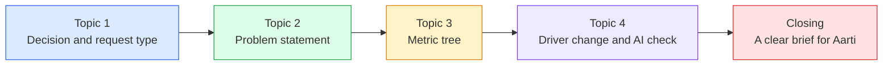
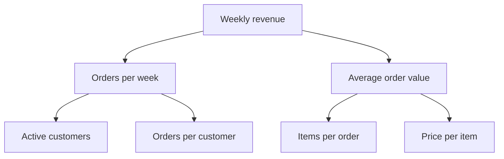
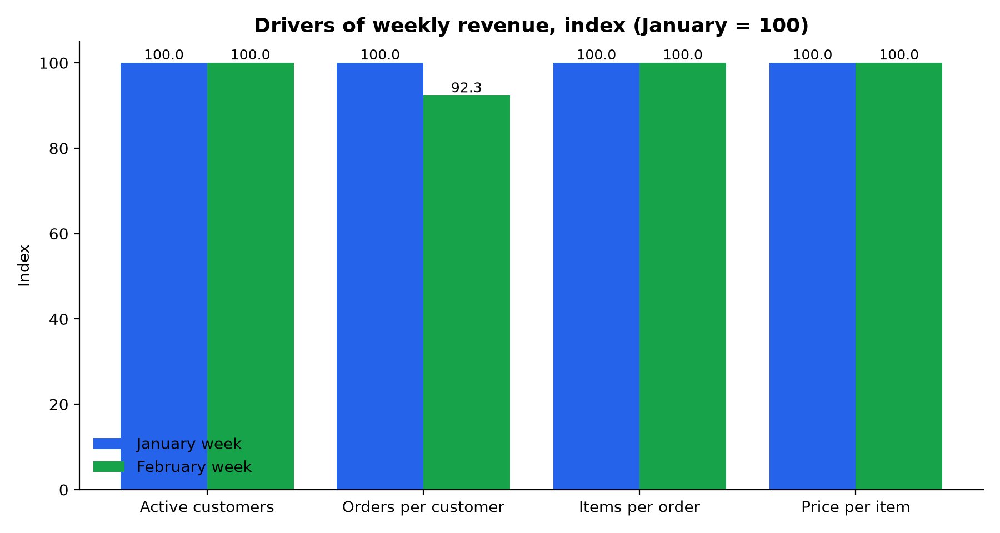
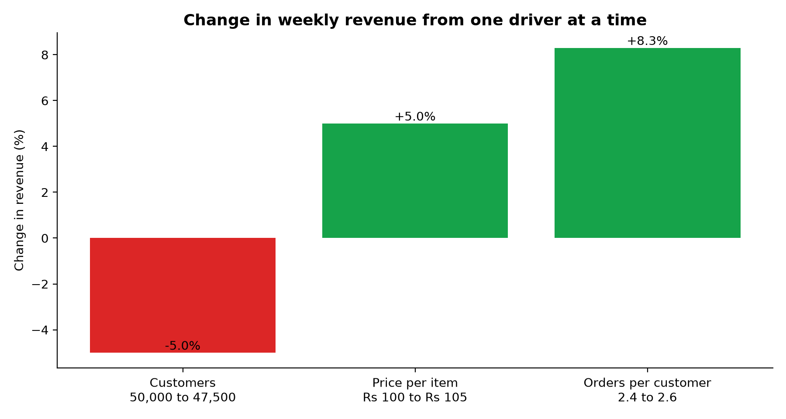

# Lecture Script: Problem Framing and Metric Trees

---

## Agenda

The lecture runs as four topics. Each topic ends with a quiz.

| Topic | What we do | Learning objectives covered | Minutes |
|:-:|:--|:--|:-:|
| 1 | Find the decision behind a request and name its type | Describe the decision a stakeholder must make and the analysis it needs Classify a business request as descriptive, diagnostic, predictive or prescriptive | 25 |
| 2 | Write the problem statement | Write a problem statement naming the scope, the exclusions and the deliverable | 20 |
| 3 | Split the top-line number into its drivers | Construct a metric tree decomposing a top-line KPI into its drivers | 30 |
| 4 | Change one driver and check the tree with an AI tool | Compute the effect on a top-line metric of a stated change in one driver | 30 |
| — | Closing: Outcome & Summary | | 15 |
| | **Total** | | **120** |

> **🎯 Instructor Note** Pace: keep the four request types in Topic 1 brisk. Spend the extra minutes on the metric tree in Topic 3 and on the driver arithmetic in Topic 4.
> Topic 4 includes one live check of a metric tree in a free chat tool. Replies differ on every run, so learners judge the reply against their own arithmetic.

---

## Scenario

**A table of two weeks.** A Zepto-style quick-commerce app in Bengaluru compares an average week in January with an average week in February 2026.

| Number | January week | February week |
|:--|:-:|:-:|
| Active customers | 50,000 | 50,000 |
| Orders per customer | 2.6 | 2.4 |
| Items per order | 4 | 4 |
| Average price per item | Rs 100 | Rs 100 |
| **Weekly revenue** | **Rs 5.2 crore** | **Rs 4.8 crore** |

> **🎯 Instructor Note** The company is only the setting. Do not claim it uses these numbers. All values are invented for teaching. Rs 1 crore is Rs 10,000,000.

---

## Problem Statement

The category head tells Aarti, a business analyst, "Orders are down. Look into it." Aarti spends a week building a 20-page deck on every city, every product and every day. The head opens it, sighs and asks, "I only wanted to know if I should spend on a discount week." A week is gone, and the deck does not answer the question.

> **How do we turn "orders are down, look into it" into a clear problem, and find which driver of revenue moved?**

> **🎯 Instructor Note** Poll: "Between January and February, which driver fell: customers, orders per customer, items per order or price per item?" Give learners 30 seconds to respond in chat. Reveal the answer in the Closing.

---

## What We Will Use

No data file today. We use four ideas and the two-week table above. Last session you wrote a data question and a KPI target. Today you frame the whole problem and split the KPI.

| Topic | Ideas | In one line |
|:-:|:--|:--|
| 1 | Decision, four request types | The choice the answer will change, and what kind of question it is |
| 2 | Problem statement | Scope, exclusions and deliverable in a few lines |
| 3 | Metric tree | A top-line KPI broken into drivers that multiply or add up to it |
| 4 | Driver change, AI check | Work out what one change does, then ask a chat tool to check the tree |

---

## How: Walking Through Aarti's Request

---

## Topic 1: Find the decision behind a request and name its type `25 min`

> **What did the category head really need from "orders are down"?**

### Example: The decision behind the request

> **What choice is the head about to make, and what analysis does that choice need?**

A **decision** is a choice between actions that the answer will change. A request is only the first words. The decision tells you what analysis is worth doing.

| Part | In Aarti's case |
|:--|:--|
| Request | "Orders are down. Look into it." |
| Decision | Spend Rs 20 lakh on a discount week, or fix repeat stock-outs first |
| Analysis it needs | Which driver of revenue fell, and by how much |

> **Result** The decision is a spending choice. The analysis it needs is narrow: find the driver that moved. A 20-page deck on every city does not help it.

### Extending it: Name the type of request

> **Which kind of question is each request?**

A **descriptive** request asks what happened. A **diagnostic** request asks why it happened. A **predictive** request asks what will happen. A **prescriptive** request asks what we should do.

| Request | Type |
|:--|:-:|
| "How many orders did we get in February?" | Descriptive |
| "Why did orders per customer fall from 2.6 to 2.4?" | Diagnostic |
| "How many orders will we get next week?" | Predictive |
| "Which action should we take: a discount week or a stock fix?" | Prescriptive |

> **🎯 Instructor Note** Cover the right column. Read each request and ask learners to type D, W, P or R in chat (descriptive, why, predict, recommend). Do not reveal until 30 seconds are up.

> **Result** Aarti's real work is diagnostic first, then prescriptive. The type tells her what data she needs before she opens a file.

> **Common mistake** Treating every request as descriptive and building a report of what happened. Fix: ask which decision the answer feeds.

### Quiz 1

**Question:** "Why did February orders per customer fall?" Which type of request is this?

**Options:**
- A) Descriptive
- B) Predictive
- C) Diagnostic
- D) Prescriptive

**Correct Answer:** C

**Explanation:**
- **A)** Descriptive asks what happened, such as a count of orders.
- **B)** Predictive asks about the future, such as next week's orders.
- **C)** Correct. "Why" asks for a cause of something that already happened.
- **D)** Prescriptive asks what action to take, not why a number moved.

---

## Topic 2: Write the problem statement `20 min`

> **How does Aarti stop herself from building a 20-page deck?**

### Example: Scope, exclusions and deliverable

> **What three things must the brief name before any analysis starts?**

A **problem statement** is a short brief with three parts. The **scope** says what is in. The **exclusions** say what is out. The **deliverable** says what Aarti hands over and by when.

| Part | Aarti's problem statement |
|:--|:--|
| Scope | Bengaluru weekly revenue, average January week against average February week, 2026 |
| Exclusions | Other cities, cancelled orders, and the Republic Day weekend |
| Deliverable | One page by Friday 20 March 2026: which driver fell, by how much, and a spend recommendation |

> **Result** "Compare Bengaluru weekly revenue for January and February 2026, leaving out cancelled orders and Republic Day weekend, and deliver a one-page driver comparison with a recommendation by 20 March 2026."

### Extending it: Spot the missing part

> **Which part is missing from "Study delivery speed across all cities and give me insights"?**

> **🎯 Instructor Note** Ask learners to type the missing part. Expected: exclusions and a dated deliverable are both missing. "Insights" is not a deliverable. Accept any answer that names both gaps.

> **Result** The scope is "all cities", which has no edge. There are no exclusions, and "insights" has no format or date.

### Quiz 2

**Question:** Which line belongs in the exclusions of Aarti's problem statement?

**Options:**
- A) A one-page comparison by 20 March 2026
- B) Cancelled orders and other cities
- C) Bengaluru weekly revenue
- D) January and February 2026

**Correct Answer:** B

**Explanation:**
- **A)** That is the deliverable: what is handed over and when.
- **B)** Correct. Exclusions say what is left out of the analysis.
- **C)** That is the scope: what is in.
- **D)** Those are the periods inside the scope.

---

## Topic 3: Split the top-line number into its drivers `30 min`

> **Weekly revenue fell from Rs 5.2 crore to Rs 4.8 crore. Where inside that number did it fall?**

### Example: Build the tree

> **What drivers multiply together to give weekly revenue?**

A **metric tree** splits a top-line KPI into smaller numbers called **drivers**. Each level either multiplies or adds up to the level above. Weekly revenue is orders times the average order value. Orders are customers times orders per customer. The average order value is items per order times price per item.

$$\boxed{ \text{revenue} = \text{customers} \times \frac{\text{orders}}{\text{customer}} \times \frac{\text{items}}{\text{order}} \times \frac{\text{Rs}}{\text{item}} }$$

For a February week: $50{,}000 \times 2.4 \times 4 \times 100 = 48{,}000{,}000$, which is Rs 4.8 crore.

> **Result** The four drivers multiply to the top line. Any number that does not multiply or add into the level above does not belong in the tree.

### Extending it: Which driver moved?

> **Compare the January and February values. Which driver is different?**

> **🎯 Instructor Note** Ask learners to type the driver in chat before showing the table. Expected: orders per customer. The other three are unchanged.

| Driver | January | February | Change |
|:--|:-:|:-:|:-:|
| Active customers | 50,000 | 50,000 | 0% |
| Orders per customer | 2.6 | 2.4 | $\frac{2.4}{2.6} - 1 \approx -7.7\%$ |
| Items per order | 4 | 4 | 0% |
| Price per item | Rs 100 | Rs 100 | 0% |

> **Result** Only orders per customer fell, by about 7.7%. Revenue fell by $\frac{48}{52} - 1 \approx -7.7\%$, which is the same percentage.

> **Common mistake** Adding drivers that should be multiplied, such as customers plus orders per customer. Fix: check the units of each level before drawing the link.

### Quiz 3

**Question:** Weekly revenue equals orders times average order value. Which pair is a correct split of average order value?

**Options:**
- A) Active customers and orders per customer
- B) Weekly revenue and active customers
- C) Orders per week and price per item
- D) Items per order and price per item

**Correct Answer:** D

**Explanation:**
- **A)** These two make up orders per week, not average order value.
- **B)** Revenue is the top of the tree. It cannot be a driver of itself.
- **C)** Orders per week is a count of orders. Multiplying by price per item gives a mixed unit.
- **D)** Correct. Items per order times price per item gives Rs per order.

---

## Topic 4: Change one driver and check the tree with an AI tool `30 min`

> **If one driver changes and the others stay put, what happens to revenue?**

### Example: Win back orders per customer

> **What is weekly revenue if orders per customer returns from 2.4 to 2.6?**

**Predict before running: What will happen?**

> **🎯 Instructor Note** Ask learners to type the new revenue before you show it. Expected: back to Rs 5.2 crore. Common wrong guess: +0.2%, from reading the 0.2 gap as a percentage.

The percentage change in one driver passes straight to the top line when the drivers multiply. The new revenue is:

$$50{,}000 \times 2.6 \times 4 \times 100 = 52{,}000{,}000$$

$$\frac{52{,}000{,}000 - 48{,}000{,}000}{48{,}000{,}000} \approx +8.3\%$$

> **Result** Orders per customer going from 2.4 to 2.6 lifts revenue by Rs 40 lakh, which is +8.3%. The rest of the tree stays the same.

### Extending it: A 5% change in two other drivers

> **What if active customers fall by 5%, or the price per item rises by 5%?**

> **🎯 Instructor Note** Ask for a prediction. Expected: the first gives Rs 4.56 crore (−5%), the second gives Rs 5.04 crore (+5%). Each driver is a plain multiplier here.

| Change from the February base (Rs 4.8 crore) | New weekly revenue | Effect |
|:--|:-:|:-:|
| Active customers: 50,000 to 47,500 | Rs 4.56 crore | $-5.0\%$ |
| Price per item: Rs 100 to Rs 105 | Rs 5.04 crore | $+5.0\%$ |
| Orders per customer: 2.4 to 2.6 | Rs 5.2 crore | $+8.3\%$ |

> **Result** A 5% change in one multiplying driver is a 5% change in revenue. The 2.4 to 2.6 move is bigger in percentage terms, at +8.3%, so it matters more.

### Extending it: Ask an AI tool to check the tree, live

> **Can a chat tool find a mistake in a metric tree?**

> **🎯 Instructor Note** Mentor: in ChatGPT, Claude or Gemini, paste the wrong tree below and the prompt. Learners fill the table. Replies differ on every run, so do not predict wording.

Prompt for the chat tool: "Check this metric tree. Do the drivers multiply to the top line? Say yes or no for each line and show the arithmetic." Pasted tree, with one planted mistake: "Weekly revenue = active customers + orders per customer × items per order × price per item."

| Check | What the tool said | What we get by hand |
|:--|:-:|:-:|
| Does the tool flag the plus sign? | Yes or No | The customers term should be multiplied, not added |
| Does the tool show the arithmetic? | Yes or No | $50{,}000 \times 2.4 \times 4 \times 100 = 48{,}000{,}000$ |

> **Result** Learners compare the tool's reply with their own arithmetic. A tool can help with a check, but the numbers are checked by hand before the tree is used.

### Quiz 4

**Question:** The drivers multiply. Price per item rises by 10% and everything else stays the same. What happens to weekly revenue?

**Options:**
- A) It rises by 10%
- B) It rises by 1%
- C) It stays the same
- D) It falls by 10%

**Correct Answer:** A

**Explanation:**
- **A)** Correct. $1.10 \times 48{,}000{,}000 = 52{,}800{,}000$, a 10% rise.
- **B)** 1% mixes up 10% with a tenth of 10%.
- **C)** Revenue is price times quantity, so a higher price moves it.
- **D)** A higher price cannot make a multiplying driver shrink the top line.

---

## Closing: Outcome & Summary `15 min`

Back to Aarti. We answer the Problem Statement using each topic once.

> **1. What decision sits behind "orders are down"? (Topic 1)**

Whether to spend Rs 20 lakh on a discount week or fix stock-outs first. The work is diagnostic first, then prescriptive.

> **2. What is the problem statement? (Topic 2)**

Compare Bengaluru weekly revenue for January and February 2026, excluding cancelled orders and Republic Day weekend, and deliver a one-page driver comparison with a recommendation by 20 March 2026.

> **3. Which driver moved? (Topic 3)**

Orders per customer fell from 2.6 to 2.4, about 7.7%. Customers, items per order and price per item did not change.

> **4. What would fixing it be worth? (Topic 4)**

Returning to 2.6 orders per customer adds Rs 40 lakh a week, which is $+8.3\%$.

### Outcome

| | Aarti's first deck | Aarti's brief |
|:--|:-:|:-:|
| Decision named | No | Yes |
| Scope, exclusions, deliverable | No | Yes |
| Driver that moved | Not found | Orders per customer |
| Value of the fix | Not stated | Rs 40 lakh a week |

> **Therefore,** A clear brief names the decision, the scope, the exclusions and the deliverable. A metric tree then finds the one driver that moved. Aarti can tell the head that stock-outs, which cut repeat orders, deserve attention before a discount week.

> **🎯 Instructor Note** Reveal the poll: orders per customer fell. The other three drivers did not change. Note that the stock-out link is only a hypothesis to test in the data.

### Summary

| Learning objective | Takeaway |
|:--|:--|
| Decision behind a request | The decision tells you which analysis is worth doing |
| Request types | Descriptive, diagnostic, predictive or prescriptive |
| Problem statement | Scope, exclusions and deliverable, with a date |
| Metric tree | A top-line KPI split into drivers that multiply or add up to it |
| Effect of one driver | With multiplying drivers, a percentage change passes straight to the top line |
| **Practical value** | Before any analysis, write the decision, the brief and the tree on one page |

---

# Launch the Feedback Poll

> **🎯 Instructor Note** Reminder: launch the feedback poll now to collect learner feedback.

