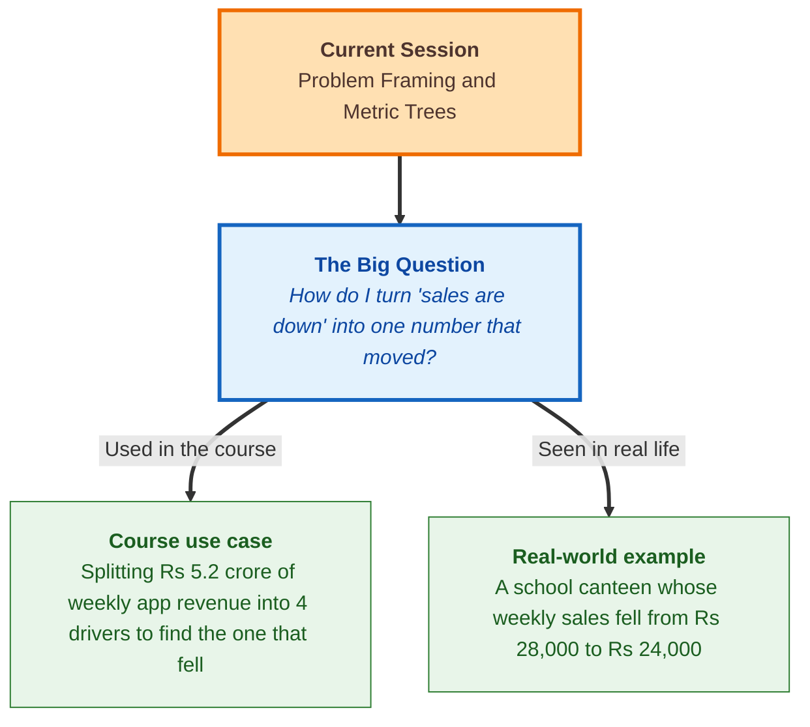

## Problem Framing and Metric Trees

### Mental Map

---

### What You'll Learn

Have you ever wondered how a school can tell why its canteen earns less than last term?

By the end of this session, you will be able to:

- **Describe** the choice the principal must make and the answer it needs.
- **Classify** a request as a question about the past, a cause, the future or an action.
- **Calculate** new weekly sales when visits rise from 3 to 3.5 per student.
- **Build** a picture that splits Rs 24,000 of weekly sales into four smaller numbers.
- **Write** a short brief that says what is in, what is out and what you hand over.

> **Topics you will meet:** The decision behind a request, descriptive, diagnostic, predictive or prescriptive, problem statement with scope, exclusions and deliverable, metric tree, effect of one driver change, asking an AI tool to check your metric tree.
>
> Join the session to learn each of these in detail.

---

### Why You Are Learning This Topic

Mrs. Rao is the principal of a school. She tells Dev, the school accountant, "Canteen sales are down. Look into it."

Dev works for ten days and hands over a thick file. It covers every snack, every class and every day.

Mrs. Rao only wanted to know if she should cut the samosa price. The file does not say.

A **metric tree** means one number broken into smaller numbers that multiply or add up to it.

In this course, you will frame each request and split its number before you open any data.

> **Think about it:** What one question should Dev have asked Mrs. Rao before he started?

---

### The School Canteen Puzzle

Dev copies four numbers from the canteen register for a normal week.

| Number | Last term | This term |
|:----------:|:----------:|:----------:|
| Students who buy | 200 | 200 |
| Visits per student each week | 3.5 | 3 |
| Items bought per visit | 2 | 2 |
| Price per item | Rs 20 | Rs 20 |
| Weekly sales | Rs 28,000 | Rs 24,000 |

**What you want to happen:**

- Mrs. Rao says which choice the answer will change.
- Dev writes a one-paragraph brief with a hand-over date.
- Dev finds which of the four numbers moved.

> **Wonder about this:**
>
> - Which of the four numbers changed between the two terms?
> - How much would weekly sales gain if that number came back?

---

### Think It Through

There is no wrong first try. Keep your guesses for the session.

**1. Mrs. Rao may cut the samosa price or open a second counter. Which choice does "sales are down" help her make?**
Hint: Think about what each choice would change.

**2. "Why did visits fall?" asks about the past or the future?**
Hint: Look at the tense of the verb.

**3. Price rises from Rs 20 to Rs 22 and nothing else moves. Do weekly sales rise or fall?**
Hint: The four numbers are multiplied together.

---

### One Question to Carry Into the Session

> **What do you ask before you analyse, so the answer changes a choice?**
>
> Which of the four register numbers would you check first, and why?
