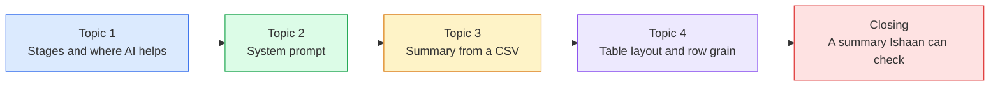
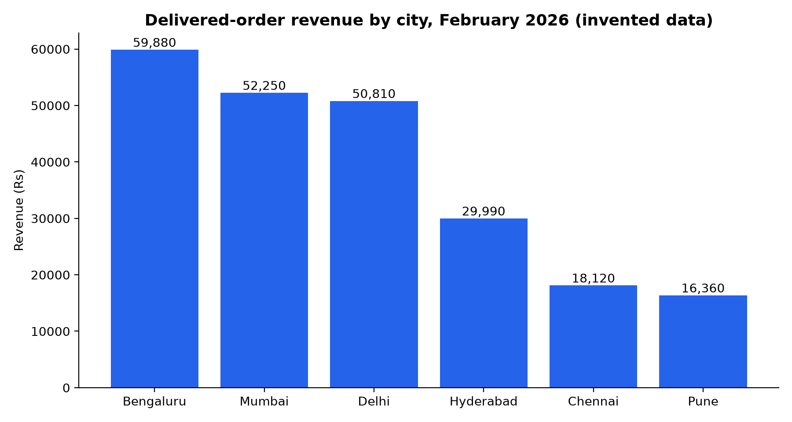
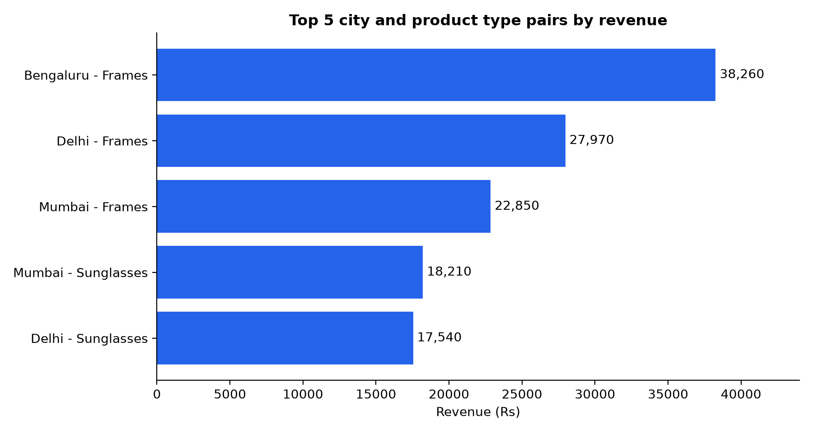

# <font color='#1d4ed8'>Lecture Script: Your Analysis Workflow with ChatGPT or Claude</font>

---

## <font color='blue'>Agenda</font>

The lecture runs as four topics. Each topic ends with a quiz.

| Topic | What we do | Learning objectives covered | Minutes |
|:-:|:--|:--|:-:|
| 1 | Place each task in a workflow stage and decide where AI can help | Classify analytics tasks by workflow stage and by whether generative AI can assist | 25 |
| 2 | Set standing instructions for the assistant | Write a system prompt that fixes the assistant's role, scope and constraints | 25 |
| 3 | Ask for a summary from a CSV | Write a prompt that returns a stated summary from a CSV attached in a chat tool | 35 |
| 4 | Fix the layout of the result table | Write a prompt that fixes a result table's columns and row grain so the AI returns that layout | 20 |
| — | Closing: Outcome & Summary | | 15 |
| | **Total** | | **120** |

> <font color="red">**🎯 Instructor Note**</font> Pace: keep Topic 1 brisk. Spend the extra minutes on the CSV summary prompt in Topic 3, where learners check the tool against an answer key.
> Topics 2 to 4 run live in a free chat tool (ChatGPT or Claude). Replies differ on every run, so learners fill the tables from what they see.

---

## <font color='blue'>Scenario</font>

**A Monday-morning ask.** A Lenskart-style eyewear retailer has one file for February 2026 and one question from the store head.

1. The store head writes: "Which cities earned the most from delivered orders?"
2. The file has 120 orders from 6 cities and 3 product types.
3. The analyst, Ishaan, has a free chat tool open and 45 minutes before the review.

> <font color="red">**🎯 Instructor Note**</font> The company is only the setting. Do not claim it uses these numbers. The file is invented for teaching: `data/eyewear_orders_feb2026.csv`, 120 rows, 9 of them cancelled. Learners attach or paste it into the chat tool.

---

## <font color='blue'>Problem Statement</font>

Ishaan pastes the whole file into a chat tool and types, "Analyse this." The reply is long. It has a total that he does not check, and a table with a row for every order. He copies the total into his slide. In the review, the store head adds the city figures on a phone and the total is different. Ishaan cannot say which number is right, and the review loses its trust.

> <font color='purple'>**How do we use a chat tool at each stage of an analysis, so that we give it clear instructions, get the summary and layout we asked for, and can check the result?**</font>

> <font color="red">**🎯 Instructor Note**</font> Poll: "Can you trust a chat tool's total from a CSV without a second check?" Give learners 30 seconds to respond in chat. Reveal the answer in the Closing.

---

## <font color='blue'>What We Will Use</font>

ChatGPT, Claude or Gemini, all on the free plan, and one CSV. Last session you wrote a brief and a metric tree. Today you give a chat tool clear instructions for the same kind of work.

| Topic | Tools | In one line |
|:-:|:--|:--|
| 1 | Workflow stages | Six stages from business question to communication |
| 2 | System prompt | Standing instructions: role, scope and constraints |
| 3 | CSV attached in a chat tool | A prompt that names the file, the rows to use and the summary needed |
| 4 | Result table prompt | Columns and row grain, so the table has the layout we need |

---

## <font color='blue'>How: Walking Through Ishaan's February File</font>



---

## <font color='blue'>Topic 1: Place each task in a workflow stage and decide where AI can help</font> `25 min`

> <font color='purple'>**Where in the analysis was Ishaan's "Analyse this" a mistake?**</font>

### <font color='green'>Example: Tasks by stage</font>

> <font color='purple'>**Which stage does each task belong to, and can generative AI assist?**</font>

Two sessions ago you met the six stages of an analytics workflow. We place five of Ishaan's tasks in those stages. **Generative AI can assist** means it can draft or suggest, and a person still checks the result.

| Task | Stage | Can generative AI assist? | Why |
|:--|:-:|:-:|:--|
| Decide that city revenue is what the store head needs | 1. Business question | Partly | It can suggest options. The decision stays with a person |
| Reword the ask as a data question | 2. Data question | Yes | Drafting text is a strength. A person checks it |
| Remove cancelled orders and fix a typo in a city name | 3. Get and prepare data | Partly | It can suggest rules. A person confirms them against the file |
| Add up revenue for each city | 4. Analyse | Partly | Chat tools can slip on arithmetic. Check the total a second way |
| Write two sentences for the slide | 6. Communicate | Yes | Drafting text is a strength. A person edits and owns it |

> <font color='green'>**Result**</font> AI helps most where the task is writing and suggesting. It needs a second check where the task is exact counting or where a decision is made.

### <font color='green'>Extending it: Classify two more tasks</font>

> <font color='purple'>**Where do "pick the KPI target for next quarter" and "suggest a chart title" fall?**</font>

> <font color="red">**🎯 Instructor Note**</font> Ask learners to type the stage and Yes, Partly or No in chat. Expected: the KPI target is Stage 1, with a person owning the number. The chart title is Stage 6, and AI can draft it.

> <font color='green'>**Result**</font> A KPI target sets what the business wants, so a person owns it. A chart title is drafted text, so AI can help.

> <font color='#b45309'>**Common mistake**</font> Handing a chat tool the whole job, from question to slide. Fix: place each task in its stage and decide who owns it.

### <font color='purple'>Quiz 1</font>

**Question:** Which task should a person own, even when AI can draft options?

**Options:**
- A) Reword a column header
- B) Draft three versions of a data question
- C) Suggest a chart title
- D) Decide which business objective matters this quarter

**Correct Answer:** D

**Explanation:**
- **A)** Rewording is a drafting task that AI can handle, with a quick check.
- **B)** Drafting options is a strength of the tool. A person picks one.
- **C)** A title is drafted text, so AI can help.
- **D)** Correct. Choosing the objective is a business decision that a person owns.

---

## <font color='blue'>Topic 2: Set standing instructions for the assistant</font> `25 min`

> <font color='purple'>**How do we tell the tool, once, how to behave for every question?**</font>

### <font color='green'>Example: A system prompt for the analysis assistant</font>

> <font color='purple'>**What three things does a system prompt fix?**</font>

A **system prompt** is a standing instruction that applies to the whole chat. It fixes three things. The **role** says who the assistant is. The **scope** says what it may work on. The **constraints** say what it must and must not do.

In a free chat tool, paste it as the first message if there is no custom-instructions setting.

| Part | Ishaan's system prompt line |
|:--|:--|
| Role | "You are an analysis assistant for the eyewear team's order data." |
| Scope | "Answer only questions about the attached order files." |
| Constraints | "Use only the file. Name the columns you used. If a value is missing, say so instead of guessing." |

> <font color='green'>**Result**</font> Three short lines fix who the tool is, what it may touch and how it must behave. Every later question follows them.

### <font color='green'>Extending it: Test the system prompt live</font>

> <font color='purple'>**Does the tool stay inside the scope we set?**</font>

> <font color="red">**🎯 Instructor Note**</font> Mentor: paste the three lines into ChatGPT or Claude. Then ask the two questions below. Learners fill the table. Replies differ on every run, so do not predict wording.

| Question to ask | Stays in scope? | Names the columns it used? |
|:--|:-:|:-:|
| "How many orders are in the file?" | Yes or No | Yes or No |
| "What will the eyewear market do next year?" | Yes or No | Yes or No |

> <font color='green'>**Result**</font> A reply that declines the second question, or says the file cannot answer it, is staying in scope. Learners note any reply that guesses.

> <font color='#b45309'>**Common mistake**</font> Writing only a role, such as "You are an expert". Fix: add scope and constraints too, because the role alone does not limit anything.

### <font color='purple'>Quiz 2</font>

**Question:** Which line is a constraint in a system prompt?

**Options:**
- A) "You are an analysis assistant for the eyewear team."
- B) "If a value is missing, say so instead of guessing."
- C) "Answer only questions about the attached order files."
- D) "Hello, how can I help?"

**Correct Answer:** B

**Explanation:**
- **A)** This sets the role, who the assistant is.
- **B)** Correct. A constraint says what the assistant must or must not do.
- **C)** This sets the scope, what the assistant may work on.
- **D)** A greeting fixes nothing about role, scope or behaviour.

---

## <font color='blue'>Topic 3: Ask for a summary from a CSV</font> `35 min`

> <font color='purple'>**How do we ask for the city totals so that the answer can be checked?**</font>

### <font color='green'>Example: Name the file, the rows and the summary</font>

> <font color='purple'>**What must a prompt say to get revenue from delivered orders for each city?**</font>

A good CSV prompt names four things: the file, the rows to keep, the measure to add up and the grouping. It also asks the tool to list the columns it used.

Prompt: "Using only the attached file, keep the rows where status is Delivered. Add amount_rs for each city. Give the number of orders and the total revenue for each city. List the columns you used."

> <font color="red">**🎯 Instructor Note**</font> Mentor: attach `eyewear_orders_feb2026.csv` to ChatGPT or Claude and run the prompt. Learners compare the reply with the answer key below. Replies differ, so read each number, not the style.

**Output** (answer key, recomputed in Python from data/eyewear_orders_feb2026.csv)

```
     city  orders  revenue_rs
Bengaluru      32       59880
   Mumbai      25       52250
    Delhi      22       50810
Hyderabad      12       29990
  Chennai      10       18120
     Pune      10       16360
TOTAL 111 227410 | rows in file 120 cancelled 9
```

> <font color='green'>**Result**</font> The answer key has 111 delivered orders and Rs 227,410 in total. A reply that gives a different total has an error to find, such as cancelled orders included.

<p align="center"></p>

### <font color='green'>Extending it: Check the tool with two methods</font>

> <font color='purple'>**How do we know the tool's total is right?**</font>

> <font color="red">**🎯 Instructor Note**</font> Ask learners to add the six city revenues by hand or on a phone. Expected: $59{,}880 + 52{,}250 + 50{,}810 + 29{,}990 + 18{,}120 + 16{,}360 = 227{,}410$. Compare it with the tool's total.

$$59{,}880 + 52{,}250 + 50{,}810 + 29{,}990 + 18{,}120 + 16{,}360 = 227{,}410$$

| Check | Tool's reply | Answer key |
|:--|:-:|:-:|
| Delivered orders | Learners write it here | 111 |
| Total revenue | Learners write it here | Rs 227,410 |
| Bengaluru revenue | Learners write it here | Rs 59,880 |

> <font color='green'>**Result**</font> The city figures must add up to the total. If the tool's cities do not add to its total, one of them is wrong.

### <font color='green'>Extending it: Ask the tool to show its work</font>

> <font color='purple'>**What if we add "list the rows you excluded"?**</font>

> <font color="red">**🎯 Instructor Note**</font> Mentor: add the sentence and rerun. Expected: the tool should name 9 cancelled orders. Learners check the count against the answer key. Do not predict the wording.

> <font color='green'>**Result**</font> Asking for the excluded rows turns a hidden choice into a visible one. 120 rows minus 9 cancelled is 111 delivered.

> <font color='#b45309'>**Common mistake**</font> Writing "summarise the file". Fix: name the rows to keep, the measure and the grouping, and ask for the columns used.

### <font color='purple'>Quiz 3</font>

**Question:** Which prompt is best for city revenue from delivered orders?

**Options:**
- A) "Using only the attached file, keep Delivered rows, add amount_rs by city, and list the columns you used."
- B) "Analyse the file and give insights."
- C) "Summarise this."
- D) "Give me the usual city numbers."

**Correct Answer:** A

**Explanation:**
- **A)** Correct. It names the file, the rows to keep, the measure, the grouping and the check.
- **B)** "Insights" has no measure, rows or grouping.
- **C)** "Summarise" does not say what to add up or how.
- **D)** "Usual" depends on a memory the tool does not have.

---

## <font color='blue'>Topic 4: Fix the layout of the result table</font> `20 min`

> <font color='purple'>**The totals are right. How do we get a table Ishaan can paste straight onto a slide?**</font>

### <font color='green'>Example: Columns and row grain</font>

> <font color='purple'>**What does one row of the table stand for?**</font>

The **row grain** is what one row of a table stands for. Ishaan's first reply had one row per order, which is a grain of 111 rows. A slide needs one row per city and product type. Fix the columns and the grain in the prompt.

Prompt: "Using only the attached file, keep Delivered rows. Return a table with one row per city and product_type and the columns city, product_type, orders, revenue_rs. Sort by revenue_rs, highest first. Show only the top 5 rows."

**Output** (answer key, recomputed in Python (top 5 rows))

```
rows at this grain: 18
     city product_type  orders  revenue_rs
Bengaluru       Frames      17       38260
    Delhi       Frames      11       27970
   Mumbai       Frames      11       22850
   Mumbai   Sunglasses       6       18210
    Delhi   Sunglasses       6       17540
```

> <font color='green'>**Result**</font> The grain of one row per city and product type gives 18 rows. The top 5 rows give the slide. Learners compare the tool's table with this key.

<p align="center"></p>

### <font color='green'>Extending it: Change the grain</font>

> <font color='purple'>**What if one row stands for one city only?**</font>

> <font color="red">**🎯 Instructor Note**</font> Ask for a prediction of the row count. Expected: 6 rows, one for each city. Mentor reruns the prompt with "one row per city" and learners count rows.

> <font color='green'>**Result**</font> One row per city gives 6 rows. One row per city and product type gives 18 rows. One row per order gives 111 rows. Changing the grain changes the table's length and meaning.

> <font color='#b45309'>**Common mistake**</font> Naming the columns but not the grain. Fix: say what one row stands for, so the tool does not add or merge rows.

### <font color='purple'>Quiz 4</font>

**Question:** The file has 6 cities and 3 product types, and every pair has delivered orders. How many rows does a table with one row per city and product type have?

**Options:**
- A) 6
- B) 9
- C) 18
- D) 111

**Correct Answer:** C

**Explanation:**
- **A)** 6 is the number of cities, which is the grain of one row per city.
- **B)** 9 is 6 plus 3. Pairs are multiplied, not added.
- **C)** Correct. $6 \times 3 = 18$.
- **D)** 111 is the number of delivered orders, the grain of one row per order.

---

## <font color='blue'>Closing: Outcome & Summary</font> `15 min`

Back to Ishaan. We answer the Problem Statement using each topic once.

> <font color='purple'>**1. Where does a chat tool help in the workflow? (Topic 1)**</font>

Where the task is drafting or suggesting, such as wording a data question or writing slide text. Ishaan keeps the decisions, and checks the counting.

> <font color='purple'>**2. What standing instructions does Ishaan give? (Topic 2)**</font>

A role (analysis assistant), a scope (the attached order files) and constraints (use only the file, name the columns, say when a value is missing).

> <font color='purple'>**3. What does the summary prompt ask for? (Topic 3)**</font>

Delivered rows only, orders and revenue for each city, and the columns used. The answer key gives 111 orders and Rs 227,410.

> <font color='purple'>**4. What layout does the slide need? (Topic 4)**</font>

One row per city and product type, four named columns, sorted by revenue, top 5 rows.

### <font color='green'>Outcome</font>

| | "Analyse this" | Ishaan's final prompts |
|:--|:-:|:-:|
| Standing instructions | None | Role, scope and constraints |
| Rows used | All 120, unstated | 111 Delivered, stated |
| Table grain | One row per order | One row per city and product type |
| Total checked by hand | No | Yes: Rs 227,410 |

> <font color='green'>**Therefore,**</font> A chat tool is a drafting assistant. Ishaan gives it a role, a scope and constraints, names the rows, the measure and the grain, and checks the total a second way. Then he can stand behind the slide.

> <font color="red">**🎯 Instructor Note**</font> Reveal the poll: no. A total from a chat tool needs a second check, such as adding the city figures by hand or on a phone.

### <font color='green'>Summary</font>

| Learning objective | Takeaway |
|:--|:--|
| Classify tasks by stage and AI help | AI helps most with drafting. Decisions and exact counts need a person |
| System prompt | Role, scope and constraints, set once for the chat |
| Prompt for a summary from a CSV | Name the file, the rows to keep, the measure, the grouping and ask for the columns used |
| Table columns and row grain | Name the columns and say what one row stands for |
| **Practical value** | Clear instructions and a second check turn a chat tool into a safe assistant for everyday analysis |

---

# <font color='red'>Launch the Feedback Poll</font>

> <font color="red">**🎯 Instructor Note**</font> Reminder: launch the feedback poll now to collect learner feedback.

