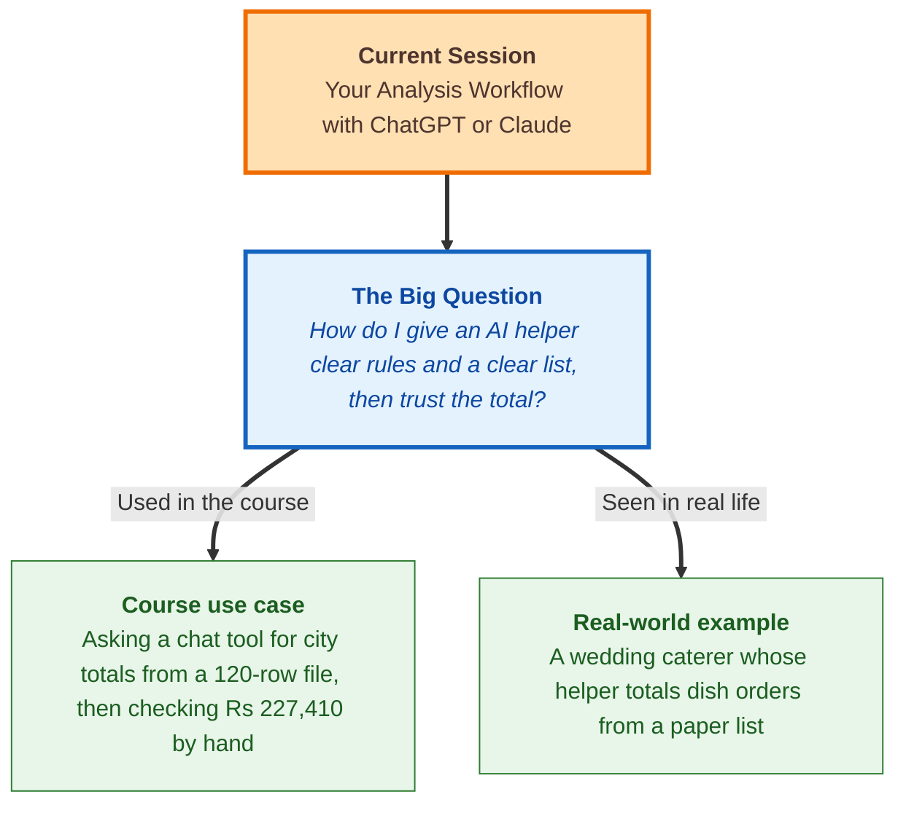

## Your Analysis Workflow with ChatGPT or Claude

### Mental Map

---

### What You'll Learn

Have you ever wondered why a helper gives you a different answer when you ask a loose question?

By the end of this session, you will be able to:

- **Classify** four caterer jobs by whether a helper can do them or a person must.
- **Check** a helper's total of 290 plates by adding the lines yourself.
- **Write** 3 standing rules for a helper: the job, the limits and the do-nots.
- **Design** a request that asks for dish totals from a list of 4 dishes.
- **Build** a table layout where one row stands for one dish, with 3 named columns.

> **Topics you will meet:** Where AI helps at each stage of an analysis, standing instructions for your analysis assistant, a summary from a CSV in a chat tool, prompts that return a table in the layout you need.
>
> Join the session to learn each of these in detail.

---

### Why You Are Learning This Topic

Mrs. Nair runs a catering business. For a wedding of 120 guests, she hires a helper, Kabir, for the week.

She says, "Do the lists." Kabir adds up the plates, but he counts cancelled plates too.

He also writes one line for every guest, so the list has 120 lines. Mrs. Nair cannot read it, and she orders 15 plates more than needed.

A **system prompt** means standing instructions that tell an AI tool its job and limits before you ask anything.

In this course, you will give chat tools clear instructions and check every total they return.

> **Think about it:** What three sentences would you say to Kabir on his first morning?

---

### The Wedding Caterer Puzzle

Mrs. Nair keeps a short list of dish orders.

| Dish | Plates ordered | Plates cancelled |
|:----------:|:----------:|:----------:|
| Paneer Butter Masala | 60 | 5 |
| Dal Makhani | 55 | 0 |
| Veg Biryani | 70 | 10 |
| Gulab Jamun | 120 | 0 |

**What you want to happen:**

- Kabir knows his job and his limits before he starts.
- Kabir counts only the plates that are not cancelled.
- The final list has one row for each dish.

> **Wonder about this:**
>
> - Which plates should Kabir count for each dish?
> - What would the list look like with one row for each guest?

---

### Think It Through

There is no wrong first try. Keep your guesses for the session.

**1. Which job should Mrs. Nair keep for herself: choosing the menu or adding the plates?**
Hint: Think about who answers for the choice.

**2. Kabir hears "total the orders". Which three facts would make that request clearer?**
Hint: Think about which rows, what to add and how to group.

**3. The list covers 120 guests and 4 dishes. What is the row count of a list with one row per dish?**
Hint: Count what one row stands for.

---

### One Question to Carry Into the Session

> **How do you give a helper rules and a clear request, and still check the answer?**
>
> Which line of Mrs. Nair's list would you add up first to test Kabir?
