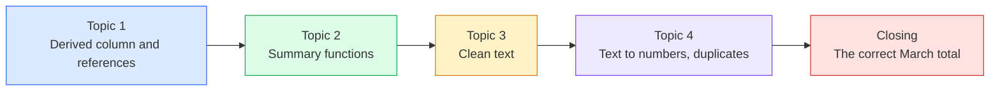
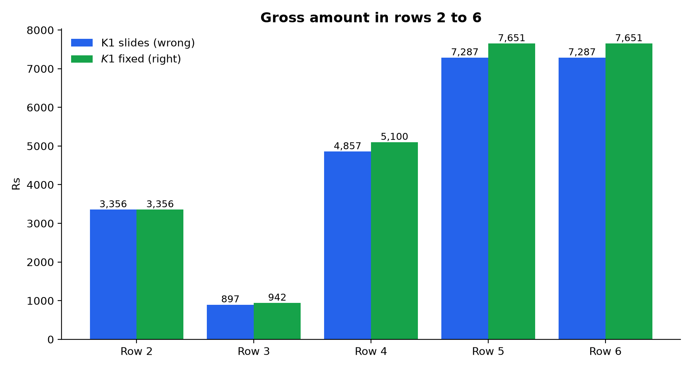
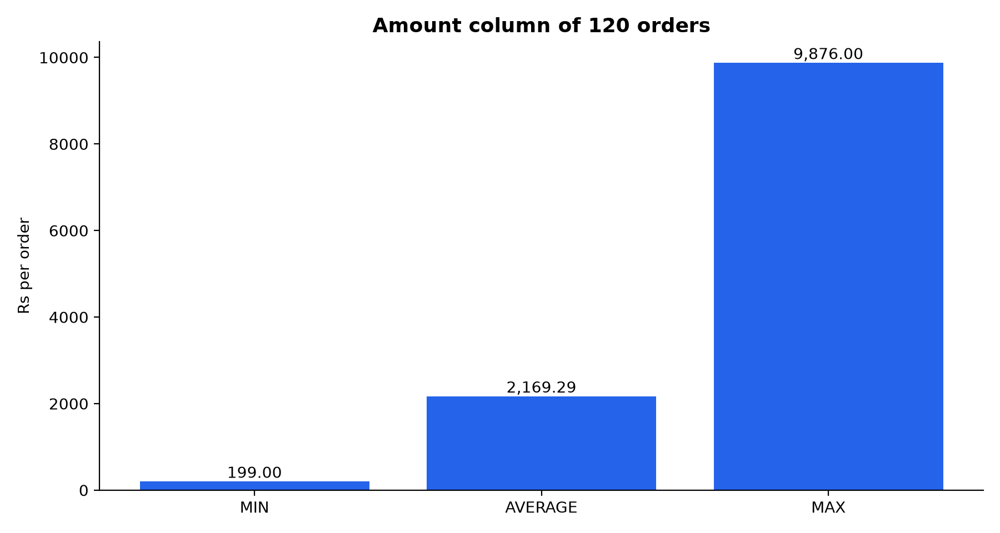
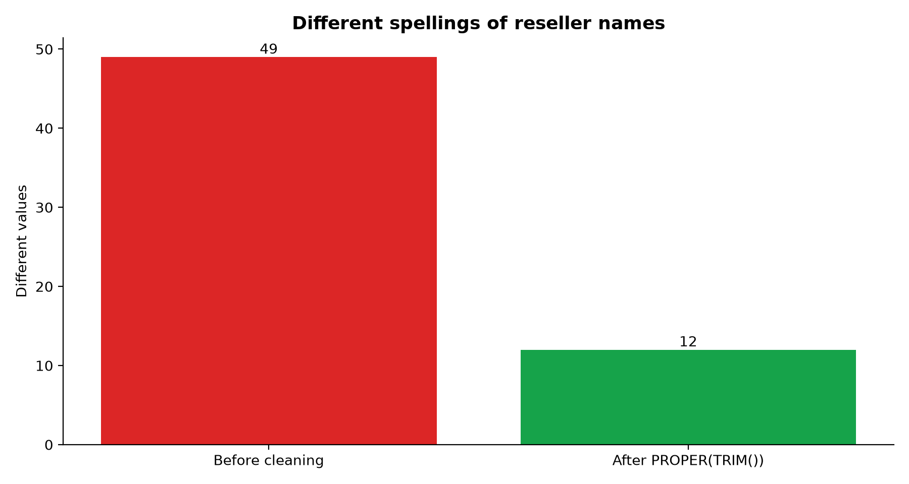
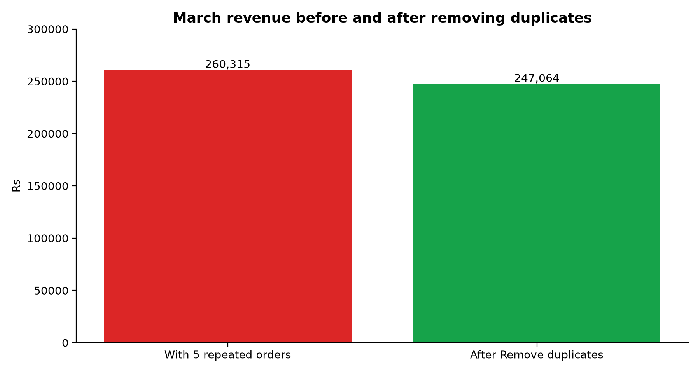

# <font color='#1d4ed8'>Lecture Script: Spreadsheet Formulas and Data Cleaning</font>

---

## <font color='blue'>Agenda</font>

The lecture runs as four topics. Each topic ends with a quiz.

| Topic | What we do | Learning objectives covered | Minutes |
|:-:|:--|:--|:-:|
| 1 | Build a derived column and copy it down | Write a formula that computes a derived column from other cells in a row<br>Apply absolute and relative references so a formula copies correctly across a range | 30 |
| 2 | Summarise a column | Compute summary values for a column using SUM, AVERAGE, COUNT, MIN and MAX | 20 |
| 3 | Clean the text columns | Clean a text column using TRIM, PROPER and SUBSTITUTE | 25 |
| 4 | Fix text numbers and dates, then remove duplicates | Convert text-formatted numbers and dates into real numeric and date values<br>Remove duplicate rows from a spreadsheet table using a stated key | 30 |
| — | Closing: Outcome & Summary | | 15 |
| | **Total** | | **120** |

> <font color="red">**🎯 Instructor Note**</font> Pace: keep the SUM, AVERAGE, COUNT, MIN and MAX tour in Topic 2 brisk. Spend the extra minutes on absolute references in Topic 1 and on the text-to-number conversion in Topic 4.
> Learners work in Google Sheets. Cell values shown here are verified by recomputation in Python from the same CSV.

---

## <font color='blue'>Scenario</font>

**Two totals for one file.** A Meesho-style reselling app has one order export for March 2026. Two analysts open it and report different March revenue.

| | Analyst A | Analyst B |
|:--|:-:|:-:|
| Rows used | All 120 rows | 115 unique orders |
| Reseller names | 49 different spellings | 12 clean names |
| March revenue | Rs 260,315 | Rs 247,064 |

> <font color="red">**🎯 Instructor Note**</font> The company is only the setting. Do not claim it uses these numbers. The file is invented for teaching: `data/reseller_orders_mar2026.csv`, 120 rows with 5 repeated orders. Import it into Google Sheets with "Convert text to numbers, dates and formulas" switched off, so columns B and G stay text. If E and F arrive as text, the `*` in Topic 1 still reads them as numbers.

---

## <font color='blue'>Problem Statement</font>

Divya prepares the March payout for resellers. She adds up the amount column and sends Rs 260,315 to finance. Finance finds that five orders appear twice, that "Arjun Reddy" is spelled several ways, and that shipping costs are stored as text such as "Rs 120". The payout is Rs 13,251 too high, and the shipping total in her sheet is zero.

> <font color='purple'>**How do we build the amount column, summarise it, and clean the text, numbers, dates and duplicates, so the March total is right?**</font>

> <font color="red">**🎯 Instructor Note**</font> Poll: "By how much do repeated orders overstate the total?" Options: Rs 5,000, Rs 13,251 or Rs 25,000. Give learners 30 seconds to respond in chat. Reveal the answer in the Closing.

---

## <font color='blue'>What We Will Use</font>

Google Sheets and one CSV with 120 rows. Last session you gave a chat tool a prompt and checked its total. Today you build and check the numbers yourself in a sheet.

| Topic | Tools | In one line |
|:-:|:--|:--|
| 1 | `=E2*F2`, `$K$1` | A formula for one row, and a reference that stays fixed |
| 2 | `SUM`, `AVERAGE`, `COUNT`, `MIN`, `MAX` | Five summaries of a column |
| 3 | `TRIM`, `PROPER`, `SUBSTITUTE` | Fix spaces, capitals and unwanted characters |
| 4 | `VALUE`, `DATEVALUE`, Remove duplicates | Turn text into numbers and dates, and drop repeated rows |

| Column | What it holds |
|:--|:--|
| A order_id | Number |
| B order_date_text | Text, such as `24 Mar 2026` |
| C reseller | Messy text |
| D product_code | Text with underscores |
| E qty, F unit_price | Numbers |
| G shipping_text | Text, such as `Rs 120` |

---

## <font color='blue'>How: Walking Through Divya's March File</font>



---

## <font color='blue'>Topic 1: Build a derived column and copy it down</font> `30 min`

> <font color='purple'>**Divya has quantity and price in separate columns. How does she get the amount of each order?**</font>

### <font color='green'>Example: The amount column</font>

> <font color='purple'>**What formula gives the amount for the order in row 2?**</font>

A **formula** starts with `=` and works out a value from other cells. A **derived column** is a column whose cells are formulas built from other columns in the same row. The amount of an order is $\text{qty} \times \text{unit price}$.

$$\boxed{ \text{amount} = \text{qty} \times \text{unit\_price} }$$

**Predict before running: What will happen?**

> <font color="red">**🎯 Instructor Note**</font> Row 2 has qty 4 and unit price 799. Expected: 3196. Common wrong guess: learners type the formula in every row by hand.

In cell H2, type this formula. Then double-click the small square at the bottom-right corner of H2 to fill it down to row 121.

=E2*F2

**Output** (cell values, verified by recomputation in Python)

```
H2 = 3196  H3 = 897  H4 = 4857
```

#### <font color='#c2410c'>Logic Explanation</font>

- `E2` and `F2` are the quantity and price cells in the same row. `*` multiplies.
- When you copy the formula down, row numbers change with it. In H3 the formula becomes `=E3*F3`, in H4 it becomes `=E4*F4`.

> <font color='green'>**Result**</font> One formula in H2 gives every row its own amount. The first three rows are 3,196, 897 and 4,857.

### <font color='green'>Extending it: Add 5% GST from one fixed cell</font>

> <font color='purple'>**What happens if the GST rate sits in K1 and the formula is copied down?**</font>

An **absolute reference** has `$` signs, such as `$K$1`. It does not move when copied. A **relative reference**, such as `K1`, shifts with the row. Put 0.05 in K1.

> <font color="red">**🎯 Instructor Note**</font> Ask learners to guess which row goes wrong. Expected: H3 onwards, because `K1` becomes `K2`, then `K3`. Those cells are empty, so the GST is silently zero.

Wrong, in I2: =H2*(1+K1)
Right, in I2: =H2*(1+$K$1)

**Output** (cell values, verified by recomputation in Python)

```
row 2 | wrong (K1 slides): 3355.8 | right ($K$1): 3355.8
row 3 | wrong (K1 slides): 897 | right ($K$1): 941.85
row 4 | wrong (K1 slides): 4857 | right ($K$1): 5099.85
```

<p align="center"></p>

> <font color='green'>**Result**</font> The wrong formula is right in row 2 and then drops the GST, because `K1` slides to an empty cell. The `$K$1` version gives 3,355.80, 941.85 and 5,099.85 for the first three rows.

> <font color='#b45309'>**Common mistake**</font> Checking only the first row after copying. Fix: look at the formula in the last row and in one middle row too.

### <font color='purple'>Quiz 1</font>

**Question:** The GST rate is in K1. Which formula in I2 copies down correctly?

**Options:**
- A) `=H2*(1+K1)`
- B) `=H2*K1`
- C) `=H2*(1+$K$1)`
- D) `=$H$2*(1+$K$1)`

**Correct Answer:** C

**Explanation:**
- **A)** `K1` is relative, so it moves to K2, K3 and so on when copied.
- **B)** It has the same sliding problem and gives only the GST, not the total.
- **C)** Correct. `H2` moves with each row and `$K$1` stays on the rate.
- **D)** `$H$2` is fixed too, so every row would show the first order's amount.

---

## <font color='blue'>Topic 2: Summarise a column</font> `20 min`

> <font color='purple'>**The amount column is ready. What are the total, the average and the extremes?**</font>

### <font color='green'>Example: Five summary functions</font>

> <font color='purple'>**What do SUM, AVERAGE, COUNT, MIN and MAX return for the amount column?**</font>

A **range** such as `H2:H121` is a block of cells. `SUM` adds the numbers. `AVERAGE` gives the mean. `COUNT` counts the cells that hold numbers. `MIN` and `MAX` give the smallest and largest.

$$\text{average} = \frac{\text{sum}}{\text{count}}$$

**Predict before running: What will happen?**

> <font color="red">**🎯 Instructor Note**</font> Ask learners to guess whether the average is nearer Rs 500 or Rs 2,000. Expected: about Rs 2,169, because saree orders are large. These figures still include the 5 repeated rows.

=SUM(H2:H121)
=AVERAGE(H2:H121)
=COUNT(H2:H121)
=MIN(H2:H121)
=MAX(H2:H121)

**Output** (cell values, verified by recomputation in Python)

```
SUM 260315
AVERAGE 2169.29
COUNT 120
MIN 199
MAX 9876
check: 260315 / 120 = 2169.29
```

#### <font color='#c2410c'>Code Explanation</font>

- **Line 1** `SUM` adds every amount, giving Rs 260,315.
- **Line 2** `AVERAGE` divides that sum by the 120 numbers, giving Rs 2,169.29.
- **Line 3** `COUNT` returns 120, the number of cells with a number.
- **Lines 4 and 5** `MIN` returns 199 and `MAX` returns 9,876.

> <font color='green'>**Result**</font> March shows 120 orders with a total of Rs 260,315, an average of Rs 2,169.29, a smallest order of Rs 199 and a largest of Rs 9,876. These numbers still include the repeated rows.

<p align="center"></p>

### <font color='green'>Extending it: Find which order is the largest</font>

> <font color='purple'>**Which order has the amount 9,876?**</font>

> <font color="red">**🎯 Instructor Note**</font> Mentor: sort or filter column H, largest first. Learners read order 3016: 4 sarees at Rs 2,469.

> <font color='green'>**Result**</font> Order 3016 is the largest, with $4 \times 2{,}469 = 9{,}876$. `MAX` gives the value, and a sort shows the row it came from.

### <font color='purple'>Quiz 2</font>

**Question:** Column H holds 120 amounts. Which formula returns the number of amounts?

**Options:**
- A) `=COUNT(H2:H121)`
- B) `=SUM(H2:H121)`
- C) `=MAX(H2:H121)`
- D) `=AVERAGE(H2:H121)`

**Correct Answer:** A

**Explanation:**
- **A)** Correct. `COUNT` counts the cells that hold numbers, here 120.
- **B)** `SUM` adds the amounts and returns Rs 260,315.
- **C)** `MAX` returns the largest amount, 9,876.
- **D)** `AVERAGE` returns the mean amount, 2,169.29.

---

## <font color='blue'>Topic 3: Clean the text columns</font> `25 min`

> <font color='purple'>**Why does the file show 49 different reseller names when there are only 12 people?**</font>

### <font color='green'>Example: Fix spaces and capitals</font>

> <font color='purple'>**How do we turn "  priya  SHARMA " into "Priya Sharma"?**</font>

`TRIM` removes spaces at the start and end, and reduces repeated spaces inside to one. `PROPER` makes the first letter of each word a capital and the rest small. Put one inside the other: `PROPER(TRIM(C2))`.

**Predict before running: What will happen?**

> <font color="red">**🎯 Instructor Note**</font> Expected: the name loses its extra spaces and gets capitals. Common wrong guess: `TRIM` alone also fixes capitals. It does not.

=PROPER(TRIM(C2))

**Output** (cell values, verified by recomputation in Python)

```
'arjun reddy' -> 'Arjun Reddy'
'Arjun Reddy' -> 'Arjun Reddy'
'arjun reddy' -> 'Arjun Reddy'
'Kavita Nair' -> 'Kavita Nair'
different spellings before: 49 | after: 12
```

#### <font color='#c2410c'>Code Explanation</font>

- **Inner part** `TRIM(C2)` removes the end spaces and repeated inner spaces.
- **Outer part** `PROPER(...)` fixes the capitals on the trimmed text.

> <font color='green'>**Result**</font> The 49 spellings become 12 names. Learners can confirm this with the filter drop-down on the new column, which lists each different value once.

<p align="center"></p>

### <font color='green'>Extending it: Replace underscores in the product code</font>

> <font color='purple'>**How do we turn `KURTI_COTTON` into `Kurti Cotton`?**</font>

`SUBSTITUTE(text, old, new)` swaps one piece of text for another. Here it swaps `_` for a space. `PROPER` then fixes the capitals.

=PROPER(SUBSTITUTE(D2,"_"," "))

**Output** (cell values, verified by recomputation in Python)

```
KURTI_COTTON -> Kurti Cotton
['Dupatta Net', 'Kurti Cotton', 'Saree Silk', 'Shoes Canvas', 'Tshirt Printed']
```

> <font color='green'>**Result**</font> The 5 product codes read as Kurti Cotton, Dupatta Net, Saree Silk, Shoes Canvas and Tshirt Printed.

> <font color='#b45309'>**Common mistake**</font> Typing the cleaned name over the original column. Fix: keep the original and put the formula in a new column, so you can always compare.

### <font color='purple'>Quiz 3</font>

**Question:** Which formula turns "  PRIYA   sharma " into "Priya Sharma"?

**Options:**
- A) `=TRIM(C2)`
- B) `=PROPER(C2)`
- C) `=SUBSTITUTE(C2," ","")`
- D) `=PROPER(TRIM(C2))`

**Correct Answer:** D

**Explanation:**
- **A)** `TRIM` fixes spaces but leaves "PRIYA sharma" with mixed capitals.
- **B)** `PROPER` fixes capitals but keeps the extra spaces.
- **C)** It removes every space and gives "PRIYAsharma".
- **D)** Correct. `TRIM` fixes the spaces and `PROPER` fixes the capitals.

---

## <font color='blue'>Topic 4: Fix text numbers and dates, then remove duplicates</font> `30 min`

> <font color='purple'>**Shipping shows "Rs 120" and dates show "24 Mar 2026". Why can the sheet not add or sort them?**</font>

### <font color='green'>Example: Text to a number</font>

> <font color='purple'>**How do we turn "Rs 120" into the number 120?**</font>

A value in the sheet can look like a number but be **text**. `SUM` and `COUNT` ignore text. `SUBSTITUTE` removes `Rs ` and the comma. `VALUE` turns the remaining text into a real number.

**Predict before running: What will happen?**

> <font color="red">**🎯 Instructor Note**</font> Ask what `=COUNT(G2:G121)` returns on the raw column. Expected: 0, because no cell is a number. After conversion it returns 120.

=VALUE(SUBSTITUTE(SUBSTITUTE(G2,"Rs ",""),",",""))
=COUNT(G2:G121)

**Output** (cell values, verified by recomputation in Python)

```
raw G2: Rs 40 -> number 40
COUNT on raw text column: 0
COUNT on cleaned column: 120
SUM of cleaned shipping: 9490
```

#### <font color='#c2410c'>Code Explanation</font>

- **Inner `SUBSTITUTE`** removes `Rs ` from the start. The outer one removes the comma in values such as `Rs 1,200`.
- **`VALUE`** converts the cleaned text into a number. The second formula, placed on the cleaned column, counts 120 numbers.

> <font color='green'>**Result**</font> Shipping was invisible to `SUM`. Once converted, the shipping column adds to Rs 9,490.

### <font color='green'>Extending it: Text to a real date</font>

> <font color='purple'>**How do we turn "24 Mar 2026" into a date the sheet can sort?**</font>

`DATEVALUE` turns date text into a date number. Sheets stores each date as a count of days since 30 December 1899. Format the result as a date.

=DATEVALUE(B2)

**Output** (cell values, verified by recomputation in Python)

```
B2 text: 24 Mar 2026
DATEVALUE number: 46105
31 Mar 2026 - 1 Mar 2026 = 30 days
```

> <font color='green'>**Result**</font> "24 Mar 2026" becomes 46105, which Sheets shows as a date. Dates can now be sorted and subtracted: 31 March minus 1 March is 30 days.

### <font color='green'>Extending it: Remove duplicates by a stated key</font>

> <font color='purple'>**How do we drop the 5 orders that appear twice?**</font>

A **key** is the column, or columns, that identify one record. Here the key is `order_id`. In Sheets, choose Data, then Data cleanup, then Remove duplicates. Tick "Data has header row" and tick only `order_id`.

> <font color="red">**🎯 Instructor Note**</font> Mentor: run the tool on a copy of the sheet. The dialog should report 5 duplicate rows removed and 115 unique rows left. Learners check the counts against the Python check below.

**Output** (cell values, verified by recomputation in Python)

```
rows before: 120 | distinct order_id: 115
rows removed: 5 | rows left: 115
total before: Rs 260315 | after: Rs 247064 | overstated by: Rs 13251
```

<p align="center"></p>

> <font color='green'>**Result**</font> Removing duplicates by `order_id` takes the sheet from 120 rows to 115 and the total from Rs 260,315 to Rs 247,064. The repeated orders overstated it by Rs 13,251.

> <font color='#b45309'>**Common mistake**</font> Ticking every column as the key. Fix: choose the column that identifies the order. If a name was spelled differently in a repeat, a ticked name column would keep both rows.

### <font color='purple'>Quiz 4</font>

**Question:** The file has 120 rows and 115 different `order_id` values. How many rows remain after Remove duplicates with `order_id` as the key?

**Options:**
- A) 120
- B) 115
- C) 5
- D) 235

**Correct Answer:** B

**Explanation:**
- **A)** 120 is the count before. Rows with a repeated `order_id` are removed.
- **B)** Correct. One row stays for each of the 115 different order ids.
- **C)** 5 is the number of rows removed, not the number left.
- **D)** 235 adds 120 and 115. Removing rows never increases the count.

---

## <font color='blue'>Closing: Outcome & Summary</font> `15 min`

Back to Divya. We answer the Problem Statement using each topic once.

> <font color='purple'>**1. How does Divya get each order's amount? (Topic 1)**</font>

With `=E2*F2` copied down, and `$K$1` for any fixed rate such as GST.

> <font color='purple'>**2. What does she check on the column? (Topic 2)**</font>

`SUM`, `AVERAGE`, `COUNT`, `MIN` and `MAX` of the amount. Before cleaning they show Rs 260,315, Rs 2,169.29, 120, 199 and 9,876.

> <font color='purple'>**3. How does she fix the names? (Topic 3)**</font>

`=PROPER(TRIM(C2))` reduces 49 spellings to 12 names.

> <font color='purple'>**4. How does she fix the numbers, the dates and the repeats? (Topic 4)**</font>

`VALUE` and `DATEVALUE` make real numbers and dates, and Remove duplicates with the key `order_id` drops 5 rows. Now the final summary on 115 orders:

**Output** (cell values, verified by recomputation in Python)

```
orders: 115
SUM amount: 247064
AVERAGE amount: 2148.38
SUM shipping: 9130
```

### <font color='green'>Outcome</font>

| | Before cleaning | After cleaning |
|:--|:-:|:-:|
| Rows | 120 | 115 |
| Reseller names | 49 spellings | 12 names |
| March revenue | Rs 260,315 | Rs 247,064 |
| Shipping total | 0 (text is ignored) | Rs 9,130 |

> <font color='green'>**Therefore,**</font> The correct March revenue is Rs 247,064 from 115 orders. Divya's first total was Rs 13,251 too high because five orders were counted twice. Her shipping total of zero came from text that `SUM` ignores.

> <font color="red">**🎯 Instructor Note**</font> Reveal the poll: Rs 13,251. Point at the Outcome row for March revenue: 260,315 minus 247,064.

### <font color='green'>Summary</font>

| Learning objective | Takeaway |
|:--|:--|
| Derived column | A formula built from other cells in the row, filled down the column |
| Absolute and relative references | `$K$1` stays fixed. `K1` slides when copied |
| Summary functions | `SUM`, `AVERAGE`, `COUNT`, `MIN` and `MAX` summarise a range |
| Clean text | `TRIM` fixes spaces, `PROPER` fixes capitals, `SUBSTITUTE` swaps pieces of text |
| Text to numbers and dates | `VALUE` and `DATEVALUE` turn text into numbers and dates that `SUM` and sorting can use |
| Remove duplicates | Choose a key. Rows with a repeated key are dropped |
| **Practical value** | A sheet that adds up wrongly usually has text, repeats or copied references that moved. Check these three before you share a total |

---

# <font color='red'>Launch the Feedback Poll</font>

> <font color="red">**🎯 Instructor Note**</font> Reminder: launch the feedback poll now to collect learner feedback.

