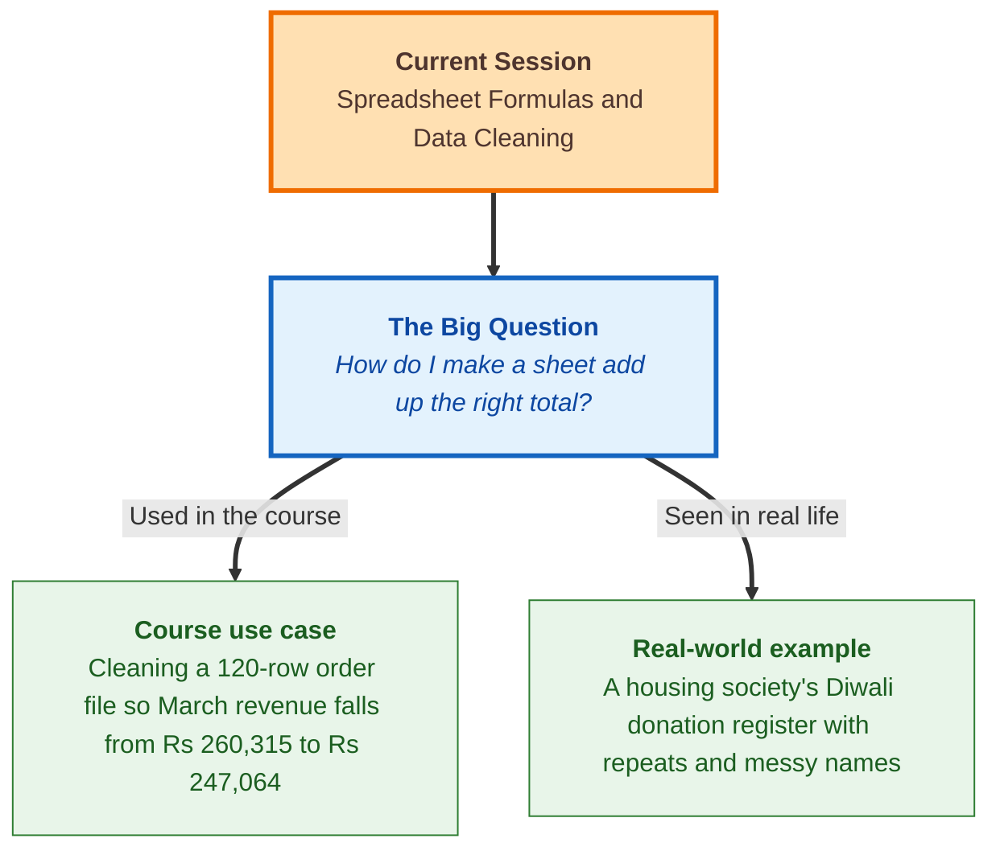

## Spreadsheet Formulas and Data Cleaning

### Mental Map

---

### What You'll Learn

Have you ever wondered why a register total looks different from the money in the tin?

By the end of this session, you will be able to:

- **Identify** which lines in a 4-line register are repeats of the same payment.
- **Calculate** the total and the average of the donations on a short list.
- **Apply** one fixed 5% fee to every line without the fee drifting away.
- **Use** three clean-up moves to fix spaces, capitals and stray letters in names.
- **Demonstrate** how "Rs 500" becomes a number that can be added.
- **Write** the one fact that tells you two lines are the same entry.

> **Topics you will meet:** Formulas, absolute vs relative references, SUM AVERAGE COUNT MIN and MAX, TRIM PROPER and SUBSTITUTE, text to numbers and dates, remove duplicates.
>
> Join the session to learn each of these in detail.

---

### Why You Are Learning This Topic

Sunita volunteers to total the Diwali party donations in her housing society.

She types each line as the neighbours wrote it. Her total says Rs 3,000.

The tin holds Rs 2,000. Flat A-102 appears twice, and the treasurer is upset.

A **formula** means a rule typed into a sheet cell that works out a value from other cells.

In this course, you will build formulas and clean files before you trust any total.

> **Think about it:** Where would you look first to find the Rs 1,000 gap?

---

### The Society Register Puzzle

Sunita copies four lines from the register.

| Flat | Name as written | Amount as written |
|:----------:|:----------:|:----------:|
| A-101 | "  sunita rao " | Rs 500 |
| A-102 | "RAVI KUMAR" | Rs 1,000 |
| B-201 | "meena shah" | Rs 500 |
| A-102 | "Ravi Kumar" | Rs 1,000 |

**What you want to happen:**

- Every name looks the same way.
- Every amount can be added by the sheet.
- Each flat is counted once.

> **Wonder about this:**
>
> - Which two lines are the same payment?
> - Why would a sheet refuse to add "Rs 500"?

---

### Think It Through

There is no wrong first try. Keep your guesses for the session.

**1. Sunita adds a 5% hall fee in one cell and copies the line down. Why might line 3 lose the fee?**
Hint: Think about what moves when you copy a line.

**2. "Rs 500" sits beside "500". Which one can a sheet add?**
Hint: Look at the letters.

**3. Which fact tells you flat A-102 paid once and not twice?**
Hint: Look for a detail that names one payment.

---

### One Question to Carry Into the Session

> **What can quietly make a sheet add up wrong?**
>
> Which of the four lines would you fix first, and why?
