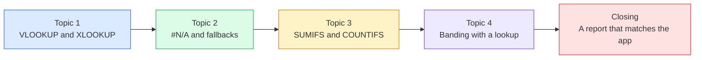
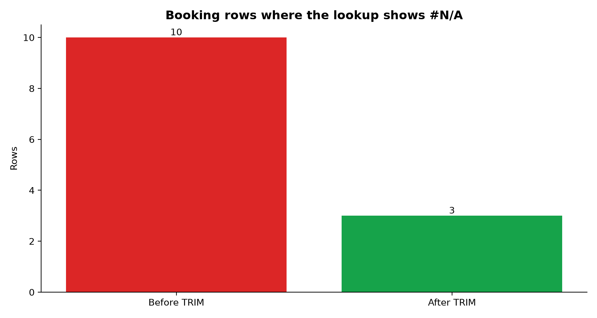
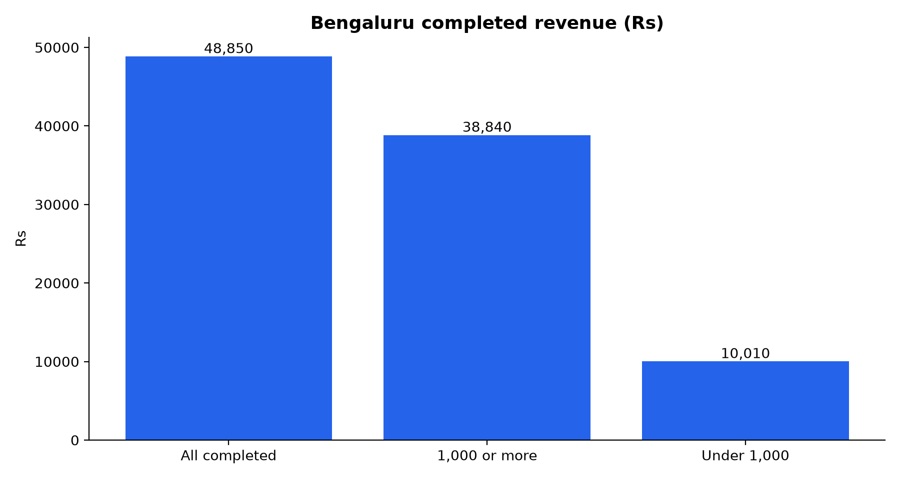
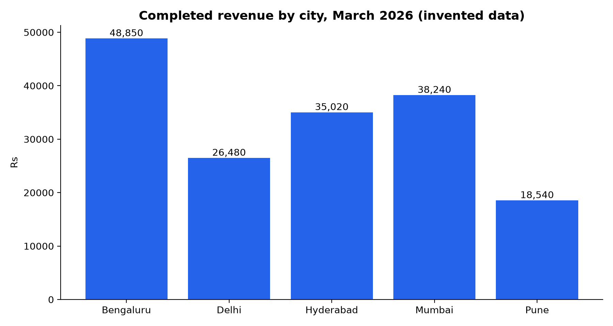
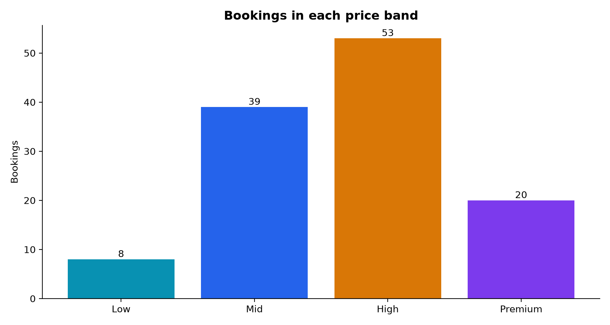

# <font color='#1d4ed8'>Lecture Script: Lookup Functions and Conditional Aggregation</font>

---

## <font color='blue'>Agenda</font>

The lecture runs as four topics. Each topic ends with a quiz.

| Topic | What we do | Learning objectives covered | Minutes |
|:-:|:--|:--|:-:|
| 1 | Look up a service name from the price list | Write a VLOOKUP that returns a value from another table on an exact match<br>Write an XLOOKUP that returns a value with an explicit not-found result | 25 |
| 2 | Find why a lookup fails and give it a readable fallback | Diagnose a lookup returning #N/A caused by trailing spaces or a type mismatch<br>Write a formula wrapped in IFERROR or IFNA that returns a readable fallback | 30 |
| 3 | Add and count with several conditions | Write a conditional aggregation using SUMIFS or COUNTIFS over multiple criteria | 30 |
| 4 | Assign a price band from a threshold table | Write an approximate-match lookup that assigns a band from a threshold table | 20 |
| — | Closing: Outcome & Summary | | 15 |
| | **Total** | | **120** |

> <font color="red">**🎯 Instructor Note**</font> Pace: keep the XLOOKUP variation in Topic 1 brisk. Spend the extra minutes on the #N/A diagnosis in Topic 2 and on the SUMIFS criteria in Topic 3.
> Topic 2 includes one live question to a free chat tool. Replies differ on every run, so learners judge the reply against the checks in the sheet.

---

## <font color='blue'>Scenario</font>

**Three sheets that must talk to each other.** An Urban Company-style home-services app in Bengaluru keeps March 2026 bookings in one sheet. The service names and the price bands sit in two other sheets.

| Sheet | What it holds | Rows |
|:--|:--|:-:|
| Bookings | booking_id, city, service_code, amount_rs, status | 120 |
| Services | service_code, service_name, category, base_rate_rs | 8 |
| Bands | from_amount_rs, band | 4 |

> <font color="red">**🎯 Instructor Note**</font> The company is only the setting. Do not claim it uses these numbers. The three files are invented for teaching and sit in `data/`. Import each CSV into its own tab named Bookings, Services and Bands, with "Convert text to numbers, dates and formulas" switched on. 7 service codes carry a trailing space and 3 are missing from the price list. Before class, confirm that `=LEN(C5)` shows 6.

---

## <font color='blue'>Problem Statement</font>

Rohit builds the March report. He types a lookup to bring in each service name, and the sheet shows #N/A on 10 rows. He deletes those rows to make the column look tidy. The amount column loses Rs 14,900 and the Bengaluru manager asks why her numbers do not match the app. Rohit cannot say whether the rows were wrong or only unmatched.

> <font color='purple'>**How do we look up values from another sheet, find out why a lookup fails, and total the right bookings by city, status and price band?**</font>

> <font color="red">**🎯 Instructor Note**</font> Poll: "A lookup shows #N/A although the code looks identical. What is the most likely cause?" Give learners 30 seconds to respond in chat. Reveal the answer in the Closing.

---

## <font color='blue'>What We Will Use</font>

Google Sheets with three tabs. Last session you used `TRIM`, `SUBSTITUTE`, absolute references and `COUNT`. You use them again today. In Topic 2 we also ask a free chat tool to explain a lookup error.

| Topic | Tools | In one line |
|:-:|:--|:--|
| 1 | `VLOOKUP`, `XLOOKUP` | Bring a value from another table by its key |
| 2 | `LEN`, `TRIM`, `IFNA`, `IFERROR` | Find hidden spaces, and show a readable message instead of an error |
| 3 | `SUMIFS`, `COUNTIFS` | Add or count rows that meet several conditions |
| 4 | `VLOOKUP` with `TRUE` | Pick the band whose threshold the amount has reached |

---

## <font color='blue'>How: Walking Through Rohit's March Report</font>



---

## <font color='blue'>Topic 1: Look up a service name from the price list</font> `25 min`

> <font color='purple'>**The booking has only a code such as CLN02. How does Rohit bring in the service name?**</font>

### <font color='green'>Example: VLOOKUP on an exact match</font>

> <font color='purple'>**What formula returns the service name for the code in C2?**</font>

A **lookup** finds a key in one table and returns a value from the same row. `VLOOKUP(key, table, column number, FALSE)` looks down the first column of the table. The last argument `FALSE` asks for an **exact match**.

**Predict before running: What will happen?**

> <font color="red">**🎯 Instructor Note**</font> C2 holds CLN02. Services has CLN02 in row 3. Expected: Deep Cleaning. Common wrong guess: learners forget `FALSE` and think it is optional.

=VLOOKUP(C2,Services!$A$2:$D$9,2,FALSE)

**Output** (cell values, verified by recomputation in Python)

```
C2 = 'CLN02' -> Deep Cleaning
```

#### <font color='#c2410c'>Code Explanation</font>

- **`C2`** is the key: the service code of this booking.
- **`Services!$A$2:$D$9`** is the table. `$` keeps it fixed when you copy the formula down.
- **`2`** returns the value from the second column of the table, the service name.
- **`FALSE`** asks for an exact match, so CLN02 never matches CLN03.

> <font color='green'>**Result**</font> Booking 7001 is a Deep Cleaning booking. Copying the formula down gives a name for every code that is in the table.

### <font color='green'>Extending it: Another column, and XLOOKUP</font>

> <font color='purple'>**How do we return the base rate, and how does XLOOKUP name a result when the code is missing?**</font>

Change the column number to 4 for the base rate. `XLOOKUP(key, lookup column, return column, not-found text)` has two ranges, one for the keys and one for the answers. The fourth argument is shown when no match exists.

=VLOOKUP(C2,Services!$A$2:$D$9,4,FALSE)
=XLOOKUP(C2,Services!$A$2:$A$9,Services!$B$2:$B$9,"Not in price list")

**Output** (cell values, verified by recomputation in Python)

```
base rate for CLN02: 1499
first GRD09 row is sheet row 47 (booking 7046 )
XLOOKUP for GRD09 -> Not in price list
```

> <font color='green'>**Result**</font> The base rate for CLN02 is Rs 1,499. For code GRD09, which is not in the price list, `XLOOKUP` shows "Not in price list" instead of an error. `VLOOKUP` has no such argument, so it shows #N/A.

> <font color='#b45309'>**Common mistake**</font> Leaving out `FALSE` or `$` signs. Fix: exact match needs `FALSE`, and the table range needs `$` to stay put.

### <font color='purple'>Quiz 1</font>

**Question:** Which formula returns the service name on an exact match and copies down correctly?

**Options:**
- A) `=VLOOKUP(C2,Services!A2:D9,2,TRUE)`
- B) `=VLOOKUP(C2,Services!$A$2:$D$9,2,FALSE)`
- C) `=VLOOKUP(Services!$A$2:$D$9,C2,2,FALSE)`
- D) `=VLOOKUP(C2,Services!$A$2:$D$9,2)`

**Correct Answer:** B

**Explanation:**
- **A)** `TRUE` asks for an approximate match, and the range without `$` slides when copied.
- **B)** Correct. The key comes first, the table is fixed, and `FALSE` gives an exact match.
- **C)** The key and the table are in the wrong order.
- **D)** Leaving out the last argument means `TRUE`, which can return a wrong row without any error.

---

## <font color='blue'>Topic 2: Find why a lookup fails and give it a readable fallback</font> `30 min`

> <font color='purple'>**Ten rows show #N/A. Are the codes wrong, or is something hiding?**</font>

### <font color='green'>Example: A code that looks right but fails</font>

> <font color='purple'>**Why does the VLOOKUP in row 5 return #N/A?**</font>

`#N/A` means "not available": the lookup found no match. Cell C5 shows `PST07`, and the price list has `PST07`. A **trailing space** is a space after the last letter. It is invisible, but the sheet reads `PST07 ` as a different value. `LEN` counts the characters in a cell.

**Predict before running: What will happen?**

> <font color="red">**🎯 Instructor Note**</font> Ask learners what `LEN(C5)` returns. Expected: 6, not 5. `TRIM` removes the space and `LEN(TRIM(C5))` returns 5.

=LEN(C5)
=LEN(TRIM(C5))
=VLOOKUP(TRIM(C5),Services!$A$2:$D$9,2,FALSE)

**Output** (cell values, verified by recomputation in Python)

```
C5 = 'PST07 ' | LEN = 6 | LEN(TRIM) = 5 | lookup on raw: #N/A | lookup on TRIM: Pest Control
#N/A rows in 120: before TRIM 10 | after TRIM 3
```

<p align="center"></p>

#### <font color='#c2410c'>Code Explanation</font>

- **Line 1** `LEN(C5)` returns 6, one more than the five visible characters.
- **Line 2** `LEN(TRIM(C5))` returns 5, so the cell had a space.
- **Line 3** Putting `TRIM` inside the lookup gives Pest Control.

> <font color='green'>**Result**</font> Seven of the ten #N/A rows came from trailing spaces. After `TRIM` only 3 remain. Those are the rows with code GRD09, which is truly missing from the price list.

### <font color='green'>Extending it: The type mismatch</font>

> <font color='purple'>**What if the key looks like a number but is stored as text?**</font>

A lookup does not match the text "103" with the number 103. The first is text and the second is a number. `ISNUMBER(cell)` returns TRUE for a number and FALSE for text.

| Check | Cell holds the number 103 | Cell holds the text "103" |
|:--|:-:|:-:|
| `=ISNUMBER(A2)` | TRUE | FALSE |
| Lookup in a table of numbers | Match | #N/A |
| Fix | None needed | `=VALUE(A2)` first, as in the last session |

> <font color="red">**🎯 Instructor Note**</font> Mentor: type the number 103 in one cell and the text '103 in another. Run `ISNUMBER` on both. Learners see TRUE and FALSE and try a lookup against a numeric table. Our booking codes are text, so this case does not appear in our file.

> <font color='green'>**Result**</font> The two usual causes of a false #N/A are a hidden space and a type mismatch. `LEN` and `ISNUMBER` find them.

### <font color='green'>Extending it: Show a readable fallback</font>

> <font color='purple'>**What should the sheet show for GRD09, instead of #N/A?**</font>

`IFNA(formula, fallback)` shows the fallback only when the formula returns #N/A. `IFERROR(formula, fallback)` shows it for every error.

=IFNA(VLOOKUP(TRIM(C2),Services!$A$2:$D$9,2,FALSE),"Check code")
=IFERROR(VLOOKUP(TRIM(C2),Services!$A$2:$D$9,9,FALSE),"Check code")

> <font color="red">**🎯 Instructor Note**</font> The second formula asks for column 9 of a 4-column table, a mistake. A lookup with an out-of-range column returns #REF!. Learners see that `IFERROR` hides this mistake, while `IFNA` would show it.

**Output** (cell values, verified by recomputation in Python)

```
rows showing "Check code" with IFNA: 3
GRD09 rows are sheet rows: [47, 73, 107]
```

> <font color='green'>**Result**</font> Three rows show "Check code", and the other 117 show a service name. `IFERROR` would also hide the wrong column number 9, so use `IFNA` when only a missing key is expected.

### <font color='green'>Extending it: Ask an AI tool to explain the error, live</font>

> <font color='purple'>**Can a free chat tool name the likely cause of #N/A?**</font>

> <font color="red">**🎯 Instructor Note**</font> Mentor: in ChatGPT, Claude or Gemini, run the prompt below. Learners fill the table. Replies differ on every run, so do not predict wording.

Prompt: "In Google Sheets, `=VLOOKUP(C5,Services!$A$2:$D$9,2,FALSE)` returns #N/A, but the code in C5 looks the same as in the table. List three likely causes and one check for each."

| Cause the tool listed | Check it suggested | Do we test it with `LEN`, `TRIM` or `ISNUMBER`? |
|:--|:--|:-:|
| Learners write it here | Learners write it here | Yes or No |
| Learners write it here | Learners write it here | Yes or No |
| Learners write it here | Learners write it here | Yes or No |

> <font color='green'>**Result**</font> A good reply names a trailing space and a type mismatch. Learners run each check in the sheet. The sheet, not the reply, decides the cause.

### <font color='purple'>Quiz 2</font>

**Question:** `LEN(C5)` returns 6 and `LEN(TRIM(C5))` returns 5 for the visible code PST07. What is the cause of the #N/A?

**Options:**
- A) The column number is wrong
- B) The code is missing from the price list
- C) The cell has a trailing space
- D) The code is stored as a number

**Correct Answer:** C

**Explanation:**
- **A)** A wrong column number gives #REF!, not #N/A.
- **B)** After `TRIM`, the code PST07 is found in the price list, so it is not missing.
- **C)** Correct. One extra character appears in `LEN` and disappears after `TRIM`.
- **D)** A code with letters cannot be a number, and `LEN` would not show an extra character.

---

## <font color='blue'>Topic 3: Add and count with several conditions</font> `30 min`

> <font color='purple'>**The names are fixed. How much did Bengaluru earn from completed bookings?**</font>

### <font color='green'>Example: SUMIFS and COUNTIFS</font>

> <font color='purple'>**What are the completed revenue and the number of completed bookings for Bengaluru?**</font>

`SUMIFS(sum range, criteria range 1, criterion 1, criteria range 2, criterion 2)` adds the amounts where every condition is true. `COUNTIFS` counts the rows where every condition is true. All ranges must have the same size.

**Predict before running: What will happen?**

> <font color="red">**🎯 Instructor Note**</font> Ask learners to guess whether cancelled bookings are added. Expected: no, because status must be Completed. Bengaluru has more than 25 rows, so the count should be above 25.

=SUMIFS(D2:D121,B2:B121,"Bengaluru",E2:E121,"Completed")
=COUNTIFS(B2:B121,"Bengaluru",E2:E121,"Completed")

**Output** (cell values, verified by recomputation in Python)

```
SUMIFS Bengaluru Completed = 48850
COUNTIFS Bengaluru Completed = 31
all Bengaluru rows: 34 | of which cancelled: 3
```

#### <font color='#c2410c'>Code Explanation</font>

- **`D2:D121`** is the sum range, the amounts to add.
- **`B2:B121,"Bengaluru"`** is the first condition: city equals Bengaluru.
- **`E2:E121,"Completed"`** is the second condition: status equals Completed.
- **`COUNTIFS`** has no sum range. It counts the rows that pass both conditions.

> <font color='green'>**Result**</font> Bengaluru has Rs 48,850 from 31 completed bookings. Cancelled bookings are left out.

### <font color='green'>Extending it: Add a third condition</font>

> <font color='purple'>**How much of that revenue came from bookings of Rs 1,000 or more?**</font>

A criterion can be a comparison written in quotes, such as `">=1000"`.

=SUMIFS(D2:D121,B2:B121,"Bengaluru",E2:E121,"Completed",D2:D121,">=1000")

**Output** (cell values, verified by recomputation in Python)

```
SUMIFS with >=1000 = 38840 | COUNTIFS = 17
below 1000: 10010
```

<p align="center"></p>

> <font color='green'>**Result**</font> Bookings of Rs 1,000 or more bring Rs 38,840 from 17 bookings. The remaining Rs 10,010 comes from smaller ones.

### <font color='green'>Extending it: One formula for every city</font>

> <font color='purple'>**How do we fill a table for all five cities?**</font>

Put the city names in G2:G6. In H2, use the city cell as the criterion, and fix the ranges with `$`. Then fill down.

=SUMIFS($D$2:$D$121,$B$2:$B$121,G2,$E$2:$E$121,"Completed")

**Output** (cell values, verified by recomputation in Python)

```
Bengaluru 48850
Delhi 26480
Hyderabad 35020
Mumbai 38240
Pune 18540
sum of the five = 167130 | all completed = 167130
```

<p align="center"></p>

> <font color='green'>**Result**</font> The five cities add up to Rs 167,130, the same as the total of all completed bookings. That match is a quick check that no city was missed.

> <font color='#b45309'>**Common mistake**</font> Using ranges of different sizes, such as `E2:E50` with `D2:D121`. Fix: every range in one formula must have the same number of rows.

### <font color='purple'>Quiz 3</font>

**Question:** Which formula returns the completed revenue for Bengaluru?

**Options:**
- A) `=SUMIFS(D2:D121,B2:B121,"Bengaluru",E2:E121,"Completed")`
- B) `=SUMIFS(B2:B121,"Bengaluru",D2:D121,E2:E121,"Completed")`
- C) `=COUNTIFS(B2:B121,"Bengaluru",E2:E121,"Completed")`
- D) `=SUMIFS(D2:D121,B2:B121,"Bengaluru",E2:E50,"Completed")`

**Correct Answer:** A

**Explanation:**
- **A)** Correct. The sum range comes first, then each range with its criterion, all the same size.
- **B)** The sum range must come first. This order breaks the pairs of ranges and criteria.
- **C)** `COUNTIFS` counts rows. It returns 31, not the revenue.
- **D)** `E2:E50` is shorter than `D2:D121`, so the ranges do not match and the formula errors.

---

## <font color='blue'>Topic 4: Assign a price band from a threshold table</font> `20 min`

> <font color='purple'>**Rohit wants each booking labelled Low, Mid, High or Premium. There is no code to look up. How does he do it?**</font>

### <font color='green'>Example: An approximate-match lookup</font>

> <font color='purple'>**Which band does an amount of Rs 1,000 fall in?**</font>

An **approximate match** finds the largest threshold that is less than or equal to the amount. The Bands sheet lists the thresholds from smallest to largest: 0 is Low, 500 is Mid, 1,000 is High and 2,000 is Premium. Use `TRUE` as the last argument.

| from_amount_rs | band |
|:-:|:-:|
| 0 | Low |
| 500 | Mid |
| 1000 | High |
| 2000 | Premium |

**Predict before running: What will happen?**

> <font color="red">**🎯 Instructor Note**</font> Ask which band 1,000 gets. Expected: High, because the amount has reached the 1,000 threshold. Common wrong guess: Mid, because "under 1,000" feels right.

=VLOOKUP(D2,Bands!$A$2:$B$5,2,TRUE)

**Output** (cell values, verified by recomputation in Python)

```
320 -> Low
499 -> Low
500 -> Mid
999 -> Mid
1000 -> High
1999 -> High
2000 -> Premium
```

<p align="center"></p>

#### <font color='#c2410c'>Code Explanation</font>

- **`D2`** is the amount to place.
- **`Bands!$A$2:$B$5`** is the threshold table, fixed with `$`.
- **`TRUE`** asks for the closest threshold that does not go above the amount.

> <font color='green'>**Result**</font> An amount of exactly 500 is Mid, exactly 1,000 is High and exactly 2,000 is Premium. A threshold belongs to the band that starts there.

### <font color='green'>Extending it: Count the bookings in each band</font>

> <font color='purple'>**How many bookings fall in each band?**</font>

=COUNTIF(F2:F121,"High")

**Output** (cell values, verified by recomputation in Python)

```
band
Low         8
Mid        39
High       53
Premium    20
```

> <font color='green'>**Result**</font> The four bands hold all 120 bookings. Mid and High hold 92 of them.

> <font color='#b45309'>**Common mistake**</font> Writing the thresholds out of order, or using `FALSE`. Fix: sort the thresholds from smallest to largest and use `TRUE`.

### <font color='purple'>Quiz 4</font>

**Question:** The thresholds are 0, 500, 1,000 and 2,000. An amount is exactly Rs 1,000. Which band does `VLOOKUP(...,TRUE)` return?

**Options:**
- A) Mid
- B) Low
- C) Premium
- D) High

**Correct Answer:** D

**Explanation:**
- **A)** Mid starts at 500 and ends before 1,000.
- **B)** Low is below 500.
- **C)** Premium starts at 2,000, which the amount has not reached.
- **D)** Correct. 1,000 is the largest threshold that is less than or equal to the amount.

---

## <font color='blue'>Closing: Outcome & Summary</font> `15 min`

Back to Rohit. We answer the Problem Statement using each topic once.

> <font color='purple'>**1. How does he bring in the service name? (Topic 1)**</font>

`=VLOOKUP(C2,Services!$A$2:$D$9,2,FALSE)`, or `XLOOKUP` with "Not in price list" as the not-found result.

> <font color='purple'>**2. Why did 10 rows show #N/A, and what does the sheet show now? (Topic 2)**</font>

Seven had a trailing space, which `TRIM` removes. Three are truly missing, and `IFNA` shows "Check code".

> <font color='purple'>**3. What are the right totals? (Topic 3)**</font>

Completed revenue is Rs 167,130 across five cities. Bengaluru earns Rs 48,850 from 31 completed bookings.

> <font color='purple'>**4. How does he label each booking? (Topic 4)**</font>

With an approximate-match lookup into the Bands table. Here is the final check in one place:

**Output** (cell values, verified by recomputation in Python)

```
rows kept: 120 | rows showing Check code: 3
revenue of the 3 unmatched rows (included): 2860
revenue all 120 rows: 180320 | completed only: 167130
```

### <font color='green'>Outcome</font>

| | Rohit's first report | Rohit's final report |
|:--|:-:|:-:|
| Rows with #N/A | 10, deleted | 3 shown as "Check code" |
| Rows kept | 110 | 120 |
| Cause of the 7 spaces | Unknown | `TRIM` fixes it |
| Completed revenue by city | Not checked | Rs 167,130 in total |
| Price band | None | Low, Mid, High or Premium |

> <font color='green'>**Therefore,**</font> A false #N/A is usually a hidden space or a type mismatch, and a real one is a missing key. Rohit keeps all 120 rows, shows a readable message for the 3 unmatched codes, and totals by city, status and band with the right functions.

> <font color="red">**🎯 Instructor Note**</font> Reveal the poll: a trailing space is the most common cause when the code looks identical. A type mismatch is the second.

### <font color='green'>Summary</font>

| Learning objective | Takeaway |
|:--|:--|
| VLOOKUP exact match | Key, fixed table, column number and `FALSE` |
| XLOOKUP with not-found | Separate key and answer columns, and a fourth argument for a missing key |
| Diagnose #N/A | Check `LEN` against `LEN(TRIM())` for spaces, and `ISNUMBER` for types |
| IFERROR or IFNA | `IFNA` hides only #N/A. `IFERROR` hides every error |
| SUMIFS or COUNTIFS | Add or count rows that meet several conditions, over equal-sized ranges |
| Approximate-match band | Sorted thresholds with `TRUE`. A threshold belongs to the band it starts |
| **Practical value** | A report that keeps every row and explains every gap is one a manager can trust |

---

# <font color='red'>Launch the Feedback Poll</font>

> <font color="red">**🎯 Instructor Note**</font> Reminder: launch the feedback poll now to collect learner feedback.

