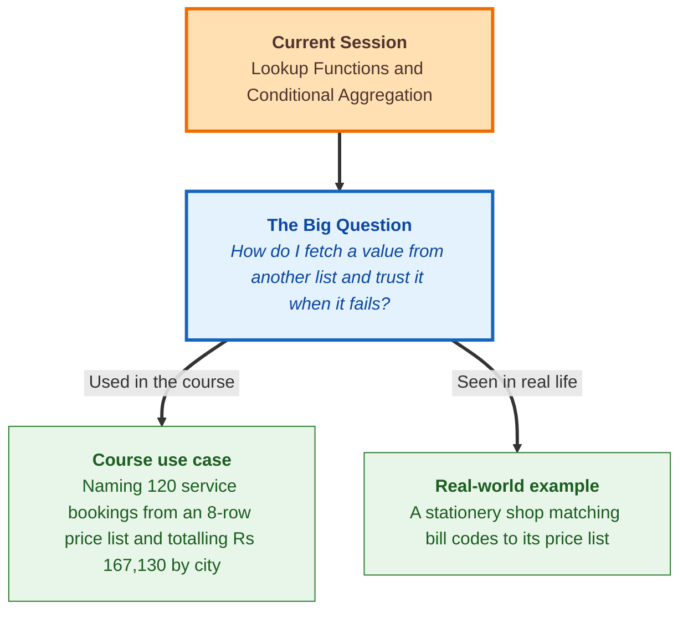

## Lookup Functions and Conditional Aggregation

### Mental Map

---

### What You'll Learn

Have you ever wondered how a shop finds the price of an item from a short code on the bill?

By the end of this session, you will be able to:

- **Describe** how a helper finds a price on a list using an item code.
- **Calculate** Saturday notebook sales from 3 bill lines using two conditions at once.
- **Use** a slab list to pick a 5% or 10% discount for a bill total.
- **Determine** what a bill should say when a code is missing from the list.
- **Examine** why a code that looks identical still finds no price.
- **Write** a question for a chat tool that names the symptom and asks for checks.

> **Topics you will meet:** VLOOKUP, XLOOKUP, fixing #N/A in lookups, IFERROR, SUMIFS and COUNTIFS, banding with a lookup, asking an AI tool to explain a lookup error.
>
> Join the session to learn each of these in detail.

---

### Why You Are Learning This Topic

Mr. Gupta runs a stationery shop. His helper, Tanu, writes a short code on every bill line.

Tanu searches the price list for the code NB2. The list has NB2, but the bill says "NB2 " with a space after it.

She finds nothing and writes a price of zero. The shop loses Rs 40 on each notebook.

A **lookup** means finding a value in one list by matching a code from another list.

In this course, you will look up values across sheets and explain every gap.

> **Think about it:** What should Tanu have written on the bill when she found no match?

---

### The Stationery Shop Puzzle

The price list shows PEN1 at Rs 10, NB2 at Rs 40 and GL3 at Rs 25. Tanu writes three bill lines.

| Bill line | Code written | Quantity | Day |
|:----------:|:----------:|:----------:|:----------:|
| 1 | PEN1 | 10 | Saturday |
| 2 | "NB2 " with a space | 5 | Saturday |
| 3 | GL9 | 2 | Sunday |

**What you want to happen:**

- Each bill line shows its price from the list.
- A code that is truly missing says "Ask manager".
- The shop counts Saturday notebook sales using two conditions.

> **Wonder about this:**
>
> - Why do "NB2" and "NB2 " not match?
> - Which discount slab would a Rs 1,000 bill earn?

---

### Think It Through

There is no wrong first try. Keep your guesses for the session.

**1. Line 2 says "NB2 " with a space. Why might the price list refuse to match it?**
Hint: Count the characters in each one.

**2. Code GL9 is not on the price list at all. What should the bill show?**
Hint: Say what Tanu should do next.

**3. Slabs are 0 to 499, 500 to 999 and 1,000 and above. Which slab does a Rs 1,000 bill earn?**
Hint: Check the edge of each slab.

---

### One Question to Carry Into the Session

> **How do you tell a mistake in a code from a code that is truly missing?**
>
> Which bill line would you check first?
