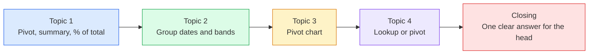
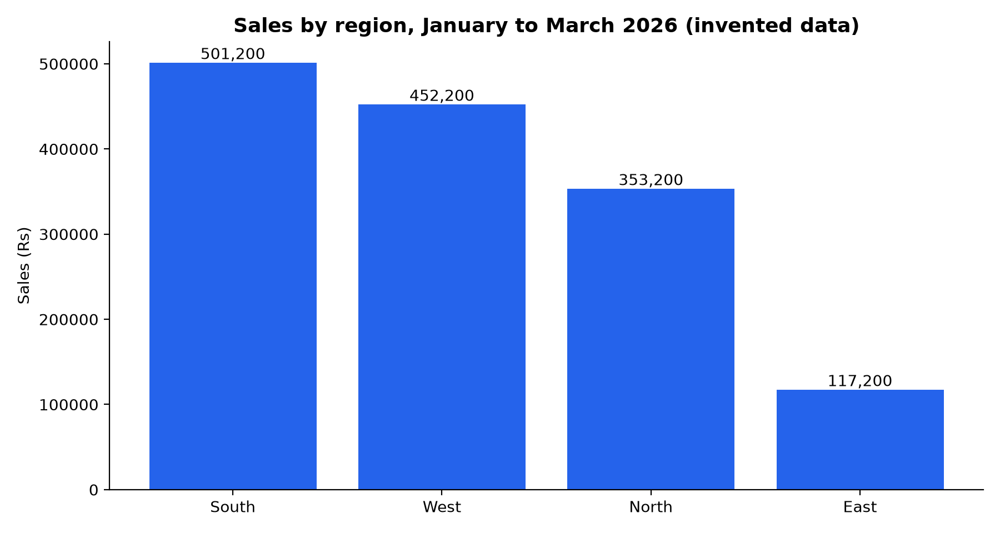
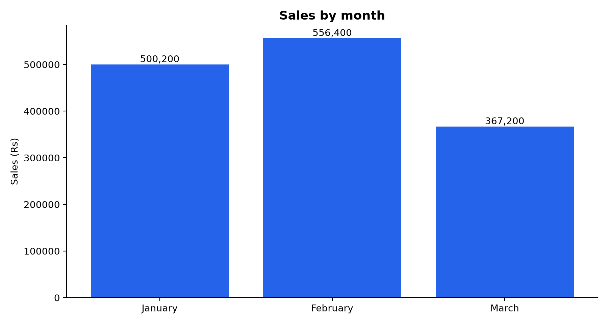
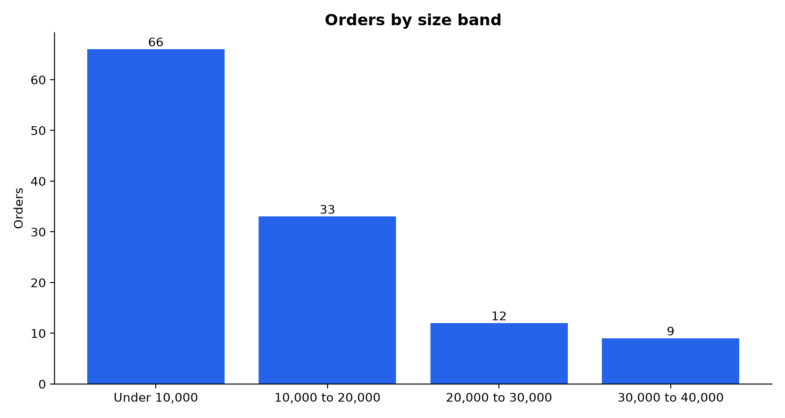
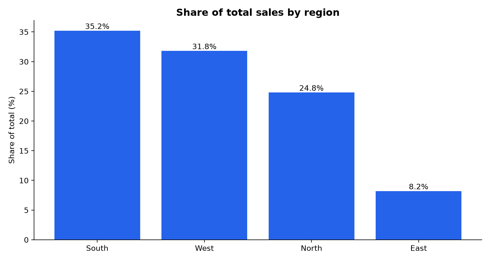

# <font color='#1d4ed8'>Lecture Script: Pivot Tables and Analysis</font>

---

## <font color='blue'>Agenda</font>

The lecture runs as four topics. Each topic ends with a quiz.

| Topic | What we do | Learning objectives covered | Minutes |
|:-:|:--|:--|:-:|
| 1 | Build a pivot table and change what it shows | Build a pivot table that aggregates a measure by one or more categories<br>Configure a pivot value field to show a percentage of total or a different summary function | 30 |
| 2 | Group rows into months and size bands | Aggregate pivot rows into date periods or numeric bins using grouping | 25 |
| 3 | Chart the pivot | Build a pivot chart linked to a pivot table so it updates with the pivot | 20 |
| 4 | Choose a lookup or a pivot | Select between a lookup formula and a pivot table, justifying by whether the output is per-row or summarised | 30 |
| — | Closing: Outcome & Summary | | 15 |
| | **Total** | | **120** |

> <font color="red">**🎯 Instructor Note**</font> Pace: keep the chart in Topic 3 brisk. Spend the extra minutes on the value-field settings in Topic 1 and on the lookup-or-pivot decision in Topic 4.
> Learners work in Google Sheets. Pivot values shown here are verified by recomputation in Python from the same CSV.

---

## <font color='blue'>Scenario</font>

**A conversation.** A Parle-style biscuit and snack distributor in Gujarat has one sheet of 120 orders for January to March 2026. The regional head and the analyst talk after a review.

> **Head:** "Which region sells the most, and what share of the total is that?"
>
> **Analyst, Prakash:** "I have 120 rows. Give me a minute."
>
> **Head:** "A minute, or a day? Last time you built it with 20 separate formulas."

> <font color="red">**🎯 Instructor Note**</font> The company is only the setting. Do not claim it uses these numbers. The data is invented for teaching: `data/distributor_orders_q1_2026.csv` (120 orders) and `data/distributors.csv` (8 rows). Import both with conversion switched on, so order_date is a real date.

---

## <font color='blue'>Problem Statement</font>

Prakash writes a separate SUMIFS for each region, product and month. After an hour he has 60 formulas, and one of them uses the wrong range. The regional head gets a number for the South that is Rs 40,000 too low. The head moves stock away from the South on that number, and the South runs short of rusk the next week.

> <font color='purple'>**How do we summarise 120 rows by region, product, month and size, show each region's share, chart it, and know when a pivot is the right tool instead of a formula?**</font>

> <font color="red">**🎯 Instructor Note**</font> Poll: "To show each order's distributor name on its own row, do we use a lookup or a pivot?" Give learners 30 seconds to respond in chat. Reveal the answer in the Closing.

---

## <font color='blue'>What We Will Use</font>

Google Sheets: the Insert menu for pivot tables and charts. Last session you used `SUMIFS` and `VLOOKUP`. Today a pivot table does the same summing without a formula for each cell.

| Topic | Tools | In one line |
|:-:|:--|:--|
| 1 | Pivot table editor: Rows, Columns, Values, Summarize by, Show as | Drag fields to summarise a measure by categories |
| 2 | Pivot date group, histogram rule | Group dates into months and numbers into bands |
| 3 | Chart from the pivot | A chart that updates when the pivot changes |
| 4 | `VLOOKUP`, pivot table | Per-row output uses a lookup. Summarised output uses a pivot |

---

## <font color='blue'>How: Walking Through the Distributor Sheet</font>



---

## <font color='blue'>Topic 1: Build a pivot table and change what it shows</font> `30 min`

> <font color='purple'>**How does Prakash get sales by region without writing a formula for each region?**</font>

### <font color='green'>Example: Sales by region</font>

> <font color='purple'>**What is the total of sales_rs for each region?**</font>

A **pivot table** summarises many rows into a small table. You choose which field becomes the rows and which field is added up. The sheet has six columns: order_id, order_date, region, distributor_id, product and sales_rs.

1. Click any cell in the data, then Insert > Pivot table > Create.
2. Rows > Add > region.
3. Values > Add > sales_rs, Summarize by SUM.

**Predict before running: What will happen?**

> <font color="red">**🎯 Instructor Note**</font> Ask learners which region will be the largest. Expected: South, at Rs 501,200. Common wrong guess: North, because it has more distributors.

**Output** (cell values, verified by recomputation in Python)

```
South 501200
West 452200
North 353200
East 117200
Grand total 1423800
```

> <font color='green'>**Result**</font> The pivot has four rows and a grand total of Rs 1,423,800. South leads with Rs 501,200, then West with Rs 452,200.

<p align="center"></p>

### <font color='green'>Extending it: Add product as columns</font>

> <font color='purple'>**How do we see region and product together?**</font>

4. Columns > Add > product.

**Output** (cell values, verified by recomputation in Python)

```
product       Candy Cream biscuits Glucose biscuits Namkeen    Rusk Grand total
region                                                                         
East           8700          42300             9100   57100              117200
North         35900          47600            69400   76000  124300      353200
South         43800          75600            60600  153700  167500      501200
West          19400         119200            49600  102900  161100      452200
Grand total  107800         284700           188700  389700  452900     1423800
```

> <font color='green'>**Result**</font> A two-way pivot with 4 rows and 5 product columns. The cell for East and Rusk is empty because East has no rusk orders. An empty cell means no rows, not zero sales.

### <font color='green'>Extending it: Show as percent of total, and change the summary</font>

> <font color='purple'>**What share of all sales is each region, and what is the average order?**</font>

In the Values box, open **Show as** and choose "% of grand total". Add `sales_rs` a second time and set **Summarize by** to AVERAGE. A **summary function** is the rule that turns many numbers into one, such as SUM, COUNT or AVERAGE.

$$\text{share of region} = \frac{\text{sales of region}}{\text{grand total}} \qquad \text{average order} = \frac{\text{sales}}{\text{orders}}$$

**Output** (cell values, verified by recomputation in Python)

```
           SUM  COUNT  AVERAGE  share_%
region                                 
South   501200     44  11391.0     35.2
West    452200     33  13703.0     31.8
North   353200     33  10703.0     24.8
East    117200     10  11720.0      8.2
shares add to 100.0
```

> <font color='green'>**Result**</font> South is 35.2% of sales and East only 8.2%. West has the highest average order, Rs 13,703, though it has fewer orders than South.

> <font color='#b45309'>**Common mistake**</font> Reading a COUNT as sales. Fix: check "Summarize by" for each value field before reading the numbers.

### <font color='purple'>Quiz 1</font>

**Question:** Which setting turns the pivot's sales column into each region's share of all sales?

**Options:**
- A) Summarize by COUNT
- B) Summarize by AVERAGE
- C) Show as: % of grand total
- D) Sort by sales_rs

**Correct Answer:** C

**Explanation:**
- **A)** COUNT gives the number of orders, not a share of sales.
- **B)** AVERAGE gives the mean order size, not a share.
- **C)** Correct. "% of grand total" divides each region's sum by the grand total.
- **D)** Sorting changes the order of rows, not the values.

---

## <font color='blue'>Topic 2: Group rows into months and size bands</font> `25 min`

> <font color='purple'>**The head asks, "How did the quarter move month by month, and how big are most orders?"**</font>

### <font color='green'>Example: Group dates into months</font>

> <font color='purple'>**How do we get one row for each month instead of one for each day?**</font>

Grouping combines rows into periods. Remove `region`, add `order_date` to Rows, then right-click a date and choose **Create pivot date group > Year-Month**.

**Predict before running: What will happen?**

> <font color="red">**🎯 Instructor Note**</font> Ask which month is highest. Expected: February, Rs 556,400. March is lowest because the file has fewer March orders.

**Output** (cell values, verified by recomputation in Python)

```
            SUM of sales_rs  orders
order_date                         
2026-01              500200      45
2026-02              556400      44
2026-03              367200      31
```

> <font color='green'>**Result**</font> January is Rs 500,200 from 45 orders, February Rs 556,400 from 44 orders and March Rs 367,200 from 31 orders. Three rows replace 90 days.

<p align="center"></p>

### <font color='green'>Extending it: Group numbers into bands</font>

> <font color='purple'>**How many orders are small, medium or large?**</font>

Put `sales_rs` in Rows, then right-click a value and choose a **histogram rule** (grouping by number). Set the interval to 10,000, start at 0 and end at 40,000. Add `order_id` to Values with COUNT.

**Output** (cell values, verified by recomputation in Python)

```
sales_rs
0 to under 10,000         66
10,000 to under 20,000    33
20,000 to under 30,000    12
30,000 to under 40,000     9
total 120 | min 2700 | max 33800
```

<p align="center"></p>

> <font color='green'>**Result**</font> 66 of the 120 orders are under Rs 10,000, and only 9 reach Rs 30,000 or more. The four bands hold all 120 orders, from a smallest order of Rs 2,700 to a largest of Rs 33,800.

> <font color='#b45309'>**Common mistake**</font> Leaving the end of the band range too low, so large orders drop out of the pivot. Fix: set the end above the maximum and check that the counts add up to 120.

### <font color='purple'>Quiz 2</font>

**Question:** The pivot has one row for every date in the file. Which feature gives one row for each month?

**Options:**
- A) Pivot date group, Year-Month
- B) Show as: % of grand total
- C) Summarize by COUNT
- D) A filter on the region field

**Correct Answer:** A

**Explanation:**
- **A)** Correct. A pivot date group combines dates into months.
- **B)** A percentage changes the values, not how the rows are grouped.
- **C)** COUNT changes the summary and keeps one row for each date.
- **D)** A filter hides rows. It does not combine them into months.

---

## <font color='blue'>Topic 3: Chart the pivot</font> `20 min`

> <font color='purple'>**The head wants a picture. What happens to the picture if the pivot changes?**</font>

### <font color='green'>Example: A chart linked to the pivot</font>

> <font color='purple'>**How do we build a chart that follows the pivot?**</font>

A **pivot chart** is a chart built from the pivot table's range, so it updates when the pivot changes. Rebuild the region pivot with `% of grand total`, select the pivot table, then choose Insert > Chart.

1. Select the pivot table (region and sales_rs).
2. Insert > Chart. Chart type: Column chart.
3. Customize > Chart title: Share of sales by region.

**Output** (cell values, verified by recomputation in Python)

```
region
South    35.2
West     31.8
North    24.8
East      8.2
```

<p align="center"></p>

> <font color='green'>**Result**</font> The chart shows South 35.2%, West 31.8%, North 24.8% and East 8.2%. The four shares add to 100%.

### <font color='green'>Extending it: Change the pivot, watch the chart</font>

> <font color='purple'>**What happens to the chart when we add a filter on product?**</font>

> <font color="red">**🎯 Instructor Note**</font> Mentor: on the pivot, open the product filter and keep only Rusk. Learners watch the chart redraw with no edit to the chart. Expected: South leads with Rs 167,500 of Rs 452,900.

**Output** (cell values, verified by recomputation in Python)

```
region
South    167500
West     161100
North    124300
Rusk total 452900
```

> <font color='green'>**Result**</font> With only Rusk kept, South leads with Rs 167,500, then West at Rs 161,100. The chart redraws by itself. A chart from a normal copied range would not.

> <font color='#b45309'>**Common mistake**</font> Pasting the pivot's values elsewhere and charting those. Fix: chart the pivot itself, so refreshes carry through.

### <font color='purple'>Quiz 3</font>

**Question:** The pivot gets a new filter. What happens to a chart built from the pivot range?

**Options:**
- A) Nothing, until you rebuild the chart
- B) The chart is deleted
- C) The chart shows the first row only
- D) The chart updates with the pivot

**Correct Answer:** D

**Explanation:**
- **A)** A chart linked to the pivot follows it. A chart from pasted values does not.
- **B)** A filter does not delete a chart.
- **C)** The chart keeps showing all the rows that the pivot shows.
- **D)** Correct. The chart reads the pivot range, so it redraws when the pivot changes.

---

## <font color='blue'>Topic 4: Choose a lookup or a pivot</font> `30 min`

> <font color='purple'>**Prakash now has two tools. How does he pick the right one for each request?**</font>

### <font color='green'>Example: Per-row output needs a lookup</font>

> <font color='purple'>**How do we show each order's distributor name on its own row?**</font>

A **lookup** returns one value for every row, so the output has as many rows as the data. The distributor name lives in the second table, so each of the 120 rows needs a match.

=VLOOKUP(D2,Distributors!$A$2:$B$9,2,FALSE)

**Output** (cell values, verified by recomputation in Python)

```
row 2 distributor_id D07 -> Konkan Foods
rows in the output: 120
```

> <font color='green'>**Result**</font> Order 2001 shows its distributor name, and every other order does too. The output has 120 rows, one for each order.

### <font color='green'>Extending it: Summarised output needs a pivot</font>

> <font color='purple'>**How do we show total sales for each distributor?**</font>

A **pivot** returns one row for each group, so the output is smaller than the data. Put `distributor_id` in Rows and SUM of sales_rs in Values.

**Output** (cell values, verified by recomputation in Python)

```
distributor_id
D03    277900
D07    240400
D04    223300
D08    211800
D01    181800
D02    171400
D06     72500
D05     44700
rows in the output: 8 | total 1423800
```

> <font color='green'>**Result**</font> The pivot has 8 rows, one for each distributor, and its total matches Rs 1,423,800. D03 is the largest distributor, with Rs 277,900.

### <font color='green'>Extending it: Decide for three requests</font>

> <font color='purple'>**Which tool fits each request?**</font>

> <font color="red">**🎯 Instructor Note**</font> Cover the right column. Read each request and ask learners to type Lookup or Pivot. Reveal after 30 seconds.

| Request | Output | Tool |
|:--|:-:|:-:|
| "Add the distributor's name to every order" | One value per row | Lookup |
| "Total sales by region and product" | One row per group | Pivot |
| "Show the base price of each product next to each order" | One value per row | Lookup |

> <font color='green'>**Result**</font> Ask one question: should the output have one value for each row, or one row for each group? A pivot summarises. A lookup copies a value onto each row.

> <font color='#b45309'>**Common mistake**</font> Using a pivot to add a name to every order. Fix: a pivot groups rows. It cannot return a value for each row.

### <font color='purple'>Quiz 4</font>

**Question:** The regional head wants the average order size for each product. Which tool fits, and why?

**Options:**
- A) Lookup, because the data has a product column
- B) Pivot, because the output is one row for each product
- C) Neither, because averages need a macro
- D) Lookup, because every row needs a value

**Correct Answer:** B

**Explanation:**
- **A)** Having a product column does not make a lookup the right tool.
- **B)** Correct. The output is summarised, with one row for each group.
- **C)** A pivot value field can use AVERAGE with no macro.
- **D)** The request is for a summary, not a value on every row.

---

## <font color='blue'>Closing: Outcome & Summary</font> `15 min`

Back to Prakash. We answer the Problem Statement using each topic once.

> <font color='purple'>**1. How does he summarise 120 rows by region and show shares? (Topic 1)**</font>

A pivot table with `region` in Rows, SUM of `sales_rs` in Values and "% of grand total". South is 35.2% of Rs 1,423,800.

> <font color='purple'>**2. How does he get months and size bands? (Topic 2)**</font>

A pivot date group gives January, February and March. A histogram rule gives four bands of Rs 10,000.

> <font color='purple'>**3. How does the head see it? (Topic 3)**</font>

A chart built from the pivot range, which redraws when a filter changes.

> <font color='purple'>**4. When is a pivot the wrong tool? (Topic 4)**</font>

When each row needs its own value, such as a distributor name. Then Prakash uses a lookup.

### <font color='green'>Outcome</font>

| | Prakash's 60 formulas | Prakash's pivot |
|:--|:-:|:-:|
| Time to build | An hour | A few clicks |
| Risk of a wrong range | High | None, the editor picks the field |
| Shares of sales | Extra formulas | "Show as" in one step |
| Chart that follows changes | No | Yes |

> <font color='green'>**Therefore,**</font> Use a pivot when you want one row for each group, and a lookup when you want a value on each row. Prakash tells the head that South leads with 35.2% of Rs 1,423,800, and the South runs no risk of being short.

> <font color="red">**🎯 Instructor Note**</font> Reveal the poll: a lookup. A distributor name is needed on every order row, and a pivot returns one row for each group.

### <font color='green'>Summary</font>

| Learning objective | Takeaway |
|:--|:--|
| Build a pivot table | Rows and Columns hold the categories. Values holds the measure |
| Value field settings | Choose the summary function and "Show as" for a share of the total |
| Grouping | Pivot date groups make months. A histogram rule makes numeric bands |
| Pivot chart | A chart from the pivot range updates when the pivot changes |
| Lookup or pivot | A lookup gives one value per row. A pivot gives one row per group |
| **Practical value** | A pivot answers "how much by group" in seconds and keeps the answer in step with the data |

---

# <font color='red'>Launch the Feedback Poll</font>

> <font color="red">**🎯 Instructor Note**</font> Reminder: launch the feedback poll now to collect learner feedback.

