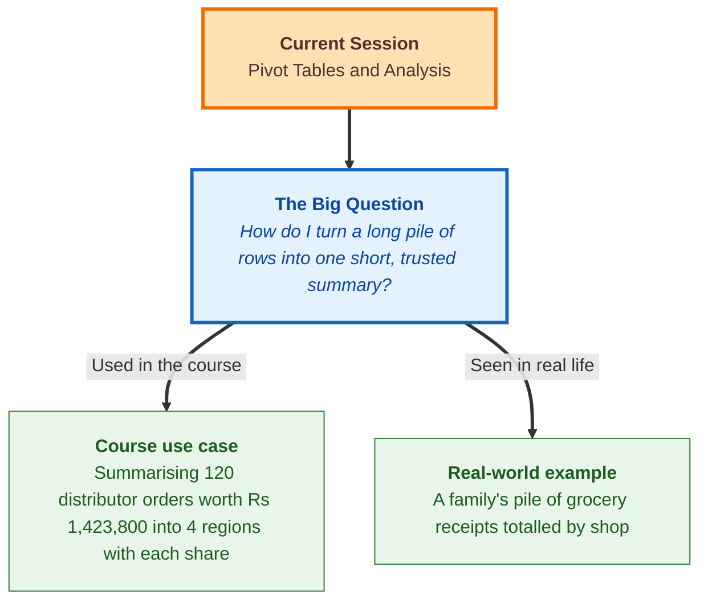

## Pivot Tables and Analysis

### Mental Map

---

### What You'll Learn

Have you ever wondered how a pile of receipts turns into one line that says where the money went?

By the end of this session, you will be able to:

- **Summarise** a pile of 6 receipts into one line for each shop.
- **Predict** what happens to a bar picture when one receipt changes.
- **Calculate** each shop's share of a Rs 2,000 monthly spend.
- **Differentiate** a tally by shop, by week and by size of bill.
- **Justify** whether a task needs a tally or a value written on each receipt.

> **Topics you will meet:** Build a pivot table, percent of total, group by date or number, pivot chart linked to the pivot, lookup or pivot.
>
> Join the session to learn each of these in detail.

---

### Why You Are Learning This Topic

Meera keeps the month's grocery receipts in a drawer. Her husband asks, "Which shop took most of our money?"

She spends an evening adding receipts shop by shop on a calculator. She misreads one receipt and gets a wrong total.

Next month she must do it all again, because nothing was saved.

A **pivot table** means a small table that adds up a long list of rows into one line for each group.

In this course, you will build summary tables like this from files of 120 rows or more.

> **Think about it:** What would let Meera redo the totals in seconds next month?

---

### The Grocery Receipts Puzzle

Meera lists six receipts from the month.

| Receipt | Shop | Week | Amount |
|:----------:|:----------:|:----------:|:----------:|
| 1 | Kumar Stores | 1 | Rs 400 |
| 2 | Fresh Mart | 1 | Rs 700 |
| 3 | Kumar Stores | 2 | Rs 300 |
| 4 | Dairy Point | 2 | Rs 200 |
| 5 | Fresh Mart | 3 | Rs 300 |
| 6 | Kumar Stores | 4 | Rs 100 |

**What you want to happen:**

- One line shows the total for each shop.
- Each line also shows its share of the month's spend.
- A bar picture follows the totals when a receipt changes.

> **Wonder about this:**
>
> - Which shop gets the biggest share of the Rs 2,000?
> - How would you total the receipts for each week instead?

---

### Think It Through

There is no wrong first try. Keep your guesses for the session.

**1. Two receipts come from Fresh Mart. Which line of a summary holds them together?**
Hint: Think about the group they share.

**2. Fresh Mart's receipts add up to Rs 1,000 of the Rs 2,000 total. What share is that?**
Hint: Divide the shop's amount by the total.

**3. Meera wants each receipt to show its shop's phone number. Does she need a summary or a value on each receipt?**
Hint: Count the lines you expect in the answer.

---

### One Question to Carry Into the Session

> **When do you want one line for each group, and when one value for each row?**
>
> Which line of Meera's list would you check first to trust a summary?
