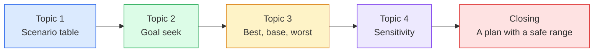
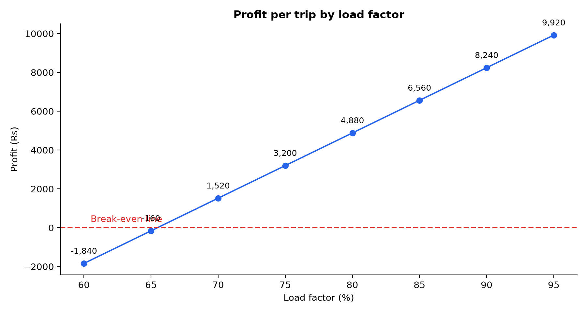
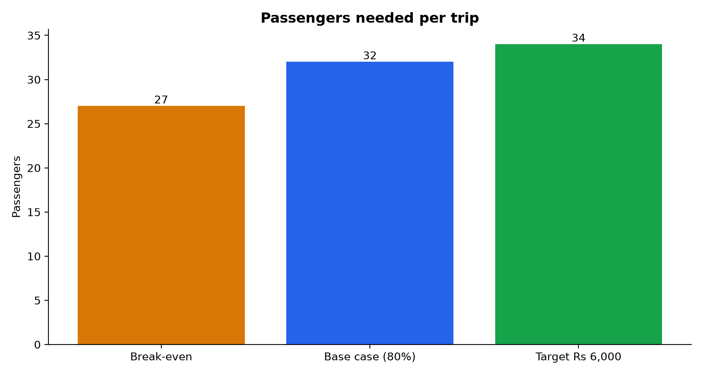
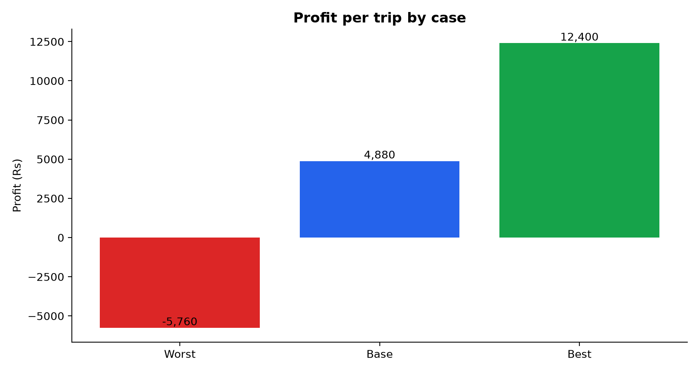
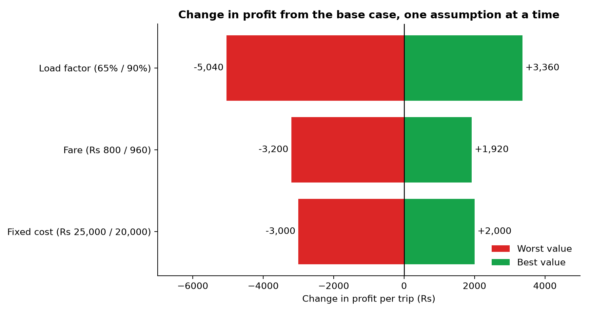

# <font color='#1d4ed8'>Lecture Script: What-If and Scenario Models</font>

---

## <font color='blue'>Agenda</font>

The lecture runs as four topics. Each topic ends with a quiz.

| Topic | What we do | Learning objectives covered | Minutes |
|:-:|:--|:--|:-:|
| 1 | Build a scenario table over one input | Construct a scenario table showing how an output changes across a range of input values | 25 |
| 2 | Find the input that hits a target | Compute the input value that reaches a stated target output using goal seek | 30 |
| 3 | Compare best, base and worst cases | Construct a scenario comparison showing an outcome under best, base and worst assumptions | 25 |
| 4 | Find the assumption that matters most | Analyze which assumption a business case is most sensitive to | 25 |
| — | Closing: Outcome & Summary | | 15 |
| | **Total** | | **120** |

> <font color="red">**🎯 Instructor Note**</font> Pace: keep the table formula in Topic 1 brisk. Spend the extra minutes on goal seek in Topic 2 and on the sensitivity comparison in Topic 4.
> Topic 4 includes one live review of assumptions in a free chat tool. Replies differ on every run, so learners judge the reply against the sheet.

---

## <font color='blue'>Scenario</font>

**A model sheet.** A redBus-style bus operator runs one Bengaluru to Chennai trip each night. A planner keeps five inputs in a sheet and one profit formula under them.

| Cell | Input | Value |
|:-:|:--|:-:|
| B1 | Seats on the bus | 40 |
| B2 | Average fare per passenger | Rs 900 |
| B3 | Cost per passenger (meal, handling) | Rs 60 |
| B4 | Fixed cost per trip (driver, fuel, tolls) | Rs 22,000 |
| B5 | Load factor (share of seats filled) | 80% |

> <font color="red">**🎯 Instructor Note**</font> The company is only the setting. Do not claim it uses these numbers. All values are invented for teaching. Goal seek in Google Sheets comes from a free add-on, so check its menu names before class. Answers below are verified by algebra and Python.

---

## <font color='blue'>Problem Statement</font>

Aditi plans the route. She tells her manager, "At 80% full, a trip earns Rs 4,880." The manager asks, "What if only 70% fill? And what fill do we need to earn Rs 6,000?" Aditi types a new load factor into the sheet, one value at a time, and reads the profit each time. She shows the manager one number. During a slow week the buses run at 65% full, and the route loses money on every trip.

> <font color='purple'>**How do we show how profit changes across inputs, find the input that hits a target, compare best, base and worst cases, and learn which assumption matters most?**</font>

> <font color="red">**🎯 Instructor Note**</font> Poll: "Which assumption moves profit most between its best and worst value: load factor, fare or fixed cost?" Give learners 30 seconds to respond in chat. Reveal the answer in the Closing.

---

## <font color='blue'>What We Will Use</font>

Google Sheets, with the free Goal Seek add-on. Last session you summarised data with a pivot table. Today the data is a model: a few inputs and one formula.

| Topic | Tools | In one line |
|:-:|:--|:--|
| 1 | Formula with `$` references, a column of input values | Recompute the output for many inputs at once |
| 2 | Goal Seek add-on | Find the input value that makes the output hit a target |
| 3 | Three columns of assumptions | One column each for the best, base and worst case |
| 4 | Change one input at a time | See which input moves the output most |

---

## <font color='blue'>How: Walking Through the Night Bus</font>



---

## <font color='blue'>Topic 1: Build a scenario table over one input</font> `25 min`

> <font color='purple'>**What does one trip earn if the bus is 60%, 65% or 95% full?**</font>

### <font color='green'>Example: The profit formula</font>

> <font color='purple'>**What is the profit of one trip at 80% full?**</font>

A **model** is a sheet where one formula turns inputs into an output. Profit equals the fare minus the cost per passenger, times the passengers, minus the fixed cost. Passengers equal seats times the load factor.

$$\boxed{\text{profit} = \text{seats} \times \text{load factor} \times (\text{fare} - \text{cost per passenger}) - \text{fixed cost}}$$

$$40 \times 0.80 \times (900 - 60) - 22{,}000 = 32 \times 840 - 22{,}000 = 4{,}880$$

=B1*B5*(B2-B3)-B4

> <font color='green'>**Result**</font> 32 passengers pay Rs 840 each after the meal, which is Rs 26,880. After the fixed cost of Rs 22,000, one trip earns Rs 4,880.

### <font color='green'>Example: A scenario table</font>

> <font color='purple'>**How do we see the profit for load factors from 60% to 95% in one view?**</font>

A **scenario table** lists several values of one input and the output for each. Put the load factors in A9:A16. In B9, point the formula at A9 and lock the other inputs with `$`. Then fill down.

**Predict before running: What will happen?**

> <font color="red">**🎯 Instructor Note**</font> Ask learners at which load factor profit turns positive. Expected: between 65% and 70%. Common wrong guess: 50%, because "half full feels fine".

=$B$1*A9*($B$2-$B$3)-$B$4

**Output** (cell values, verified by recomputation in Python)

```
60%  passengers 24  profit -1,840
65%  passengers 26  profit -160
70%  passengers 28  profit 1,520
75%  passengers 30  profit 3,200
80%  passengers 32  profit 4,880
85%  passengers 34  profit 6,560
90%  passengers 36  profit 8,240
95%  passengers 38  profit 9,920
```

<p align="center"></p>

> <font color='green'>**Result**</font> Profit is Rs -1,840 at 60%, Rs -160 at 65% and Rs 1,520 at 70%. Each 5-point step adds Rs 1,680, because 2 passengers pay Rs 840 each.

> <font color='#b45309'>**Common mistake**</font> Leaving `B1`, `B2`, `B3` and `B4` without `$`. Fix: lock every fixed input, and leave only the column of load factors free.

### <font color='purple'>Quiz 1</font>

**Question:** The load factors are in A9:A16. Which formula in B9 fills down correctly to give the profit for each?

**Options:**
- A) `=B1*A9*(B2-B3)-B4`
- B) `=$B$1*A9*($B$2-$B$3)-$B$4`
- C) `=$B$1*$A$9*($B$2-$B$3)-$B$4`
- D) `=A9*($B$2-$B$3)`

**Correct Answer:** B

**Explanation:**
- **A)** The inputs lack `$`, so `B1` slides to `B2`, `B3` and so on when filled down.
- **B)** Correct. The inputs stay locked and only the load factor in column A moves.
- **C)** `$A$9` is locked too, so every row shows the 60% result.
- **D)** It leaves out the seats and the fixed cost, so it is not profit.

---

## <font color='blue'>Topic 2: Find the input that hits a target</font> `30 min`

> <font color='purple'>**The table shows profit for set load factors. What load factor gives exactly Rs 6,000?**</font>

### <font color='green'>Example: Goal seek for a profit target</font>

> <font color='purple'>**What load factor makes a trip earn Rs 6,000?**</font>

**Goal seek** works backwards. You choose the output cell, the value you want it to reach and the one input cell it may change. The add-on tries values until the output matches.

Set cell:        B7   (the profit formula)
To value:        6000
By changing:     B5   (the load factor)

**Predict before running: What will happen?**

> <font color="red">**🎯 Instructor Note**</font> Ask learners to guess the load factor from the table. Expected: between 80% and 85%, because Rs 4,880 and Rs 6,560 sit on either side. Common wrong guess: 90%.

We can check what goal seek returns by algebra. Set profit to the target and solve for the load factor.

$$\boxed{L = \frac{\text{target} + \text{fixed cost}}{\text{seats} \times (\text{fare} - \text{cost per passenger})}} = \frac{6{,}000 + 22{,}000}{40 \times 840} = \frac{28{,}000}{33{,}600}$$

**Output** (cell values, verified by recomputation in Python)

```
load factor = 0.833333 = 83.33%
passengers = 33.33
check profit at that load factor = 6000.0
```

> <font color='green'>**Result**</font> The load factor is 83.33%, which is 33.3 passengers. Goal seek should show about 0.8333 in B5 and Rs 6,000 in B7.

### <font color='green'>Extending it: The break-even load factor</font>

> <font color='purple'>**At what load factor does the trip neither gain nor lose?**</font>

Set the target to 0. A bus cannot carry a fraction of a passenger, so we round the passengers **up** to a whole number.

**Output** (cell values, verified by recomputation in Python)

```
break-even load factor = 65.48% = 26.19 passengers
26 passengers -> profit -160
27 passengers -> profit 680
33 passengers -> profit 5720
target Rs 6,000 needs 34 passengers -> profit 6560
```

<p align="center"></p>

> <font color='green'>**Result**</font> The break-even load factor is 65.48%, or 26.2 passengers. With 26 passengers the trip loses Rs 160, so 27 are needed. To earn Rs 6,000 the operator needs 34 passengers, since 33 earn only Rs 5,720.

> <font color='#b45309'>**Common mistake**</font> Reading the goal-seek answer as a whole number of passengers. Fix: round up to the next whole passenger, then recheck the profit.

### <font color='purple'>Quiz 2</font>

**Question:** Which three things must you give goal seek?

**Options:**
- A) A chart, a table and a pivot
- B) The input, the output and a chat tool
- C) A range of inputs, a step size and a chart
- D) The cell to set, the target value and the cell to change

**Correct Answer:** D

**Explanation:**
- **A)** Goal seek works on formula cells, not on charts or pivots.
- **B)** No chat tool is needed. Goal seek runs inside the sheet.
- **C)** A range and step belong to a scenario table, which tries fixed values.
- **D)** Correct. It needs the output cell, the value to reach and the one input it may change.

---

## <font color='blue'>Topic 3: Compare best, base and worst cases</font> `25 min`

> <font color='purple'>**One input moves at a time in the table. What if load, fare and cost all turn out better, or all worse?**</font>

### <font color='green'>Example: Three assumption sets</font>

> <font color='purple'>**What is the profit if every assumption goes our way, or against us?**</font>

A **scenario comparison** has one column for each case. The **base case** is the most likely set of assumptions. The **best case** is each assumption at its most favourable realistic value. The **worst case** is each at its least favourable.

| Assumption | Worst | Base | Best |
|:--|:-:|:-:|:-:|
| Load factor | 65% | 80% | 90% |
| Average fare | Rs 800 | Rs 900 | Rs 960 |
| Fixed cost per trip | Rs 25,000 | Rs 22,000 | Rs 20,000 |

On a new tab named Cases, put the cases in columns B, C and D, with the load factor in row 2, the fare in row 3 and the fixed cost in row 4. Put seats (40) in F1 and cost per passenger (60) in F2. Write the formula in B5 and fill right.

=$F$1*B2*(B3-$F$2)-B4

**Output** (cell values, verified by recomputation in Python)

```
Worst profit = 40 x 0.65 x (800-60) - 25,000 = -5,760
Base  profit = 40 x 0.8 x (900-60) - 22,000 = 4,880
Best  profit = 40 x 0.9 x (960-60) - 20,000 = 12,400
```

<p align="center"></p>

> <font color='green'>**Result**</font> The worst case loses Rs 5,760 per trip, the base case earns Rs 4,880 and the best case earns Rs 12,400. The range from loss to gain is Rs 18,160.

### <font color='green'>Extending it: Read the three together</font>

> <font color='purple'>**What does the spread of the three cases tell the manager?**</font>

> <font color="red">**🎯 Instructor Note**</font> Ask learners how often they think the worst case should be planned for. Answers vary. Expected point: a plan should say what happens if the worst case arrives.

> <font color='green'>**Result**</font> A single base number hides a loss. The three cases show that the route can lose money, and by how much.

> <font color='#b45309'>**Common mistake**</font> Setting the best and worst cases to unrealistic extremes. Fix: give a reason for each value, such as last year's slowest week.

### <font color='purple'>Quiz 3</font>

**Question:** What is the best case in a scenario comparison?

**Options:**
- A) Every assumption at its most favourable realistic value
- B) The result that the manager hopes for
- C) The average of the worst and base cases
- D) Any assumption set that gives a profit

**Correct Answer:** A

**Explanation:**
- **A)** Correct. Each assumption is set to its best value that could realistically happen.
- **B)** A hope is not a reason. Each value needs support.
- **C)** An average of two cases is neither best nor worst.
- **D)** The base case may also give a profit, so profit alone does not define the best case.

---

## <font color='blue'>Topic 4: Find the assumption that matters most</font> `25 min`

> <font color='purple'>**Which of the three assumptions should Aditi check hardest before she presents?**</font>

### <font color='green'>Example: Change one assumption at a time</font>

> <font color='purple'>**How much does profit move when each assumption alone goes to its best or worst value?**</font>

**Sensitivity** means how much the output moves when one input changes. Keep the other inputs at the base case and change one input to its best, then to its worst.

**Predict before running: What will happen?**

> <font color="red">**🎯 Instructor Note**</font> Ask learners to guess the largest swing. Expected: the load factor. The fare and the fixed cost move profit less over their ranges.

**Output** (cell values, verified by recomputation in Python)

```
Load factor (65% / 90%)          worst -5,040  best +3,360  total swing 8,400
Fare (Rs 800 / 960)              worst -3,200  best +1,920  total swing 5,120
Fixed cost (Rs 25,000 / 20,000)  worst -3,000  best +2,000  total swing 5,000
```

<p align="center"></p>

> <font color='green'>**Result**</font> Load factor swings profit by Rs 8,400 (from Rs -5,040 to Rs +3,360 around the base). Fare swings it by Rs 5,120, and fixed cost by Rs 5,000. The business case is most sensitive to the load factor.

### <font color='green'>Extending it: Ask an AI tool to review the assumptions, live</font>

> <font color='purple'>**Can a chat tool point out a weak assumption?**</font>

> <font color="red">**🎯 Instructor Note**</font> Mentor: in ChatGPT, Claude or Gemini, paste the assumptions table from Topic 3 and the prompt below. Learners fill the table. Replies differ on every run, so do not predict wording.

Prompt: "Here are my assumptions for a night-bus trip model. Which assumption looks least realistic, and which one should I test first? Answer in 3 bullets and give one reason for each."

| What the tool said | Do we agree? | How do we test it in the sheet? |
|:--|:-:|:--|
| Learners write it here | Yes or No | Learners write it here |
| Learners write it here | Yes or No | Learners write it here |

> <font color='green'>**Result**</font> The tool is a second pair of eyes. Learners test its suggestion with the sheet: change that one assumption and see how far profit moves. The sheet decides, not the reply.

> <font color='#b45309'>**Common mistake**</font> Choosing the "most important" assumption by feel. Fix: change each one by a stated amount and compare the swings.

### <font color='purple'>Quiz 4</font>

**Question:** Profit swings by Rs 8,400 for load factor, Rs 5,120 for fare and Rs 5,000 for fixed cost. Which assumption is the business case most sensitive to?

**Options:**
- A) Fixed cost
- B) Fare
- C) Load factor
- D) All three equally

**Correct Answer:** C

**Explanation:**
- **A)** Fixed cost has the smallest swing, Rs 5,000.
- **B)** Fare has the second-largest swing, Rs 5,120.
- **C)** Correct. The largest swing, Rs 8,400, belongs to load factor.
- **D)** The three swings are different, so they do not matter equally.

---

## <font color='blue'>Closing: Outcome & Summary</font> `15 min`

Back to Aditi. We answer the Problem Statement using each topic once.

> <font color='purple'>**1. How does profit change across load factors? (Topic 1)**</font>

From Rs -1,840 at 60% to Rs 9,920 at 95%, gaining Rs 1,680 for every 5 points.

> <font color='purple'>**2. What load factor hits a target? (Topic 2)**</font>

83.33% for Rs 6,000, and 65.48% to break even. In whole passengers, 34 and 27.

> <font color='purple'>**3. What are the three cases? (Topic 3)**</font>

Worst Rs -5,760, base Rs 4,880 and best Rs 12,400 per trip.

> <font color='purple'>**4. What matters most? (Topic 4)**</font>

The load factor, with a swing of Rs 8,400. The final check of all numbers in one place:

**Output** (cell values, verified by recomputation in Python)

```
base 4880.0 | at 65% -160 | break-even passengers 27 -> 680 | 6,000 target passengers 34 -> 6560
swings: {'Load factor (65% / 90%)': 8400, 'Fare (Rs 800 / 960)': 5120, 'Fixed cost (Rs 25,000 / 20,000)': 5000}
```

### <font color='green'>Outcome</font>

| | Aditi's first answer | Aditi's final answer |
|:--|:-:|:-:|
| Profit at 80% full | Rs 4,880 | Rs 4,880 |
| Profit at 65% full | Not shown | Rs -160 |
| Passengers to cover cost | Not shown | 27 passengers (65.48%) |
| Worst to best case | Not shown | Rs -5,760 to Rs 12,400 |
| Assumption to watch | Not shown | Load factor |

> <font color='green'>**Therefore,**</font> The plan earns Rs 4,880 per trip at 80% full, loses money below about 65.5%, and is most sensitive to the load factor. Aditi tells her manager to watch the load factor first and to plan for the worst case.

> <font color="red">**🎯 Instructor Note**</font> Reveal the poll: load factor. Its swing of Rs 8,400 is larger than the fare's Rs 5,120 and the fixed cost's Rs 5,000. The ranking depends on the ranges chosen.

### <font color='green'>Summary</font>

| Learning objective | Takeaway |
|:--|:--|
| Scenario table | One formula with locked inputs, filled down a column of input values |
| Goal seek | Choose the cell to set, the target value and the cell to change |
| Best, base and worst | Three assumption sets, each with a reason, give a range and not one number |
| Sensitivity | Change one assumption at a time and compare the swings |
| **Practical value** | A model with a table, a target and three cases lets you answer "what if" in minutes and show how far you can trust the plan |

---

# <font color='red'>Launch the Feedback Poll</font>

> <font color="red">**🎯 Instructor Note**</font> Reminder: launch the feedback poll now to collect learner feedback.

