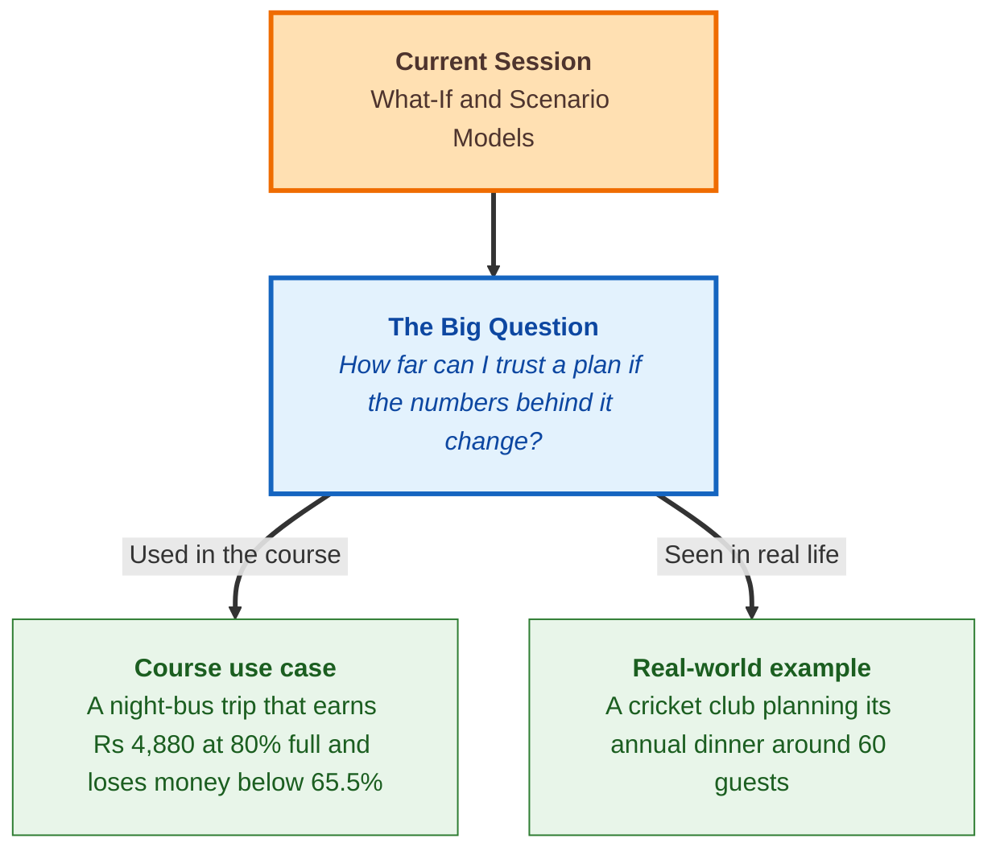

## What-If and Scenario Models

### Mental Map

---

### What You'll Learn

Have you ever wondered how a club knows the number of guests it needs before it books the hall?

By the end of this session, you will be able to:

- **Calculate** the club's profit when 60 guests come at Rs 400 each.
- **Determine** the number of guests the club needs to earn Rs 5,000.
- **Compare** a lucky evening, a usual evening and a poor evening.
- **Examine** which of three numbers moves the profit most.
- **Build** a small table of profit for 5 different guest counts.

> **Topics you will meet:** What-if scenario table across input values, goal seek, best base and worst case comparison, which assumption the result is most sensitive to, asking an AI tool to review your scenario assumptions.
>
> Join the session to learn each of these in detail.

---

### Why You Are Learning This Topic

Imran is the treasurer of a cricket club. He plans the annual dinner for 60 guests.

He tells the committee, "We will earn Rs 3,000 for new kit." Then it rains, and only 45 guests come.

The club loses Rs 750. Nobody had asked what would happen with fewer guests.

A **scenario** means a "what if" version of a plan, with its own set of numbers.

In this course, you will test a plan under three scenarios before you present it.

> **Think about it:** What single question could have warned Imran about the rain?

---

### The Club Dinner Puzzle

Imran writes down the numbers for the evening.

| Item | Value |
|:----------:|:----------:|
| Hall rent, paid once | Rs 12,000 |
| Caterer cost for each guest | Rs 150 |
| Ticket price for each guest | Rs 400 |
| Guests expected | 60 |

**What you want to happen:**

- Imran sees the profit for 40, 50, 60, 70 and 80 guests.
- Imran finds the guest count that earns Rs 5,000.
- Imran knows which number to watch most closely.

> **Wonder about this:**
>
> - What number of guests would cover the hall rent and nothing more?
> - Would a Rs 50 change in ticket price matter more than 5 guests?

---

### Think It Through

There is no wrong first try. Keep your guesses for the session.

**1. Each guest brings Rs 400 and costs Rs 150. How much does one more guest add to the club's money?**
Hint: Subtract the cost from the ticket price.

**2. Each guest adds Rs 250 after the caterer. What number of guests covers the Rs 12,000 hall?**
Hint: Divide the hall rent by the amount each guest adds.

**3. Which number is hardest to be sure of: hall rent, ticket price or guest count?**
Hint: Think about which one the weather can change.

---

### One Question to Carry Into the Session

> **Which number in a plan should you test first?**
>
> What would you tell the committee about a poor evening?
