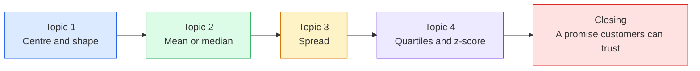
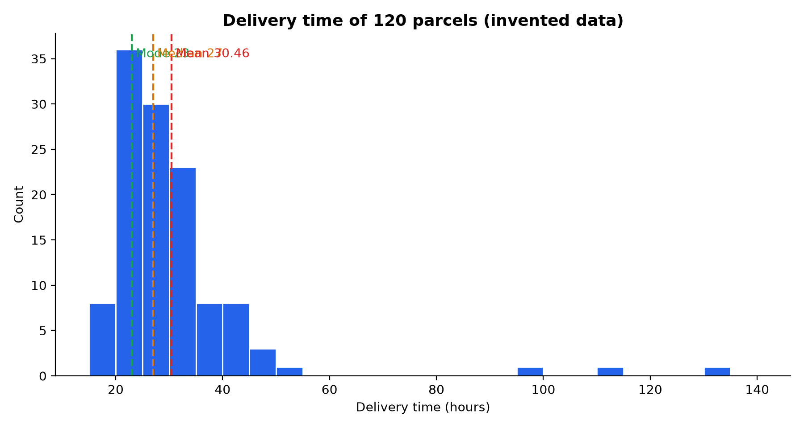
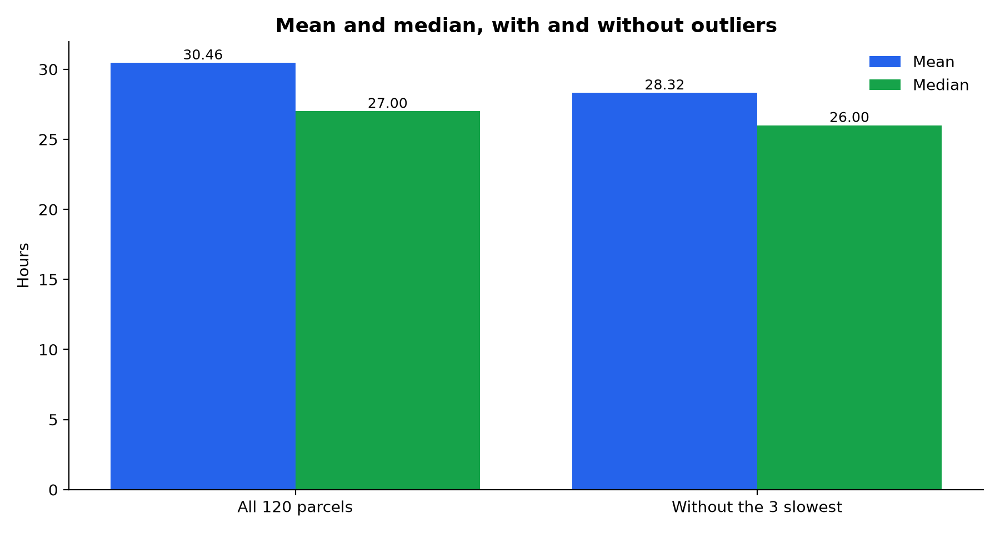
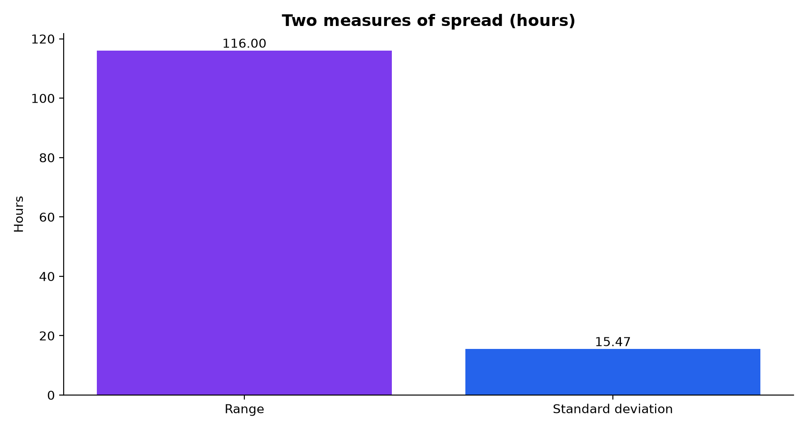
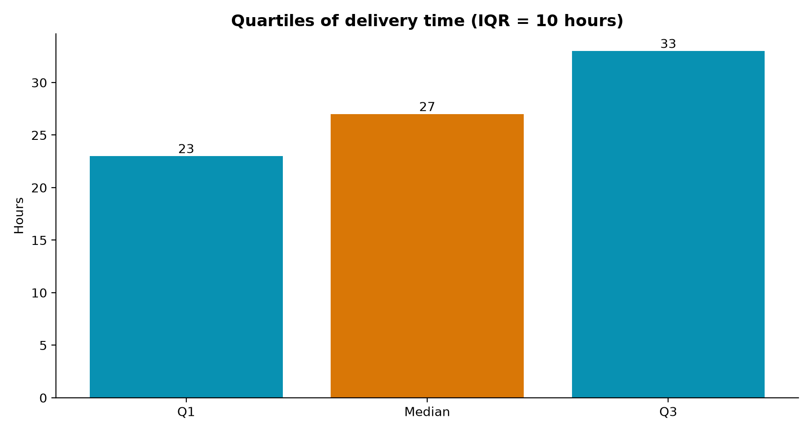

# <font color='#1d4ed8'>Lecture Script: Descriptive Statistics for Business Data</font>

---

## <font color='blue'>Agenda</font>

The lecture runs as four topics. Each topic ends with a quiz.

| Topic | What we do | Learning objectives covered | Minutes |
|:-:|:--|:--|:-:|
| 1 | Find the centre and the shape | Compute the mean, median and mode of a numeric dataset<br>Describe the shape of a distribution as symmetric, right-skewed or left-skewed | 30 |
| 2 | Pick the mean or the median | Select between the mean and the median as the centre measure, justifying by skew and outliers | 20 |
| 3 | Measure and read the spread | Compute the range, variance and standard deviation of a dataset<br>Interpret a standard deviation in the units and context of the variable | 30 |
| 4 | Split into quartiles and place one parcel | Compute the quartiles and interquartile range of a dataset<br>Compute a z-score expressing how far a value sits from the mean | 25 |
| — | Closing: Outcome & Summary | | 15 |
| | **Total** | | **120** |

> <font color="red">**🎯 Instructor Note**</font> Pace: keep the mode in Topic 1 brisk. Spend the extra minutes on the mean-or-median choice in Topic 2 and on reading the standard deviation in Topic 3.
> Topic 3 includes one live request to a free chat tool to explain a statistic. Replies differ on every run, so learners judge the reply against the checks given.

---

## <font color='blue'>Scenario</font>

**Two headlines for one file.** An India Post-style speed-post service has the delivery time, in hours, of 120 parcels. Two analysts write two headlines from the same column.

| | Headline A | Headline B |
|:--|:--|:--|
| Statement | "The average parcel takes 30.5 hours" | "A typical parcel takes 27 hours" |
| What each tells a customer | A promise of 30 hours looks safe | A promise of 27 hours looks right for half of parcels |

> <font color="red">**🎯 Instructor Note**</font> The service is only the setting. Do not claim it uses these numbers. The 120 delivery times are invented for teaching: `data/parcel_delivery_hours.csv`, columns parcel_id, city and delivery_hours. Import it into Google Sheets. The times sit in C2:C121.

---

## <font color='blue'>Problem Statement</font>

Rahul prepares the delivery promise for a customer page. He computes the average, 30.5 hours, and writes "delivered within 30 hours". One week later, 40 of the 120 parcels in the file would have missed that promise, and three took 96 hours or more. A customer who waited 134 hours writes a complaint. Rahul cannot say whether the average, the middle or the spread should have set the promise.

> <font color='purple'>**What number describes a typical parcel, how spread out are the times, and how far from typical is one slow parcel?**</font>

> <font color="red">**🎯 Instructor Note**</font> Poll: "To describe a typical parcel in this file, is the mean or the median the better centre?" Give learners 30 seconds to respond in chat. Reveal the answer in the Closing.

---

## <font color='blue'>What We Will Use</font>

Google Sheets and one column of 120 delivery times. Last session you tested a plan with a model. Today you describe a column of data with a few numbers. In Topic 3 we also ask a free chat tool to explain a statistic.

| Topic | Tools | In one line |
|:-:|:--|:--|
| 1 | `AVERAGE`, `MEDIAN`, `MODE`, a histogram | Centre of the data, and the shape of its histogram |
| 2 | `AVERAGE` and `MEDIAN` with and without extreme values | Which centre stays steady |
| 3 | `MAX`, `MIN`, `VAR.S`, `STDEV.S` | How spread out the times are, in hours |
| 4 | `QUARTILE`, `STANDARDIZE` | The middle half of the data and the distance of one value from the mean |

---

## <font color='blue'>How: Walking Through the Parcel Column</font>



---

## <font color='blue'>Topic 1: Find the centre and the shape</font> `30 min`

> <font color='purple'>**What is the one number that sits at the middle of 120 delivery times?**</font>

### <font color='green'>Example: Mean, median and mode</font>

> <font color='purple'>**What are the mean, the median and the mode of delivery_hours?**</font>

The **mean** is the sum divided by the count. The **median** is the middle value when the times are sorted. The **mode** is the value that appears most often.

$$\boxed{\bar{x} = \frac{\sum x_i}{n}}$$

**Predict before running: What will happen?**

> <font color="red">**🎯 Instructor Note**</font> Ask learners whether the mean will be above or below the median. Expected: above, because a few very slow parcels pull it up. Common wrong guess: equal.

=AVERAGE(C2:C121)
=MEDIAN(C2:C121)
=MODE(C2:C121)

**Output** (cell values, verified by recomputation in Python)

```
n = 120
AVERAGE = 30.46 (sum 3655 / 120 )
MEDIAN  = 27.0
MODE    = 23 (appears 12 times)
```

#### <font color='#c2410c'>Code Explanation</font>

- **Line 1** `AVERAGE` adds all 120 times and divides by 120.
- **Line 2** `MEDIAN` sorts the times and takes the middle, here between the 60th and 61st values.
- **Line 3** `MODE` returns the most frequent time, 23 hours, which appears 12 times.

> <font color='green'>**Result**</font> The mean is 30.46 hours, the median is 27 hours and the mode is 23 hours. The three centres are different.

### <font color='green'>Extending it: Read the shape</font>

> <font color='purple'>**What does the order mean, median and mode tell us about the shape?**</font>

A distribution is **right-skewed** when it has a long tail on the high side, **left-skewed** when the tail is on the low side, and **symmetric** when both sides match. In a right-skewed set the mean is above the median. In a left-skewed set it is below. In a symmetric set they are about equal.

Insert > Chart > Chart type: Histogram. Data range: C2:C121.

<p align="center"></p>

> <font color='green'>**Result**</font> The histogram has a tall block near 20 to 30 hours and a long tail to the right. The mean (30.46) sits above the median (27), so the data is right-skewed.

> <font color='#b45309'>**Common mistake**</font> Calling a distribution skewed "to the right" because the tall bars are on the left. Fix: the skew is named by the side of the long tail.

### <font color='purple'>Quiz 1</font>

**Question:** Mean 30.46, median 27 and mode 23. What is the shape?

**Options:**
- A) Symmetric
- B) Left-skewed
- C) Cannot be told without the data
- D) Right-skewed

**Correct Answer:** D

**Explanation:**
- **A)** In a symmetric set the mean and median are about equal. Here they differ by 3.46.
- **B)** Left-skewed data has a mean below the median. Here it is above.
- **C)** The order of the three centres is enough to say the direction of the skew.
- **D)** Correct. The mean above the median points to a long tail on the right.

---

## <font color='blue'>Topic 2: Pick the mean or the median</font> `20 min`

> <font color='purple'>**Rahul has three centres. Which one should set the promise?**</font>

### <font color='green'>Example: Remove the three slowest parcels</font>

> <font color='purple'>**How much do the mean and the median move when the three slowest parcels are left out?**</font>

An **outlier** is a value that sits far from the rest. Three parcels took 96, 112 and 134 hours. The rest of the file lies between 18 and 53 hours.

**Predict before running: What will happen?**

> <font color="red">**🎯 Instructor Note**</font> Ask which centre moves more when the three are dropped. Expected: the mean. The median moves by 1 hour. Common wrong guess: both move equally.

=AVERAGE(C2:C121)
=MEDIAN(C2:C121)
(then repeat on a copy of the column without the three slowest rows)

**Output** (cell values, verified by recomputation in Python)

```
all 120      : mean 30.46 | median 27.0
without 3 outliers (117): mean 28.32 | median 26.0
mean moves by 2.14 | median moves by 1.0
```

<p align="center"></p>

> <font color='green'>**Result**</font> Dropping 3 of 120 parcels moves the mean by 2.14 hours but the median by only 1 hour. The median is steadier when the data has outliers.

### <font color='green'>Extending it: Choose the centre for the promise</font>

> <font color='purple'>**Which measure should the customer page quote?**</font>

> <font color="red">**🎯 Instructor Note**</font> Ask learners to type "mean" or "median" in chat, with a reason. Expected: median, for a right-skewed file with outliers. A mean is fine for a roughly symmetric file.

| Situation | Better centre | Reason |
|:--|:-:|:--|
| Roughly symmetric, no outliers | Mean | It uses every value and matches the median |
| Skewed, or has outliers | Median | A few extreme values do not drag it |
| Counting the most popular value | Mode | It is the most frequent value |

> <font color='green'>**Result**</font> For this right-skewed file with 3 outliers, the median, 27 hours, is the fairer picture of a typical parcel. The mean, 30.46 hours, is pulled up by the slowest three.

> <font color='#b45309'>**Common mistake**</font> Deleting outliers without saying so. Fix: report the centre with and without them, and say why.

### <font color='purple'>Quiz 2</font>

**Question:** Three parcels took 96, 112 and 134 hours. Which centre best describes a typical parcel?

**Options:**
- A) The mean, since it uses every value
- B) The median, since a few extreme values barely move it
- C) The mode, since it is the largest number
- D) Either, since they are always equal

**Correct Answer:** B

**Explanation:**
- **A)** Using every value is the reason the mean gets pulled by outliers.
- **B)** Correct. The median stays near the middle when a few values are extreme.
- **C)** The mode is the most frequent value, not the largest.
- **D)** The mean and median differ by 3.46 hours here.

---

## <font color='blue'>Topic 3: Measure and read the spread</font> `30 min`

> <font color='purple'>**Two files can share a median and still behave differently. How spread out are these times?**</font>

### <font color='green'>Example: Range, variance and standard deviation</font>

> <font color='purple'>**How wide are the delivery times, and what is the typical distance of a time from the mean?**</font>

The **range** is the largest value minus the smallest. The **variance** is the average of the squared distances from the mean. The **standard deviation** is the square root of the variance, so it is in hours. For a sample, we divide by $n - 1$.

$$\boxed{s = \sqrt{\frac{\sum (x_i - \bar{x})^2}{n - 1}}}$$

=MAX(C2:C121)-MIN(C2:C121)
=VAR.S(C2:C121)
=STDEV.S(C2:C121)

**Output** (cell values, verified by recomputation in Python)

```
MAX - MIN = 134 - 18 = 116
VAR.S     = 239.43 hours squared
STDEV.S   = 15.47 hours
check: sqrt(VAR.S) = 15.47
```

> <font color='green'>**Result**</font> The range is 116 hours, the variance is 239.43 hours squared and the standard deviation is 15.47 hours. The variance is in squared hours, so we quote the standard deviation.

### <font color='green'>Extending it: Read the standard deviation</font>

> <font color='purple'>**What does "15.47 hours" tell Rahul?**</font>

A standard deviation is read in the units of the data. A typical parcel sits about 15.5 hours from the mean of 30.5 hours. Mean minus one standard deviation is 14.98 hours, and mean plus one is 45.93 hours.

**Output** (cell values, verified by recomputation in Python)

```
mean -/+ 1 sd = 14.98 to 45.93
parcels in that band: 113 of 120 = 94.2 %
```

> <font color='green'>**Result**</font> 113 of the 120 parcels, 94.2%, fall between 14.98 and 45.93 hours. The standard deviation is large partly because three parcels are far out.

<p align="center"></p>

### <font color='green'>Extending it: Ask an AI tool to explain it in plain words, live</font>

> <font color='purple'>**Can a chat tool explain "standard deviation 15.5 hours" to a manager?**</font>

> <font color="red">**🎯 Instructor Note**</font> Mentor: in ChatGPT, Claude or Gemini, run the prompt below. Learners fill the table. Replies differ on every run, so do not predict wording.

Prompt: "Parcel delivery times in my file have a mean of 30.5 hours and a standard deviation of 15.5 hours. Explain the standard deviation in two plain sentences for an operations manager."

| Check on the reply | Yes or No |
|:--|:-:|
| Does it say the unit is hours? | |
| Does it say a typical time sits about 15.5 hours from the mean? | |
| Does it avoid claims we have not checked, such as "68% of parcels"? | |

> <font color='green'>**Result**</font> Learners compare the reply with the checks. A good reply keeps the unit and the plain meaning, and a risky reply adds a rule that this file does not follow.

> <font color='#b45309'>**Common mistake**</font> Quoting the variance as if it were in hours. Fix: take the square root and say "hours".

### <font color='purple'>Quiz 3</font>

**Question:** The standard deviation of delivery times is 15.47 hours. Which reading is correct?

**Options:**
- A) 15.47% of parcels are late
- B) The slowest parcel is 15.47 hours slower than the fastest
- C) A typical parcel's time is about 15.5 hours from the mean
- D) Every parcel is within 15.47 hours of the mean

**Correct Answer:** C

**Explanation:**
- **A)** A standard deviation is in hours, not a percentage of late parcels.
- **B)** The gap between slowest and fastest is the range, 116 hours.
- **C)** Correct. It is the typical distance from the mean, in hours.
- **D)** 7 parcels, such as the 134-hour one, are further out than that.

---

## <font color='blue'>Topic 4: Split into quartiles and place one parcel</font> `25 min`

> <font color='purple'>**The range is 116 hours because of three parcels. What do the middle 50% of parcels look like, and how unusual is the 96-hour one?**</font>

### <font color='green'>Example: Quartiles and the interquartile range</font>

> <font color='purple'>**Between which two times do the middle half of the parcels fall?**</font>

**Quartiles** split the sorted data into four equal parts. $Q_1$ has 25% of values below it and $Q_3$ has 75% below it. The **interquartile range** (IQR) is the distance between them.

$$\boxed{\text{IQR} = Q_3 - Q_1}$$

=QUARTILE(C2:C121,1)
=QUARTILE(C2:C121,3)
=QUARTILE(C2:C121,3)-QUARTILE(C2:C121,1)

**Output** (cell values, verified by recomputation in Python)

```
Q1 = 23.0 | Q2 (median) = 27.0 | Q3 = 33.0
IQR = Q3 - Q1 = 10.0
```

<p align="center"></p>

> <font color='green'>**Result**</font> $Q_1 = 23$ hours and $Q_3 = 33$ hours, so the IQR is 10 hours. The middle 50% of parcels arrive within a 10-hour window. The range was 116 hours.

### <font color='green'>Extending it: How far is one parcel from the mean?</font>

> <font color='purple'>**What is the z-score of a 96-hour parcel, and of a 27-hour parcel?**</font>

A **z-score** says how many standard deviations a value sits from the mean. A positive z is above the mean.

$$\boxed{z = \frac{x - \bar{x}}{s}}$$

=STANDARDIZE(96,AVERAGE(C2:C121),STDEV.S(C2:C121))

**Output** (cell values, verified by recomputation in Python)

```
x =  27  z = (27 - 30.46) / 15.47 = -0.22
x =  96  z = (96 - 30.46) / 15.47 = +4.24
x = 134  z = (134 - 30.46) / 15.47 = +6.69
```

> <font color='green'>**Result**</font> The 96-hour parcel has $z = +4.24$, over four standard deviations above the mean. A 27-hour parcel has $z = -0.22$, almost at the mean. The 134-hour parcel is at $z = +6.69$.

> <font color='#b45309'>**Common mistake**</font> Treating a z-score as hours. Fix: z counts standard deviations. Multiply by $s$ to get hours.

### <font color='purple'>Quiz 4</font>

**Question:** A parcel has a z-score of +2. What does that mean?

**Options:**
- A) It is 2 standard deviations above the mean
- B) It took 2 hours longer than the mean
- C) It took 2% longer than the mean
- D) It took twice the mean time

**Correct Answer:** A

**Explanation:**
- **A)** Correct. A z-score counts standard deviations from the mean.
- **B)** Two hours would only be a z-score if the standard deviation were 1 hour.
- **C)** A z-score is not a percentage of the mean.
- **D)** A z-score never means "twice the mean". It counts standard deviations.

---

## <font color='blue'>Closing: Outcome & Summary</font> `15 min`

Back to Rahul. We answer the Problem Statement using each topic once.

> <font color='purple'>**1. What is the centre and the shape? (Topic 1)**</font>

Mean 30.46 hours, median 27 hours and mode 23 hours. The mean is above the median, so the file is right-skewed.

> <font color='purple'>**2. Which centre does he quote? (Topic 2)**</font>

The median, 27 hours, because three outliers pull the mean up.

> <font color='purple'>**3. How spread out are the times? (Topic 3)**</font>

The range is 116 hours and the standard deviation is 15.47 hours. A typical parcel is about 15.5 hours from the mean.

> <font color='purple'>**4. How unusual is a slow parcel? (Topic 4)**</font>

The middle half of parcels fall between 23 and 33 hours (IQR 10). The 96-hour parcel has $z = +4.24$.

**Output** (cell values, verified by recomputation in Python)

```
share of parcels above 30 hours: 40 of 120
share at or below Q3 (33 h): 76.7 %
share at or below 45 h: 94.2 %
```

### <font color='green'>Outcome</font>

| | Rahul's first headline | Rahul's final summary |
|:--|:-:|:-:|
| Centre | Mean 30.5 hours | Median 27 hours |
| Spread | Not given | IQR 10 hours, standard deviation 15.47 hours |
| Slow parcels | Not mentioned | 3 parcels over 90 hours, with $z$ above 4 |
| Promise "within 30 hours" | Looks safe | 40 of 120 parcels (33.3%) take longer |

> <font color='green'>**Therefore,**</font> A typical parcel takes 27 hours, and the middle half arrive in 23 to 33 hours. The mean of 30.5 hours is pulled up by three outliers. Rahul should quote the median with the middle-half range and flag the slow tail.

> <font color="red">**🎯 Instructor Note**</font> Reveal the poll: the median. The file is right-skewed with outliers, so the mean is pulled up.

### <font color='green'>Summary</font>

| Learning objective | Takeaway |
|:--|:--|
| Mean, median, mode | Sum over count, the middle value and the most frequent value |
| Shape | The side of the long tail names the skew. Mean above median means right-skewed |
| Mean or median | Use the median for skewed data or outliers, and the mean for symmetric data |
| Range, variance, standard deviation | Spread in the data's units. The standard deviation is the square root of the variance |
| Quartiles and IQR | $Q_1$ and $Q_3$ bound the middle 50%. IQR is $Q_3 - Q_1$ |
| Reading the standard deviation | A typical distance from the mean, in the variable's own units |
| Z-score | The distance from the mean in standard deviations, $\frac{x - \bar{x}}{s}$ |
| **Practical value** | Before quoting an average, check the shape, the spread and the outliers |

---

# <font color='red'>Launch the Feedback Poll</font>

> <font color="red">**🎯 Instructor Note**</font> Reminder: launch the feedback poll now to collect learner feedback.

