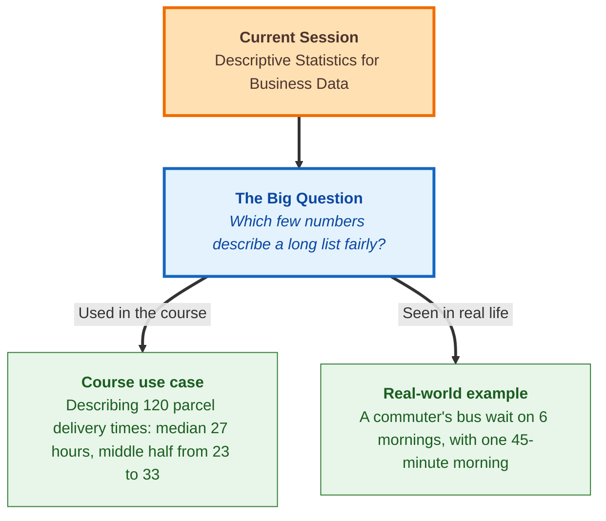

## Descriptive Statistics for Business Data

### Mental Map

---

### What You'll Learn

Have you ever wondered how one bad morning can change what a commuter says about her bus?

By the end of this session, you will be able to:

- **Identify** the wait that appears most often in a week of 6 mornings.
- **Describe** how one 45-minute morning stretches the picture to one side.
- **Interpret** how far a usual morning sits from the middle, in minutes.
- **Calculate** the total divided by 6 and the middle wait of the sorted list.
- **Determine** how far the 45-minute morning sits from the rest of the week.
- **Judge** which middle number to tell a friend about a usual morning.

> **Topics you will meet:** Mean median and mode, skew and shape, mean or median, range variance and standard deviation, quartiles and IQR, reading standard deviation, z-score, asking an AI tool to explain a statistic in plain words.
>
> Join the session to learn each of these in detail.

---

### Why You Are Learning This Topic

Kiran catches the 8:15 bus to work. She notes her wait each morning for a week.

On Friday she waited 45 minutes. At lunch she tells a friend, "My average wait is about 15 minutes."

Her friend frowns. "You wait about 10 minutes on most days." Both of them are right, and both are describing the same week.

A **statistic** means one number that describes a whole list of numbers.

In this course, you will pick the right statistic before you describe any business data.

> **Think about it:** Which of the two numbers would you tell a new neighbour?

---

### The Bus Stop Wait Puzzle

Kiran writes down her wait on each of 6 mornings.

| Morning | Wait in minutes |
|:----------:|:----------:|
| Monday | 8 |
| Tuesday | 10 |
| Wednesday | 9 |
| Thursday | 12 |
| Friday | 45 |
| Saturday | 8 |

**What you want to happen:**

- Kiran finds the wait that happens most often.
- Kiran finds the middle wait and the total divided by 6.
- Kiran says how unusual the 45-minute morning was.

> **Wonder about this:**
>
> - Which number moves more when Friday changes from 45 to 12?
> - How far from the usual morning is a wait of 45 minutes?

---

### Think It Through

There is no wrong first try. Keep your guesses for the session.

**1. Which wait on the list appears twice?**
Hint: Scan the list for a repeated number.

**2. Friday changes from 45 minutes to 12. Which moves more: the total divided by 6, or the middle wait?**
Hint: Think about which number listens to every value.

**3. Most waits sit between 8 and 12 minutes. Is a 45-minute wait close to usual or far from it?**
Hint: Compare 45 with the usual range of waits.

---

### One Question to Carry Into the Session

> **Which number tells the truth about a usual morning?**
>
> What would you add so a friend also knows about the bad Friday?
