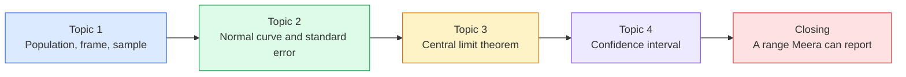
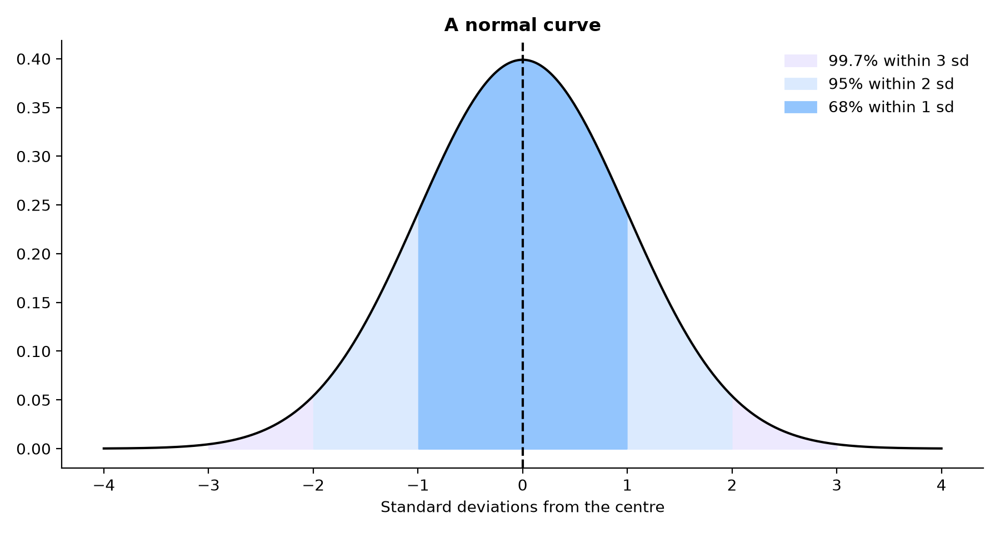
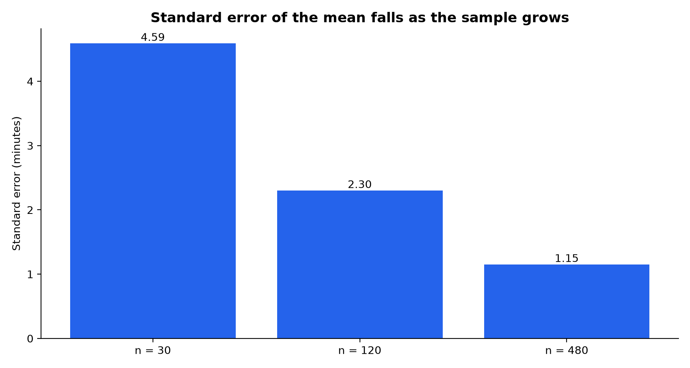
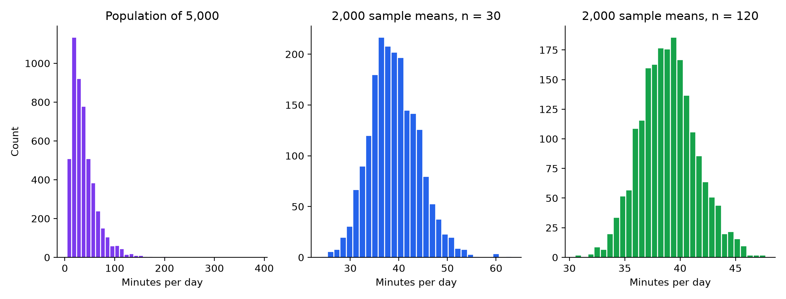
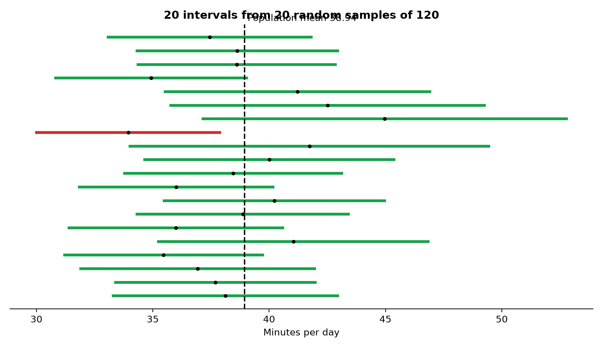

# <font color='#1d4ed8'>Lecture Script: Sampling and Confidence Intervals</font>

---

## <font color='blue'>Agenda</font>

The lecture runs as four topics. Each topic ends with a quiz.

| Topic | What we do | Learning objectives covered | Minutes |
|:-:|:--|:--|:-:|
| 1 | Name the population, the frame and the sample | Classify the population, sampling frame and sample for a stated study | 20 |
| 2 | Describe the bell curve and compute the standard error | Describe the shape, centre and spread of a normal distribution<br>Compute the standard error of a sample mean | 30 |
| 3 | See why sample means form a bell | Describe the central limit theorem and the conditions under which it holds | 25 |
| 4 | Build a confidence interval and read it | Compute a confidence interval for a population mean<br>Interpret a confidence interval in terms of repeated sampling | 30 |
| — | Closing: Outcome & Summary | | 15 |
| | **Total** | | **120** |

> <font color="red">**🎯 Instructor Note**</font> Pace: keep the classification in Topic 1 brisk. Spend the extra minutes on the standard error in Topic 2 and on reading the interval in Topic 4.
> Topic 4 includes one live request to a free chat tool to explain a confidence interval. Replies differ on every run, so learners judge the reply against the checks given.

---

## <font color='blue'>Scenario</font>

**A short story.** A JioHotstar-style streaming app has 5,000 active viewers in March 2026. The advertising team wants one number: the average minutes a viewer watches each day. Nobody can ask all 5,000 viewers, so an analyst asks 120.

> The analyst, Meera, picks 120 user IDs at random from the list of all 5,000. She reads the minutes watched for each of them. The sample mean is 39.13 minutes.
>
> The advertising head says, "So the answer is 39.13?"

> <font color="red">**🎯 Instructor Note**</font> The company is only the setting. Do not claim it uses these numbers. All values are invented for teaching: `data/viewing_minutes_sample.csv` (120 rows, user_id and minutes_per_day). The population of 5,000 was simulated with a fixed seed for the checks in Topics 2 to 4.

---

## <font color='blue'>Problem Statement</font>

Meera reports "viewers watch 39.13 minutes a day" and the advertising team books slots on that number. A week later another analyst takes a different random 120 viewers and gets 36.5 minutes. The team asks which number is right, and whether the plan should change. Meera cannot say how far her 39.13 could be from the truth for all 5,000 viewers, and she cannot say how sure she is.

> <font color='purple'>**How do we use a sample of 120 to say something about all 5,000 viewers, and how sure can we be?**</font>

> <font color="red">**🎯 Instructor Note**</font> Poll: "A 95% confidence interval for the mean is 34.5 to 43.7 minutes. Does it mean 95% of viewers watch between 34.5 and 43.7 minutes?" Give learners 30 seconds to respond in chat. Reveal the answer in the Closing.

---

## <font color='blue'>What We Will Use</font>

Google Sheets and one column of 120 viewing times. Last session you computed a mean and a standard deviation for one column. Today those two numbers describe a sample, and we use them to speak about a population. In Topic 4 we also ask a free chat tool to explain an interval.

| Topic | Tools | In one line |
|:-:|:--|:--|
| 1 | Population, sampling frame, sample | Who we care about, the list we draw from, and who we asked |
| 2 | Normal curve, `STDEV.S`, `SQRT`, `COUNT` | A bell with a centre and a spread, and the standard error of a mean |
| 3 | Sample means | Why the means of many samples form a bell |
| 4 | `AVERAGE`, standard error, interval | A range for the population mean, and how to read it |

---

## <font color='blue'>How: Walking Through Meera's Sample</font>



---

## <font color='blue'>Topic 1: Name the population, the frame and the sample</font> `20 min`

> <font color='purple'>**Meera asked 120 people. Who is she really trying to learn about?**</font>

### <font color='green'>Example: Three groups in one study</font>

> <font color='purple'>**What are the population, the sampling frame and the sample in Meera's study?**</font>

The **population** is everyone we want to learn about. The **sampling frame** is the list we pick from. The **sample** is the people we picked and measured.

| Term | In Meera's study | Size |
|:--|:--|:-:|
| Population | All active viewers in March 2026 | 5,000 |
| Sampling frame | The list of the 5,000 user IDs | 5,000 |
| Sample | The 120 viewers picked at random | 120 |

> <font color='green'>**Result**</font> The sample mean describes 120 viewers. The question is about all 5,000. The frame matches the population here, because every viewer is on the list.

### <font color='green'>Extending it: A frame that misses people</font>

> <font color='purple'>**What if Meera only used the list of viewers who clicked last week's email?**</font>

> <font color="red">**🎯 Instructor Note**</font> Ask learners to type the population, the frame and what is wrong. Expected: the population is still all 5,000, the frame is only the email clickers, and the frame leaves out viewers who never open email.

| Term | New study |
|:--|:--|
| Population | All active viewers in March 2026 |
| Sampling frame | Viewers who clicked last week's email |
| Sample | 120 picked from that list |

> <font color='green'>**Result**</font> The sample can only speak for people on the frame. A frame that leaves out part of the population can give a wrong answer, however large the sample.

> <font color='#b45309'>**Common mistake**</font> Calling the list the "population". Fix: the population is who we care about, and the frame is the list we can actually draw from.

### <font color='purple'>Quiz 1</font>

**Question:** The app has 5,000 active viewers. Meera picks 120 of them at random from the full user list. Which one is the sample?

**Options:**
- A) The 5,000 viewers
- B) The 120 viewers she picked
- C) The list of user IDs
- D) The advertising team

**Correct Answer:** B

**Explanation:**
- **A)** The 5,000 viewers are the population.
- **B)** Correct. The sample is the group that was picked and measured.
- **C)** The list of user IDs is the sampling frame.
- **D)** The advertising team uses the result. It is not data.

---

## <font color='blue'>Topic 2: Describe the bell curve and compute the standard error</font> `30 min`

> <font color='purple'>**Meera's 39.13 came from one sample. How far could it be from the truth?**</font>

### <font color='green'>Example: The normal distribution</font>

> <font color='purple'>**What does a normal curve look like, and what do its centre and spread mean?**</font>

A **normal distribution** is a bell-shaped curve. It is symmetric, with its **centre** (the mean $\mu$) in the middle and its **spread** (the standard deviation $\sigma$) setting how wide the bell is. About 68% of values lie within $\sigma$ of the centre, 95% within $2\sigma$ and 99.7% within $3\sigma$.

$$\boxed{\text{within } \mu \pm 1\sigma: 68\% \qquad \mu \pm 2\sigma: 95\% \qquad \mu \pm 3\sigma: 99.7\%}$$

**Output** (cell values, verified by recomputation in Python)

```
population: mean 38.94 | sd 28.16 | median 32.0
normal curve within 1 sd: 68.3%
normal curve within 2 sd: 95.4%
normal curve within 3 sd: 99.7%
```

<p align="center"></p>

> <font color='green'>**Result**</font> The shares are 68.3%, 95.4% and 99.7%. We reuse them as "68, 95, 99.7". The bell has a centre and a spread, and nothing else.

### <font color='green'>Example: The standard error of a sample mean</font>

> <font color='purple'>**How much does a sample mean usually move from sample to sample?**</font>

The **standard error** is the typical distance between a sample mean and the population mean. It shrinks as the sample grows.

$$\boxed{\text{SE} = \frac{s}{\sqrt{n}}}$$

**Predict before running: What will happen?**

> <font color="red">**🎯 Instructor Note**</font> Ask learners whether the standard error will be larger or smaller than the sample's standard deviation of about 25. Expected: much smaller, since it divides by $\sqrt{120} \approx 10.95$.

=AVERAGE(B2:B121)
=STDEV.S(B2:B121)
=STDEV.S(B2:B121)/SQRT(COUNT(B2:B121))

**Output** (cell values, verified by recomputation in Python)

```
n = 120
AVERAGE = 39.13
STDEV.S = 25.16
SE = s / sqrt(n) = 25.16 / 10.95 = 2.3
```

<p align="center"></p>

> <font color='green'>**Result**</font> The sample mean is 39.13 minutes, the sample standard deviation is 25.16 and the standard error is 2.30 minutes. A mean from another sample of 120 would typically land about 2.3 minutes away.

### <font color='green'>Extending it: A bigger sample</font>

> <font color='purple'>**What happens to the standard error if we ask 480 viewers, four times as many?**</font>

> <font color="red">**🎯 Instructor Note**</font> Ask for a prediction. Expected: it halves, since $\sqrt{4} = 2$. Common wrong guess: it falls to a quarter.

**Output** (cell values, verified by recomputation in Python)

```
n = 30 -> SE = 4.59
n = 120 -> SE = 2.3
n = 480 -> SE = 1.15
```

> <font color='green'>**Result**</font> At $n = 480$ the standard error is 1.15, half of 2.30. Four times the sample size cuts the standard error to half.

> <font color='#b45309'>**Common mistake**</font> Mixing up the standard deviation and the standard error. Fix: the standard deviation describes viewers, and the standard error describes a sample mean.

### <font color='purple'>Quiz 2</font>

**Question:** A sample of 120 viewers has a standard deviation of 25.16 minutes. What is the standard error of the mean?

**Options:**
- A) 2.30
- B) 0.21
- C) 275.6
- D) 25.16

**Correct Answer:** A

**Explanation:**
- **A)** Correct. $\frac{25.16}{\sqrt{120}} = \frac{25.16}{10.95} \approx 2.30$.
- **B)** 0.21 divides by 120 and forgets the square root.
- **C)** 275.6 multiplies by $\sqrt{120}$ instead of dividing.
- **D)** 25.16 is the standard deviation itself, not divided by anything.

---

## <font color='blue'>Topic 3: See why sample means form a bell</font> `25 min`

> <font color='purple'>**Viewing times are not bell-shaped. Why do we still use a bell to talk about the sample mean?**</font>

### <font color='green'>Example: Skewed viewers, bell-shaped means</font>

> <font color='purple'>**What shape do the means of many samples take, when the viewers themselves are skewed?**</font>

The **central limit theorem** says that the means of repeated random samples form an approximately normal curve when the sample is large enough, even when the population is not normal. The centre of that curve is the population mean, and its spread is the standard error.

**Predict before running: What will happen?**

> <font color="red">**🎯 Instructor Note**</font> Ask learners what shape 2,000 sample means will take for $n = 120$. Expected: a bell, centred at the population mean 38.94. The population itself has a long right tail.

**Output** (cell values, verified by recomputation in Python)

```
population: mean 38.94 | sd 28.16 | mean > median: True
n=30  2,000 sample means: centre 39.03 | spread 5.07 | sigma/sqrt(n) 5.14
n=120 2,000 sample means: centre 38.9 | spread 2.56 | sigma/sqrt(n) 2.57
n=120 share of means within 2 SE of 38.94: 95.4 %
```

<p align="center"></p>

> <font color='green'>**Result**</font> The population is skewed. The sample means for $n = 30$ and $n = 120$ are bell-shaped, centred at about 39 minutes. Their spreads, 5.1 and 2.6, match $\frac{\sigma}{\sqrt{n}}$.

### <font color='green'>Extending it: When the theorem holds</font>

> <font color='purple'>**What conditions must hold before we trust the bell?**</font>

> <font color="red">**🎯 Instructor Note**</font> Read the three conditions and ask learners to type one way each could fail. Expected: not random (only email clickers), not independent (family members sharing an account), n too small for a heavily skewed population.

| Condition | What it means | A way it fails |
|:--|:--|:--|
| Random sample | Every member of the frame has a fair chance | Picking the first 120 users in the list |
| Independent values | One viewer's time does not decide another's | Several users sharing one account |
| Large enough $n$ | A common guide is 30 or more. A very skewed population needs more | A sample of 5 from a skewed population |

> <font color='green'>**Result**</font> The theorem is a promise about random samples. A convenient or tiny sample does not earn it.

> <font color='#b45309'>**Common mistake**</font> Saying "the data become normal when $n$ is large". Fix: the data stay skewed. It is the distribution of the sample mean that becomes bell-shaped.

### <font color='purple'>Quiz 3</font>

**Question:** Which statement about the central limit theorem is correct?

**Options:**
- A) The population must be perfectly normal
- B) Larger samples make the population itself normal
- C) It works for any sample, however small or biased
- D) Means of random samples are approximately normal when the sample is large enough

**Correct Answer:** D

**Explanation:**
- **A)** The population can be skewed. The theorem is useful because it need not be normal.
- **B)** The population does not change. The distribution of sample means does.
- **C)** A random sample is a condition, and a very small sample may not be enough.
- **D)** Correct. This is the theorem, with its conditions of random, independent values.

---

## <font color='blue'>Topic 4: Build a confidence interval and read it</font> `30 min`

> <font color='purple'>**We know the sample mean moves by about 2.3 minutes. What range should Meera report for all viewers?**</font>

### <font color='green'>Example: A 95% confidence interval</font>

> <font color='purple'>**What is the interval for the population mean?**</font>

With the standard error in cell C2, a **confidence interval** is a range built around the sample mean. For 95% confidence the margin is about two standard errors either side, because 95% of a bell lies within two spreads of its centre.

$$\boxed{\bar{x} \pm 2 \times \text{SE}} \qquad 39.13 \pm 2 \times 2.30$$

=AVERAGE(B2:B121)-2*C2
=AVERAGE(B2:B121)+2*C2

**Output** (cell values, verified by recomputation in Python)

```
margin = 2 x 2.3 = 4.59
95% interval: 34.54 to 43.73
simulated population mean 38.94 is inside: True
```

> <font color='green'>**Result**</font> The 95% confidence interval is 34.54 to 43.73 minutes. The simulated population mean, 38.94, sits inside it. In real life we never know that number, so the interval is our best statement. (A more exact multiplier is 1.96, which gives a slightly narrower interval.)

### <font color='green'>Extending it: Read it as repeated sampling</font>

> <font color='purple'>**What does "95% confident" mean?**</font>

**Predict before running: What will happen?**

> <font color="red">**🎯 Instructor Note**</font> Ask what share of 2,000 intervals will contain 38.94. Expected: close to 95%. Common wrong guess: this one interval has a 95% chance of containing it.

**Output** (cell values, verified by recomputation in Python)

```
intervals built: 2000 | contain the population mean: 1871 = 93.6 %
```

<p align="center"></p>

> <font color='green'>**Result**</font> 1,871 of 2,000 intervals, 93.6%, contain the population mean. That is close to 95%, and the small gap comes from the skewed population. The 95% belongs to the method over repeated sampling. It is not the chance for one interval after it has been built.

| Statement | Correct? |
|:--|:-:|
| "In repeated sampling, about 95% of such intervals contain the population mean" | Yes |
| "95% of viewers watch between 34.54 and 43.73 minutes" | No. That is about individual viewers |
| "The sample mean is 95% accurate" | No. Accuracy is not a percentage here |

### <font color='green'>Extending it: Ask an AI tool to explain it, live</font>

> <font color='purple'>**Can a chat tool explain our interval in plain words?**</font>

> <font color="red">**🎯 Instructor Note**</font> Mentor: in ChatGPT, Claude or Gemini, run the prompt below. Learners tick the table. Replies differ on every run, so do not predict wording.

Prompt: "A sample of 120 viewers gives a mean of 39.13 minutes a day and a 95% confidence interval of 34.54 to 43.73. Explain what the interval means in two plain sentences for an advertising manager."

| Check on the reply | Yes or No |
|:--|:-:|
| Does it talk about the population mean, not individual viewers? | |
| Does it link the 95% to repeated samples? | |
| Does it avoid "95% chance the true mean is in this interval"? | |

> <font color='green'>**Result**</font> Learners compare the reply with the checks. A reply that says "95% of viewers" is describing individuals and is wrong for an interval of the mean.

> <font color='#b45309'>**Common mistake**</font> Reporting the interval as the range of individual viewers. Fix: the interval is for the population mean. Individual viewers vary far more.

### <font color='purple'>Quiz 4</font>

**Question:** What does a 95% confidence interval mean in terms of repeated sampling?

**Options:**
- A) There is a 95% chance that this one interval contains the true mean
- B) 95% of viewers watch within the interval
- C) If we repeated the sampling many times, about 95% of such intervals would contain the true mean
- D) The sample mean is 95% accurate

**Correct Answer:** C

**Explanation:**
- **A)** Once the interval is built, the true mean is inside it or not. The 95% describes the method.
- **B)** The interval is for the mean, not for individual viewers.
- **C)** Correct. The 95% is the long-run share of intervals that capture the true mean.
- **D)** Accuracy is not measured as a percentage in this way.

---

## <font color='blue'>Closing: Outcome & Summary</font> `15 min`

Back to Meera. We answer the Problem Statement using each topic once.

> <font color='purple'>**1. Who is the study about? (Topic 1)**</font>

The population is the 5,000 active viewers. The frame is the full user list, and the sample is the 120 picked at random.

> <font color='purple'>**2. How far can a sample mean move? (Topic 2)**</font>

The standard error is $\frac{25.16}{\sqrt{120}} \approx 2.30$ minutes. A bell has a centre and a spread.

> <font color='purple'>**3. Why can we use the bell? (Topic 3)**</font>

By the central limit theorem, means of random samples are approximately normal, even for skewed viewing times.

> <font color='purple'>**4. What range does she report? (Topic 4)**</font>

The 95% confidence interval is 34.54 to 43.73 minutes. About 95% of intervals built this way capture the true mean.

### <font color='green'>Outcome</font>

| | Meera's first report | Meera's final report |
|:--|:-:|:-:|
| Statement | "Viewers watch 39.13 minutes" | "Viewers watch about 39 minutes, between 34.5 and 43.7 with 95% confidence" |
| Sample size and frame | Not stated | 120 random viewers from the full list |
| Uncertainty | Not stated | Standard error 2.30 minutes |
| Second sample of 36.5 | Looks like a contradiction | Falls inside the interval |

> <font color='green'>**Therefore,**</font> A sample mean is one draw from a bell-shaped spread of possible means. Meera reports the interval, 34.54 to 43.73 minutes, and the advertising team can see that 36.5 from another sample is not a conflict.

> <font color="red">**🎯 Instructor Note**</font> Reveal the poll: no. The interval is for the population mean. Individual viewers vary far more than the mean does.

### <font color='green'>Summary</font>

| Learning objective | Takeaway |
|:--|:--|
| Population, frame, sample | Who we care about, the list we draw from, and who we measured |
| Normal distribution | Bell-shaped, with a centre $\mu$ and a spread $\sigma$ |
| Standard error | $\frac{s}{\sqrt{n}}$. It falls as the sample grows |
| Central limit theorem | Means of random, independent samples of enough size are approximately normal |
| Confidence interval | Sample mean plus or minus about two standard errors |
| Interpretation | About 95% of such intervals, over repeated samples, contain the true mean |
| **Practical value** | Report a sample result with its range, and say who the sample can speak for |

---

# <font color='red'>Launch the Feedback Poll</font>

> <font color="red">**🎯 Instructor Note**</font> Reminder: launch the feedback poll now to collect learner feedback.

