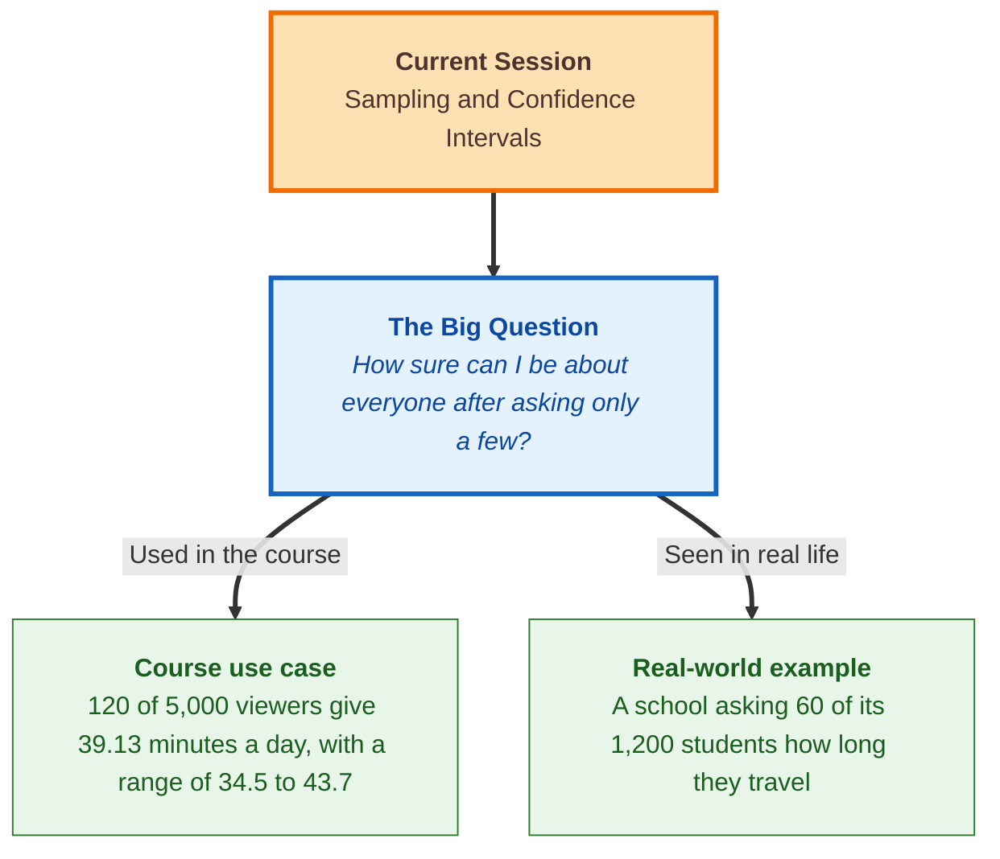

## Sampling and Confidence Intervals

### Mental Map

---

### What You'll Learn

Have you ever wondered how a school can learn about 1,200 students by asking only 60?

By the end of this session, you will be able to:

- **Classify** the 1,200 students, the class list and the 60 students who were asked.
- **Describe** a bell shape by its centre and its spread.
- **Summarise** why the averages of repeated surveys settle into that bell.
- **Calculate** how far one survey average is likely to sit from the truth.
- **Determine** a range of travel times that likely holds the school's true average.
- **Judge** which sentence about "95% sure" is right.

> **Topics you will meet:** Population frame and sample, the normal distribution, standard error, central limit theorem, confidence interval for a mean, reading a confidence interval, asking an AI tool to explain a confidence interval in plain words.
>
> Join the session to learn each of these in detail.

---

### Why You Are Learning This Topic

Mrs. Iyer, the principal, wants to set new school bus timings. She needs the average time students travel to school.

Her clerk, Mr. Nair, asks 60 students and gets 25 minutes. Mrs. Iyer asks, "Is it exactly 25 for all 1,200 students?"

Mr. Nair has no answer. A second clerk asks another 60 students and gets 27 minutes.

A **sample** means the small group you ask or measure to learn about a larger group.

In this course, you will report sample results with a range, so readers know how far to trust them.

> **Think about it:** Do 25 and 27 disagree, or do they say the same thing?

---

### The School Travel Survey Puzzle

Mr. Nair writes down what he knows.

| Fact | Value |
|:----------:|:----------:|
| Students in the school | 1,200 |
| Students asked | 60 |
| Average travel time of the 60 | 25 minutes |
| Spread of the 60 times | 12 minutes |

**What you want to happen:**

- Mr. Nair says who the 60 students stand for.
- Mr. Nair gives a range, not one number.
- Mrs. Iyer knows how much to trust that range.

> **Wonder about this:**
>
> - Would 240 students give a steadier answer than 60?
> - What would a range of 22 to 28 minutes tell Mrs. Iyer?

---

### Think It Through

There is no wrong first try. Keep your guesses for the session.

**1. The 60 students are the first ones through the gate. Do they stand for all 1,200?**
Hint: Think about who arrives first.

**2. Another group of 60 gives 27 minutes. Does that make 25 wrong?**
Hint: Think about picking different students each time.

**3. Mr. Nair asks 240 students instead of 60. Will his average be steadier?**
Hint: Think about how a larger group evens out odd answers.

---

### One Question to Carry Into the Session

> **How do you say something about everyone after asking only a few?**
>
> What would you add to "25 minutes" so Mrs. Iyer knows how far to trust it?
