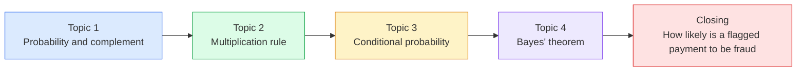
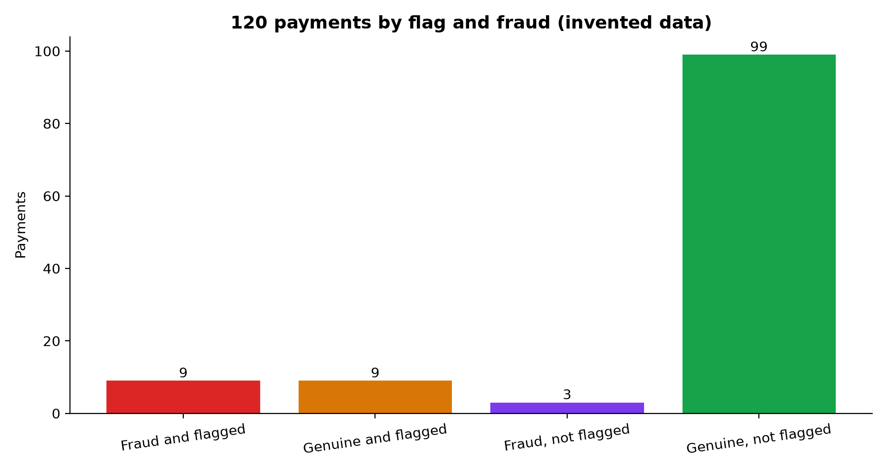
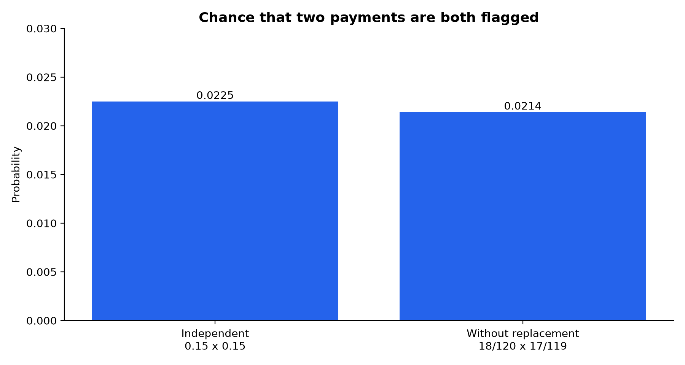
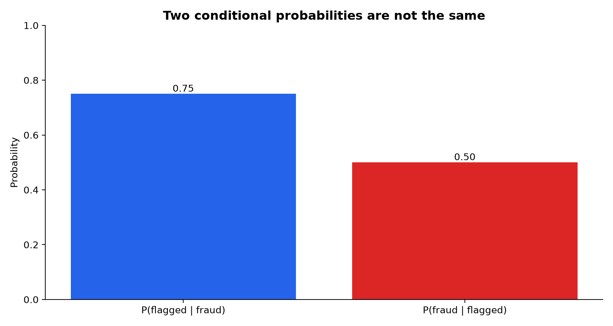
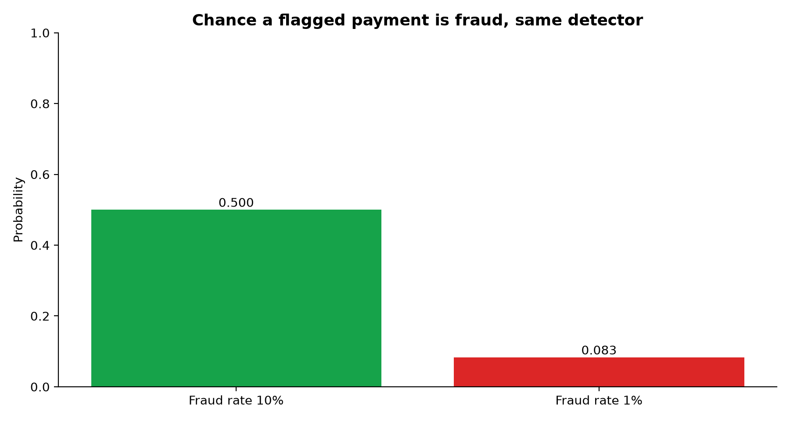

# <font color='#1d4ed8'>Lecture Script: Probability and Bayes Theorem</font>

---

## <font color='blue'>Agenda</font>

The lecture runs as four topics. Each topic ends with a quiz.

| Topic | What we do | Learning objectives covered | Minutes |
|:-:|:--|:--|:-:|
| 1 | Turn counts into a probability and its complement | Compute the probability of an event and of its complement | 25 |
| 2 | Multiply probabilities for two events | Apply the multiplication rule to independent and dependent events | 30 |
| 3 | Read a probability from a two-way table | Compute a conditional probability from a two-way table | 30 |
| 4 | Update a probability after an alert | Apply Bayes' theorem to update a probability given a test result | 20 |
| — | Closing: Outcome & Summary | | 15 |
| | **Total** | | **120** |

> <font color="red">**🎯 Instructor Note**</font> Pace: keep the complement in Topic 1 brisk. Spend the extra minutes on the dependent case in Topic 2 and on the "flipped" conditional probability in Topic 3, since Topic 4 depends on it.
> Learners use Google Sheets. Cell values shown here are verified by recomputation in Python from the same CSV.

---

## <font color='blue'>Scenario</font>

**One alert, two readings.** A PhonePe-style UPI app has a fraud detector. The detector flags a payment and the manager reads the flag in a hurry.

| | What the detector says | What the manager hears |
|:--|:--|:--|
| The fact | "I flag 75% of real frauds" | "A flagged payment is 75% likely to be fraud" |
| The risk | Some genuine payments are also flagged | Genuine customers are blocked |

> <font color="red">**🎯 Instructor Note**</font> The company is only the setting. Do not claim it uses these numbers. The 120 payments are invented for teaching: `data/upi_alerts_sample.csv` with columns txn_id, amount_rs, flagged and fraud. Real fraud rates are far lower, so treat 10% as a teaching number.

---

## <font color='blue'>Problem Statement</font>

Neha manages payment safety. A detector flags a payment, and she knows it flags 75% of real frauds. She freezes the customer's account at once. The customer is a genuine shopkeeper who is locked out for two days. When Neha checks the sample, half of the flagged payments were genuine, and she cannot explain why a detector that catches 75% of fraud is wrong so often.

> <font color='purple'>**If a payment is flagged, how likely is it to be fraud, and why is that different from "the detector catches 75% of fraud"?**</font>

> <font color="red">**🎯 Instructor Note**</font> Poll: "The detector flags 75% of frauds. A payment is flagged. Is it 75% likely to be fraud?" Give learners 30 seconds to respond in chat. Reveal the answer in the Closing.

---

## <font color='blue'>What We Will Use</font>

Google Sheets and one CSV of 120 payments. Last session you used `COUNTIFS` with several criteria. Today we use it to count the cells of a two-way table.

| Term | Meaning | In our data |
|:--|:--|:--|
| **Event** | Something that may or may not happen | A payment is flagged: $F$. A payment is fraud: $D$ |
| **Probability** $P(A)$ | Cases where $A$ happens divided by all cases | $P(F) = \frac{18}{120}$ |
| **Complement** $A^c$ | $A$ does not happen | A payment is not flagged |
| **Independent** | One event does not change the chance of the other | Two payments from different customers |
| **Conditional** $P(A \mid B)$ | Chance of $A$ once we know $B$ happened | Chance of fraud, given a flag |

$$\boxed{P(A) = \frac{n(A)}{n(S)}} \qquad P(A^c) = 1 - P(A)$$

$$P(A \cap B) = P(A)\,P(B) \ \text{(independent)} \qquad P(A \cap B) = P(A)\,P(B \mid A) \ \text{(dependent)}$$

$$P(A \mid B) = \frac{P(A \cap B)}{P(B)} \qquad \boxed{P(D \mid F) = \frac{P(F \mid D)\,P(D)}{P(F \mid D)\,P(D) + P(F \mid D^c)\,P(D^c)}}$$

---

## <font color='blue'>How: Walking Through the Flagged Payment</font>



---

## <font color='blue'>Topic 1: Turn counts into a probability and its complement</font> `25 min`

> <font color='purple'>**Before Neha reads a flag, how often is a payment flagged at all?**</font>

### <font color='green'>Example: The probability of a flag</font>

> <font color='purple'>**What share of the 120 payments are flagged, and what share are not?**</font>

When every payment is equally likely to be picked, the probability of an event is the number of payments where it happens divided by all payments.

$$\boxed{P(F) = \frac{n(F)}{n(S)}} \qquad P(F^c) = 1 - P(F)$$

**Predict before running: What will happen?**

> <font color="red">**🎯 Instructor Note**</font> Ask learners to guess the share flagged. Expected: 18 flags in 120 payments, which is 0.15. Common wrong guess: 0.75, mixing it up with the detector's catch rate.

=COUNTIF(C2:C121,"Yes")/COUNTA(C2:C121)
=1-COUNTIF(C2:C121,"Yes")/COUNTA(C2:C121)

**Output** (cell values, verified by recomputation in Python)

```
n(F) = 18 of 120 | P(F) = 0.15 | P(not F) = 0.85
n(D) = 12 | P(D) = 0.1 | P(not D) = 0.9
```

#### <font color='#c2410c'>Logic Explanation</font>

- **Line 1** `COUNTIF` counts the "Yes" cells in the flagged column. `COUNTA` counts all filled cells. Dividing gives $\frac{18}{120}$.
- **Line 2** The same share, taken away from 1, gives the complement.

> <font color='green'>**Result**</font> $P(F) = \frac{18}{120} = 0.15$, so $P(F^c) = 0.85$. The fraud rate is $P(D) = \frac{12}{120} = 0.10$ and its complement is $0.90$.

<p align="center"></p>

### <font color='green'>Extending it: Check that the two add to 1</font>

> <font color='purple'>**Why is the complement a quick check?**</font>

> <font color="red">**🎯 Instructor Note**</font> Ask learners to add $0.15 + 0.85$ and $0.10 + 0.90$. Expected: both give 1. An event and its complement cover every payment exactly once.

$$P(F) + P(F^c) = 0.15 + 0.85 = 1 \qquad P(D) + P(D^c) = 0.10 + 0.90 = 1$$

> <font color='green'>**Result**</font> If a probability and its complement do not add to 1, a count is wrong. The complement is also the easy route to "not flagged".

> <font color='#b45309'>**Common mistake**</font> Dividing by the number of "Yes" cells instead of all 120 payments. Fix: the denominator is always the full set you picked from.

### <font color='purple'>Quiz 1</font>

**Question:** 18 of 120 payments are flagged. What is the probability that a random payment is not flagged?

**Options:**
- A) 0.85
- B) 0.15
- C) 0.18
- D) 0.75

**Correct Answer:** A

**Explanation:**
- **A)** Correct. $1 - \frac{18}{120} = 1 - 0.15 = 0.85$.
- **B)** 0.15 is the probability that a payment is flagged.
- **C)** 0.18 divides 18 by 100, not by the 120 payments.
- **D)** 0.75 is the detector's catch rate for fraud, a different quantity.

---

## <font color='blue'>Topic 2: Multiply probabilities for two events</font> `30 min`

> <font color='purple'>**What is the chance that two payments are both flagged?**</font>

### <font color='green'>Example: Two independent payments</font>

> <font color='purple'>**If the two payments come from different customers, what is the chance both are flagged?**</font>

Two events are **independent** when one does not change the chance of the other. For independent events we multiply.

$$\boxed{P(A \cap B) = P(A)\,P(B)}$$

=(COUNTIF(C2:C121,"Yes")/COUNTA(C2:C121))^2

**Output** (cell values, verified by recomputation in Python)

```
P(both flagged), independent = 0.0225
```

> <font color='green'>**Result**</font> $0.15 \times 0.15 = 0.0225$. About 2.3 pairs in 100 would both be flagged.

### <font color='green'>Extending it: Two payments drawn from this file</font>

> <font color='purple'>**What if we pick two payments from the 120 and do not put the first back?**</font>

Now the events are **dependent**: the first pick changes what is left. After one flagged payment is taken, 17 flagged payments remain among 119.

$$\boxed{P(A \cap B) = P(A)\,P(B \mid A)} \qquad \frac{18}{120} \times \frac{17}{119}$$

**Predict before running: What will happen?**

> <font color="red">**🎯 Instructor Note**</font> Ask learners whether the answer is bigger or smaller than 0.0225. Expected: smaller, because one flagged payment has already been used up.

=(18/120)*(17/119)

**Output** (cell values, verified by recomputation in Python)

```
dependent, without putting back = 0.02143
independent = 0.0225
```

<p align="center"></p>

> <font color='green'>**Result**</font> $\frac{18}{120} \times \frac{17}{119} \approx 0.0214$, a little smaller than 0.0225. With a small file the difference shows. With millions of payments it would vanish.

### <font color='green'>Extending it: Flagged and fraud together</font>

> <font color='purple'>**What is the chance that one payment is both fraud and flagged?**</font>

> <font color="red">**🎯 Instructor Note**</font> Fraud makes a flag more likely, so the events are dependent. Ask learners what the wrong independent product gives. Expected: $0.10 \times 0.15 = 0.015$, five times too small.

=(COUNTIF(D2:D121,"Yes")/COUNTA(D2:D121))*(9/12)

**Output** (cell values, verified by recomputation in Python)

```
P(D) * P(F | D) = 0.075 | direct count 9/120 = 0.075
wrong, treating as independent: P(D)*P(F) = 0.015
```

> <font color='green'>**Result**</font> $P(D \cap F) = 0.10 \times 0.75 = 0.075$, which matches $\frac{9}{120}$ counted directly. The independent product 0.015 is wrong because fraud and flags go together.

> <font color='#b45309'>**Common mistake**</font> Multiplying two probabilities without asking whether the events are independent. Fix: ask whether knowing the first changes the second.

### <font color='purple'>Quiz 2</font>

**Question:** Two payments come from unrelated customers. Each has a 0.15 chance of being flagged. What is the chance that both are flagged?

**Options:**
- A) 0.30
- B) 0.15
- C) 0.0225
- D) 0.0214

**Correct Answer:** C

**Explanation:**
- **A)** 0.30 adds the probabilities. For "both" of independent events we multiply.
- **B)** 0.15 is the chance for one payment.
- **C)** Correct. $0.15 \times 0.15 = 0.0225$.
- **D)** 0.0214 is the value when two payments are drawn from the file without putting the first back.

---

## <font color='blue'>Topic 3: Read a probability from a two-way table</font> `30 min`

> <font color='purple'>**Neha cares about one group only: the flagged payments. What is the chance of fraud inside that group?**</font>

### <font color='green'>Example: Build the two-way table</font>

> <font color='purple'>**How many payments fall in each of the four cells of flagged and fraud?**</font>

A **two-way table** counts payments by two yes or no facts at once. Use `COUNTIFS` for each cell, as in the last session.

=COUNTIFS($C$2:$C$121,"Yes",$D$2:$D$121,"Yes")
=COUNTIFS($C$2:$C$121,"Yes",$D$2:$D$121,"No")

**Output** (cell values, verified by recomputation in Python)

```
fraud            Yes   No  All
flagged \ fraud               
Yes                9    9   18
No                 3   99  102
All               12  108  120
```

> <font color='green'>**Result**</font>

| | Fraud: Yes | Fraud: No | Total |
|:--|:-:|:-:|:-:|
| **Flagged: Yes** | 9 | 9 | 18 |
| **Flagged: No** | 3 | 99 | 102 |
| **Total** | 12 | 108 | 120 |

### <font color='green'>Example: Conditional probability</font>

> <font color='purple'>**Given that a payment is flagged, what is the chance it is fraud?**</font>

**Conditional probability** is the chance of one event once we know the other happened. We restrict the table to the row that is known, then divide.

$$\boxed{P(D \mid F) = \frac{n(D \cap F)}{n(F)} = \frac{9}{18}}$$

=COUNTIFS(C2:C121,"Yes",D2:D121,"Yes")/COUNTIF(C2:C121,"Yes")

**Output** (cell values, verified by recomputation in Python)

```
P(D | F) = 0.5 | P(F | D) = 0.75
P(D | not F) = 0.0294
```

<p align="center"></p>

> <font color='green'>**Result**</font> $P(D \mid F) = \frac{9}{18} = 0.50$. The flipped question gives $P(F \mid D) = \frac{9}{12} = 0.75$, the detector's catch rate. They are different numbers because they divide by different totals.

> <font color='#b45309'>**Common mistake**</font> Reading $P(D \mid F)$ as if it were $P(F \mid D)$. Fix: the condition is the group you divide by.

### <font color='green'>Extending it: Fraud among the not-flagged</font>

> <font color='purple'>**What is the chance of fraud among payments that were not flagged?**</font>

> <font color="red">**🎯 Instructor Note**</font> Ask for a prediction. Expected: small. 3 frauds hide among 102 unflagged payments.

$$P(D \mid F^c) = \frac{3}{102} \approx 0.029$$

> <font color='green'>**Result**</font> About 2.9% of unflagged payments are fraud, against 50% of flagged ones. The flag does carry information.

### <font color='purple'>Quiz 3</font>

**Question:** Use the table: 9 payments are fraud and flagged, 12 are fraud, and 18 are flagged. What is $P(D \mid F)$, the chance of fraud given a flag?

**Options:**
- A) 0.75
- B) 0.50
- C) 0.075
- D) 0.10

**Correct Answer:** B

**Explanation:**
- **A)** 0.75 is $\frac{9}{12}$, which divides by the frauds. That is $P(F \mid D)$.
- **B)** Correct. $\frac{9}{18} = 0.50$ divides by the flagged payments.
- **C)** 0.075 is $\frac{9}{120}$, the chance of fraud and flagged together.
- **D)** 0.10 is $\frac{12}{120}$, the overall fraud rate.

---

## <font color='blue'>Topic 4: Update a probability after an alert</font> `20 min`

> <font color='purple'>**Neha does not always have the full table. Can she get 0.50 from the detector's catch rate alone?**</font>

### <font color='green'>Example: Bayes' theorem</font>

> <font color='purple'>**Given the catch rate, the false-flag rate and the fraud rate, what is $P(D \mid F)$?**</font>

**Bayes' theorem** updates the fraud rate after a flag. We start from three inputs: the base rate $P(D) = 0.10$, the catch rate $P(F \mid D) = 0.75$ and the false-flag rate $P(F \mid D^c) = \frac{9}{108} \approx 0.0833$.

$$\boxed{P(D \mid F) = \frac{P(F \mid D)\,P(D)}{P(F \mid D)\,P(D) + P(F \mid D^c)\,P(D^c)}}$$

$$P(D \mid F) = \frac{0.75 \times 0.10}{0.75 \times 0.10 + 0.0833 \times 0.90} = \frac{0.075}{0.075 + 0.075} = 0.50$$

**Output** (cell values, verified by recomputation in Python)

```
numerator 0.075 | denominator 0.15 | P(D | F) = 0.5
```

> <font color='green'>**Result**</font> Bayes gives 0.50, the same answer as the table. The denominator $0.15$ is $P(F)$, the share of all payments that are flagged.

### <font color='green'>Extending it: Lower the fraud rate</font>

> <font color='purple'>**What if only 1% of payments were fraud, with the same detector?**</font>

**Predict before running: What will happen?**

> <font color="red">**🎯 Instructor Note**</font> Ask learners to guess a flagged payment's chance of fraud. Common wrong guess: still near 0.75 or 0.50. Expected: far lower, about 0.083.

=(0.75*0.01)/(0.75*0.01+(9/108)*0.99)

**Output** (cell values, verified by recomputation in Python)

```
base rate 0.10 -> 0.5
base rate 0.01 -> 0.0833
```

<p align="center"></p>

> <font color='green'>**Result**</font> With 1% fraud, a flagged payment is fraud only about 8.3% of the time. The same detector, a rarer event, a much lower answer.

> <font color='#b45309'>**Common mistake**</font> Ignoring the base rate and answering with the catch rate. Fix: always start with how common fraud is.

### <font color='purple'>Quiz 4</font>

**Question:** The detector catches 75% of frauds and falsely flags about 8.3% of genuine payments. Fraud is 10% of payments. What is the chance that a flagged payment is fraud?

**Options:**
- A) 0.75
- B) 0.083
- C) 0.10
- D) 0.50

**Correct Answer:** D

**Explanation:**
- **A)** 0.75 is the catch rate, $P(F \mid D)$, not $P(D \mid F)$.
- **B)** 0.083 is the false-flag rate for genuine payments.
- **C)** 0.10 is the starting fraud rate before any flag is known.
- **D)** Correct. $\frac{0.075}{0.075 + 0.075} = 0.50$.

---

## <font color='blue'>Closing: Outcome & Summary</font> `15 min`

Back to Neha. We answer the Problem Statement using each topic once.

> <font color='purple'>**1. How often is a payment flagged? (Topic 1)**</font>

$P(F) = \frac{18}{120} = 0.15$, so $P(F^c) = 0.85$. Fraud is $P(D) = 0.10$.

> <font color='purple'>**2. How do the events combine? (Topic 2)**</font>

Fraud and flags are dependent: $P(D \cap F) = 0.10 \times 0.75 = 0.075$. Multiplying as if independent gives 0.015.

> <font color='purple'>**3. What is the chance of fraud, given a flag? (Topic 3)**</font>

$P(D \mid F) = \frac{9}{18} = 0.50$. The catch rate $P(F \mid D) = 0.75$ is a different number.

> <font color='purple'>**4. Does the answer hold from the rates alone? (Topic 4)**</font>

Yes, Bayes gives the same 0.50. With 1% fraud the same flag means only 0.083.

### <font color='green'>Outcome</font>

| | What Neha believed | What the data says |
|:--|:-:|:-:|
| Chance a flagged payment is fraud | 0.75 | 0.50 |
| What 0.75 really measures | "Flagged given fraud" | $P(F \mid D)$, the catch rate |
| If fraud were only 1% of payments | 0.75 | 0.083 |

> <font color='green'>**Therefore,**</font> A flagged payment is fraud with probability 0.50, not 0.75. The catch rate and the chance of fraud given a flag are different questions. Neha should check the flagged account before freezing it, and the check matters more when fraud is rare.

> <font color="red">**🎯 Instructor Note**</font> Reveal the poll: no. A 75% catch rate means 75% of frauds are flagged. Here only 50% of flagged payments are fraud.

### <font color='green'>Summary</font>

| Learning objective | Takeaway |
|:--|:--|
| Probability and complement | $P(A) = \frac{n(A)}{n(S)}$ and $P(A^c) = 1 - P(A)$ |
| Multiplication rule | Multiply for independent events. Use $P(A)\,P(B \mid A)$ for dependent ones |
| Conditional probability | Restrict to the known group, then divide by that group's total |
| Bayes' theorem | Update the base rate with the catch rate and the false-flag rate |
| **Practical value** | Before acting on an alert or a test, ask how common the event is and what the alert is conditioned on |

---

# <font color='red'>Launch the Feedback Poll</font>

> <font color="red">**🎯 Instructor Note**</font> Reminder: launch the feedback poll now to collect learner feedback.

