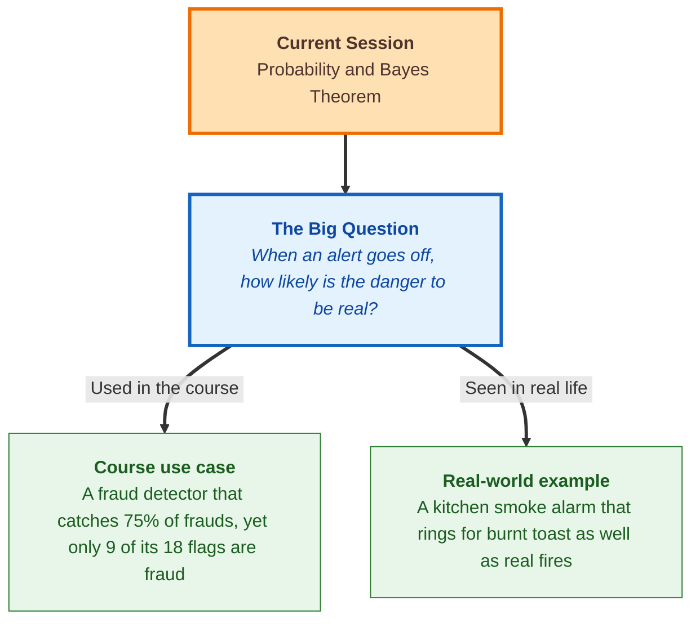

## Probability and Bayes Theorem

### Mental Map

---

### What You'll Learn

Have you ever wondered why you roll your eyes when the smoke alarm rings during breakfast?

By the end of this session, you will be able to:

- **Explain** why "the alarm rings for most fires" differs from "most rings are fires".
- **Calculate** the chance that the alarm rings on a random day, and the chance it stays silent.
- **Estimate** the chance that the alarm rings two days in a row.
- **Determine** the chance of a real fire when the alarm rings, using a table of 100 days.
- **Judge** whether to leave the house when fires become 10 times rarer.

> **Topics you will meet:** Probability and complement, multiplication rule, conditional probability from a count table, Bayes' theorem.
>
> Join the session to learn each of these in detail.

---

### Why You Are Learning This Topic

Anaya has a smoke alarm in her kitchen. Last year it rang for 2 of the 3 real fires.

It also rang on 8 mornings of burnt toast. When it rings today, Anaya grabs her bag and runs.

Her brother laughs. "The alarm catches most fires, but most of its rings are toast."

A **probability** means a number from 0 to 1 that says how likely something is.

In this course, you will turn counts into probabilities before you trust any alert or test.

> **Think about it:** Is Anaya's brother right that a ring usually means toast?

---

### The Kitchen Alarm Puzzle

Anaya keeps a note of 100 mornings.

| Type of morning | Number of mornings |
|:----------:|:----------:|
| Alarm rang, real fire | 2 |
| Alarm rang, burnt toast only | 8 |
| Alarm silent, real fire | 1 |
| Alarm silent, nothing happened | 89 |

**What you want to happen:**

- Anaya finds how often the alarm rings.
- Anaya finds how likely a fire is once it rings.
- Anaya sees what changes if fires become rarer.

> **Wonder about this:**
>
> - Which total do you divide by to find the chance of fire after a ring?
> - Would a ring mean more or less danger if toast burned twice as often?

---

### Think It Through

There is no wrong first try. Keep your guesses for the session.

**1. The alarm rang on 10 of the 100 mornings. What is the chance it stays silent on a random morning?**
Hint: The two chances add up to 1.

**2. The alarm rings on 2 of the 3 fire mornings. Is that the same as 2 of the 10 ringing mornings being fires?**
Hint: Look at the number you divide by.

**3. Fires become 10 times rarer and toast stays the same. Does a ring now mean fire more often or less often?**
Hint: Think about the number of toast mornings that remain.

---

### One Question to Carry Into the Session

> **What do you divide by when an alert has already gone off?**
>
> Would you run out of the kitchen every time the alarm rings? Why?
