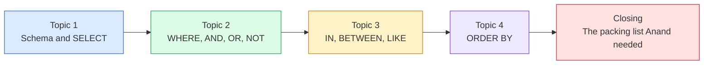
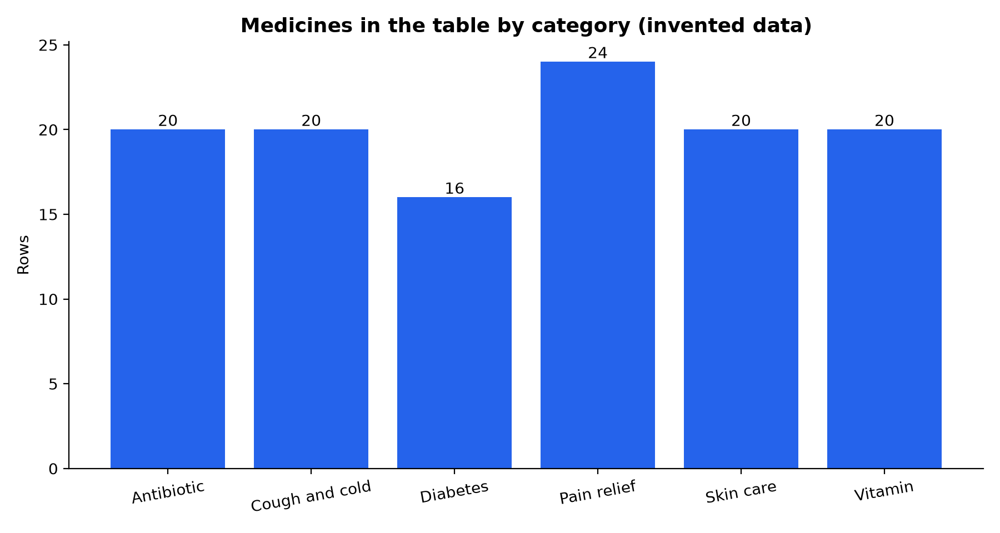
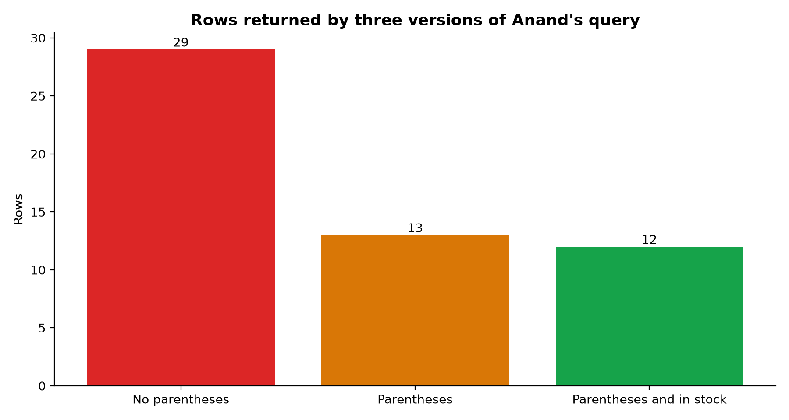
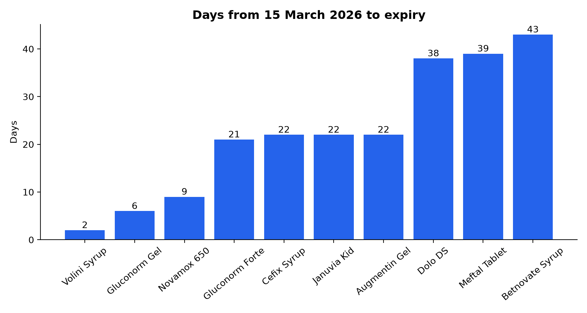
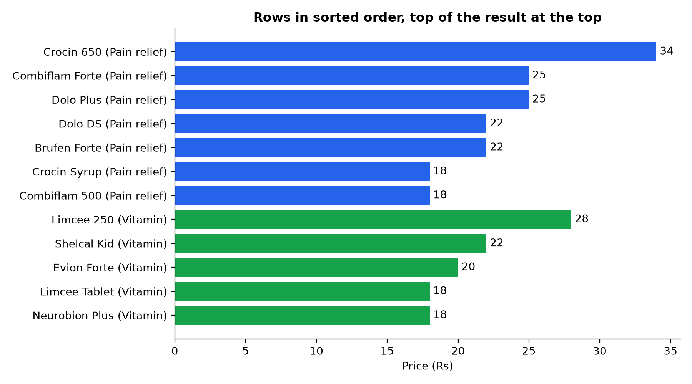

# <font color='#1d4ed8'>Lecture Script: Relational Databases and SELECT Queries</font>

---

## <font color='blue'>Agenda</font>

The lecture runs as four topics. Each topic ends with a quiz.

| Topic | What we do | Learning objectives covered | Minutes |
|:-:|:--|:--|:-:|
| 1 | Look inside a table and pick columns | Describe how a relational database stores data as tables, rows and a defined schema<br>Write a SELECT query returning named columns from a single table | 25 |
| 2 | Filter rows with conditions | Filter rows using comparison operators in a WHERE clause<br>Construct a multi-condition WHERE clause using AND, OR, NOT and parentheses | 30 |
| 3 | Match lists, ranges and patterns | Filter rows using IN, BETWEEN and LIKE pattern matching | 25 |
| 4 | Sort the answer | Write a query that sorts results on multiple columns with mixed ASC and DESC | 25 |
| — | Closing: Outcome & Summary | | 15 |
| | **Total** | | **120** |

> <font color="red">**🎯 Instructor Note**</font> Pace: keep the table-and-schema tour in Topic 1 brisk. Spend the extra minutes on AND, OR and parentheses in Topic 2.
> Learners use DB Browser for SQLite (SQLite 3.39 or later). Outputs below are copied from a real SQLite run on `data/medicines.sql`.

---

## <font color='blue'>Scenario</font>

**A table at a glance.** A PharmEasy-style online pharmacy keeps every medicine as one row in a table called `medicines`. Here are the first three rows of 120.

| medicine_id | brand_name | category | manufacturer | price_rs | stock_qty | expiry_date | prescription_required |
|:-:|:--|:--|:--|:-:|:-:|:-:|:-:|
| 101 | Combiflam Forte | Pain relief | Cipla | 25.0 | 5 | 2026-08-27 | No |
| 102 | Cheston Gel | Cough and cold | Cipla | 38.0 | 60 | 2027-08-28 | No |
| 103 | Brufen 500 | Pain relief | Lupin | 86.0 | 0 | 2026-05-13 | No |

> <font color="red">**🎯 Instructor Note**</font> The company is only the setting. Do not claim it uses this data. All 120 rows are invented for teaching: `data/medicines.sql` with a CSV copy in `data/medicines.csv`. Open the `.sql` file in DB Browser for SQLite and run it once. The fixed "today" is 15 March 2026.

---

## <font color='blue'>Problem Statement</font>

Anand works in the store team. His manager asks, "Show me the pain-relief or vitamin tablets under Rs 35 that we actually have in stock." Anand writes a query, and it returns 29 rows, including medicines at Rs 585 and medicines with zero stock. He sends the list to the packing team, who pull the wrong boxes. The order goes out late and a customer complains.

> <font color='purple'>**How do we ask a database for exactly the columns and rows we need, in the order we need them?**</font>

> <font color="red">**🎯 Instructor Note**</font> Poll: "In a WHERE clause, which runs first: AND or OR?" Give learners 30 seconds to respond in chat. Reveal the answer in the Closing.

---

## <font color='blue'>What We Will Use</font>

One tool: DB Browser for SQLite, with one table of 120 medicines. Earlier you used spreadsheet formulas and lookups. Today you ask a database for rows with a query.

| Topic | Tools | In one line |
|:-:|:--|:--|
| 1 | `PRAGMA table_info`, `SELECT ... FROM` | See the schema, then pick the columns you need |
| 2 | `WHERE`, `AND`, `OR`, `NOT`, `( )` | Keep only the rows that pass a test |
| 3 | `IN`, `BETWEEN`, `LIKE` | Match a list, a range or a pattern |
| 4 | `ORDER BY`, `ASC`, `DESC` | Sort on one column, then break ties with another |

---

## <font color='blue'>How: Walking Through the Medicines Table</font>



---

## <font color='blue'>Topic 1: Look inside a table and pick columns</font> `25 min`

> <font color='purple'>**Before Anand asks for anything, what is actually stored, and in what shape?**</font>

### <font color='green'>Example: Tables, rows and the schema</font>

> <font color='purple'>**What does the medicines table hold, and what does each column allow?**</font>

A **relational database** stores data in **tables**. A table has **columns** that name each fact and **rows** that hold one record each. The **schema** is the table's blueprint: its column names and the type of data each column accepts. `PRAGMA table_info` shows it.

**Predict before running: What will happen?**

> <font color="red">**🎯 Instructor Note**</font> Expected: 8 rows, one for each column, with a name and a type. Common wrong guess: 120 rows, one for each medicine.

```sql
PRAGMA table_info(medicines);
```

**Output**

```
+-----+-----------------------+---------+---------+------------+----+
| cid | name                  | type    | notnull | dflt_value | pk |
+-----+-----------------------+---------+---------+------------+----+
|   0 | medicine_id           | INTEGER |       0 | NULL       |  1 |
|   1 | brand_name            | TEXT    |       1 | NULL       |  0 |
|   2 | category              | TEXT    |       1 | NULL       |  0 |
|   3 | manufacturer          | TEXT    |       1 | NULL       |  0 |
|   4 | price_rs              | REAL    |       1 | NULL       |  0 |
|   5 | stock_qty             | INTEGER |       1 | NULL       |  0 |
|   6 | expiry_date           | TEXT    |       1 | NULL       |  0 |
|   7 | prescription_required | TEXT    |       1 | NULL       |  0 |
+-----+-----------------------+---------+---------+------------+----+
```

#### <font color='#c2410c'>Code Explanation</font>

- **`PRAGMA table_info(medicines)`** asks SQLite to describe the table. It returns one row for each column. `name` is the column, `type` is its data type, `notnull` is 1 when a value is required and `pk` is 1 for the primary key.

> <font color='green'>**Result**</font> The table has 8 columns. `medicine_id` is the primary key, so each medicine has its own id. Text columns hold names, `price_rs` holds a number with decimals and `stock_qty` holds whole numbers.

<p align="center"></p>

### <font color='green'>Extending it: Pick named columns</font>

> <font color='purple'>**How do we see only the brand name, category and price of the first five medicines?**</font>

`SELECT` names the columns we want. `FROM` names the table. `ORDER BY medicine_id` keeps the rows in the same order every time. `LIMIT 5` shows only the first 5.

```sql
SELECT brand_name, category, price_rs
FROM medicines
ORDER BY medicine_id
LIMIT 5;
```

**Output**

```
+-----------------+----------------+----------+
| brand_name      | category       | price_rs |
+-----------------+----------------+----------+
| Combiflam Forte | Pain relief    |     25.0 |
| Cheston Gel     | Cough and cold |     38.0 |
| Brufen 500      | Pain relief    |     86.0 |
| Shelcal 650     | Vitamin        |    185.0 |
| Januvia Plus    | Diabetes       |     86.0 |
+-----------------+----------------+----------+
```

#### <font color='#c2410c'>Code Explanation</font>

- **Line 1** Three named columns, in the order we write them.
- **Line 2** The table they come from.
- **Line 3** Sorts by `medicine_id`, so the output is always the same.
- **Line 4** Cuts the result to 5 rows.

> <font color='green'>**Result**</font> Only three columns appear, instead of all eight. Naming columns is lighter than `SELECT *`, and it makes the output easier to read.

> <font color='#b45309'>**Common mistake**</font> Using `SELECT *` on every query. Fix: name the columns you need, so the result carries no extra data.

### <font color='purple'>Quiz 1</font>

**Question:** What is the schema of the `medicines` table?

**Options:**
- A) One row of data about a medicine
- B) The values stored in the `price_rs` column
- C) The column names of the table with the type of data each one accepts
- D) The order in which rows are shown

**Correct Answer:** C

**Explanation:**
- **A)** A row is one record. The schema describes the structure.
- **B)** Values are the data. The schema describes where the data goes.
- **C)** Correct. The schema is the blueprint of names and types.
- **D)** Row order is set by `ORDER BY`, not by the schema.

---

## <font color='blue'>Topic 2: Filter rows with conditions</font> `30 min`

> <font color='purple'>**Anand got 28 rows, but only the cheap, in-stock ones matter. How does he keep only those?**</font>

### <font color='green'>Example: A comparison in WHERE</font>

> <font color='purple'>**Which medicines cost more than Rs 500?**</font>

`WHERE` keeps only the rows where a test is true. A **comparison operator** is `=`, `<>`, `<`, `>`, `<=` or `>=`.

**Predict before running: What will happen?**

> <font color="red">**🎯 Instructor Note**</font> Expected: 13 rows, every one with a price above 500. A price of exactly 500 would not appear because `>` excludes it.

```sql
SELECT brand_name, price_rs, stock_qty
FROM medicines
WHERE price_rs > 500
ORDER BY medicine_id;
```

**Output**

```
+-----------------+----------+-----------+
| brand_name      | price_rs | stock_qty |
+-----------------+----------+-----------+
| Cetaphil Syrup  |    585.0 |         0 |
| Azithral 500    |    650.0 |         0 |
| Zifi 250        |    650.0 |        20 |
| Becosules DS    |    585.0 |        20 |
| Januvia Tablet  |    528.0 |        60 |
| Novamox Forte   |    650.0 |        60 |
| Meftal Gel      |    585.0 |       250 |
| Cheston Kid     |    650.0 |        20 |
| Zifi Kid        |    528.0 |         5 |
| Gluconorm Forte |    650.0 |        35 |
| Ascoril 500     |    528.0 |       120 |
| Sinarest Gel    |    585.0 |       120 |
| Januvia 250     |    650.0 |         5 |
+-----------------+----------+-----------+
```

#### <font color='#c2410c'>Code Explanation</font>

- **Line 3** `WHERE price_rs > 500` tests each row. A row stays only when the test is true.

> <font color='green'>**Result**</font> 13 medicines pass the test. The cheapest of them is Rs 528.

### <font color='green'>Extending it: Combine tests with AND, OR and parentheses</font>

> <font color='purple'>**What does Anand's manager's request return when we write it without parentheses?**</font>

`AND` needs both tests true. `OR` needs at least one true. `NOT` flips a test. When AND and OR meet, SQL runs **AND first**. Anand wrote the request without parentheses.

**Predict before running: What will happen?**

> <font color="red">**🎯 Instructor Note**</font> Ask learners how many rows they expect. Expected: far more than intended, because `AND` ties `Vitamin` and `< 25` first, and every Pain relief row also passes through `OR`.

```sql
SELECT brand_name, category, price_rs, stock_qty
FROM medicines
WHERE category = 'Pain relief'
   OR category = 'Vitamin' AND price_rs < 35
ORDER BY medicine_id
LIMIT 6;
```

**Output**

```
+-----------------+-------------+----------+-----------+
| brand_name      | category    | price_rs | stock_qty |
+-----------------+-------------+----------+-----------+
| Combiflam Forte | Pain relief |     25.0 |         5 |
| Brufen 500      | Pain relief |     86.0 |         0 |
| Meftal Plus     | Pain relief |     52.0 |         0 |
| Meftal Kid      | Pain relief |     99.0 |         0 |
| Combiflam Syrup | Pain relief |     68.0 |         0 |
| Limcee Tablet   | Vitamin     |     18.0 |        12 |
+-----------------+-------------+----------+-----------+
```

**Output** (cell values, verified by recomputation in Python)

```
rows without parentheses: 29
rows with parentheses: 13
rows with parentheses and stock_qty > 0: 12
```

> <font color='green'>**Result**</font> Without parentheses the query keeps all Pain relief rows at any price, plus the cheap vitamins. That is 29 rows, and it includes Rs 585 items.

```sql
SELECT brand_name, category, price_rs, stock_qty
FROM medicines
WHERE (category = 'Pain relief' OR category = 'Vitamin')
  AND price_rs < 35
  AND stock_qty > 0
ORDER BY medicine_id;
```

**Output**

```
+-----------------+-------------+----------+-----------+
| brand_name      | category    | price_rs | stock_qty |
+-----------------+-------------+----------+-----------+
| Combiflam Forte | Pain relief |     25.0 |         5 |
| Limcee Tablet   | Vitamin     |     18.0 |        12 |
| Crocin 650      | Pain relief |     34.0 |       120 |
| Evion Forte     | Vitamin     |     20.0 |         5 |
| Crocin Syrup    | Pain relief |     18.0 |        20 |
| Limcee 250      | Vitamin     |     28.0 |        60 |
| Combiflam 500   | Pain relief |     18.0 |        12 |
| Dolo DS         | Pain relief |     22.0 |        12 |
| Neurobion Plus  | Vitamin     |     18.0 |        35 |
| Brufen Forte    | Pain relief |     22.0 |        12 |
| Shelcal Kid     | Vitamin     |     22.0 |       250 |
| Dolo Plus       | Pain relief |     25.0 |        60 |
+-----------------+-------------+----------+-----------+
```

> <font color='green'>**Result**</font> With parentheses, the `OR` runs first, and both of the other tests then apply to every row. Crocin 500 costs Rs 30 but has no stock, so the stock test removes it (13 rows become 12). The answer is 12 medicines, all under Rs 35 and all in stock. That is the list Anand needed.

<p align="center"></p>

### <font color='green'>Extending it: NOT</font>

> <font color='purple'>**Which medicines at Rs 480 or more are not pain relief?**</font>

```sql
SELECT brand_name, category, price_rs
FROM medicines
WHERE NOT category = 'Pain relief'
  AND price_rs >= 480
ORDER BY medicine_id
LIMIT 5;
```

**Output**

```
+----------------+------------+----------+
| brand_name     | category   | price_rs |
+----------------+------------+----------+
| Cetaphil Syrup | Skin care  |    585.0 |
| Novamox 250    | Antibiotic |    480.0 |
| Azithral 500   | Antibiotic |    650.0 |
| Zifi 250       | Antibiotic |    650.0 |
| Becosules DS   | Vitamin    |    585.0 |
+----------------+------------+----------+
```

> <font color='green'>**Result**</font> `NOT category = 'Pain relief'` removes every pain-relief row. The first five rows left are all priced at Rs 480 or more.

> <font color='#b45309'>**Common mistake**</font> Writing `A OR B AND C` and expecting `OR` to run first. Fix: put parentheses around the part you want to run first.

### <font color='purple'>Quiz 2</font>

**Question:** Which WHERE clause returns Pain relief or Vitamin medicines that cost under Rs 35?

**Options:**
- A) `WHERE (category = 'Pain relief' OR category = 'Vitamin') AND price_rs < 35`
- B) `WHERE category = 'Pain relief' OR category = 'Vitamin' AND price_rs < 35`
- C) `WHERE category = 'Pain relief' AND category = 'Vitamin' AND price_rs < 35`
- D) `WHERE category = 'Vitamin' OR price_rs < 35`

**Correct Answer:** A

**Explanation:**
- **A)** Correct. The parentheses make the `OR` run first, so the price test applies to both categories.
- **B)** `AND` runs first, so Pain relief rows pass at any price.
- **C)** A medicine has one category, so it cannot be both, and no row passes.
- **D)** It returns all vitamins at any price, and all cheap medicines of any category.

---

## <font color='blue'>Topic 3: Match lists, ranges and patterns</font> `25 min`

> <font color='purple'>**The manager now asks about two categories, a price band and a name starting with "Dolo". How does Anand write those short?**</font>

### <font color='green'>Example: IN and BETWEEN</font>

> <font color='purple'>**Which Diabetes or Skin care medicines cost between Rs 300 and Rs 500?**</font>

`IN` matches any value in a list. It replaces a chain of `OR`s. `BETWEEN a AND b` keeps values from `a` to `b`, **including both ends**.

```sql
SELECT brand_name, category, price_rs
FROM medicines
WHERE category IN ('Diabetes', 'Skin care')
  AND price_rs BETWEEN 300 AND 500
ORDER BY medicine_id;
```

**Output**

```
+----------------+-----------+----------+
| brand_name     | category  | price_rs |
+----------------+-----------+----------+
| Cetaphil 500   | Skin care |    320.0 |
| Soframycin 500 | Skin care |    480.0 |
+----------------+-----------+----------+
```

> <font color='green'>**Result**</font> Two medicines match: Cetaphil 500 at Rs 320 and Soframycin 500 at Rs 480. Both prices are inside the range.

### <font color='green'>Extending it: BETWEEN on dates</font>

> <font color='purple'>**Which medicines expire between 15 March and 30 April 2026?**</font>

Dates are stored as text in the form `2026-03-15`. In that form, text order is date order, so `BETWEEN` works on dates too.

```sql
SELECT brand_name, expiry_date
FROM medicines
WHERE expiry_date BETWEEN '2026-03-15' AND '2026-04-30'
ORDER BY expiry_date, medicine_id;
```

**Output**

```
+-----------------+-------------+
| brand_name      | expiry_date |
+-----------------+-------------+
| Volini Syrup    | 2026-03-17  |
| Gluconorm Gel   | 2026-03-21  |
| Novamox 650     | 2026-03-24  |
| Gluconorm Forte | 2026-04-05  |
| Cefix Syrup     | 2026-04-06  |
| Januvia Kid     | 2026-04-06  |
| Augmentin Gel   | 2026-04-06  |
| Dolo DS         | 2026-04-22  |
| Meftal Tablet   | 2026-04-23  |
| Betnovate Syrup | 2026-04-27  |
+-----------------+-------------+
```

> <font color='green'>**Result**</font> Ten medicines expire in that window, the earliest being Volini Syrup on 17 March 2026. They are the first to sell or return.

<p align="center"></p>

### <font color='green'>Extending it: LIKE patterns</font>

> <font color='purple'>**How do we find every name that starts with Dolo, or ends with Forte?**</font>

`LIKE` matches a pattern. `%` stands for any number of characters. In SQLite, `LIKE` ignores upper and lower case for English letters.

```sql
SELECT brand_name
FROM medicines
WHERE brand_name LIKE 'dolo%'
ORDER BY medicine_id;
```

**Output**

```
+------------+
| brand_name |
+------------+
| Dolo Forte |
| Dolo 250   |
| Dolo DS    |
| Dolo Plus  |
+------------+
```

**Output** (cell values, verified by recomputation in Python)

```
names ending in Forte: 16
names containing Kid: 15
```

> <font color='green'>**Result**</font> The lowercase pattern `dolo%` still finds the 4 Dolo medicines. A pattern of `%Forte` matches names that end in Forte, and `%Kid%` matches names that contain Kid anywhere.

> <font color='#b45309'>**Common mistake**</font> Writing `LIKE 'Dolo'` with no `%`. Fix: without `%` the pattern must match the whole name, so it finds nothing.

### <font color='purple'>Quiz 3</font>

**Question:** Which pattern finds every brand name that starts with Dolo?

**Options:**
- A) `LIKE '%Dolo'`
- B) `LIKE 'Dolo'`
- C) `LIKE '%Dolo%'`
- D) `LIKE 'Dolo%'`

**Correct Answer:** D

**Explanation:**
- **A)** `%Dolo` matches names that end with Dolo.
- **B)** Without `%` the whole name must be exactly Dolo.
- **C)** `%Dolo%` also matches names that merely contain Dolo, such as "Paradolo".
- **D)** Correct. `Dolo%` fixes the start and allows anything after it.

---

## <font color='blue'>Topic 4: Sort the answer</font> `25 min`

> <font color='purple'>**Anand has the right rows. How does he put the most useful rows first?**</font>

### <font color='green'>Example: Sort on two columns</font>

> <font color='purple'>**How do we sort by category A to Z, and inside each category from the highest price down?**</font>

`ORDER BY` sorts the result. `ASC` means smallest first and is the default. `DESC` means largest first. When several columns are listed, SQL sorts by the first, then uses the next to break ties.

**Predict before running: What will happen?**

> <font color="red">**🎯 Instructor Note**</font> Expected: all Pain relief rows come before Vitamin rows, and inside Pain relief the highest price comes first. Rows with the same price are then ordered by `medicine_id`.

```sql
SELECT brand_name, category, price_rs
FROM medicines
WHERE category IN ('Pain relief', 'Vitamin')
  AND price_rs < 35
  AND stock_qty > 0
ORDER BY category ASC, price_rs DESC, medicine_id;
```

**Output**

```
+-----------------+-------------+----------+
| brand_name      | category    | price_rs |
+-----------------+-------------+----------+
| Crocin 650      | Pain relief |     34.0 |
| Combiflam Forte | Pain relief |     25.0 |
| Dolo Plus       | Pain relief |     25.0 |
| Dolo DS         | Pain relief |     22.0 |
| Brufen Forte    | Pain relief |     22.0 |
| Crocin Syrup    | Pain relief |     18.0 |
| Combiflam 500   | Pain relief |     18.0 |
| Limcee 250      | Vitamin     |     28.0 |
| Shelcal Kid     | Vitamin     |     22.0 |
| Evion Forte     | Vitamin     |     20.0 |
| Limcee Tablet   | Vitamin     |     18.0 |
| Neurobion Plus  | Vitamin     |     18.0 |
+-----------------+-------------+----------+
```

#### <font color='#c2410c'>Code Explanation</font>

- **Line 2** Two categories, listed with `IN`.
- **Lines 3 and 4** Two more tests: cheap, and in stock.
- **Line 5** Sorts by category A to Z, then price from high to low, then `medicine_id` so ties are always in the same order.

> <font color='green'>**Result**</font> Pain relief rows appear first, since "P" comes before "V". Inside each category the price falls from top to bottom, and equal prices follow `medicine_id`.

<p align="center"></p>

### <font color='green'>Extending it: Flip one direction</font>

> <font color='purple'>**What changes if price is sorted low to high instead?**</font>

```sql
SELECT brand_name, category, price_rs
FROM medicines
WHERE category IN ('Pain relief', 'Vitamin')
  AND price_rs < 35
  AND stock_qty > 0
ORDER BY category ASC, price_rs ASC, medicine_id
LIMIT 5;
```

**Output**

```
+-----------------+-------------+----------+
| brand_name      | category    | price_rs |
+-----------------+-------------+----------+
| Crocin Syrup    | Pain relief |     18.0 |
| Combiflam 500   | Pain relief |     18.0 |
| Dolo DS         | Pain relief |     22.0 |
| Brufen Forte    | Pain relief |     22.0 |
| Combiflam Forte | Pain relief |     25.0 |
+-----------------+-------------+----------+
```

> <font color='green'>**Result**</font> The categories stay in the same order. Inside Pain relief, the price now climbs from the lowest. Each column carries its own direction.

> <font color='#b45309'>**Common mistake**</font> Writing `ORDER BY category, price_rs DESC` and thinking `DESC` covers both columns. Fix: `DESC` applies to the column right before it.

### <font color='purple'>Quiz 4</font>

**Question:** `ORDER BY category ASC, price_rs DESC`. Two medicines are in the same category. Which one comes first?

**Options:**
- A) The cheaper one
- B) The more expensive one
- C) The one with the shorter name
- D) The one with the lower `medicine_id`

**Correct Answer:** B

**Explanation:**
- **A)** The cheaper one would come first only with `price_rs ASC`.
- **B)** Correct. Within one category, `DESC` puts the larger price first.
- **C)** Name length is not used in this sort.
- **D)** `medicine_id` is only a tie-breaker when it is listed, and it is not listed here.

---

## <font color='blue'>Closing: Outcome & Summary</font> `15 min`

Back to Anand. We answer the Problem Statement using each topic once.

> <font color='purple'>**1. What did he pick? (Topic 1)**</font>

Named columns: `brand_name`, `category`, `price_rs` and `stock_qty`, from the schema of 8 columns.

> <font color='purple'>**2. Which rows did he keep? (Topic 2)**</font>

Pain relief or Vitamin, under Rs 35 and in stock, with the `OR` in parentheses. That is 12 rows, not 29.

> <font color='purple'>**3. Can he make it shorter? (Topic 3)**</font>

Yes, with `IN` for the two categories, as in the final query below.

> <font color='purple'>**4. In what order does the packing team read it? (Topic 4)**</font>

Category A to Z, then price high to low, with `medicine_id` as the tie-breaker.

```sql
SELECT brand_name, category, price_rs, stock_qty
FROM medicines
WHERE category IN ('Pain relief', 'Vitamin')
  AND price_rs < 35
  AND stock_qty > 0
ORDER BY category ASC, price_rs DESC, medicine_id;
```

**Output**

```
+-----------------+-------------+----------+-----------+
| brand_name      | category    | price_rs | stock_qty |
+-----------------+-------------+----------+-----------+
| Crocin 650      | Pain relief |     34.0 |       120 |
| Combiflam Forte | Pain relief |     25.0 |         5 |
| Dolo Plus       | Pain relief |     25.0 |        60 |
| Dolo DS         | Pain relief |     22.0 |        12 |
| Brufen Forte    | Pain relief |     22.0 |        12 |
| Crocin Syrup    | Pain relief |     18.0 |        20 |
| Combiflam 500   | Pain relief |     18.0 |        12 |
| Limcee 250      | Vitamin     |     28.0 |        60 |
| Shelcal Kid     | Vitamin     |     22.0 |       250 |
| Evion Forte     | Vitamin     |     20.0 |         5 |
| Limcee Tablet   | Vitamin     |     18.0 |        12 |
| Neurobion Plus  | Vitamin     |     18.0 |        35 |
+-----------------+-------------+----------+-----------+
```

### <font color='green'>Outcome</font>

| | Anand's first query | Anand's final query |
|:--|:-:|:-:|
| Rows returned | 29 | 12 |
| Includes Rs 585 items | Yes | No |
| Includes zero stock | Yes | No |
| Order for the packing team | None | Category, then price high to low |

> <font color='green'>**Therefore,**</font> Anand's first query returned 29 rows because `AND` ran before `OR`. With the `OR` grouped in parentheses, or written as `IN`, the query returns the 12 medicines his manager asked for, sorted for packing.

> <font color="red">**🎯 Instructor Note**</font> Reveal the poll: `AND` runs first. That is why parentheses matter when `AND` and `OR` are mixed.

### <font color='green'>Summary</font>

| Learning objective | Takeaway |
|:--|:--|
| Tables, rows and schema | A table has named columns, each with a type. Each row is one record |
| SELECT named columns | `SELECT col1, col2 FROM table` returns only what you name |
| Comparison in WHERE | `WHERE` keeps rows where the test is true |
| AND, OR, NOT and parentheses | `AND` runs before `OR`. Use parentheses to say what you mean |
| IN, BETWEEN, LIKE | A list, an inclusive range and a pattern with `%` |
| Sorting on multiple columns | `ORDER BY a ASC, b DESC`, with the id as the last tie-breaker |
| **Practical value** | A clear query returns exactly the rows a team needs, in the order they need them |

---

# <font color='red'>Launch the Feedback Poll</font>

> <font color="red">**🎯 Instructor Note**</font> Reminder: launch the feedback poll now to collect learner feedback.

