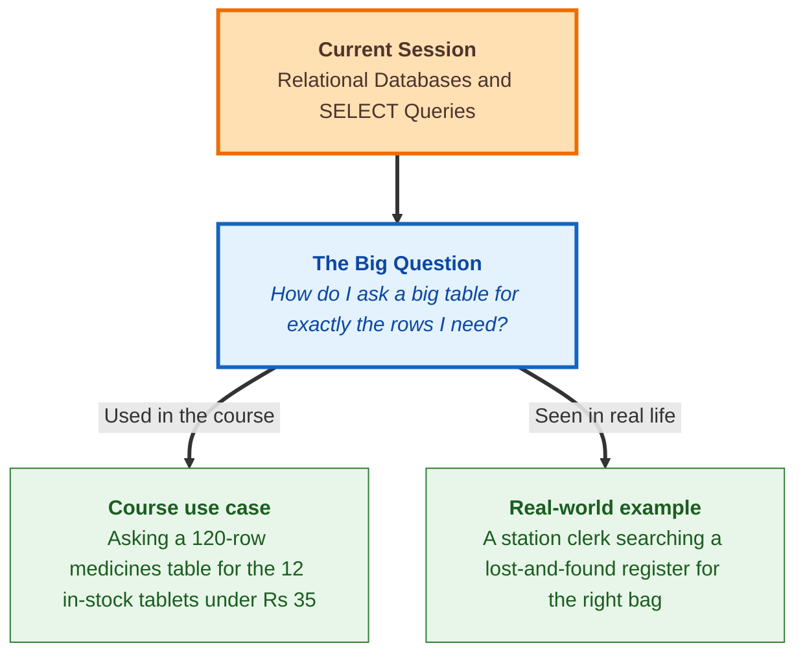

## Relational Databases and SELECT Queries

### Mental Map

---

### What You'll Learn

Have you ever wondered how a station clerk finds your lost bag among hundreds of entries?

By the end of this session, you will be able to:

- **Describe** how a register stores each found item as a row with fixed columns.
- **Explain** why mixing "and" with "or" without brackets changes the list.
- **Use** a comparison to pick items found on platform 3 or higher.
- **Apply** a list, a range and a name pattern to narrow 5 items.
- **Build** a rule that joins three conditions into one request.
- **Write** a request that sorts items by colour, then by platform.

> **Topics you will meet:** Tables rows and schema, SELECT, WHERE, AND OR and NOT, IN LIKE and date range (BETWEEN), ORDER BY.
>
> Join the session to learn each of these in detail.

---

### Why You Are Learning This Topic

Mr. Das is the clerk at a railway station. A traveller asks, "Show me black or blue bags found on platform 1 that are still unclaimed."

Mr. Das pulls every black bag, from any platform. He adds the blue bags found on platform 1.

The traveller gets a black bag from platform 4 that was claimed last week. The traveller misses the train.

A **table** means a grid where each row is one record and each column is one fact about it.

In this course, you will ask tables of 120 rows or more for exactly the rows you need.

> **Think about it:** Which words in the traveller's request did Mr. Das read in the wrong order?

---

### The Lost-and-Found Puzzle

Mr. Das keeps one row for each found item. Here are five of them.

| Item | Colour | Platform | Status |
|:----------:|:----------:|:----------:|:----------:|
| Backpack | Black | 4 | Claimed |
| Duffel bag | Blue | 1 | Unclaimed |
| Handbag | Black | 1 | Unclaimed |
| Umbrella | Red | 2 | Unclaimed |
| Backpack | Blue | 3 | Unclaimed |

**What you want to happen:**

- The list shows only the columns the traveller needs.
- Only unclaimed black or blue bags from platform 1 remain.
- The list is sorted by colour, then by platform.

> **Wonder about this:**
>
> - Which items remain if "and" is read before "or"?
> - Which two items start with the word Back?

---

### Think It Through

There is no wrong first try. Keep your guesses for the session.

**1. Which of the five items are black or blue, from platform 1 and unclaimed?**
Hint: Check each item against all three tests.

**2. Does the backpack from platform 3 pass "between platform 1 and 2"?**
Hint: Look at both ends of the range.

**3. Two items have the same colour. How would you decide which comes first?**
Hint: Pick a second column to break the tie.

---

### One Question to Carry Into the Session

> **How do you write a request so the list has exactly the rows you meant?**
>
> Which tests would you group in brackets for the traveller's request?
