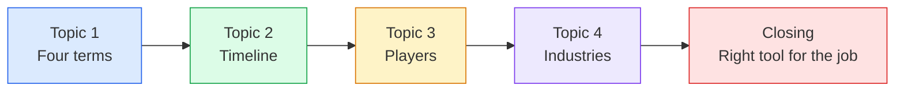
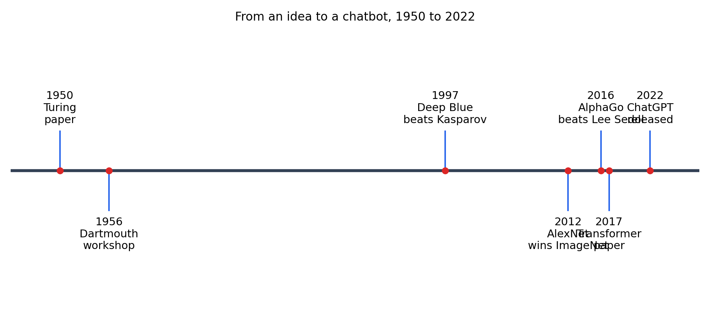

# Lecture Script: AI Landscape — What is AI?

---

## Agenda

The lecture runs as four topics. Each topic ends with a quiz.

| Topic | What we do | Learning objectives covered | Minutes |
|:-:|:--|:--|:-:|
| 1 | Sort the four terms with a food-app order | Distinguish between AI, ML, Data Science, and GenAI. | 30 |
| 2 | Walk the AI timeline | Describe the evolution of AI at a high level. | 25 |
| 3 | Match the players to their products | Identify major AI players and their flagship products. | 20 |
| 4 | Spot AI across industries | Recognize real-world AI applications across industries. | 30 |
| — | Closing: Outcome & Summary | | 15 |
| | **Total** | | **120** |

> **🎯 Instructor Note** Pace: this is a talk-and-discuss session with no software. Spend the time on the four-term sort in Topic 1 and on the industry round in Topic 4. Keep the timeline in Topic 2 to the dates on the slide.
> Product names and versions change often. Check the names in Topic 3 on the day of the session.

---

## Scenario

A Zomato-style food app has one order, and five teams touch it. Follow a single order of paneer tikka from "open the app" to "problem with my order".

| Moment in the order | What happens |
|:--|:--|
| 1. Home screen | The app picks restaurants for you |
| 2. Rider assignment | A program searches for the best route |
| 3. Delivery time | The app shows "arrives in 32 minutes" |
| 4. Problem with the order | A chat assistant writes a reply |
| 5. Monday meeting | An analyst shows managers last week's late-delivery trends |

> **🎯 Instructor Note** Zomato is only the setting. Do not claim it uses these methods or numbers. The order and every number in this script are invented for teaching.

---

## Problem Statement

In the Monday meeting, five people used the words "AI", "ML", "data science" and "GenAI" as if they meant the same thing. The manager asked, "Which of these will help us decide menu prices?" Nobody could answer. The team bought a chatbot licence to forecast demand. A chatbot writes text, and it cannot forecast demand from sales numbers. The money was wasted, and the forecast was still missing.

> **What does each term mean, how did the field reach this point, who are the main players, and where does AI really show up in a business?**

> **🎯 Instructor Note** Poll: "ChatGPT is an example of: AI, ML, GenAI, or all three?" Give learners 30 seconds to respond in chat. Reveal the answer in the Closing.

---

## What We Will Use

This is the first session of the course. You need no software and no earlier knowledge. You need one thing: curiosity about the apps you already use.

| Topic | Tools | In one line |
|:-:|:--|:--|
| 1 | A four-term table, the food-app order | Place each moment of the order under the right term |
| 2 | A timeline | See the main steps from 1950 to 2022 |
| 3 | A players-and-products table | Link each company to what it sells |
| 4 | An industry table | See where AI appears in banking, health, retail and more |

---

## How: Walking Through One Food Order

---

## Topic 1: Sort the four terms with a food-app order `30 min`

> **Five moments, four words. Which word fits which moment?**

### Example: Define the four terms

> **What does each of the four terms cover?**

| Term | What it covers | Food-app moment |
|:--|:--|:--|
| **AI** (artificial intelligence) | Any computer system that does a task that normally needs human thinking | Moment 2: route search |
| **ML** (machine learning) | The part of AI where a system learns patterns from data instead of following written rules | Moments 1 and 3: restaurant picks, delivery time |
| **GenAI** (generative AI) | The part of ML that creates new content, such as text, images or code | Moment 4: chat reply |
| **Data Science** | A field that uses data, statistics, programming and business knowledge to answer questions. It may use ML, and it also uses charts and simple statistics | Moment 5: the analyst's trends |

AI, ML and GenAI sit inside each other. GenAI is inside ML, and ML is inside AI. Data Science is a different kind of label: it describes the work of answering questions with data, and it overlaps with ML.

**Predict before you read on: What will happen?**

> **🎯 Instructor Note** Give learners 30 seconds to respond in chat. Ask which moment is "AI but not ML". Expected: moment 2, the route search, which follows a written search method and does not learn from data.

> **Result** All five moments are AI at the widest level, except the analyst's trends, which are Data Science work. The labels answer different questions: "what can it do?" for AI, ML and GenAI, and "what is the job?" for Data Science.

### Extending it: Sort four more tools

> **Where would you place each of these four tools?**

> **🎯 Instructor Note** Take answers one by one. Accept a reasoned answer and show the table below afterwards.

| Tool | Label |
|:--|:--|
| A spam filter that learns from emails users mark as spam | ML (inside AI) |
| A calculator app | Neither. It follows fixed arithmetic rules |
| A tool that draws a picture from a text request | GenAI (inside ML, inside AI) |
| A monthly sales report in Excel with charts | Data Science work (analytics). It uses no ML |

> **Result** A tool is ML when it learns from data, and GenAI when it creates new content. A report with charts is Data Science work and does not need ML.

### Quiz 1

**Question:** Which statement is correct?

**Options:**
- A) GenAI is a wider field than AI
- B) Every Data Science task uses a chatbot
- C) GenAI is a part of ML, and ML is a part of AI
- D) ML and AI mean exactly the same thing

**Correct Answer:** C

**Explanation:**
- **A)** GenAI is narrower. It is the part of ML that creates new content.
- **B)** Many Data Science tasks, such as charts and averages, need no chatbot at all.
- **C)** GenAI sits inside ML, and ML sits inside AI.
- **D)** AI is wider. A route search is AI and is not ML.

---

## Topic 2: Walk the AI timeline `25 min`

> **The chat assistant feels new. How old are the ideas behind it?**

### Example: Nine dates from 1950 to 2022

> **Which events mark the journey from an idea to a chatbot?**

| Year | Event | Why it matters |
|:-:|:--|:--|
| 1950 | Alan Turing publishes "Computing Machinery and Intelligence" | Asks whether machines can think and proposes a test |
| 1956 | The Dartmouth workshop | The field is named "artificial intelligence" |
| 1980s | Rule-based expert systems spread in business | Programs follow rules written by experts |
| Mid-1970s and late 1980s | Two "AI winters" | Funding and interest fall when promises are not met |
| 1997 | IBM's Deep Blue beats chess champion Garry Kasparov | A machine beats a world champion at chess |
| 2012 | AlexNet wins the ImageNet image contest | Deep learning takes off |
| 2016 | AlphaGo beats Go champion Lee Sedol | A learning system wins at a far larger game |
| 2017 | Google researchers publish "Attention Is All You Need" | Introduces the transformer, the design behind today's chatbots |
| 2022 | ChatGPT is released to the public | GenAI reaches everyone |

**Predict before you read on: What will happen?**

> **🎯 Instructor Note** Ask learners to guess the year ChatGPT launched. Expected: many say 2023. The release was on 30 November 2022.

> **Result** The ideas are about 70 years old. The sudden jump came after 2012, when deep learning worked at scale, and after 2017, when the transformer design arrived.

### Extending it: Why did it jump after 2012?

> **What changed around 2012 so that learning systems started to win?**

> **🎯 Instructor Note** Ask for ideas in chat first. Expected: three ingredients, more data, faster chips (GPUs) and better methods.

| Ingredient | Why it mattered |
|:--|:--|
| More data | Photos, text and clicks were stored at huge scale on the internet |
| Faster chips | GPUs, built for graphics, could train large models much faster than ordinary chips |
| Better methods | Deep learning methods could use the data and chips well |

> **Result** No single invention did it. Data, chips and methods arrived together.

### Quiz 2

**Question:** Which event made generative AI a public tool in late 2022?

**Options:**
- A) Deep Blue beating Kasparov
- B) The Dartmouth workshop
- C) AlphaGo beating Lee Sedol
- D) The public release of ChatGPT

**Correct Answer:** D

**Explanation:**
- **A)** Deep Blue was a chess machine from 1997. It does not generate text.
- **B)** Dartmouth in 1956 named the field.
- **C)** AlphaGo in 2016 played the game of Go. It was not a public chatbot.
- **D)** ChatGPT was released on 30 November 2022 and brought generative AI to everyone.

---

## Topic 3: Match the players to their products `20 min`

> **Learners hear company names in every AI headline. Who makes what?**

### Example: Players and flagship products

> **Which company is behind which product?**

> **🎯 Instructor Note** Names and products change often. Check this table on the day of the session and update it if needed.

| Player | Flagship product | What it is |
|:--|:--|:--|
| OpenAI | ChatGPT | A chatbot built on the GPT family of models |
| Google (with Google DeepMind) | Gemini | A family of models and a chatbot |
| Anthropic | Claude | A chatbot and a family of models |
| Meta | Llama | A family of models whose weights can be downloaded |
| Microsoft | Copilot | An assistant built into Windows and Office |
| NVIDIA | GPUs for AI | Chips that train and run most large models |

**Predict before you read on: What will happen?**

> **🎯 Instructor Note** Ask learners which one of the six sells chips and not a chatbot. Expected: NVIDIA.

> **Result** Five of the six sell models or assistants. NVIDIA sells the chips that sit underneath them.

### Extending it: Three layers

> **Why do some names appear in more than one place?**

| Layer | What sits here | Example |
|:--|:--|:--|
| Chips | Hardware that does the heavy maths | NVIDIA GPUs |
| Models | The trained system that predicts text, images or numbers | GPT, Gemini, Claude, Llama |
| Apps | The product you use | ChatGPT, Copilot, a company's own support bot |

> **Result** A company can sit in several layers. An app can use a model from another company. That is why you must ask which layer a news story is about.

### Quiz 3

**Question:** Which player is best known for the chips that train AI models?

**Options:**
- A) OpenAI
- B) NVIDIA
- C) Anthropic
- D) Meta

**Correct Answer:** B

**Explanation:**
- **A)** OpenAI is known for ChatGPT and the GPT models.
- **B)** NVIDIA's GPUs train and run most large models.
- **C)** Anthropic makes Claude.
- **D)** Meta makes the Llama models.

---

## Topic 4: Spot AI across industries `30 min`

> **The food app uses AI in five places. Where do banks, hospitals and farms use it?**

### Example: One use per industry

> **Which task in each industry does AI help with?**

| Industry | A real use | Type |
|:--|:--|:--|
| Banking | Flag a card payment that looks unlike the customer's usual pattern | ML |
| Retail | Suggest "customers also bought" items | ML |
| Logistics | Estimate the arrival time of a parcel | ML |
| Healthcare | Help a doctor look at a scan, with the doctor making the decision | ML |
| Agriculture | Spot a crop disease from a photo of a leaf | ML |
| Customer service | Draft a reply to a customer message | GenAI |
| Education | Explain a topic in simple words | GenAI |

**Predict before you read on: What will happen?**

> **🎯 Instructor Note** Give learners 30 seconds to respond in chat. Ask which industries on the table use GenAI. Expected: customer service and education. The others learn patterns and predict.

> **Result** Most business uses of AI today predict or flag something from past data (ML). Text and image creation (GenAI) is the newest part. In healthcare, AI supports the doctor and the doctor decides.

### Extending it: Your own industry round

> **Pick one industry you may work in. What is one task AI could help with, and what data would it need?**

> **🎯 Instructor Note** Take 3 to 5 answers from learners in chat. A good answer names a task, the data and who decides. Push for the data: if there is no data, there is no ML.

| Example answer | Data needed |
|:--|:--|
| A telecom company predicts which customers may leave | Past usage and plan history |
| A hospital predicts how many beds it needs next week | Past admissions by day |
| A school flags students who are missing classes | Attendance records |

> **Result** Every good AI use starts with a clear task and data to learn from. A task with no data cannot be handled with ML.

### Quiz 4

**Question:** A bank flags a payment because it looks unlike the customer's usual pattern. Which label fits best?

**Options:**
- A) GenAI, because it creates a new message
- B) Neither AI nor ML, because it is a bank
- C) A calculator app
- D) ML, because it learns patterns from past payments

**Correct Answer:** D

**Explanation:**
- **A)** The system flags a payment. It does not create new content.
- **B)** Banks use AI widely, and this task is ML.
- **C)** A calculator follows fixed rules. This system learns from past payments.
- **D)** It learns the usual pattern from past data and flags what differs, which is ML.

---

## Closing: Outcome & Summary `15 min`

Back to the Monday meeting. We can now answer the manager.

> **1. Which tool helps decide menu prices?**

Menu pricing needs past sales numbers and a forecast. That is Data Science work, and it may use ML to predict demand (Topic 1). A chatbot is GenAI. It writes text, so it is the wrong tool for a demand forecast.

> **2. Where does each moment of the food order sit, and who supplies the tool?**

The home screen picks and the delivery time are ML (Topics 1 and 4). The rider's route search is AI and not ML (Topic 1). The chat reply is GenAI, from a model that comes from a player in Topic 3's table. The analyst's trends are Data Science (Topic 1). The ideas have been building since 1950, with the big jump after 2012 (Topic 2).

### Outcome

| Moment | Label | Right for menu pricing? |
|:--|:-:|:-:|
| Restaurant picks | ML | Partly, it learns from orders |
| Route search | AI | No |
| Delivery time | ML | No |
| Chat reply | GenAI | No |
| Analyst's trends | Data Science | Yes, with ML for the forecast |

> **Therefore,** match the tool to the task. For a forecast from sales data, use Data Science with ML. For writing, use GenAI. Use the right word, and the right tool follows.

> **🎯 Instructor Note** Reveal the poll: all three. ChatGPT is GenAI, GenAI is a part of ML, and ML is a part of AI.

### Summary

| Learning objective | Takeaway |
|:--|:--|
| AI, ML, Data Science and GenAI | GenAI sits inside ML, ML sits inside AI, and Data Science is the work of answering questions with data |
| Evolution of AI | An idea from 1950 that reached everyone in 2022, with the jump after 2012 and 2017 |
| Players and products | OpenAI (ChatGPT), Google (Gemini), Anthropic (Claude), Meta (Llama), Microsoft (Copilot) and NVIDIA (chips) |
| Applications across industries | Banks, retailers, hospitals, farms and schools use AI to predict, flag and draft |
| **Practical value** | Using the right word helps you pick the right tool and avoid wasted money |

---

# Launch the Feedback Poll

> **🎯 Instructor Note** Reminder: launch the feedback poll now to collect learner feedback.
