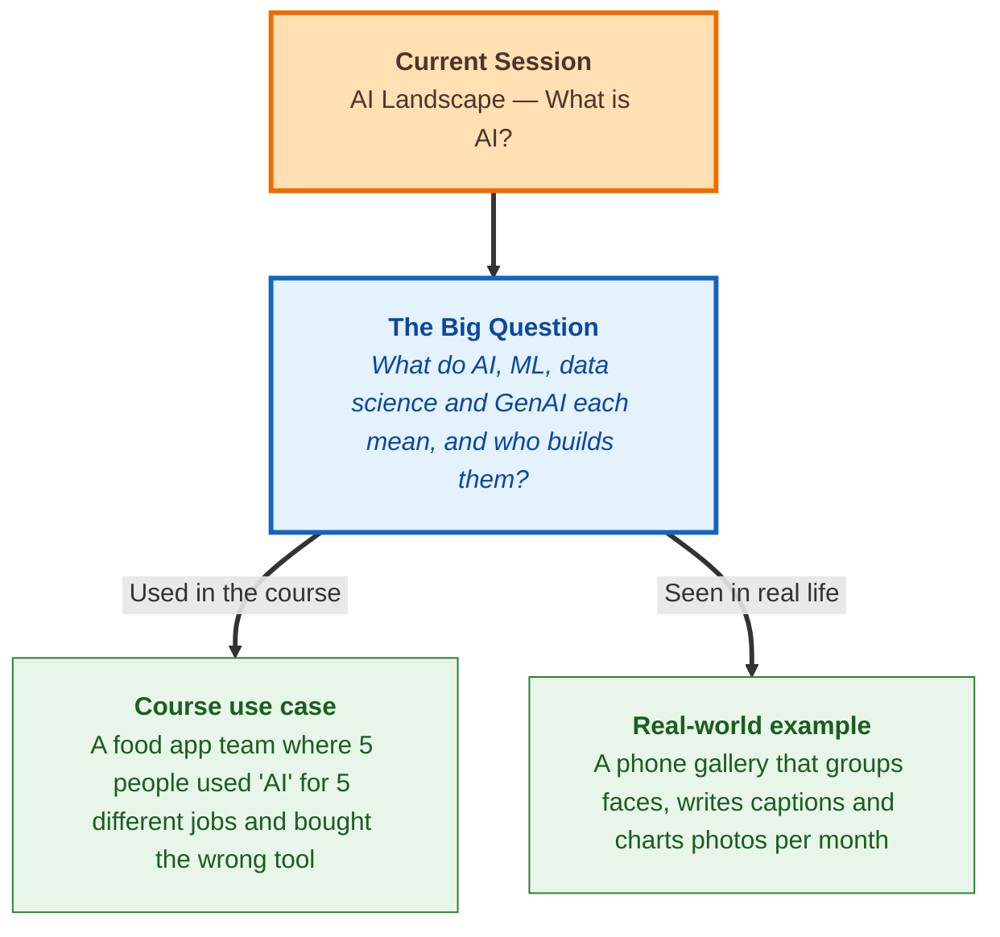

## AI Landscape — What is AI?

### Mental Map

---

### What You'll Learn

Have you ever wondered how your phone gallery knows which photos show the same person?

By the end of this session, you will be able to:

- **Name** the 4 words people mix up when they talk about smart apps.
- **Identify** 3 companies and one app that each of them makes.
- **Classify** 4 gallery features as AI, ML, GenAI or data science.
- **Describe** in 3 steps how smart apps grew from 1956 to 2022.
- **Compare** how a bank, a farm and a school use smart tools.
- **Judge** which tool fits a job, such as forecasting demand.

> **Topics you will meet:** AI vs ML vs Data Science vs GenAI, brief history of AI, key players and products, real-world examples across industries.
>
> Join the session to learn each of these in detail.

---

### Why You Are Learning This Topic

Aarti opens her phone gallery. Faces are grouped by person. A caption appears under one photo: Birthday at the beach. A chart shows 120 photos taken in March. Her cousin says it is all AI. Her friend says it is ML. A third friend says it is data science. Aarti cannot tell who is right.

**AI** means a computer system that does a task that normally needs human thinking.

In this course, you will use the right word for each tool and pick the right tool for each job.

> **Think about it:** Can three friends use three different words for one gallery and still all be right?

---

### Phone Gallery Puzzle

Here are 4 features in Aarti's gallery.

| Feature | What it does |
|:----------:|:----------:|
| Face groups | Puts photos of one person together |
| Caption writer | Writes a new line under a photo |
| Monthly chart | Counts photos per month |
| Shortest-route map | Finds the quickest way to a photo's place |

**What you want to happen:**

- Each feature gets one clear name.
- Aarti can say which feature learns from photos.
- Aarti can say which feature writes new text.

> **Wonder about this:**
>
> - Which feature does not learn from any photo?
> - Which feature is only a count and a chart?

---

### Think It Through

There is no wrong first try. Keep your guesses for the session.

**1. The caption writer creates a new line of text. Which tool does the same job as a story-writing tool?**
Hint: Look for the word writes.

**2. The monthly chart counts 120 photos in March. Does it need to learn from photos?**
Hint: A count follows a fixed step.

**3. Aarti's friend says the face groups learn from photos. Which feature in the table learns in the same way?**
Hint: Look for a feature that spots patterns.

---

### One Question to Carry Into the Session

> **How can one phone gallery hold four different kinds of smart features?**
>
> Which feature in Aarti's gallery would you call the oldest idea?
