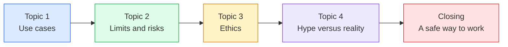

# Lecture Script: AI in Business — Why It Matters

---

## Agenda

The lecture runs as four topics. Each topic ends with a quiz.

| Topic | What we do | Learning objectives covered | Minutes |
|:-:|:--|:--|:-:|
| 1 | Follow an analyst's Monday | Identify practical AI use cases relevant to analyst roles. | 30 |
| 2 | Find where the tool breaks | Explain key limitations and risks of current AI tools. | 30 |
| 3 | Decide what is fair to do | Discuss ethical considerations in AI use. | 25 |
| 4 | Sort hype from reality | Separate AI hype from realistic capability. | 20 |
| — | Closing: Outcome & Summary | | 15 |
| | **Total** | | **120** |

> **🎯 Instructor Note** Pace: this is a talk-and-discuss session with no software. Spend the time on use cases in Topic 1 and on limits in Topic 2. Keep the ethics round to real examples learners raise.
> Replies from learners are opinions. There is no single right answer in Topic 3. Look for reasons.

---

## Scenario

**One analyst, one Monday.** Divya is a data analyst at a Tata 1mg-style online pharmacy. Her manager gives her four jobs before lunch.

| Job | Size of the task |
|:--|:--|
| Summarise customer reviews | 480 reviews of a new vitamin range |
| Research a competitor | Prices of 20 common medicines |
| Draft an email | A message to the supply team about a late delivery |
| Automate a weekly report | A sheet that Divya rebuilds by hand every Monday |

> **🎯 Instructor Note** Tata 1mg is only the setting. Do not claim it uses these tools. The jobs and the numbers are invented for teaching.

---

## Problem Statement

Divya pasted all 480 reviews into a free chatbot and got a clean summary. She sent it to her manager. The summary said "customers love the packaging", but only 6 of the 480 reviews mentioned packaging. The chatbot had also quoted a review that is not in the data. The manager planned a packaging campaign on that line. Divya had saved 2 hours and lost her manager's trust.

> **Where can an analyst use AI with confidence, where does it break, what is fair to do with it, and how do we tell a real capability from a headline?**

> **🎯 Instructor Note** Poll: "An AI summary reads smoothly. Should you send it without checking?" Options: yes, no, or only for short texts. Give learners 30 seconds to respond in chat. Reveal the answer in the Closing.

---

## What We Will Use

Last time you saw the AI landscape: the four terms, the timeline, the players and the industries. Today you apply it to one job, the analyst's. You need no software.

| Topic | Tools | In one line |
|:-:|:--|:--|
| 1 | A use-case table | Match each of Divya's jobs to a way AI can help |
| 2 | A risk table | Name what can go wrong with each use |
| 3 | A discussion round | Weigh fairness, privacy and honesty |
| 4 | A claim checker | Test a headline claim against what a tool does |

---

## How: Walking Through Divya's Monday

---

## Topic 1: Follow an analyst's Monday `30 min`

> **Divya has four jobs. Which of them can AI help with, and how?**

### Example: Four jobs, four uses

> **How does AI help with summarising, researching, drafting and automating?**

| Job | How AI helps | What Divya still does |
|:--|:--|:--|
| Summarise 480 reviews | Groups themes and gives a first summary | Checks counts and quotes against the reviews |
| Research competitor prices | Suggests where to look and how to compare | Opens the sources and checks every price |
| Draft an email | Writes a clear first draft in seconds | Adds the real facts and edits the tone |
| Automate the weekly report | Suggests steps and a formula or script | Tests the result against last week's numbers |

**Predict before you read on: What will happen?**

> **🎯 Instructor Note** Give learners 30 seconds to respond in chat. Ask which job carries the most risk if the AI is wrong. Expected: the price research, because a wrong price leads straight to a wrong decision.

> **Result** In all four jobs, AI makes a first version, and the analyst checks it. AI saves time on the first draft. It does not remove the check.

### Extending it: Your own Monday

> **What is one job you do each week that fits a first-draft helper?**

> **🎯 Instructor Note** Take 3 to 5 answers in chat. Good answers name a task with text, a pattern or a repeated step.

> **Result** Tasks that fit are repeated, text-heavy and easy to check. Tasks that need a precise number from a private source do not fit without a check.

### Quiz 1

**Question:** Which use of AI fits an analyst best?

**Options:**
- A) Getting a first draft, then checking it against the data
- B) Replacing the data check with the AI's answer
- C) Sending the AI's output to the manager unread
- D) Letting AI decide which numbers to report

**Correct Answer:** A

**Explanation:**
- **A)** AI saves time on a first draft and the analyst checks it.
- **B)** The check is the analyst's job. AI does not replace it.
- **C)** Unread output can carry invented facts, like Divya's quote.
- **D)** Which numbers matter is a business decision, and the analyst owns it.

---

## Topic 2: Find where the tool breaks `30 min`

> **Divya's summary was smooth and wrong in two places. What exactly went wrong?**

### Example: Three limits in one summary

> **What limits of current AI tools show up in Divya's summary?**

| What happened | The limit | Plain meaning |
|:--|:--|:--|
| A quote that is not in the data | Hallucination | The tool writes text that sounds right and is not backed by facts |
| "Customers love the packaging" from 6 of 480 reviews | Overstating | The tool can give a small signal the weight of a big one |
| Another run gave a different top theme | Inconsistency | The same question can give different answers on different runs |

Other risks: private data pasted into a public tool, an old knowledge date, and numbers worked out wrongly.

**Predict before you read on: What will happen?**

> **🎯 Instructor Note** Ask learners to find the check that would have caught each limit. Expected: search the quote in the data, count the packaging reviews, and run the summary twice.

> **Result** Each limit has a cheap check: search for the quote, count the cases, and repeat the run. A tool that sounds sure can still be wrong.

### Extending it: What not to paste

> **Divya's reviews contain customer names and phone numbers. Is it safe to paste them into a free chatbot?**

> **🎯 Instructor Note** Take answers in chat. Expected: no. Remove personal data first, and follow the company's rule. Free consumer tools may keep or use what you type, depending on their terms.

> **Result** Strip names, phone numbers and any private detail before pasting, and follow your company's policy on which tools are allowed.

### Quiz 2

**Question:** An AI tool quotes a customer review that is not in your data. What is this called?

**Options:**
- A) Bias
- B) Hallucination
- C) Automation
- D) Summarisation

**Correct Answer:** B

**Explanation:**
- **A)** Bias is an unfair lean in outputs. A made-up quote is invented text.
- **B)** Hallucination is text that sounds right and is not backed by facts.
- **C)** Automation means a repeated task runs on its own.
- **D)** Summarisation is the task. The invented quote is a fault inside it.

---

## Topic 3: Decide what is fair to do `25 min`

> **Divya can use AI to read 480 reviews in a minute. Is every use of AI fair because it is fast?**

### Example: Four ethics questions

> **What should Divya ask before she uses AI on this work?**

| Question | Why it matters | Example at the pharmacy |
|:--|:--|:--|
| Is the data private? | People trusted the company with their details | Reviews with names and phone numbers |
| Is the output fair to everyone? | A tool learns from past data, which can carry unfair patterns | A tool that ranks complaints from one region lower |
| Is it honest? | People should know when AI helped | A report that does not say AI wrote the first draft |
| Who is responsible? | A person must own the result | The analyst who sent the summary |

**Predict before you read on: What will happen?**

> **🎯 Instructor Note** Take a show of hands in chat: "Should a report say that AI helped?" Expected: opinions vary. Ask for the reason behind each answer, and note the company policy.

> **Result** The tool does not carry responsibility. The person who sends the result does. Good practice is to protect private data, look for unfair patterns, be open about AI help, and own the output.

### Extending it: Your call

> **A manager asks Divya to use AI to rank 500 job applicants by their resumes. What would you ask before agreeing?**

> **🎯 Instructor Note** Take 3 to 5 answers. Strong answers ask what data the tool learned from, whether a person reviews each case, and whether the candidates are told.

> **Result** When a decision changes a person's life, ask about the data, keep a person in the loop and tell the people affected.

### Quiz 3

**Question:** An AI tool ranks applicants and a person sends the final list. Who is responsible for the list?

**Options:**
- A) The AI tool
- B) The company that made the tool, always
- C) The applicants
- D) The person who sends the list

**Correct Answer:** D

**Explanation:**
- **A)** A tool cannot be held responsible for a decision.
- **B)** The maker may share duties, but the person who uses and sends the output still owns the decision.
- **C)** Applicants do not own the process.
- **D)** The person who uses the output and sends it owns the result.

---

## Topic 4: Sort hype from reality `20 min`

> **A headline says, "AI will do every analyst's job by next year." How do we test a claim like that?**

### Example: A four-question claim checker

> **What four questions turn a headline into something we can test?**

| Question | Hype sounds like | Reality sounds like |
|:--|:--|:--|
| What exactly can it do? | "Does every analyst's job" | "Drafts a first summary of text" |
| On what data was it tested? | "Works on anything" | "Tested on 200 reviews in English" |
| What happens when it is wrong? | "It does not make mistakes" | "It can invent a quote, so check it" |
| Who checks the result? | "No human needed" | "The analyst checks counts and quotes" |

**Predict before you read on: What will happen?**

> **🎯 Instructor Note** Read the headline aloud. Ask learners which of the four questions it fails first. Expected: "what exactly can it do?", since "every job" is not a task.

> **Result** A job is a bundle of tasks. AI handles some tasks well and others badly. The headline names a job, and the checker asks about tasks.

### Extending it: Common misconceptions

> **Which of these statements is a myth?**

| Statement | True or myth | Reason |
|:--|:-:|:--|
| "AI understands like a person" | Myth | It predicts likely text from patterns |
| "A longer answer is a more correct answer" | Myth | Length says nothing about truth |
| "AI always gives the same answer" | Myth | Answers can change from run to run |
| "AI can save an analyst time on first drafts" | True | It is a fast first-draft helper |

> **Result** Three of the four sound fair and are myths. The true one is modest: AI is a quick helper for first drafts.

### Quiz 4

**Question:** Which claim is the most realistic?

**Options:**
- A) "AI never makes mistakes"
- B) "AI replaces the need to check any output"
- C) "AI can draft a first summary of 480 reviews, which an analyst must check"
- D) "AI understands customers like a person"

**Correct Answer:** C

**Explanation:**
- **A)** AI makes mistakes, including invented facts.
- **B)** Checking is still needed.
- **C)** It names a task, a size and the human check.
- **D)** AI predicts likely text. It does not understand like a person.

---

## Closing: Outcome & Summary `15 min`

Back to Divya's Monday. We can now describe a safer way to work.

> **1. What should Divya have done with the review summary?**

Use AI for the first draft (Topic 1). Search the quote, count the packaging reviews and run the summary twice (Topic 2). Remove names and phone numbers first (Topic 3).

> **2. How should she describe the result to her manager?**

Say what the tool did, say what she checked, and own the result (Topic 3). Do not claim more than the data shows: 6 of 480 reviews is a weak signal (Topic 4).

### Outcome

| | What happened | What a safe version looks like |
|:--|:--|:--|
| Use | Pasted all reviews and sent the summary | Used AI for the first draft only |
| Check | None | Quote searched, packaging counted (6 of 480), run repeated |
| Privacy | Names and phones pasted | Personal details removed first |
| Claim | "Customers love the packaging" | "A few reviews (6 of 480) mention packaging" |

> **Therefore,** use AI as a fast first-draft helper, check what it gives you, protect private data, be open about the help, and own the result. Judge any headline by the task, the data, the failure and the checker.

> **🎯 Instructor Note** Reveal the poll: no. Smooth writing says nothing about accuracy. Check counts and quotes before sending.

### Summary

| Learning objective | Takeaway |
|:--|:--|
| Use cases for analysts | AI drafts, groups and suggests, and the analyst checks |
| Limits and risks | Hallucination, overstating, inconsistency and private data are the main risks |
| Ethics | Protect private data, look for unfair patterns, be open about AI help and own the result |
| Hype versus reality | Test a claim by its task, its data, its failure and its checker |
| **Practical value** | You can use AI at work to save time without losing trust |

---

# Launch the Feedback Poll

> **🎯 Instructor Note** Reminder: launch the feedback poll now to collect learner feedback.
