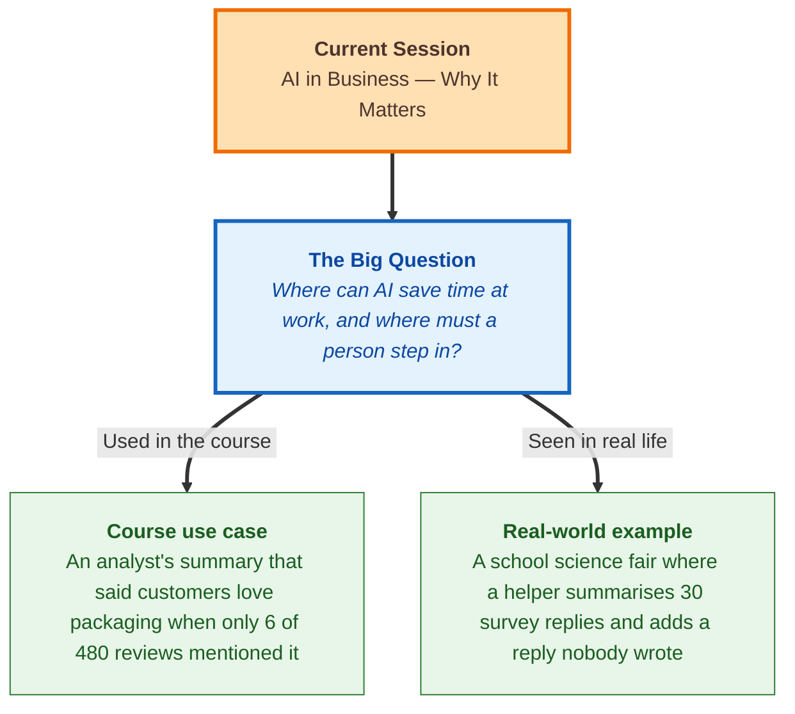

## AI in Business — Why It Matters

### Mental Map

---

### What You'll Learn

Have you ever wondered whether a smart helper can read 30 survey replies faster and still get them right?

By the end of this session, you will be able to:

- **List** 3 jobs in the fair project where a smart helper saves time.
- **Explain** why the summary holds a reply that nobody wrote.
- **Classify** each risk as private data, wrong facts or unfair results.
- **Judge** whether a headline about smart helpers is fair or too loud.
- **Justify** who is responsible for the final summary.
- **Check** the summary against the 30 replies.

> **Topics you will meet:** business use cases for analysts (summarization, research, drafting, automation), capabilities and limitations of current AI tools, ethics and responsible use, common misconceptions.
>
> Join the session to learn each of these in detail.

---

### Why You Are Learning This Topic

Neha runs a science fair project on school lunch. She collects 30 survey replies with student names. She asks a smart helper for a summary. In 5 seconds she gets 3 neat lines. One line quotes a reply that nobody wrote. Another line says most students love the new menu. Only 9 replies say so.

A **summary** means a short version that keeps the main points of a longer text.

In this course, you will use smart helpers for first drafts and check every claim against the data.

> **Think about it:** Why did a neat summary hold a quote that nobody wrote?

---

### Science Fair Puzzle

Here is what Neha's replies say.

| Reply type | Count |
|:----------:|:----------:|
| Love the new menu | 9 |
| Like it a little | 11 |
| Do not like it | 7 |
| No opinion | 3 |

**What you want to happen:**

- The summary shows the real count for each type.
- The summary keeps student names private.
- Neha can say who checked it.

> **Wonder about this:**
>
> - Does 9 of 30 mean most students?
> - Should the student names go into the helper at all?

---

### Think It Through

There is no wrong first try. Keep your guesses for the session.

**1. The helper says most students love the menu. What count would make that true?**
Hint: Most means more than half of 30.

**2. A quote in the summary is not in the replies. How could Neha find that out quickly?**
Hint: Search the replies for the words.

**3. Who should sign the final summary: the helper or Neha?**
Hint: Think about who answers questions at the fair.

---

### One Question to Carry Into the Session

> **How much of a neat summary can we trust before we check it?**
>
> Which line in Neha's summary would you check first?
