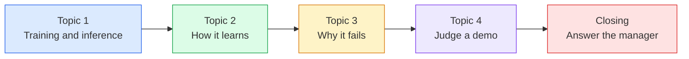
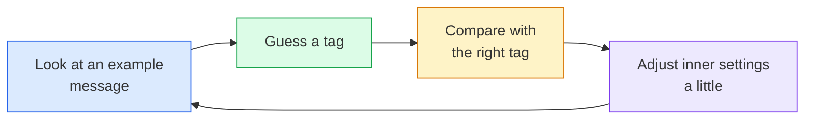

# Lecture Script: How AI "Thinks" — Demystified

---

## Agenda

The lecture runs as four topics. Each topic ends with a quiz.

| Topic | What we do | Learning objectives covered | Minutes |
|:-:|:--|:--|:-:|
| 1 | Cooking school and the kitchen | Explain training vs. inference using everyday analogies. | 25 |
| 2 | Guess, compare, adjust | Describe conceptually how a model "learns" from data. | 25 |
| 3 | Why a model invents and why it leans | Identify why AI systems hallucinate or show bias. | 25 |
| 4 | Watch a live demo and judge it | Critically evaluate an AI-generated demo output. | 30 |
| — | Closing: Outcome & Summary | | 15 |
| | **Total** | | **120** |

> **🎯 Instructor Note** Pace: no maths and no code in this session. Spend the time on the live demo in Topic 4. Learners observe the demo and do not operate the tool.
> Chatbot replies change from run to run. This script gives a checklist for judging a reply, not the exact words.

---

## Scenario

**A help bot before and after launch.** A Jio-style telecom company builds a help bot that reads customer messages.

| | Before launch | After launch |
|:--|:--|:--|
| What the team does | Shows the bot 50,000 past messages with the right tags | Customers type new messages all day |
| What the bot does | Learns from the messages | Answers each new message |
| Where mistakes show up | In practice tests | In front of customers |

> **🎯 Instructor Note** Jio is only the setting. Do not claim it uses this bot. The numbers and messages are invented for teaching.

---

## Problem Statement

On the first week after launch the bot made two mistakes. It answered a question about "Super Plan 599" with benefits that the company never offered, because the plan is not real and the bot filled in a likely-sounding answer. It also read messages written in a regional spelling style less accurately than messages written in standard English, because the practice messages held far fewer of them. A manager asked the team, "Is the bot thinking, and why does it fail like this?"

> **What is the difference between learning and answering, how does a model learn from examples, why does it invent and lean, and how do we judge one answer in front of us?**

> **🎯 Instructor Note** Poll: "When does a chatbot learn from data: while you chat, or before it is released?" Give learners 30 seconds to respond in chat. Reveal the answer in the Closing.

---

## What We Will Use

You have seen what AI is, where it is used and where it breaks. Today we look inside, in plain words. You will need no maths and no code. A live chatbot demo is run by the mentor, and you observe.

| Topic | Tools | In one line |
|:-:|:--|:--|
| 1 | Two everyday analogies | Link training and inference to a cooking school and a kitchen |
| 2 | A guess-compare-adjust picture | See how a model changes after each wrong guess |
| 3 | A cause table | Link each failure to its cause |
| 4 | A live demo and a checklist | Judge one answer in five questions |

---

## How: Walking Through the Help Bot

---

## Topic 1: Cooking school and the kitchen `25 min`

> **The team says "we train the bot" and "the bot runs". Are those two different things?**

### Example: Training is school, inference is service

> **How is training different from inference?**

**Training** is the long phase where a model learns from a large set of examples. **Inference** is the quick phase where the finished model answers one new question. Think of a cook. Training is cooking school, where the cook practises on 50,000 recipes and gets corrected. Inference is the restaurant kitchen, where the cook makes one dish for one customer using what they learned.

| | Training | Inference |
|:--|:--|:--|
| Cooking analogy | Cooking school | A busy kitchen |
| Help bot | Learns from 50,000 past messages | Answers a new message |
| Takes | A long time and heavy computers | A moment per answer |
| Done | Before release (and again when the team updates it) | Every time a customer types |

**Predict before you read on: What will happen?**

> **🎯 Instructor Note** Give learners 30 seconds to respond in chat. Ask: "When a customer types a message, is the bot still in cooking school?" Expected: no. It is in the kitchen.

> **Result** Training happens first and takes long. Inference happens each time someone asks, and it is quick. A normal chatbot does not retrain itself while you chat.

### Extending it: A second analogy

> **Which part of a student's life is training, and which is inference?**

> **🎯 Instructor Note** Take answers in chat. Expected: months of study and practice papers are training. The exam answer is inference.

> **Result** Studying for months is training. Writing one exam answer is inference. A student who studied the wrong topics fails at inference, and so does a model trained on the wrong examples.

### Quiz 1

**Question:** A customer types a new message and the bot replies in a second. Which phase is this?

**Options:**
- A) Training
- B) Inference
- C) Data collection
- D) Model retirement

**Correct Answer:** B

**Explanation:**
- **A)** Training is the long learning phase before release.
- **B)** Answering one new message with a finished model is inference.
- **C)** Data collection gathers examples before training.
- **D)** Nothing is being retired. The model is in use.

---

## Topic 2: Guess, compare, adjust `25 min`

> **During cooking school, how does the cook get better?**

### Example: The learning loop

> **What does a model do with each example during training?**

A model learns by a loop. It looks at an example and **guesses**. It **compares** the guess with the right answer. It **adjusts** its inner settings a little so that the same mistake is less likely next time. It repeats this loop thousands or millions of times.

Here are 4 of the 50,000 training messages (invented for teaching).

| Message | Right tag | Bot's early guess | After many rounds |
|:--|:-:|:-:|:-:|
| "My recharge of Rs 299 did not apply" | Recharge | Network | Recharge |
| "No signal at home since morning" | Network | Network | Network |
| "Data stopped after 600 MB" | Network | Recharge | Network |
| "Bill shows a charge I did not make" | Billing | Network | Billing |

**Predict before you read on: What will happen?**

> **🎯 Instructor Note** Ask: "Which early guess was already right?" Expected: message 2. Then ask what the model does with the wrong ones.

> **Result** The model starts with poor guesses. Each wrong guess nudges its settings. After many rounds the guesses match the right tags more often. It learns patterns from examples, and nobody writes rules by hand.

### Extending it: What a model keeps

> **After training, does the bot keep the 50,000 messages?**

> **🎯 Instructor Note** Take answers in chat. Expected: it keeps the adjusted settings, not a copy of the messages. The settings hold the patterns.

> **Result** What stays is the adjusted settings, a compressed memory of patterns. That is why a model can handle a new message it has never seen, and why it can also be confidently wrong.

### Quiz 2

**Question:** What happens after the model guesses a wrong tag during training?

**Options:**
- A) The model is deleted
- B) A person rewrites its rules by hand
- C) It adjusts its inner settings a little to make that mistake less likely
- D) It copies the right answer into a table and looks it up later

**Correct Answer:** C

**Explanation:**
- **A)** A wrong guess is the normal fuel for learning.
- **B)** Learning from data means no rules are written by hand.
- **C)** Compare, then adjust a little, then repeat.
- **D)** The model keeps adjusted settings, not a table of answers.

---

## Topic 3: Why a model invents and why it leans `25 min`

> **The bot described "Super Plan 599", which does not exist. And it reads some customers worse than others. Where do both come from?**

### Example: Two failures, two causes

> **What causes hallucination, and what causes bias?**

**Hallucination** is text that sounds right and is not backed by facts. A chatbot picks the most likely next piece of text, and likely does not mean true. When it lacks the fact, it can still write a likely-sounding answer. **Bias** is an unfair lean in outputs. It comes mainly from the training examples: if a group is rare or badly described in the data, the model does worse for that group.

| Failure | What it looks like | Cause | A cheap guard |
|:--|:--|:--|:--|
| Hallucination | A real-sounding plan "Super Plan 599" | The model writes likely text and does not check facts | Paste the real facts and ask it to use only those |
| Bias | Poorer accuracy for regional spelling | Few such examples in training | Test the bot on each group before launch |

**Predict before you read on: What will happen?**

> **🎯 Instructor Note** Ask: "Would a longer training run fix the missing 'Super Plan 599' fact?" Expected: no. More training on the same data does not add a fact that is not in it.

> **Result** Hallucination comes from writing likely text without checking facts. Bias comes from uneven training data. Both are properties of how the model learns, and both need checks from people.

### Extending it: Spot the cause

> **A bot trained mostly on messages from big cities struggles with village place names. Is this hallucination or bias?**

> **🎯 Instructor Note** Take answers in chat. Expected: bias, because the training data under-represents village names. If the bot invents a place name, that is hallucination.

> **Result** Struggling with a group the data lacks is bias. Inventing a fact that is not there is hallucination. They have different causes and different fixes.

### Quiz 3

**Question:** Why does a chatbot sometimes describe a plan that does not exist?

**Options:**
- A) It writes the most likely text and does not check facts
- B) It is looking up a hidden database
- C) It was trained too little on spelling
- D) Its screen is too small

**Correct Answer:** A

**Explanation:**
- **A)** Likely text can sound right and be false.
- **B)** The bot does not look anything up unless it is connected to a source.
- **C)** Spelling is a different problem and does not create invented plans.
- **D)** The screen has no effect.

---

## Topic 4: Watch a live demo and judge it `30 min`

> **The mentor will run a live chatbot demo. How do we judge an answer instead of just being impressed?**

### Example: A five-question checklist

> **What five questions help us judge any AI answer?**

| # | Question | What a good answer shows |
|:-:|:--|:--|
| 1 | Is every fact in the input? | Each number and name matches what we gave |
| 2 | Is anything invented? | No new names, plans, quotes or numbers |
| 3 | Is anything missing? | The main points are present |
| 4 | Does the tone match the facts? | No added feelings or claims |
| 5 | Would you send it as it is? | Yes only if 1 to 4 pass |

> **🎯 Instructor Note** Mentor demo: type the complaint below into a free chatbot and ask for a one-line summary. Learners only watch and use the checklist. The reply will differ by run. If the reply is perfect, use the sample in the next step to practise the checklist.

Complaint (invented for teaching):

> *"I recharged Rs 299 on 3 March for 28 days with 1.5 GB per day. On 5 March my data stopped after 600 MB. I called care twice and was told it is a network issue. Please fix it or refund me."*

**Predict before you see the reply: What will happen?**

> **🎯 Instructor Note** Give learners 30 seconds to respond in chat. Ask whether the reply will be correct. Expected: it is often close, and it can still change one number or add a feeling.

### Extending it: Judge a sample reply

> **This is a sample reply (invented for teaching, not from a real run). Use the checklist.**

> *"Customer recharged Rs 399 on 3 March and lost data on 5 March after 1 GB. The customer is angry and wants a refund."*

> **🎯 Instructor Note** Give learners 1 minute in chat. Expected: three wrong facts or additions and one missing point.

| Check | Finding |
|:-:|:--|
| 1. Facts in the input | Wrong amount: the complaint says Rs 299, not Rs 399 |
| 1. Facts in the input | Wrong usage: the complaint says 600 MB, not 1 GB |
| 2. Invented | "Angry" is a feeling that the complaint never states |
| 3. Missing | Two calls to care, and the option to fix the problem instead of a refund |
| 5. Send as it is? | No |

> **Result** The sample reads smoothly and fails three checks and misses one point. A good summary would say: "Customer recharged Rs 299 on 3 March, data stopped on 5 March after 600 MB, two calls to care did not help, and the customer wants a fix or a refund."

### Quiz 4

**Question:** An AI summary changes "Rs 299" to "Rs 399" and adds "angry". What is the best next step?

**Options:**
- A) Send it, because it sounds professional
- B) Ask the AI to be more confident
- C) Delete the original complaint
- D) Correct it against the original text before sending

**Correct Answer:** D

**Explanation:**
- **A)** A professional tone does not make the facts right.
- **B)** Confidence does not add accuracy.
- **C)** The original is the source of truth. Keep it.
- **D)** Compare with the original and fix what changed.

---

## Closing: Outcome & Summary `15 min`

Back to the manager's question: "Is the bot thinking, and why does it fail like this?"

> **1. Is the bot thinking?**

No, it is applying patterns. It learned them during training (Topics 1 and 2) by guess, compare and adjust. Now each answer is inference, with the settings it kept.

> **2. Why did it fail, and what would catch each failure?**

It invented "Super Plan 599" because it writes likely text without checking facts (Topic 3). It read the regional spelling worse because the training data held few such examples (Topic 3). A checklist of five questions and a test on each group catch both (Topics 3 and 4).

### Outcome

| Failure | Cause | Guard |
|:--|:--|:--|
| Invented plan | Likely text, no fact check | Give real facts, ask it to use only them, and check |
| Weak on regional spelling | Few training examples | Test each group before launch |
| Wrong amount in a summary | A smooth answer that changed a fact | The five-question checklist |

> **Therefore,** a model learns patterns in training and applies them in inference. It does not think like a person. It can invent and it can lean, so a person checks the answer against facts and tests the tool on every group it serves.

> **🎯 Instructor Note** Reveal the poll: before it is released. A normal chatbot does not retrain on your chat while you use it. The team updates it later in a new training round.

### Summary

| Learning objective | Takeaway |
|:--|:--|
| Training versus inference | Training is the long learning phase. Inference is one quick answer |
| How a model learns | It guesses, compares with the right answer, adjusts, and repeats |
| Hallucination and bias | Likely text without a fact check, and uneven training data |
| Evaluate a demo output | Check facts, inventions, missing points, tone and whether you would send it |
| **Practical value** | You can explain AI to a manager in plain words and judge an answer before trusting it |

---

# Launch the Feedback Poll

> **🎯 Instructor Note** Reminder: launch the feedback poll now to collect learner feedback.
