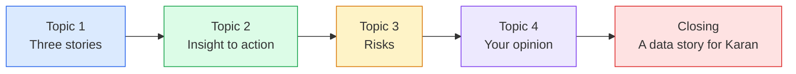

# Lecture Script: Data-Driven Decisions — Company Case Stories

---

## Agenda

The lecture runs as four topics. Each topic ends with a quiz.

| Topic | What we do | Learning objectives covered | Minutes |
|:-:|:--|:--|:-:|
| 1 | Hear three company stories | Recall real examples of data-driven business decisions and their outcomes. | 25 |
| 2 | Link each insight to an action | Explain how a data insight led to a specific business action. | 25 |
| 3 | Count the cost of ignoring or misreading data | Discuss risks of ignoring or misreading data signals. | 25 |
| 4 | Take a side on a dilemma | Form and defend an opinion on a business dilemma using narrative evidence. | 30 |
| — | Closing: Outcome & Summary | | 15 |
| | **Total** | | **120** |

> **🎯 Instructor Note** Pace: this is a story-and-discussion session with no software. Spend the time on the dilemma round in Topic 4. Keep each story to about 6 minutes.
> Story 1 uses facts that Netflix has shared in public. Stories 2 and 3 are invented for teaching. You can replace them with a documented case you have verified.

---

## Scenario

**Three stories, one pattern.** A business-news podcast runs a segment called "What did the data say?" This week it tells three stories.

| Story | Company | The decision |
|:-:|:--|:--|
| 1 | Netflix | Which ideas to keep from a famous prediction contest |
| 2 | A Zomato-style food app (invented) | What to do about late deliveries in the rain |
| 3 | A neighbourhood supermarket (invented) | How much stock to hold before the monsoon |

> **🎯 Instructor Note** Zomato is only the setting for Story 2. Do not claim it did any of this. The numbers in Stories 2 and 3 are invented for teaching.

---

## Problem Statement

A new analyst, Karan, joins a food-app team. In his first meeting, someone says, "The data is clear: raise rain fees." Another says, "The data is clearly the other way." Both quote the same table. Karan cannot say which is right. He also cannot name a single company that made a big call from data, so he has no story to compare with. He stays silent, and the team picks the louder voice.

> **What do real data-driven decisions look like, how does an insight become an action, what goes wrong when data is ignored or misread, and how do we argue for a choice with evidence?**

> **🎯 Instructor Note** Poll: "In a business meeting, which is stronger: the loudest voice or a clear data story?" Give learners 30 seconds to respond in chat. Reveal the answer in the Closing.

---

## What We Will Use

You have seen what AI is, what it can do for an analyst and how it works. Today is about the human side: decisions. You need no software. You need your opinions and your reasons.

| Topic | Tools | In one line |
|:-:|:--|:--|
| 1 | Story cards | Recall who did what, and what happened |
| 2 | An insight-to-action chain | Link what the data showed to what the company did |
| 3 | A risk table | Name how data gets ignored or misread |
| 4 | A claim, evidence and risk frame | Defend one choice in four sentences |

---

## How: Walking Through the Podcast

---

## Topic 1: Hear three company stories `25 min`

> **What did each company do, and what happened?**

### Example: Story 1, the Netflix Prize

> **What was the prize, who won, and what did Netflix do with the winning idea?**

In October 2006, Netflix announced the Netflix Prize: US$1 million for any team that could improve the accuracy of its movie-rating predictions (its system was called Cinematch) by 10 percent. In September 2009, the team BellKor's Pragmatic Chaos won. Netflix later wrote publicly (in 2012) that it did not roll out the final winning solution. The extra accuracy did not justify the engineering work, and the business had moved to streaming, where what people actually watch matters more than the stars they give.

**Predict before you read on: What will happen?**

> **🎯 Instructor Note** Ask learners whether Netflix used the winning solution. Expected: many say yes. The public account is that it did not deploy the final solution, and used ideas from earlier prize work.

> **Result** A prize-winning model was not automatically a business win. The company weighed the cost and the new data (viewing behaviour) and acted on that.

### Extending it: Stories 2 and 3 (invented)

> **What did the other two companies see in their data, and what did they do?**

> **🎯 Instructor Note** Read each story aloud. The numbers are invented for teaching.

| | Story 2: food app in the rain | Story 3: supermarket before the monsoon |
|:--|:--|:--|
| What the data showed | 30 of every 100 rainy-evening orders arrived late, against 8 of every 100 on dry evenings | Umbrellas sold out within 2 days in the first rainy week for 3 years in a row |
| What the company did | Added riders in the rain slots and showed a longer arrival time | Ordered umbrellas 3 weeks before the forecast monsoon date |
| What happened | Late orders on rainy evenings fell from 30 to 18 per 100 | No empty shelf in the first rainy week |

> **Result** In each story, the company saw a pattern in its own numbers and chose a specific action. The first story is a documented case. The other two are teaching cases.

### Quiz 1

**Question:** In the Netflix Prize, what did the winning team have to achieve?

**Options:**
- A) Build a new streaming service
- B) Cut Netflix's costs by 10 percent
- C) Write a new movie script
- D) Improve the accuracy of Netflix's rating predictions by 10 percent

**Correct Answer:** D

**Explanation:**
- **A)** The prize was about prediction accuracy, not a new service.
- **B)** Cost was not the target.
- **C)** Scripts had nothing to do with it.
- **D)** The goal was a 10 percent improvement over the Cinematch predictions.

---

## Topic 2: Link each insight to an action `25 min`

> **A table of numbers does nothing by itself. What turns an insight into an action?**

### Example: The insight-to-action chain

> **What are the four links between data and a decision?**

| Link | Question | Story 2 (food app) |
|:-:|:--|:--|
| 1. Insight | What did the data show? | Rainy evenings: 30 late per 100 orders. Dry evenings: 8 per 100 |
| 2. Reason | Why might it happen? | Orders rise and fewer riders are on the road |
| 3. Action | What will we do? | Add riders in rain slots, show a longer arrival time |
| 4. Measure | How will we know it worked? | Late orders per 100 in the next rainy week |

**Predict before you read on: What will happen?**

> **🎯 Instructor Note** Cover links 3 and 4. Ask learners to guess an action and a measure from the insight and reason. Expected: add capacity, and track late orders per 100.

> **Result** A good decision has all four links. An insight with no action wastes the data. An action with no measure cannot be judged.

### Extending it: Build the chain for Story 3

> **Fill in the four links for the supermarket.**

> **🎯 Instructor Note** Take answers in chat first, then show the table.

| Link | Story 3 (supermarket) |
|:-:|:--|
| 1. Insight | Umbrellas sold out within 2 days of the first rain in 3 years |
| 2. Reason | Demand jumps at once, and the usual order arrives late |
| 3. Action | Order umbrellas 3 weeks before the forecast monsoon date |
| 4. Measure | Days with an empty shelf in the first rainy week |

> **Result** The same four links fit a different business. The action is specific, with a quantity and a date, and the measure can be counted.

### Quiz 2

**Question:** Which of these is an action, not an insight?

**Options:**
- A) Add riders in the rain slots
- B) 30 of every 100 rainy-evening orders arrive late
- C) Fewer riders are on the road in the rain
- D) Late orders per 100 in the next rainy week

**Correct Answer:** A

**Explanation:**
- **A)** It is something the company will do.
- **B)** It is a finding in the data, which is an insight.
- **C)** It is a possible reason.
- **D)** It is a measure, used to check the result.

---

## Topic 3: Count the cost of ignoring or misreading data `25 min`

> **The data was in the room, and the team still got it wrong. How does that happen?**

### Example: Four ways data goes wrong

> **What are the common ways of ignoring or misreading a data signal?**

| Way | What it looks like | Example (invented) |
|:--|:--|:--|
| Ignoring | The signal is there and nobody acts | The supermarket's sell-out pattern sits in a report that nobody reads. Shelves are empty in week 1 |
| Reading too little | A tiny sample is treated as a trend | One rainy evening with 5 late orders leads to a fee change |
| Mixing up cause and effect | Two things move together, and one is blamed for the other | Late orders and rain both rise, and the team blames a rider group |
| Chasing the wrong target | A model that is "more accurate" but cannot be used | A prize-winning model that is too costly to run |

**Predict before you read on: What will happen?**

> **🎯 Instructor Note** Ask which of the four the Netflix story warns about. Expected: the fourth. A better score does not equal a better business result.

> **Result** Data fails in two ways: people do not act on it, or they read more into it than it holds. Both are about people, not about the numbers.

### Extending it: Spot the misread

> **A store sees that ice-cream sales and drowning news both rise in summer. A manager says, "Ice cream causes accidents, so stop selling it." What went wrong?**

> **🎯 Instructor Note** Take answers in chat. Expected: both rise because of summer heat. One does not cause the other.

> **Result** Two numbers moving together do not prove that one causes the other. A third factor, the season, explains both.

### Quiz 3

**Question:** Ice-cream sales and swimming accidents both rise in summer. What is the best reading?

**Options:**
- A) Ice cream causes accidents
- B) Accidents cause ice-cream sales
- C) A third factor, summer heat, may explain both
- D) The data must be wrong

**Correct Answer:** C

**Explanation:**
- **A)** Moving together does not prove a cause.
- **B)** There is no reason to think accidents drive sales.
- **C)** Summer heat can raise both.
- **D)** The numbers can be right, and the reading wrong.

---

## Topic 4: Take a side on a dilemma `30 min`

> **Karan's team has two views of the same table. How do we choose, and how do we argue for it?**

### Example: The rain-fee dilemma

> **What would you do?**

The food app's numbers (invented for teaching): on rainy evenings, 1,000 orders came in, and 300 were late. On dry evenings, 1,000 orders came in, and 80 were late. The team has three options.

| Option | What it does | The story in its favour | The risk |
|:--|:--|:--|:--|
| A. Raise the rain fee | Slows demand and pays riders more | Fewer orders per rider, so fewer late orders | Some customers leave for a rival |
| B. Add riders in rain slots | Adds capacity | Directly attacks the cause (too few riders) | Costs money on days when it does not rain |
| C. Show a longer arrival time | Resets expectations | Cheap and quick | Late orders stay late |

**Predict before you vote: What will happen?**

> **🎯 Instructor Note** Take a poll in chat: A, B or C. Expect a split. There is no single right answer. Look for reasons and for the risk each person names.

### Extending it: Defend your choice in four sentences

> **Use this frame: claim, evidence, risk, what would change my mind.**

> **🎯 Instructor Note** Give learners 3 minutes to write four sentences in chat. Call on 3 learners. Praise a named number in the evidence and an honest risk.

| Part | Example for option B |
|:--|:--|
| Claim | "I would add riders in rain slots." |
| Evidence | "300 of 1,000 rainy orders were late, against 80 of 1,000 dry-evening orders." |
| Risk | "The extra riders cost money on dry days, so I would add them only on forecast rain." |
| What would change my mind | "If late orders stay above 20 per 100 even with more riders, the cause is not rider count." |

> **Result** A strong opinion names a number, owns a risk and says what evidence would change it. A strong opinion can still be wrong, and it can be tested.

### Quiz 4

**Question:** Which is the strongest defence of an option?

**Options:**
- A) "I just feel it will work."
- B) "It names a number from the data, owns a risk and says what would change my mind."
- C) "Our competitor did it."
- D) "The boss prefers it."

**Correct Answer:** B

**Explanation:**
- **A)** A feeling is not evidence.
- **B)** Numbers, an honest risk and a test make an argument that others can check.
- **C)** What a competitor did is not proof that it works here.
- **D)** A boss's preference is not evidence.

---

## Closing: Outcome & Summary `15 min`

Back to Karan and his silent meeting. He now has stories and a frame.

> **1. What data stories can Karan quote?**

The Netflix Prize: a prize-winning model was not deployed in full because of cost and a change to streaming (Topic 1). The food app: the rainy-evening late rate fell after more riders were added (Topics 1 and 2). The supermarket: a repeated sell-out led to an early order (Topics 1 and 2).

> **2. How should Karan speak in the meeting?**

He should give an insight, a reason, an action and a measure (Topic 2). He should name the risk of misreading, such as mixing up cause and effect (Topic 3), and use the four-part defence (Topic 4).

### Outcome

| | First meeting | Next meeting |
|:--|:--|:--|
| Stories | None | Three company stories |
| Argument | Silence | Claim, evidence, risk and what would change his mind |
| Decision | The louder voice | The option with a testable measure |

> **Therefore,** data-driven decisions turn an insight into a specific action with a measure. They fail when data is ignored or read too far. A clear opinion names its evidence, its risk and its test.

> **🎯 Instructor Note** Reveal the poll: a clear data story. It names a number, an action and a measure, and others can check it.

### Summary

| Learning objective | Takeaway |
|:--|:--|
| Real examples | Netflix Prize (documented), and two teaching cases about rain and stock |
| Insight to action | Insight, reason, action, measure |
| Risks | Ignoring a signal, reading too little, mixing cause and effect, chasing the wrong target |
| Defend an opinion | Claim, evidence, risk and what would change my mind |
| **Practical value** | You can walk into a meeting with a story, a number and a test |

---

# Launch the Feedback Poll

> **🎯 Instructor Note** Reminder: launch the feedback poll now to collect learner feedback.
