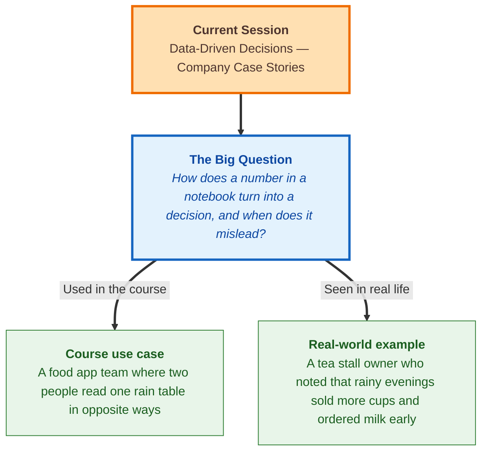

## Data-Driven Decisions — Company Case Stories

### Mental Map

---

### What You'll Learn

Have you ever wondered how a tea stall owner knows how much milk to buy before the rain starts?

By the end of this session, you will be able to:

- **Recall** what the owner wrote in the notebook on rainy days.
- **Explain** how the owner's note led to ordering 5 litres more milk.
- **Trace** a day when the owner misread the notebook and ran short.
- **Examine** why two sales rising together do not prove one caused the other.
- **Justify** which choice you would make on a rainy Friday.
- **Write** your choice in 4 short sentences.

> **Topics you will meet:** stories of companies that won/lost big through data decisions (Netflix recommendation shift, Zomato/Swiggy pricing, retail stockout examples), what changed what the data revealed, discussion what would you have done.
>
> Join the session to learn each of these in detail.

---

### Why You Are Learning This Topic

Mohan runs a tea stall. He writes cups sold in a notebook every evening. After 3 weeks he sees that rainy evenings sell more cups. He now orders 5 litres more milk before a forecast rain. One Friday it rains and the milk runs out by 6 pm. Mohan had not noted that a local match was on.

A **data-driven decision** means a choice based on numbers you collected and checked, not on a feeling.

In this course, you will turn a number into a choice, and name what could make the number mislead.

> **Think about it:** Did the notebook fail Mohan, or did he read it too quickly?

---

### Tea Stall Puzzle

Here are 5 evenings from Mohan's notebook.

| Day | Weather | Cups sold |
|:----------:|:----------:|:----------:|
| Monday | Sunny | 80 |
| Tuesday | Rain | 120 |
| Wednesday | Sunny | 85 |
| Thursday | Rain | 125 |
| Friday | Rain | 130 |

**What you want to happen:**

- Mohan orders the right amount of milk for a rainy evening.
- Mohan notes anything else that changed that day.
- Mohan can show his notebook to a friend and explain the choice.

> **Wonder about this:**
>
> - Is 3 rainy evenings enough to be sure?
> - What else could make Friday different?

---

### Think It Through

There is no wrong first try. Keep your guesses for the session.

**1. Rainy evenings sold 120, 125 and 130 cups. What is the average?**
Hint: Add the three and divide by 3.

**2. Sunny evenings sold 80 and 85 cups. What is the gap in cups between the rainy average and the sunny average?**
Hint: Subtract the two averages.

**3. Mohan ran short on Friday. Name one thing he did not write in the notebook.**
Hint: Think about what else changes a crowd.

---

### One Question to Carry Into the Session

> **How can a small notebook help us choose, and how can it fool us?**
>
> What would you add to Mohan's notebook first?
