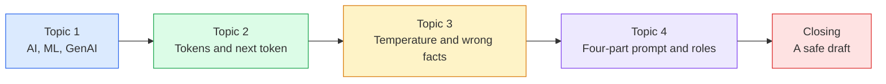
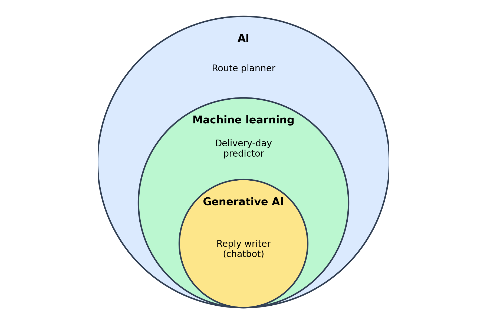
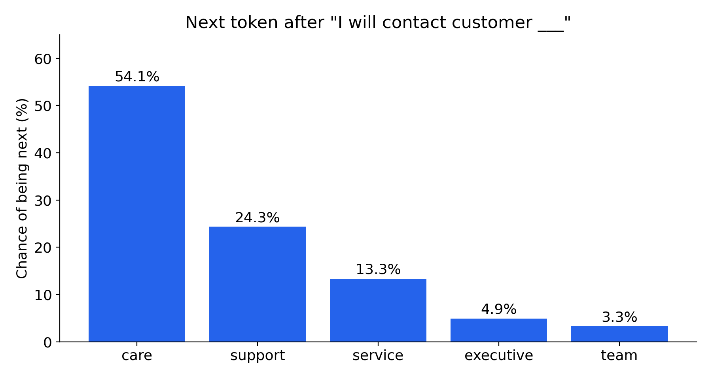
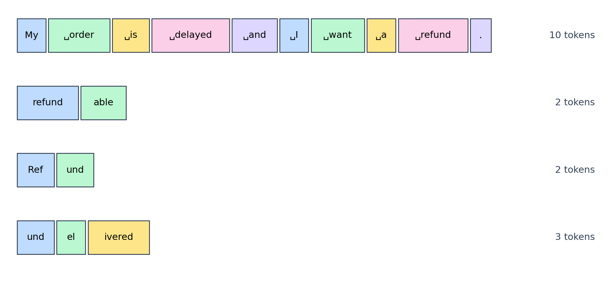
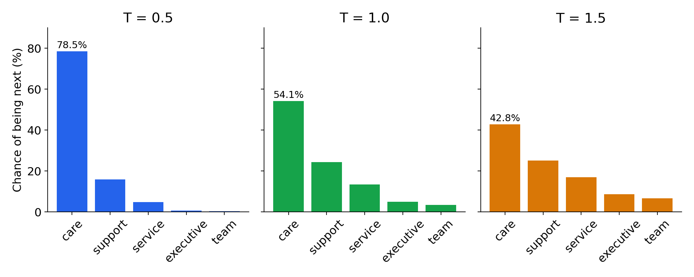

# <font color='#1d4ed8'>Lecture Script: How AI and LLMs Work with Prompts</font>

---

## <font color='blue'>Agenda</font>

The lecture runs as four topics. Each topic ends with a quiz.

| Topic | What we do | Learning objectives covered | Minutes |
|:-:|:--|:--|:-:|
| 1 | Sort the labels: AI, machine learning and generative AI | Compare AI, machine learning and generative AI by what each term covers | 20 |
| 2 | Watch a reply being built one token at a time | Describe next-token prediction as the mechanism that produces an LLM response<br>Describe how a tokenizer splits text into subword tokens | 30 |
| 3 | See why answers vary and why fluent is not the same as true | Predict how raising temperature changes the variability of an output<br>Explain why a model can produce fluent text that is factually wrong | 30 |
| 4 | Write a prompt with four elements, and know who builds the product | State the four elements of a well-formed prompt: task, context, format and constraints<br>List the roles that build and run an AI product and what each does | 25 |
| — | Closing: Outcome & Summary | | 15 |
| | **Total** | | **120** |

> <font color="red">**🎯 Instructor Note**</font> Pace: keep Topic 1 quick. Spend the time on temperature and wrong-but-fluent answers in Topic 3, and on the live prompt in Topic 4.
> Learners use a free chatbot (ChatGPT, Claude or Gemini). Chatbot replies change from run to run, so this script states what to look for, never the exact words.

---

## <font color='blue'>Scenario</font>

A Flipkart-style shopping app lets support agents click "Draft reply" and a chatbot writes the message. A customer, Sana, wrote this:

> *"My saree order was due on 10 March. Today is 14 March and it has not arrived. What do I do?"*

The agent sends the first draft the chatbot gives. The draft is smooth and kind. It also promises "a full refund within 24 hours".

> <font color="red">**🎯 Instructor Note**</font> Flipkart is only the setting. Do not claim it uses this chatbot or this policy. The customer, the order and the policy lines in this script are invented for teaching. Token splits come from one real tokenizer (`cl100k_base`). The word probabilities are invented for teaching, and the temperature maths is computed exactly.

---

## <font color='blue'>Problem Statement</font>

The support team has no refund promise in its policy. The real policy says an agent checks the courier first and offers a refund only after 7 days of delay. The chatbot wrote a confident sentence that sounded like a policy, and the agent did not notice. Sana waited for a refund that never came, and then she wrote an angry review. When the agent asked the chatbot again for a draft, the wording was different, and this time it promised a replacement. Nobody could say why the answers changed or how to stop the invention.

> <font color='purple'>**How does a chatbot build its reply, why do answers vary, why can a smooth answer be wrong, and how do we write a prompt that gives a useful and safe draft every time?**</font>

> <font color="red">**🎯 Instructor Note**</font> Poll: "A chatbot gives a calm, well-written answer. Is it correct?" Options: yes, no, or only if it is long. Give learners 30 seconds to respond in chat. Reveal the answer in the Closing.

---

## <font color='blue'>What We Will Use</font>

Before this lecture you saw the AI landscape, where AI is used in business, and how AI "thinks". Today you use that knowledge on a free chatbot. Use ChatGPT, Claude or Gemini, any one of them.

| Topic | Tools | In one line |
|:-:|:--|:--|
| 1 | A chatbot, the label table | Place each tool of the shop app under AI, machine learning or generative AI |
| 2 | Token and next-token ideas | See a reply as small pieces chosen one after another |
| 3 | The temperature setting, a fact check | Judge why answers vary and check what the model says |
| 4 | A four-part prompt, a role table | Write a prompt that gives a safe draft, and name who builds the product |

---

## <font color='blue'>How: Walking Through One Support Reply</font>



---

## <font color='blue'>Topic 1: Sort the labels: AI, machine learning and generative AI</font> `20 min`

> <font color='purple'>**The shop app has a route planner, a delivery-day predictor and a reply writer. People call all three "AI". Are they the same thing?**</font>

### <font color='green'>Example: Place each tool under the right label</font>

> <font color='purple'>**Which label fits each tool: AI, machine learning or generative AI?**</font>

**AI** is the wide field: any computer system that does a task that normally needs human thinking. **Machine learning** (ML) is the part of AI where the system learns patterns from data instead of following written rules. **Generative AI** (GenAI) is the part of ML that creates new content, such as text or images, and the chatbot is one. So each term sits inside the one before it.

**Predict before you read the table: What will happen?**

> <font color="red">**🎯 Instructor Note**</font> Give learners 30 seconds to respond in chat. Expected: most will call all three "AI". That is true, and the task is to go one level deeper.

| Tool in the shop app | What it does | AI | ML | GenAI |
|:--|:--|:-:|:-:|:-:|
| Route planner | Searches for the shortest delivery route | Yes | No | No |
| Delivery-day predictor | Learns from past orders to predict days to deliver | Yes | Yes | No |
| Reply writer (the chatbot) | Writes new text for the customer | Yes | Yes | Yes |

<p align="center"></p>

> <font color='green'>**Result**</font> All three tools are AI. Two of them are ML. Only the reply writer is GenAI. The label tells you what a tool can and cannot do: a predictor gives a number, and a GenAI tool gives new text.

### <font color='green'>Extending it: Sort a new tool</font>

> <font color='purple'>**A tool learns from 2 lakh past tickets to tag each new ticket as Delay, Refund or Damage. Where does it sit?**</font>

> <font color="red">**🎯 Instructor Note**</font> Ask for a prediction. Expected: AI and ML. It picks a tag from a fixed list, and it creates no new content, so it is not GenAI.

> <font color='green'>**Result**</font> It is machine learning, inside AI. It learns from data and chooses one of three tags. It does not write new text, so it is not generative.

### <font color='purple'>Quiz 1</font>

**Question:** A model learns from past orders to predict delivery days. A separate assistant writes reply text. Which labels fit?

**Options:**
- A) Both are generative AI
- B) The predictor is generative AI and the writer is only machine learning
- C) The predictor is machine learning and the writer is generative AI, and both are AI
- D) The predictor is AI but not machine learning

**Correct Answer:** C

**Explanation:**
- **A)** The predictor gives a number. It does not create new content, so it is not GenAI.
- **B)** The labels are swapped. The writer is the generative one.
- **C)** The predictor learns from data (ML). The writer creates new text (GenAI). Both sit inside AI.
- **D)** A model that learns from data is machine learning, so the predictor is ML as well.

---

## <font color='blue'>Topic 2: Watch a reply being built one token at a time</font> `30 min`

> <font color='purple'>**The chatbot wrote a whole paragraph for Sana. Did it plan the whole paragraph first?**</font>

### <font color='green'>Example: Next-token prediction</font>

> <font color='purple'>**What does the chatbot do each time it adds a piece to the reply?**</font>

An **LLM** (large language model) is a model trained on a very large amount of text. To answer, it reads everything so far and predicts the **next token**, the next small piece of text. It adds that token, reads again, and predicts the next one. A reply is built one token at a time. The model does not look up a stored answer.

Take the start "I will contact customer ___". The model gives each possible next token a probability, then picks one.

| Next token | Probability |
|:--|:-:|
| care | 54.1 percent |
| support | 24.3 percent |
| service | 13.3 percent |
| executive | 4.9 percent |
| team | 3.3 percent |

**Predict before you read on: What will happen?**

> <font color="red">**🎯 Instructor Note**</font> Ask which token is most likely and whether the model must pick it. Expected: "care" is most likely. The model usually picks a likely token, but it can pick another. These probabilities are invented for teaching and rounded.

<p align="center"></p>

> <font color='green'>**Result**</font> The reply grows one token at a time. At each step the model scores the possible next tokens and picks one. A fluent paragraph is thousands of such small choices in a row.

### <font color='green'>Extending it: What a token looks like</font>

> <font color='purple'>**How does a tokenizer cut text into tokens? Is a token a word?**</font>

A **tokenizer** cuts text into **subword tokens**, pieces that are often whole words but can be parts of a word. Common words are usually one token. Rare or long words are cut into several pieces. Each model has its own tokenizer, so splits differ between models.

> <font color="red">**🎯 Instructor Note**</font> Ask for a prediction. These splits come from one real tokenizer, `cl100k_base`. Expected surprises: " refund" is one token but "Refund" at the start is two, and "undelivered" does not split by syllables.

| Text | Tokens | Count |
|:--|:--|:-:|
| My order is delayed and I want a refund. | My · ␣order · ␣is · ␣delayed · ␣and · ␣I · ␣want · ␣a · ␣refund · . | 10 |
| refundable | refund · able | 2 |
| Refund | Ref · und | 2 |
| undelivered | und · el · ivered | 3 |

<p align="center"></p>

> <font color='green'>**Result**</font> A token is a piece of text, often part of a word and sometimes a space and a word together (the sign ␣ marks a leading space). The same word can split differently with a capital letter. That is why a model works with tokens and not with words.

### <font color='purple'>Quiz 2</font>

**Question:** Which statement best describes how an LLM produces a reply?

**Options:**
- A) It predicts one token at a time from the tokens so far
- B) It looks up the reply in a store of ready answers
- C) It writes the full reply first and then types it
- D) It reads the customer's mind and checks the real order

**Correct Answer:** A

**Explanation:**
- **A)** The model adds one token, reads everything again, and predicts the next token.
- **B)** An LLM is not a database of answers. It builds the text from probabilities.
- **C)** The reply is built token by token. There is no hidden finished reply.
- **D)** The model sees only the text in its input. It cannot check the real order unless you paste it in.

---

## <font color='blue'>Topic 3: See why answers vary and why fluent is not the same as true</font> `30 min`

> <font color='purple'>**The agent asked twice and got two different drafts. And the first draft promised a refund that does not exist. What is going on?**</font>

### <font color='green'>Example: Temperature changes the variety</font>

> <font color='purple'>**What happens to the choice of the next token when we raise the temperature?**</font>

**Temperature** is a setting that controls how adventurous the model is when it picks the next token. Low temperature makes the likely tokens even more likely, so answers repeat. High temperature flattens the odds, so unlikely tokens get picked more often. The model first computes a score $z_i$ for each token. The probability of token $i$ at temperature $T$ is

$$\boxed{p_i = \frac{e^{z_i / T}}{\sum_j e^{z_j / T}}}$$

You do not need to calculate this by hand. Look at what it does to the same five tokens.

**Predict before you read the table: What will happen?**

> <font color="red">**🎯 Instructor Note**</font> Ask what happens to "care" when $T$ is raised from 0.5 to 1.5. Expected: its chance falls and the others rise. Values are computed exactly from invented scores and rounded to one decimal.

| Next token | T = 0.5 (low) | T = 1.0 | T = 1.5 (high) |
|:--|:-:|:-:|:-:|
| care | 78.5 percent | 54.1 percent | 42.8 percent |
| support | 15.8 percent | 24.3 percent | 25.1 percent |
| service | 4.8 percent | 13.3 percent | 16.8 percent |
| executive | 0.6 percent | 4.9 percent | 8.6 percent |
| team | 0.3 percent | 3.3 percent | 6.6 percent |

<p align="center"></p>

> <font color='green'>**Result**</font> Raising the temperature lowers the chance of the top token ("care" goes from 78.5 to 42.8 percent) and raises the chance of the rest. Answers become more varied. Lowering it makes answers more repeatable.

> <font color='#b45309'>**Common mistake**</font> Thinking a low temperature makes the model more accurate. It only makes the output more repeatable. A repeatable wrong answer is still wrong.

### <font color='green'>Extending it: Ask the same question three times</font>

> <font color='purple'>**What do you see when you ask the chatbot the same question three times?**</font>

Open your chatbot. Type this prompt in a new chat, three times in three new chats.

```text
Write a one-line reply to a customer whose saree order is 4 days late.
```

> <font color="red">**🎯 Instructor Note**</font> Give learners 2 minutes. Expected: the three lines share the same idea but use different words. Free chatbots do not show the temperature, so the variety is the evidence. Do not share exact replies as "correct".

> <font color='green'>**Result**</font> The ideas match and the words differ, because each run picks tokens a little differently. Variety is normal, so never expect the exact same sentence twice.

### <font color='green'>Example: Fluent but wrong</font>

> <font color='purple'>**Why did the smooth draft promise a refund that is not in the policy?**</font>

The model picks the **next likely token**. It does not check a fact. A policy-sounding sentence is a likely thing to write after "Sorry for the delay", so the model writes it. This is called **hallucination**: text that reads well and is not backed by facts. Test it with a made-up rule.

**Predict before you send the prompt: What will happen?**

```text
What is the return window for sarees under the Super Saver Plus plan?
```

> <font color="red">**🎯 Instructor Note**</font> "Super Saver Plus" is invented. A model may give a confident number, or it may say it cannot verify the plan. Both are useful to discuss. Learners must check any number against a real source. Do not claim any single reply is typical.

> <font color='green'>**Result**</font> If the chatbot gives a number, it made it up, because the plan does not exist. Fluent text is not a sign of truth. Facts must come from a source that you check.

### <font color='purple'>Quiz 3</font>

**Question:** A reply must use almost the same wording every time. Which temperature suits it, and why?

**Options:**
- A) High, because flatter odds repeat the same words
- B) High, because it makes the answer more accurate
- C) Low, because it makes the model check each fact
- D) Low, because the top token gets most of the chance, so wording changes little

**Correct Answer:** D

**Explanation:**
- **A)** High temperature flattens the odds, so the wording varies more.
- **B)** Temperature does not change accuracy.
- **C)** No setting makes the model check a fact. A low temperature only repeats the likely tokens.
- **D)** At low temperature the top token takes most of the probability, so the words barely change.

---

## <font color='blue'>Topic 4: Write a prompt with four elements, and know who builds the product</font> `25 min`

> <font color='purple'>**We cannot stop the model from guessing the next token. What can we change so that the draft is useful and safe?**</font>

### <font color='green'>Example: From a vague prompt to a four-part prompt</font>

> <font color='purple'>**What four things should a prompt tell the model?**</font>

A well-formed prompt has four elements:

- **Task**: what the model must do.
- **Context**: the facts it needs, such as the real policy.
- **Format**: the shape of the answer.
- **Constraints**: what it must not do.

A vague prompt leaves the model to fill the gaps with likely text. A clear one leaves little to guess.

**Predict before you send both prompts: What will happen?**

> <font color="red">**🎯 Instructor Note**</font> Learners send Prompt A and then Prompt B in two new chats. Expected: A gives a long, generic reply that may promise things. B gives 3 short sentences, with the courier check and no refund promise. Words differ by run.

```text
Prompt A: Reply to this customer.
```

```text
Prompt B:
TASK: Write a reply to Sana, whose saree order was due on 10 March.
CONTEXT: Today is 14 March. Policy: agents check the courier first.
A refund is offered only after 7 days of delay.
FORMAT: 3 short sentences, polite, no bullet points.
CONSTRAINTS: Do not promise a refund or a replacement. Do not invent policy.
```

#### <font color='#c2410c'>Logic Explanation</font>

- **Task** says what to write, and for whom.
- **Context** gives the dates and the real policy, so the model has no need to invent it.
- **Format** limits the length and the tone.
- **Constraints** block the exact mistake that hurt Sana.

> <font color='green'>**Result**</font> Prompt B gives 4 days of delay, the courier check and no refund promise, because the prompt held those facts. The model still predicts tokens, but now the likely tokens are the right ones.

### <font color='green'>Extending it: Remove one element and see</font>

> <font color='purple'>**What happens if we delete only the Constraints line from Prompt B?**</font>

> <font color="red">**🎯 Instructor Note**</font> Ask for a prediction. Expected: the reply is often still fine, but it may now offer a refund or a replacement. Run it twice. The point is to see the risk, not to prove it happens every time.

> <font color='green'>**Result**</font> With no Constraints, nothing stops a helpful-sounding promise. Each element removes one kind of guess. Remove one and that guess comes back.

### <font color='green'>Extending it: Who builds and runs a product like this?</font>

> <font color='purple'>**Who made the "Draft reply" button work, and who would fix the refund mistake?**</font>

| Role | What the role does in the support assistant |
|:--|:--|
| Product manager | Decides that the assistant should draft replies and what a good reply means |
| Data engineer | Collects and cleans past tickets and policy text, and delivers them to the team |
| Data scientist | Tests whether the replies are accurate on a sample of tickets |
| ML engineer | Connects the model to the app so the "Draft reply" button works |
| Prompt engineer | Writes the prompt template with task, context, format and constraints |
| MLOps engineer | Keeps the service running and watches errors and cost |
| Data analyst | Measures reply time and escalations, and flags wrong outputs |

> <font color="red">**🎯 Instructor Note**</font> Tell learners that this course prepares them mostly for the data analyst role, who also writes prompts to analyse data. In small teams, one person can hold several roles.

> <font color='green'>**Result**</font> A product has several roles. The refund mistake needs the prompt engineer (fix the prompt), the data engineer (supply the real policy) and the analyst (spot wrong outputs).

### <font color='purple'>Quiz 4</font>

**Question:** Which prompt contains all four elements: task, context, format and constraints?

**Options:**
- A) "Reply to Sana politely."
- B) "Write a reply to Sana about her saree due on 10 March. Policy: refund after 7 days. Use 3 short sentences. Do not promise a refund."
- C) "Write a reply to Sana in 3 short sentences."
- D) "Sana's saree is late. Policy: refund after 7 days."

**Correct Answer:** B

**Explanation:**
- **A)** It has a task and a tone, but no context, format or constraint.
- **B)** Task (write a reply), context (due date and policy), format (3 short sentences) and constraint (no refund promise).
- **C)** It has a task and a format only.
- **D)** It has context but no task, format or constraint.

---

## <font color='blue'>Closing: Outcome & Summary</font> `15 min`

Back to Sana. We can now explain the first draft and write a better one.

> <font color='purple'>**1. Why did the first draft sound right and still make a promise?**</font>

The chatbot builds text one token at a time (Topic 2). A policy-sounding promise was a likely next piece after "Sorry for the delay", and the model never checks facts (Topic 3). Each new run picks tokens a little differently, so the second draft promised a replacement instead (Topic 3).

> <font color='purple'>**2. What is the safe draft, and who owns each part of the fix?**</font>

Send Prompt B from Topic 4 in a new chat. Check the reply against the policy before sending it. The prompt engineer owns the template, the data engineer supplies the policy, and the analyst checks outputs (Topic 4). The tools of the shop app are AI, with the reply writer being generative AI (Topic 1).

### <font color='green'>Outcome</font>

| | First draft | Final draft |
|:--|:-:|:-:|
| Prompt | Task only | Task, context, format and constraints |
| Facts in the prompt | None | Dates and the real policy |
| Refund promise | Yes, invented | No |
| Same wording on a second run | No | Not guaranteed, and the key facts stay the same |
| Checked by a person | No | Yes, against the policy |

> <font color='green'>**Therefore,**</font> a chatbot predicts the next likely token, so its text can sound right and be wrong. Put the facts in the prompt, say what it must not do, and check the output. The prompt cannot make the model perfect, and a person remains responsible for the result.

> <font color="red">**🎯 Instructor Note**</font> Reveal the poll: no. A calm, well-written answer is not evidence of truth. Link it to the invented "Super Saver Plus" return window.

### <font color='green'>Summary</font>

| Learning objective | Takeaway |
|:--|:--|
| AI, machine learning and generative AI | AI is the wide field, ML learns from data inside it, and GenAI creates new content inside ML |
| Next-token prediction | An LLM builds a reply one token at a time by picking from probabilities |
| Tokenizer | Text is cut into subword tokens, so a word can be 1 or several tokens |
| Temperature | Higher temperature flattens the odds and makes answers more varied |
| Fluent but wrong | The model picks likely text and does not check facts, so verify |
| Four elements of a prompt | Task, context, format and constraints |
| Roles in an AI product | Product manager, data engineer, data scientist, ML engineer, prompt engineer, MLOps engineer and data analyst each own a part |
| **Practical value** | A clear prompt and a human check turn a chatbot into a safe drafting helper |

---

# <font color='red'>Launch the Feedback Poll</font>

> <font color="red">**🎯 Instructor Note**</font> Reminder: launch the feedback poll now to collect learner feedback.
