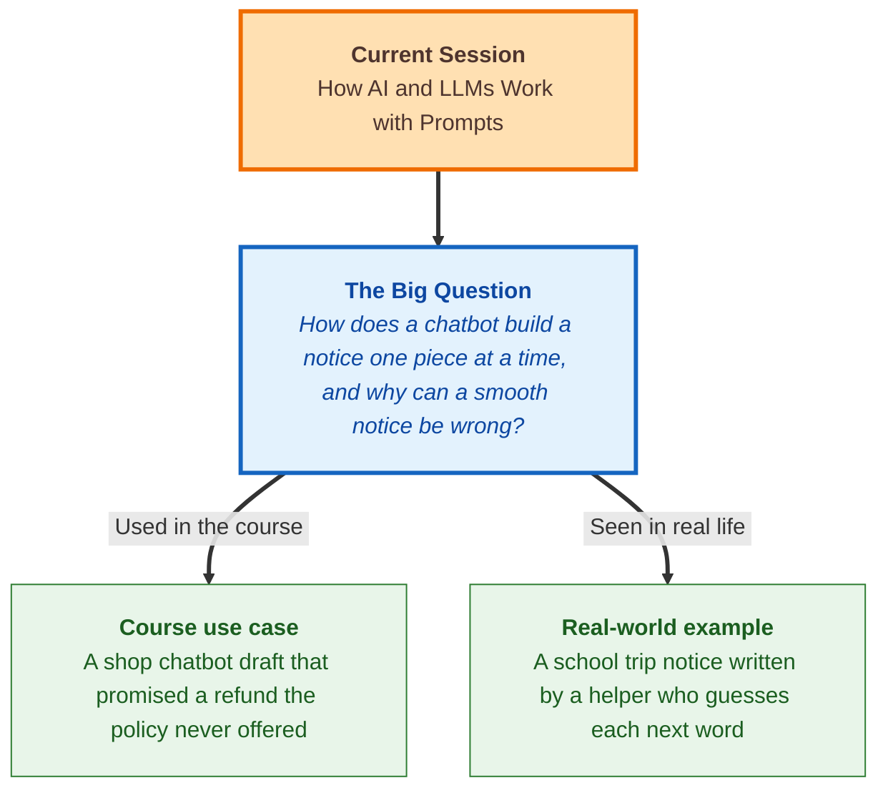

## How AI and LLMs Work with Prompts

### Mental Map

---

### What You'll Learn

Have you ever wondered how a phone keyboard guesses the next word before you type it?

By the end of this session, you will be able to:

- **List** the 4 roles on the school app team and what each role does.
- **Describe** how a helper picks the word after 'Dear' when writing the trip notice.
- **Explain** why a smooth notice can still name the wrong bus time.
- **Predict** how the notice changes when the helper is told to be bold or careful.
- **Compare** a vague request with a request that holds a task, a context, a shape and rules.
- **Write** a 4-part request for the trip notice.

> **Topics you will meet:** AI vs ML vs GenAI, next-token prediction, tokens context and temperature, hallucination, four elements of a prompt, roles and use cases across AI ML and GenAI.
>
> Join the session to learn each of these in detail.

---

### Why You Are Learning This Topic

Mrs. Kapoor needs a notice for the Science Museum trip. A helper writes it in 10 seconds. The notice sounds warm and clear. It says the bus leaves at 8:00 am. The real time is 7:30 am. Twelve students arrived late. The helper never checked the time. The helper wrote the words that sounded most likely.

A **prompt** means the instruction you give an AI helper before it writes.

In this course, you will write clear prompts and check what an AI helper writes against the facts.

> **Think about it:** Why did a notice that sounded so sure carry a wrong time?

---

### Trip Notice Puzzle

Here are the facts Mrs. Kapoor has.

| Detail | Fact |
|:----------:|:----------:|
| Place | Science Museum |
| Date | 20 March |
| Bus leaves | 7:30 am |
| Fee | Rs 250 |
| Return | 4:00 pm |

**What you want to happen:**

- The notice carries every fact above, exactly as written.
- The notice is 3 short sentences, ready for parents.
- The notice never promises a snack or a refund.

> **Wonder about this:**
>
> - What should Mrs. Kapoor tell the helper before it starts writing?
> - Would the helper write the same notice twice?

---

### Think It Through

There is no wrong first try. Keep your guesses for the session.

**1. Mrs. Kapoor types only 'Write a notice'. Which 2 facts could the helper guess wrong?**
Hint: Look at the table for times and money.

**2. She adds the table above to her request. How does that change what the helper has to guess?**
Hint: Think about what is known and what is missing.

**3. Who else on a school app team would you ask to check the notice before it goes out?**
Hint: Think of someone who tests, someone who owns the facts and someone who builds.

---

### One Question to Carry Into the Session

> **How can we ask an AI helper so that a smooth answer is also a true one?**
>
> Which fact in the trip notice would you check first?
