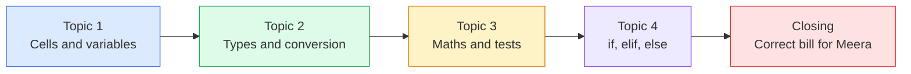
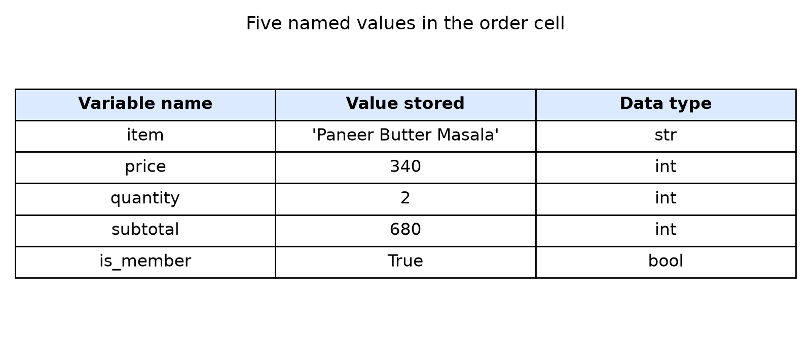
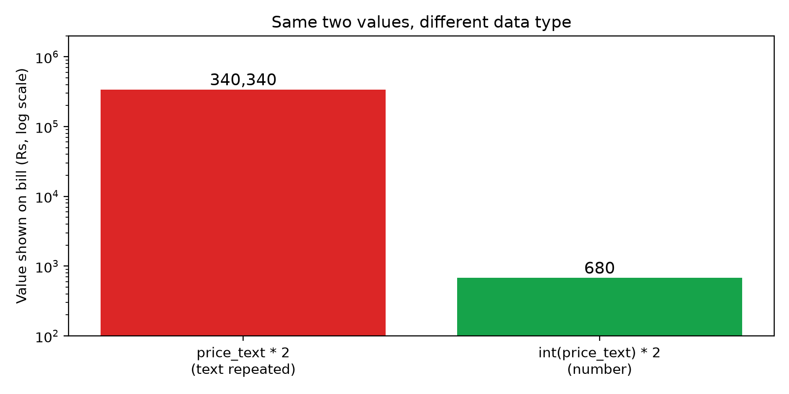
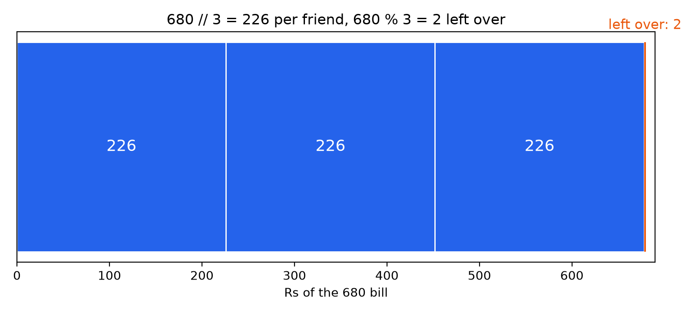
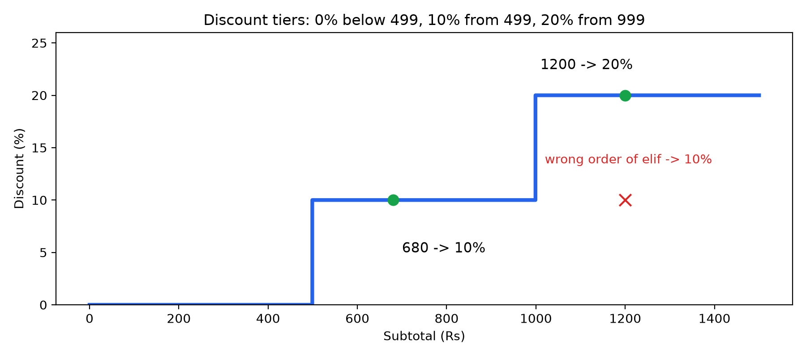
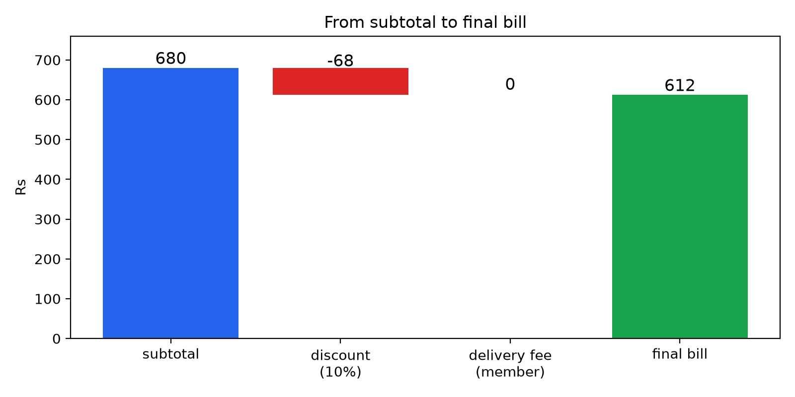

# <font color='#1d4ed8'>Lecture Script: Variables and Condition Logic in Colab</font>

---

## <font color='blue'>Agenda</font>

The lecture runs as four topics. Each topic ends with a quiz.

| Topic | What we do | Learning objectives covered | Minutes |
|:-:|:--|:--|:-:|
| 1 | Run a notebook cell and name the order values | Write and run code in a notebook cell, separating code cells from markdown cells<br>Write a script that stores values in named variables following Python naming conventions | 25 |
| 2 | Tell a text price from a number price | Classify a value as int, float, str or bool<br>Convert a value between string, integer and float types | 25 |
| 3 | Work out the bill with maths and tests | Compute a result using arithmetic operators, including integer division and modulo<br>Construct a boolean expression using comparison and logical operators | 30 |
| 4 | Pick the discount with if, elif and else | Implement branching logic for a stated business rule using if/elif/else | 25 |
| — | Closing: Outcome & Summary | | 15 |
| | **Total** | | **120** |

> <font color="red">**🎯 Instructor Note**</font> Pace: keep the notebook-cell walkthrough in Topic 1 quick. Spend the extra minutes on modulo in Topic 3 and on the order of `elif` in Topic 4.
> Every code block is a Google Colab cell. Run the cells top to bottom in one notebook.

---

## <font color='blue'>Scenario</font>

A Swiggy-style food app shows a checkout screen. Four facts sit behind it.

| What the screen shows | Value |
|:--|:-:|
| Dish | Paneer Butter Masala |
| Price of one dish | Rs 340 |
| Quantity | 2 |
| Member | Yes |

> <font color="red">**🎯 Instructor Note**</font> The company is only the setting. Do not claim it uses these numbers or rules. All values are invented for teaching and are typed straight into the notebook, so there is no data file. Use Google Colab with a fresh notebook.

---

## <font color='blue'>Problem Statement</font>

Meera orders 2 plates of Paneer Butter Masala at Rs 340 each. The checkout code reads the price from the screen as text. It repeats that text twice instead of multiplying. Meera sees a bill of "340340". She cancels the order, and the app loses a sale.

> <font color='purple'>**How can a few lines of notebook code store an order, work out the exact bill and pick the right discount, without mixing up text and numbers?**</font>

> <font color="red">**🎯 Instructor Note**</font> Poll: "If the price is text, what does `price * 2` do?" Options: crash, 680, or repeat the text. Give learners 30 seconds to respond in chat. Reveal the answer in the Closing.

---

## <font color='blue'>What We Will Use</font>

One tool for the whole lecture: Google Colab. Last session you used a chat tool and wrote prompts. Today you write the instructions yourself, in Python, and the notebook runs them.

| Topic | Tools | In one line |
|:-:|:--|:--|
| 1 | Code cell, markdown cell, `=`, `print()` | Run code and give each value a name |
| 2 | `type()`, `int()`, `float()`, `str()` | Check what kind of value you hold and change it |
| 3 | `+ - * / // % **`, `== != > < >= <=`, `and or not` | Calculate and ask yes or no questions |
| 4 | `if`, `elif`, `else` | Choose a path for a business rule |

---

## <font color='blue'>How: Walking Through the Checkout Screen</font>



---

## <font color='blue'>Topic 1: Run a notebook cell and name the order values</font> `25 min`

> <font color='purple'>**Where does Meera's order live while the code works on it?**</font>

### <font color='green'>Example: Store the order in named variables</font>

> <font color='purple'>**How do we hold the dish, the price and the quantity so that we can use them again?**</font>

A Colab notebook has two kinds of cells. A **code cell** runs Python and shows the output under it. A **markdown cell** holds notes, such as a heading that says `## Meera's order`. It never runs.

A **variable** is a name that points to a value. The `=` sign stores the value on its right under the name on its left.

**Predict before running: What will happen?**

> <font color="red">**🎯 Instructor Note**</font> Expected: one line with the three values separated by spaces. A common wrong guess is that `print` shows the variable names too.

```python
item = "Paneer Butter Masala"
price = 340
quantity = 2
print(item, price, quantity)
```

**Output**

```
Paneer Butter Masala 340 2
```

#### <font color='#c2410c'>Code Explanation</font>

- **Line 1** stores the text `Paneer Butter Masala` under the name `item`. Quotes mark text.
- **Line 2** stores the number 340 under the name `price`.
- **Line 3** stores the number 2 under the name `quantity`.
- **Line 4** `print()` shows the stored values, not the names.

> <font color='green'>**Result**</font> Three named values now sit in the notebook's memory. Any later cell can use them.

<p align="center"></p>

### <font color='green'>Extending it: Use the names in a calculation</font>

> <font color='purple'>**What is the bill before any discount?**</font>

> <font color="red">**🎯 Instructor Note**</font> Ask learners to type the answer in chat before running. Expected: 680.

```python
subtotal = price * quantity
print(subtotal)
```

**Output**

```
680
```

> <font color='green'>**Result**</font> We never typed 340 or 2 again. The names carried the values into the new line.

### <font color='green'>Extending it: Names Python accepts and names it does not</font>

> <font color='purple'>**Can any word be a variable name?**</font>

> <font color="red">**🎯 Instructor Note**</font> Run the bad name in a separate cell so the error does not stop the notebook. The error text is the last line Python prints.

A good name uses lowercase letters, digits and underscores, and starts with a letter or an underscore. Words are joined with an underscore, such as `delivery_fee`. A name must not start with a digit, must not contain spaces, and capital letters make a different name.

Typing `2nd_item = 5` in a cell gives this error:

```
SyntaxError: invalid decimal literal
```

Typing `print(Price)` when only `price` exists gives:

```
NameError: name 'Price' is not defined. Did you mean: 'slice'?
```

> <font color='green'>**Result**</font> `price` and `Price` are two different names. Pick a clear lowercase name and use it the same way every time.

> <font color='#b45309'>**Common mistake**</font> Writing `Price` after storing `price`. Fix: copy the name exactly, and read the last line of an error first.

### <font color='green'>Extending it: Notebook habits</font>

#### <font color='#c2410c'>Logic Explanation</font>

- Put a markdown cell above each part of the work with a short heading, for example `## Meera's order`.
- Cells run in the order you click them, not the order they appear. A variable defined in a cell that has not run does not exist yet.
- Use **Runtime, then Restart session and run all** before sharing a notebook. If it runs from top to bottom without errors, the order of cells is safe.

> <font color='green'>**Result**</font> A notebook that survives "Restart and run all" gives the same answer for everyone.

### <font color='purple'>Quiz 1</font>

**Question:** In a Colab notebook, which cell type holds the note `## Meera's order` and is never run as Python?

**Options:**
- A) Code cell
- B) Markdown cell
- C) Output cell
- D) Variable cell

**Correct Answer:** B

**Explanation:**
- **A)** A code cell runs Python. A heading typed there would raise an error.
- **B)** Correct. A markdown cell shows formatted notes and is never run as code.
- **C)** Output appears under a code cell. It is not a cell you type notes in.
- **D)** There is no cell type called a variable cell.

---

## <font color='blue'>Topic 2: Tell a text price from a number price</font> `25 min`

> <font color='purple'>**Meera's price came in as text. How do we see that, and how do we fix it?**</font>

### <font color='green'>Example: Ask Python what type a value is</font>

> <font color='purple'>**What kinds of values does the order hold?**</font>

Every value has a **data type**. The four we use today are `int` for whole numbers, `float` for numbers with a decimal point, `str` for text and `bool` for `True` or `False`.

**Predict before running: What will happen?**

> <font color="red">**🎯 Instructor Note**</font> Expected: str, int, float, bool, one per line, each inside `<class '...'>`. A common wrong guess is that `1.5` is an int.

```python
print(type(item))
print(type(price))
print(type(1.5))
print(type(True))
```

**Output**

```
<class 'str'>
<class 'int'>
<class 'float'>
<class 'bool'>
```

#### <font color='#c2410c'>Code Explanation</font>

- **Line 1** `item` holds text, so its type is `str`.
- **Line 2** `price` holds 340, a whole number, so its type is `int`.
- **Line 3** `1.5` has a decimal point, so it is a `float`.
- **Line 4** `True` is a yes or no value. Its type is `bool`.

> <font color='green'>**Result**</font> We can name the type of any value with `type()`.

### <font color='green'>Extending it: Reproduce Meera's "340340" bill</font>

> <font color='purple'>**What happens when the price is text and we multiply by 2?**</font>

> <font color="red">**🎯 Instructor Note**</font> This is the poll from the Problem Statement. Let learners guess first. Expected: the text repeats. Do not reveal the poll result yet.

```python
price_text = "340"
print(price_text * 2)
print(int(price_text) * 2)
```

**Output**

```
340340
680
```

#### <font color='#c2410c'>Code Explanation</font>

- **Line 1** the quotes make `"340"` a `str`, even though it looks like a number.
- **Line 2** `*` on text repeats the text, so `"340" * 2` is `340340`.
- **Line 3** `int()` converts the text to the number 340 first. Then `*` multiplies, giving 680.

> <font color='green'>**Result**</font> The same two values gave "340340" or 680. The data type decided the answer.

<p align="center"></p>

### <font color='green'>Extending it: Decimal text and the conversion that fails</font>

> <font color='purple'>**The delivery fee arrives as "40.50". Which conversion works?**</font>

> <font color="red">**🎯 Instructor Note**</font> Run both lines in separate cells. Expected: `float` works and prints 50.5. `int` raises a `ValueError`. The error text below is the last line Python prints.

```python
fee_text = "40.50"
print(float(fee_text) + 10)
```

**Output**

```
50.5
```

Now the second conversion, `int("40.50")`:

```
ValueError: invalid literal for int() with base 10: '40.50'
```

> <font color='green'>**Result**</font> `float()` reads decimal text. `int()` cannot read text that has a decimal point.

> <font color='#b45309'>**Common mistake**</font> Using `int()` on decimal text. Fix: use `float()` first, or fix the text.

### <font color='purple'>Quiz 2</font>

**Question:** `price_text = "340"`. What does `print(price_text * 2)` show?

**Options:**
- A) 680
- B) An error
- C) 340 2
- D) 340340

**Correct Answer:** D

**Explanation:**
- **A)** 680 would need a number. `"340"` is text, so it is repeated, not multiplied.
- **B)** Text times a whole number is allowed. It repeats the text.
- **C)** Python does not add a space or show the 2.
- **D)** Correct. `*` repeats text, so `"340"` appears twice.

---

## <font color='blue'>Topic 3: Work out the bill with maths and tests</font> `30 min`

> <font color='purple'>**Now that 340 is a real number, how do we add tax, share the bill and ask yes or no questions?**</font>

### <font color='green'>Example: Tax and sharing with arithmetic operators</font>

> <font color='purple'>**What is the 5% tax on Rs 680, and how do 3 friends split it?**</font>

The operators are `+` add, `-` subtract, `*` multiply, `/` divide, `//` whole-number division, `%` remainder (modulo) and `**` power.

$$\boxed{ \text{amount} = \text{quotient} \times \text{divisor} + \text{remainder} }$$

For the split: $680 = 226 \times 3 + 2$.

**Predict before running: What will happen?**

> <font color="red">**🎯 Instructor Note**</font> Expected: 34.0, then 226, then 2. A common wrong guess is 226.67 for the second line, which is what `/` gives, not `//`.

```python
gst = subtotal * 0.05
print(gst)
print(subtotal // 3)
print(subtotal % 3)
```

**Output**

```
34.0
226
2
```

#### <font color='#c2410c'>Code Explanation</font>

- **Line 1** 5% is the same as $0.05$, so $680 \times 0.05 = 34$.
- **Line 3** `//` throws away the decimal part: $680 \div 3 = 226.67$ becomes 226.
- **Line 4** `%` gives what is left after those 226s: $680 - 3 \times 226 = 2$.

> <font color='green'>**Result**</font> Each friend pays Rs 226 and Rs 2 is left to settle.

<p align="center"></p>

### <font color='green'>Extending it: Ask yes or no questions about the bill</font>

> <font color='purple'>**Does Meera qualify for an offer?**</font>

The comparison operators are `==` equal, `!=` not equal, `>`, `<`, `>=` and `<=`. Each gives a `bool`. The logical operators `and`, `or` and `not` join those answers.

> <font color="red">**🎯 Instructor Note**</font> Ask learners to predict all four lines. `is_member` is True. `and` needs both sides True. `or` needs one. `not` flips the value.

```python
is_member = True
print(subtotal >= 499)
print(subtotal >= 499 and is_member)
print(subtotal >= 999 or is_member)
print(not is_member)
```

**Output**

```
True
True
True
False
```

#### <font color='#c2410c'>Code Explanation</font>

- **Line 2** $680 \ge 499$ is true.
- **Line 3** `and` is true only when both sides are true. Both are.
- **Line 4** $680 \ge 999$ is false, but `or` needs one true side. `is_member` is true.
- **Line 5** `not` flips True to False.

> <font color='green'>**Result**</font> A boolean expression turns a business rule into a True or False answer Python can use.

> <font color='#b45309'>**Common mistake**</font> Writing `=` where `==` is needed. `=` stores a value. `==` asks if two values are equal.

### <font color='purple'>Quiz 3</font>

**Question:** Meera's bill is Rs 680. What does `680 % 3` give?

**Options:**
- A) 226
- B) 226.67
- C) 2
- D) 0

**Correct Answer:** C

**Explanation:**
- **A)** 226 is what `680 // 3` gives, the whole-number part of the division.
- **B)** 226.67 is what `680 / 3` gives, a float with the decimal part kept.
- **C)** Correct. $3 \times 226 = 678$ and $680 - 678 = 2$ is left over.
- **D)** 0 would mean 3 divides 680 exactly. It does not.

---

## <font color='blue'>Topic 4: Pick the discount with if, elif and else</font> `25 min`

> <font color='purple'>**Meera's bill passes a test. How does the code choose which discount to give?**</font>

### <font color='green'>Example: A three-tier discount rule</font>

> <font color='purple'>**What discount does a Rs 680 subtotal get under this rule: 20% from Rs 999, 10% from Rs 499, otherwise none?**</font>

`if` runs its block when the test is True. `elif` is tried only when every test above it was False. `else` runs when nothing above matched. Python reads from the top and stops at the first True.

**Predict before running: What will happen?**

> <font color="red">**🎯 Instructor Note**</font> Expected: 0.1. The first test (680 >= 999) is False, so Python moves to the `elif`, which is True.

```python
if subtotal >= 999:
    discount = 0.20
elif subtotal >= 499:
    discount = 0.10
else:
    discount = 0.0
print(discount)
```

**Output**

```
0.1
```

#### <font color='#c2410c'>Code Explanation</font>

- **Line 1** tests the highest tier first. $680 \ge 999$ is false, so the block is skipped.
- **Line 3** the `elif` test $680 \ge 499$ is true, so `discount` becomes 0.10.
- **Line 5** `else` is skipped because a branch already ran.
- **Line 8** `print` shows the discount that was chosen.

> <font color='green'>**Result**</font> The code gave Meera 10%, exactly what the rule says.

### <font color='green'>Extending it: Why the order of the tests matters</font>

> <font color='purple'>**What if we test the lowest tier first, and the subtotal is Rs 1200?**</font>

> <font color="red">**🎯 Instructor Note**</font> Poll before running: "Which discount will 1200 get?" Expected: 0.1, which is wrong. The rule says 20%.

```python
subtotal = 1200
if subtotal >= 499:
    discount = 0.10
elif subtotal >= 999:
    discount = 0.20
else:
    discount = 0.0
print(discount)
```

**Output**

```
0.1
```

> <font color='green'>**Result**</font> A Rs 1200 order is cut by 10% instead of 20%. The first test already matched, so the `elif` never ran.

> <font color='#b45309'>**Common mistake**</font> Putting the broad test before the narrow one. Fix: list the highest tier first.

<p align="center"></p>

### <font color='purple'>Quiz 4</font>

**Question:** With the correct tier order (999 first, then 499), which discount does a Rs 499 subtotal get?

**Options:**
- A) 20%
- B) No discount
- C) 10%
- D) An error

**Correct Answer:** C

**Explanation:**
- **A)** 20% needs a subtotal of 999 or more. 499 is not.
- **B)** The rule says "from Rs 499", and `>=` includes 499 itself.
- **C)** Correct. $499 \ge 999$ is false, and $499 \ge 499$ is true, so the 10% branch runs.
- **D)** The code is valid. `elif` and `else` do not raise an error.

---

## <font color='blue'>Closing: Outcome & Summary</font> `15 min`

Back to Meera. We now answer the Problem Statement with one complete cell. It uses every topic once.

> <font color='purple'>**1. How do we hold the order? (Topic 1)**</font>

In named variables: `item`, `price`, `quantity`.

> <font color='purple'>**2. How do we avoid "340340"? (Topic 2)**</font>

Keep the price as a number. If it arrives as text, convert it with `int()` or `float()` first.

> <font color='purple'>**3. How do we get the bill, free delivery for members and the discount? (Topics 3 and 4)**</font>

First, the order and the delivery fee:

```python
item = "Paneer Butter Masala"
price = 340
quantity = 2
subtotal = price * quantity
is_member = True
delivery_fee = 0 if is_member else 40
print(subtotal, delivery_fee)
```

**Output**

```
680 0
```

Then the discount and the final bill:

```python
if subtotal >= 999:
    discount = subtotal * 0.20
elif subtotal >= 499:
    discount = subtotal * 0.10
else:
    discount = 0
final_bill = subtotal - discount + delivery_fee
print(item, subtotal, discount, delivery_fee, final_bill)
```

**Output**

```
Paneer Butter Masala 680 68.0 0 612.0
```

#### <font color='#c2410c'>Code Explanation</font>

- **First cell, lines 1 to 3** named variables hold the order (Topic 1).
- **First cell, line 4** `price * quantity` multiplies two `int` values (Topics 2 and 3).
- **First cell, line 6** `0 if is_member else 40` picks the fee: free for members, Rs 40 for others (Topic 4).
- **Second cell, lines 1 to 6** the tiered discount, highest tier first (Topic 4).
- **Second cell, line 7** subtracts the discount and adds the fee (Topic 3).

<p align="center"></p>

### <font color='green'>Outcome</font>

| | Meera's old checkout | Notebook checkout |
|:--|:-:|:-:|
| Price type | text | number |
| Bill shown | 340340 | 612.0 |
| Discount applied | none | 10% |

> <font color='green'>**Therefore,**</font> Meera pays Rs 612: Rs 680 minus Rs 68, with free delivery as a member. The bug came from a price stored as text. Converting it and testing the tiers in the right order fixes it.

> <font color="red">**🎯 Instructor Note**</font> Reveal the poll: `price * 2` on text repeats the text, so the answer is "repeat the text".

### <font color='green'>Summary</font>

| Learning objective | Takeaway |
|:--|:--|
| Notebook cells | Code cells run Python, markdown cells hold notes, and "Restart and run all" checks the order |
| Named variables | Use lowercase names with underscores. `price` and `Price` are different |
| Data types | `type()` shows int, float, str or bool |
| Type conversion | `int()` and `float()` turn text into numbers. `int("40.50")` fails |
| Arithmetic | `//` is the whole part, `%` is the remainder |
| Boolean expressions | Comparisons give True or False. `and`, `or` and `not` combine them |
| Branching | `if`, `elif` and `else` pick one path. Put the highest tier first |
| **Practical value** | Any checkout, bill or eligibility rule in your work is variables, types, maths and a test |

---

# <font color='red'>Launch the Feedback Poll</font>

> <font color="red">**🎯 Instructor Note**</font> Reminder: launch the feedback poll now to collect learner feedback.
