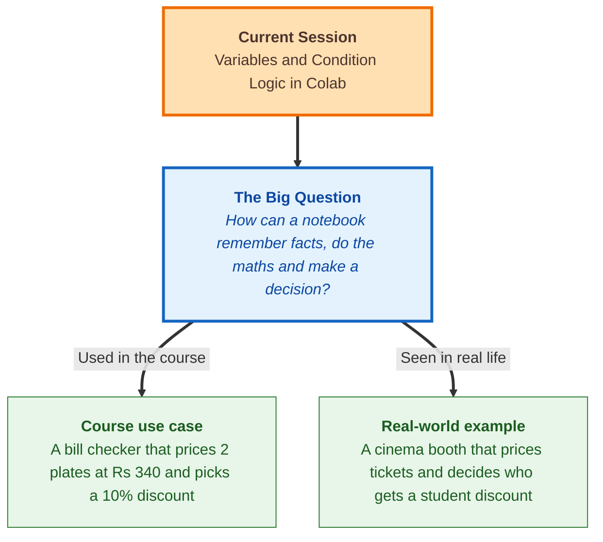

## <span style="color:#2F7DDE">Variables and Condition Logic in Colab</span>

### <span style="color:#2F7DDE">Mental Map</span>



---

### <span style="color:#2F7DDE">What You'll Learn</span>

Have you ever wondered how a cinema booth knows a student ticket costs less than a regular one?

By the end of this session, you will be able to:

- <span style="color:#D9660B">**Identify**</span> where you write instructions, where you write notes, and the labels for the 4 facts of one booking.
- <span style="color:#D9660B">**Classify**</span> each fact as a whole number, a decimal, a word or a yes-or-no answer.
- <span style="color:#D9660B">**Apply**</span> a fix that turns the word "250" into a number you can multiply.
- <span style="color:#D9660B">**Calculate**</span> the cost of 3 tickets and the rupees left when 3 friends share the bill.
- <span style="color:#D9660B">**Determine**</span> whether a booking earns the student price, using yes-or-no tests.
- <span style="color:#D9660B">**Design**</span> a three-level discount rule for the booth.

> <span style="color:#2F7DDE">**Topics you will meet:**</span> Running a Colab cell, notebook habits (markdown notes, Restart and run all), variables, data types, type conversion, arithmetic operators, comparison and logical operators, if/elif/else.
>
> Join the session to learn each of these in detail.

---

### <span style="color:#2F7DDE">Why You Are Learning This Topic</span>

Arjun walks up to a cinema booth with 3 friends. The clerk looks at a card. She says, "Student price, Rs 180 each." Then she says, "Total Rs 540."

The clerk remembered the price. She checked the card. She multiplied. Then she chose the right price.

A <span style="color:#D9660B">**variable**</span> means a name that holds a value, such as `ticket_price` holding 250.

In this course, you will teach a notebook to do the same four jobs: remember, check, calculate and decide.

> <span style="color:#2F7DDE">**Think about it:**</span> What would go wrong if the clerk forgot the price halfway through the sale?

---

### <span style="color:#2F7DDE">The Cinema Booth Puzzle</span>

Here are the facts for one booking at the booth.

| Fact | Value |
|:----------:|:----------:|
| Movie | Kantara |
| Ticket price | 250 |
| Tickets | 3 |
| Student card | Yes |

<span style="color:#D9660B">**What you want to happen:**</span>

- The booth shows the right total for 3 tickets.
- Students get a lower price than other visitors.
- A big group gets an extra discount on top.

Here is how it might start. You do not need to understand it yet.

```python
ticket_price = 250
tickets = 3
print(ticket_price * tickets)
```

> <span style="color:#D9660B">**Wonder about this:**</span>
>
> - What would the screen show if the price 250 arrived as a word, not a number?
> - How would the booth choose between two prices?

---

### <span style="color:#2F7DDE">Think It Through</span>

There is no wrong first try. Keep your guesses for the session.

**1. Rs 550 has to be shared by 3 friends. Can everyone pay an equal whole number of rupees?**
Hint: Try dividing, and look at what is left.

**2. The student price is Rs 180 and the regular price is Rs 250. What single question decides which one to show?**
Hint: The answer is a yes or a no.

**3. A group of 5 gets 20% off and a group of 3 gets 10% off. Which group size should the booth check first?**
Hint: Picture a group of 6 walking up.

---

### <span style="color:#2F7DDE">One Question to Carry Into the Session</span>

> <span style="color:#2F7DDE">**How does a notebook keep facts, calculate with them and choose a path?**</span>
>
> Which of the booth's four facts would you label first, and why?
