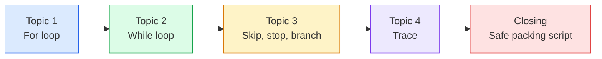
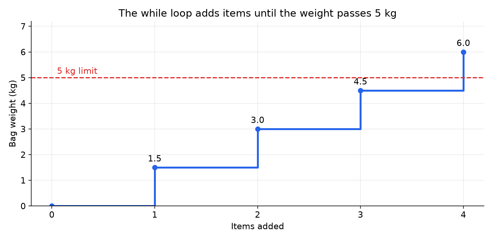
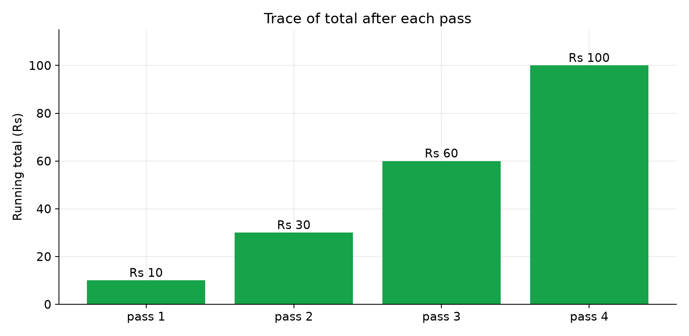
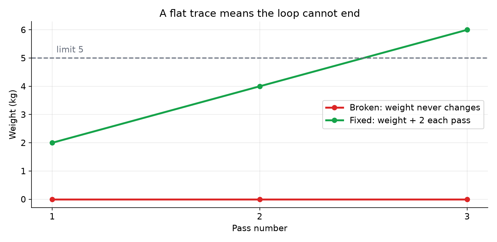
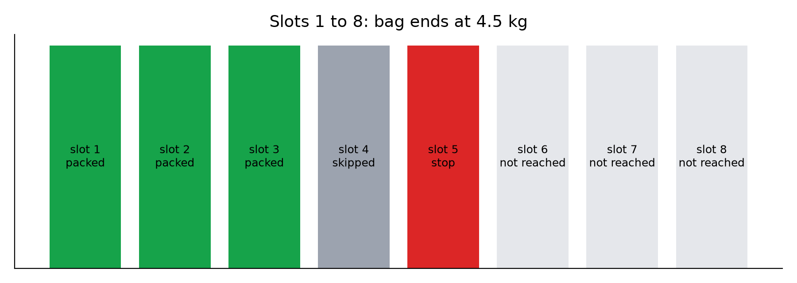

# <font color='#1d4ed8'>Lecture Script: Loops and Tracing What Runs</font>

---

## <font color='blue'>Agenda</font>

The lecture runs as four topics. Each topic ends with a quiz.

| Topic | What we do | Learning objectives covered | Minutes |
|:-:|:--|:--|:-:|
| 1 | Repeat work with a for loop | Write a for loop that iterates over a sequence | 25 |
| 2 | Repeat until a condition is met with a while loop | Write a while loop that terminates on a stated condition | 25 |
| 3 | Skip, stop and choose inside a loop | Apply break and continue to exit or skip iterations in a loop<br>Predict which branch of a conditional executes for a given input | 30 |
| 4 | Trace a loop and find why it never ends | Trace the value of a variable through successive loop iterations<br>Identify the condition in a loop that prevents it from terminating | 25 |
| — | Closing: Outcome & Summary | | 15 |
| | **Total** | | **120** |

> <font color="red">**🎯 Instructor Note**</font> Pace: keep the for loop over a string quick in Topic 1. Spend the extra minutes on tracing in Topic 4.
> Every code block is a Google Colab cell. Run the cells top to bottom in one notebook.

---

## <font color='blue'>Scenario</font>

**Before and after.** A Zepto-style quick-commerce app packs each order at a small warehouse called a dark store. A packer fills one bag per order. The bag may hold at most 5 kg.

| | Before the code | After the code |
|:--|:--|:--|
| Work | The packer counts aisles and weighs the bag by hand | A short loop counts aisles and adds weight |
| Stopping | The packer decides when the bag looks full | The code stops when the weight reaches the limit |
| Mistake | A tired packer overfills the bag | A loop with a wrong condition never stops |

> <font color="red">**🎯 Instructor Note**</font> Zepto is only the setting. Do not claim it uses these numbers or rules. All values are invented for teaching and typed into the notebook, so there is no data file. Use Google Colab with a fresh notebook.

---

## <font color='blue'>Problem Statement</font>

At 3 am a packing script was meant to add items to a bag until it weighed 5 kg. The programmer wrote `while weight < 5:` but forgot to add the weight of each item inside the loop. The weight stayed at 0, so the test stayed true forever. The script froze, and 40 orders waited with no bag packed.

> <font color='purple'>**How can a few lines of code repeat work, stop at the right moment, and let us trace exactly what ran?**</font>

> <font color="red">**🎯 Instructor Note**</font> Poll: "A loop test says `weight < 5` and the weight never changes. How many times does the loop run?" Options: 0 times, 5 times, or forever. Give learners 30 seconds to respond in chat. Reveal the answer in the Closing.

---

## <font color='blue'>What We Will Use</font>

Last session you stored values in variables and chose a path with `if`, `elif` and `else`. Today those same tools sit inside loops. The tool is still Google Colab.

| Topic | Tools | In one line |
|:-:|:--|:--|
| 1 | `for`, `range()` | Repeat a step for every number or every character |
| 2 | `while` | Repeat a step until a test turns false |
| 3 | `break`, `continue`, `if/elif/else` | Stop a loop early, skip one pass, pick a branch |
| 4 | print inside a loop | Show a variable on every pass, then read the trace |

---

## <font color='blue'>How: Walking Through the Dark Store Bag</font>



---

## <font color='blue'>Topic 1: Repeat work with a for loop</font> `25 min`

> <font color='purple'>**Packing starts at aisle 1. How do we visit aisles 1 to 5 without typing five lines?**</font>

### <font color='green'>Example: Visit five aisles with range</font>

> <font color='purple'>**How do we say the same thing once for each aisle number?**</font>

A **for loop** repeats its indented lines once for every value in a sequence. `range(1, 6)` is a sequence of whole numbers that starts at 1 and stops before 6, so it gives 1, 2, 3, 4, 5.

**Predict before running: What will happen?**

> <font color="red">**🎯 Instructor Note**</font> Expected: five lines, Aisle 1 to Aisle 5. A common wrong guess is that the last number is 6.

```python
for aisle in range(1, 6):
    print("Aisle", aisle)
```

**Output**

```
Aisle 1
Aisle 2
Aisle 3
Aisle 4
Aisle 5
```

#### <font color='#c2410c'>Code Explanation</font>

- **Line 1** `aisle` takes the next value from `range(1, 6)` on every pass. The colon starts the loop body.
- **Line 2** The indented line is the body. It runs once per value, so `print` runs five times.

> <font color='green'>**Result**</font> The loop ran five times, with `aisle` holding 1, then 2, 3, 4 and 5. The stop value 6 is never used.

### <font color='green'>Extending it: Add up the bag weight with a running total</font>

> <font color='purple'>**If aisle number 1 holds 1 kg, aisle 2 holds 2 kg and so on, how heavy is the bag after aisle 5?**</font>

> <font color="red">**🎯 Instructor Note**</font> Ask learners to type the total in chat before running. Expected: 15.

```python
bag_kg = 0
for aisle in range(1, 6):
    bag_kg = bag_kg + aisle
print(bag_kg)
```

**Output**

```
15
```

#### <font color='#c2410c'>Code Explanation</font>

- **Line 1** The bag starts empty, before the loop.
- **Line 3** Each pass adds the aisle number to the running total.
- **Line 4** `print` is outside the loop, so it runs once at the end.

> <font color='green'>**Result**</font> 1 + 2 + 3 + 4 + 5 = 15 kg. Keep the starting value outside the loop, or it resets on every pass.

### <font color='green'>Extending it: Count steps of 2 and loop over text</font>

> <font color='purple'>**A for loop also walks through the letters of a shelf code. How do we count the dashes in it?**</font>

> <font color="red">**🎯 Instructor Note**</font> Predict first: the code A7-K9-Q2 has two dashes. Expected: range(0, 10, 2) gives 0 2 4 6 8.

```python
for slot in range(0, 10, 2):
    print(slot, end=" ")
print()
dashes = 0
for ch in "A7-K9-Q2":
    if ch == "-":
        dashes = dashes + 1
print(dashes)
```

**Output**

```
0 2 4 6 8 
2
```

#### <font color='#c2410c'>Code Explanation</font>

- **Lines 1 and 2** The third number in `range` is the step. It moves 2 at a time. `end=" "` keeps the output on one line.
- **Line 3** An empty `print()` moves to the next line.
- **Lines 5 to 8** A string is a sequence of characters, so `ch` takes one character per pass. The `if` from last session counts the dashes.

> <font color='green'>**Result**</font> The slots are 0, 2, 4, 6, 8 and the code holds 2 dashes. A for loop works on any sequence, such as a range or a string.

### <font color='purple'>Quiz 1</font>

**Question:** What does `for n in range(2, 7): print(n)` print?

**Options:**
- A) 2 3 4 5 6 7
- B) 3 4 5 6
- C) 2 3 4 5 6
- D) 2 3 4 5 6 7 8

**Correct Answer:** C

**Explanation:**
- **A)** `range(2, 7)` stops before 7, so 7 is not printed.
- **B)** It starts at 2, not 3.
- **C)** Correct. It starts at 2 and stops before 7, so it prints 2, 3, 4, 5, 6.
- **D)** It stops before 7, so 8 never appears.

---

---

## <font color='blue'>Topic 2: Repeat until a condition is met with a while loop</font> `25 min`

> <font color='purple'>**We do not always know how many items fit in the bag. How can code keep going until the bag is full?**</font>

### <font color='green'>Example: Fill the bag until it reaches 5 kg</font>

> <font color='purple'>**Each item weighs 1.5 kg. How many items go in before the bag reaches the 5 kg limit?**</font>

A **while loop** repeats its body as long as its test is true. Python checks the test before every pass. The loop ends when the test turns false, so something inside the body must change the values in the test.

**Predict before running: What will happen?**

> <font color="red">**🎯 Instructor Note**</font> Expected: weights 1.5, 3.0, 4.5, 6.0 and then a count of 4. The bag passes 5 kg on the 4th item. A common wrong guess is that it stops at exactly 5.

```python
weight = 0
items = 0
while weight < 5:
    weight = weight + 1.5
    items = items + 1
    print(items, weight)
```

**Output**

```
1 1.5
2 3.0
3 4.5
4 6.0
```

#### <font color='#c2410c'>Code Explanation</font>

- **Lines 1 and 2** Start with an empty bag and no items.
- **Line 3** The test `weight < 5` is checked before every pass.
- **Lines 4 to 6** Add one item, count it and show the state. These lines change `weight`, so the test can turn false.

> <font color='green'>**Result**</font> The loop ran 4 times. At 4.5 kg the test was still true, so one more item went in and the weight became 6.0. The test only checks before a pass, not during it.

<p align="center"></p>

### <font color='green'>Extending it: Stop before the limit instead of after it</font>

> <font color='purple'>**How do we keep the bag at or below 5 kg?**</font>

> <font color="red">**🎯 Instructor Note**</font> Ask learners which test change helps. Expected: check the weight the next item would make, `weight + 1.5 <= 5`.

```python
weight = 0
items = 0
while weight + 1.5 <= 5:
    weight = weight + 1.5
    items = items + 1
print(items, weight)
```

**Output**

```
3 4.5
```

#### <font color='#c2410c'>Code Explanation</font>

- **Line 3** The test looks ahead: would one more item still fit? Only then the body runs.

> <font color='green'>**Result**</font> Now 3 items go in and the bag weighs 4.5 kg, which is within the 5 kg limit. The condition decides what the loop guarantees.

### <font color='green'>Extending it: Pack 12 items into boxes of 5</font>

> <font color='purple'>**How many items go into each box when a box holds at most 5?**</font>

> <font color="red">**🎯 Instructor Note**</font> Ask for a prediction. Expected: 5, 5 and 2. The last box is not full.

```python
remaining = 12
box = 0
while remaining > 0:
    box = box + 1
    packed = 5 if remaining >= 5 else remaining
    remaining = remaining - packed
    print("Box", box, "holds", packed)
```

**Output**

```
Box 1 holds 5
Box 2 holds 5
Box 3 holds 2
```

#### <font color='#c2410c'>Code Explanation</font>

- **Line 3** Keep going while some items are left.
- **Line 5** `5 if remaining >= 5 else remaining` picks 5, or what is left when fewer than 5 remain.
- **Line 6** Subtracting makes `remaining` fall toward 0, which ends the loop.

> <font color='green'>**Result**</font> 12 items need 3 boxes: 5, 5 and 2. The loop stops when `remaining` reaches 0.

### <font color='purple'>Quiz 2</font>

**Question:** What stops `while remaining > 0:` from running forever?

**Options:**
- A) Something in the body reduces `remaining` until the test is false
- B) Python stops every loop after 100 passes
- C) The `print` line
- D) The word `while`

**Correct Answer:** A

**Explanation:**
- **A)** Correct. The body must change the values the test reads, such as lowering `remaining`.
- **B)** Python has no such limit. A loop with a true test runs until you stop it.
- **C)** `print` only shows values. It changes nothing.
- **D)** `while` starts the loop. It does not end it.

---

---

## <font color='blue'>Topic 3: Skip, stop and choose inside a loop</font> `30 min`

> <font color='purple'>**The packer meets a broken slot and an empty shelf. How do we skip one pass or stop the whole loop?**</font>

### <font color='green'>Example: Skip a broken slot with continue</font>

> <font color='purple'>**Slot 4 is broken. How do we visit slots 1 to 6 but skip slot 4?**</font>

`continue` jumps straight to the next pass and skips the rest of the body. `break` leaves the loop completely.

**Predict before running: What will happen?**

> <font color="red">**🎯 Instructor Note**</font> Expected: 1 2 3 5 6, with 4 missing. A common wrong guess is that the loop stops at 4.

```python
for slot in range(1, 7):
    if slot == 4:
        continue
    print("Slot", slot, "scanned")
```

**Output**

```
Slot 1 scanned
Slot 2 scanned
Slot 3 scanned
Slot 5 scanned
Slot 6 scanned
```

#### <font color='#c2410c'>Code Explanation</font>

- **Line 2** The test is true only for slot 4.
- **Line 3** `continue` skips the `print` for slot 4 and goes to slot 5.

> <font color='green'>**Result**</font> Slots 1, 2, 3, 5 and 6 were scanned. Slot 4 was skipped, and the loop carried on.

### <font color='green'>Extending it: Stop the whole loop with break</font>

> <font color='purple'>**Slot 5 holds an empty shelf. How do we stop scanning there?**</font>

> <font color="red">**🎯 Instructor Note**</font> Expected: slots 1 to 4 print, then the message. Slots 5 and 6 never print.

```python
for slot in range(1, 7):
    if slot == 5:
        print("Empty shelf, stop")
        break
    print("Slot", slot, "scanned")
```

**Output**

```
Slot 1 scanned
Slot 2 scanned
Slot 3 scanned
Slot 4 scanned
Empty shelf, stop
```

#### <font color='#c2410c'>Code Explanation</font>

- **Line 3 and 4** Print a message, then `break` leaves the loop. No later slot runs.

> <font color='green'>**Result**</font> `continue` skips one pass. `break` ends the loop. Slots 5 and 6 are never scanned.

> <font color='#b45309'>**Common mistake**</font> Putting `break` before the message. Python never reaches the line after `break` in that pass.

### <font color='green'>Extending it: Predict which branch runs</font>

> <font color='purple'>**A bag weighs 5.5, 3.0 or 2.9 kg. Which branch of the if, elif and else runs for each?**</font>

> <font color="red">**🎯 Instructor Note**</font> Ask learners to predict each weight in chat. Expected: full, almost full, add more. Remember `>=` includes 3.0.

```python
for kg in [5.5, 3.0, 2.9]:
    if kg >= 5:
        print(kg, "full")
    elif kg >= 3:
        print(kg, "almost full")
    else:
        print(kg, "add more")
```

**Output**

```
5.5 full
3.0 almost full
2.9 add more
```

#### <font color='#c2410c'>Code Explanation</font>

- **Line 1** A list in square brackets is a group of values. The loop takes one at a time.
- **Lines 2 to 7** Python tests from the top and runs the first true branch only.

> <font color='green'>**Result**</font> 5.5 runs the first branch. 3.0 fails `>= 5` but passes `>= 3`, so it runs the second. 2.9 fails both, so `else` runs.

### <font color='purple'>Quiz 3</font>

**Question:** In `for n in range(1, 6)`, the body is `if n == 3: continue` then `print(n)`. What prints?

**Options:**
- A) 1 2
- B) 1 2 3 4 5
- C) 3
- D) 1 2 4 5

**Correct Answer:** D

**Explanation:**
- **A)** `continue` skips one pass only. The loop goes on to 4 and 5.
- **B)** That would happen without the `continue`. Here 3 is skipped.
- **C)** `continue` removes 3 from the output. It does not print only 3.
- **D)** Correct. For n = 3, `continue` skips the `print`. All other values print.

---

---

## <font color='blue'>Topic 4: Trace a loop and find why it never ends</font> `25 min`

> <font color='purple'>**When a loop gives a wrong answer, how can we see what it did on each pass?**</font>

### <font color='green'>Example: Trace a variable on every pass</font>

> <font color='purple'>**What does `total` hold after each pass if aisle 1 costs Rs 10 and each next aisle costs Rs 10 more?**</font>

To **trace** a loop is to write down each variable's value after every pass. A `print` inside the loop does it for us.

**Predict before running: What will happen?**

> <font color="red">**🎯 Instructor Note**</font> Expected: totals 10, 30, 60, 100. Each pass adds 10 times the aisle number.

```python
total = 0
for aisle in range(1, 5):
    total = total + aisle * 10
    print("pass", aisle, "total", total)
```

**Output**

```
pass 1 total 10
pass 2 total 30
pass 3 total 60
pass 4 total 100
```

#### <font color='#c2410c'>Code Explanation</font>

- **Line 3** The new total is the old total plus `aisle * 10`.
- **Line 4** Printing inside the loop gives one trace row per pass.

> <font color='green'>**Result**</font> The totals are 10, 30, 60, 100. A trace table has one row per pass, and it shows where a wrong value first appears.

<p align="center"></p>

### <font color='green'>Extending it: Find a loop that cannot end</font>

> <font color='purple'>**The 3 am script has `while weight < 5:` and never changes `weight`. What does the trace show?**</font>

> <font color="red">**🎯 Instructor Note**</font> We add a guard counter so the cell stops after 3 passes. Without it, the cell would run forever.

```python
weight = 0
passes = 0
while weight < 5 and passes < 3:
    passes = passes + 1
    print("pass", passes, "weight", weight)
```

**Output**

```
pass 1 weight 0
pass 2 weight 0
pass 3 weight 0
```

#### <font color='#c2410c'>Code Explanation</font>

- **Line 3** The guard `passes < 3` is only for the demo. The real bug is that nothing changes `weight`.

> <font color='green'>**Result**</font> The weight prints 0 on every pass. The test `weight < 5` stays true, so the loop never ends. This is an infinite loop.

> <font color='#b45309'>**Common mistake**</font> Stepping past the target. `while x != 10` with x going 0, 3, 6, 9, 12 never matches 10. Use `<` or `<=` instead of `!=`.

<p align="center"></p>

### <font color='green'>Extending it: Fix the loop and trace it again</font>

> <font color='purple'>**Which line must we add so the weight changes?**</font>

> <font color="red">**🎯 Instructor Note**</font> Expected: one line that adds the item weight inside the body. Ask learners to say it before you type it.

```python
weight = 0
passes = 0
while weight < 5 and passes < 8:
    passes = passes + 1
    weight = weight + 2
    print("pass", passes, "weight", weight)
```

**Output**

```
pass 1 weight 2
pass 2 weight 4
pass 3 weight 6
```

#### <font color='#c2410c'>Code Explanation</font>

- **Line 5** The new line changes `weight` on every pass, so the test can turn false.

> <font color='green'>**Result**</font> The weight goes 2, 4, 6 and the loop stops after 3 passes, without help from the guard.

### <font color='purple'>Quiz 4</font>

**Question:** A loop is `n = 10` then `while n > 0:` with body `print(n)` only. Which fix lets it end?

**Options:**
- A) Change `>` to `>=`
- B) Add `n = n - 1` inside the body
- C) Add `n = 10` inside the body
- D) Remove the `print`

**Correct Answer:** B

**Explanation:**
- **A)** `n >= 0` is still true when nothing changes `n`. It never ends.
- **B)** Correct. Lowering `n` each pass makes `n > 0` turn false after 10 passes.
- **C)** That resets `n` to 10 on every pass. The test stays true.
- **D)** `print` does not affect the test. The loop still never ends.

---

---

## <font color='blue'>Closing: Outcome & Summary</font> `15 min`

Back to the 3 am script. One cell now packs a bag up to 5 kg, skips a broken slot and ends on its own. It uses every topic once.

> <font color='purple'>**1. How do we visit aisles without repeating lines? (Topic 1)**</font>

With `for aisle in range(1, 6):`. The body runs once per aisle.

> <font color='purple'>**2. How do we repeat until the bag is full, and how do we make sure it ends? (Topic 2 and Topic 4)**</font>

With a `while` loop whose body changes the weight. The trace shows the weight moving on every pass.

> <font color='purple'>**3. How do we skip the broken slot 4 and stop at a full bag? (Topic 3)**</font>

```python
weight = 0
for slot in range(1, 9):
    if slot == 4:
        continue
    if weight + 1.5 > 5:
        break
    weight = weight + 1.5
    print("slot", slot, "weight", weight)
print("final", weight)
```

**Output**

```
slot 1 weight 1.5
slot 2 weight 3.0
slot 3 weight 4.5
final 4.5
```

#### <font color='#c2410c'>Code Explanation</font>

- **Lines 3 and 4** `continue` skips the broken slot 4 (Topic 3).
- **Lines 5 and 6** `break` stops before the bag passes 5 kg (Topic 3).
- **Line 7** The weight changes on every packed slot, so the trace is readable (Topics 2 and 4).
- **Line 8** One trace row per pass, so we can read what ran (Topic 4).

<p align="center"></p>

### <font color='green'>Outcome</font>

| | The 3 am script | The packing cell |
|:--|:-:|:-:|
| Loop test | `weight < 5`, weight never changes | Weight changes every pass |
| Passes | Never ends | Stops at slot 5 |
| Bag weight | 0 kg, nothing packed | 4.5 kg |

> <font color='green'>**Therefore,**</font> the loop must change what its test reads, and a trace shows whether it does. The 3 am script froze because `weight` stayed at 0. The new cell packs 3 items for 4.5 kg, skips slot 4 and stops before the limit.

> <font color="red">**🎯 Instructor Note**</font> Reveal the poll: the answer is "forever", because the test stays true while nothing changes the weight.

### <font color='green'>Summary</font>

| Learning objective | Takeaway |
|:--|:--|
| For loop | `for x in range(a, b)` runs the body for a, a+1, up to b-1. It also walks through a string |
| While loop | Repeats while the test is true, so the body must change what the test reads |
| Skip and stop | `continue` skips one pass, `break` leaves the loop |
| Which branch runs | Python runs the first true branch from the top. `>=` includes the boundary |
| Tracing | Print the variable on every pass to build a trace table |
| Infinite loop | A test that never turns false causes it. Find which variable the body forgot to change |
| **Practical value** | Every report, check or batch job you write later is a loop. A trace habit lets you find the line that went wrong in minutes. |

---

# <font color='red'>Launch the Feedback Poll</font>

> <font color="red">**🎯 Instructor Note**</font> Reminder: launch the feedback poll now to collect learner feedback.
