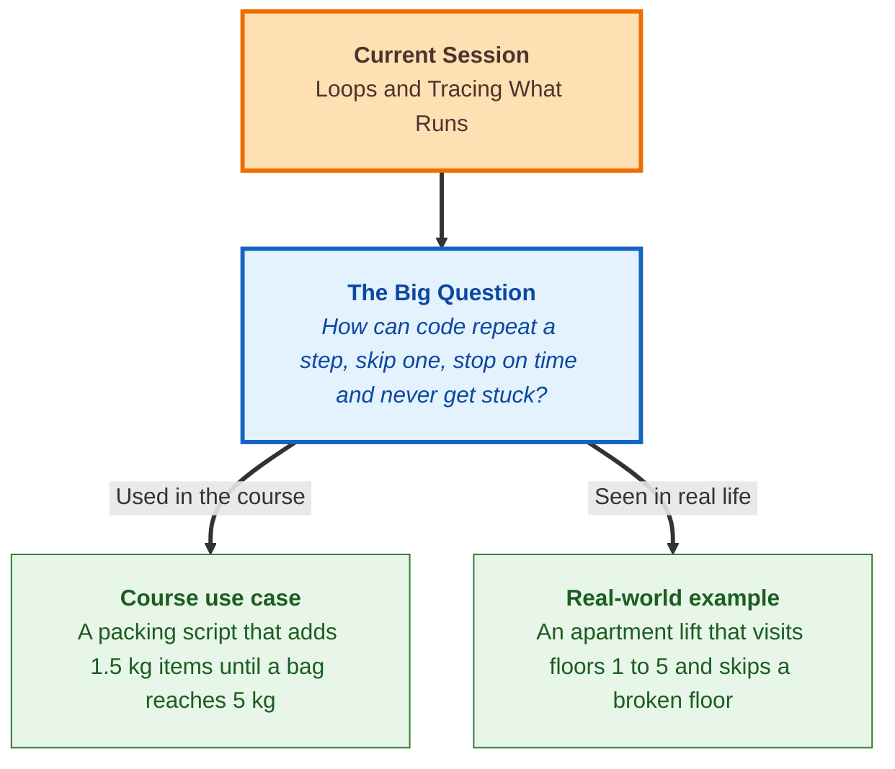

## <span style="color:#2F7DDE">Loops and Tracing What Runs</span>

### <span style="color:#2F7DDE">Mental Map</span>



---

### <span style="color:#2F7DDE">What You'll Learn</span>

Have you ever wondered how a lift knows to visit floor 3, skip floor 4 and stop at floor 5?

By the end of this session, you will be able to:

- <span style="color:#D9660B">**Identify**</span> the one test that keeps the lift door closing for ever.
- <span style="color:#D9660B">**Predict**</span> which message the lift shows for floor 3, floor 4 and floor 5.
- <span style="color:#D9660B">**Use**</span> two commands to skip the broken floor 4 and to stop the ride early.
- <span style="color:#D9660B">**Trace**</span> the floor number after each stop of a 5-floor ride.
- <span style="color:#D9660B">**Write**</span> a short repeating instruction that visits floors 1 to 5.
- <span style="color:#D9660B">**Build**</span> a repeating instruction that holds the door until the sensor is clear.

> <span style="color:#2F7DDE">**Topics you will meet:**</span> for loop, while loop, break and continue, which branch runs, tracing, infinite loop.
>
> Join the session to learn each of these in detail.

---

### <span style="color:#2F7DDE">Why You Are Learning This Topic</span>

Asha lives on floor 5. Each morning the lift visits floors 1, 2 and 3 for neighbours. Floor 4 is closed for repairs, so the lift passes it. One day the door sensor fails. The door keeps trying to close and never moves. Asha waits, and the lift is stuck on one floor for ever.

A <span style="color:#D9660B">**loop**</span> means a set of instructions that repeats until a test says stop.

In this course, you will write loops so a notebook repeats work for 5 aisles or 500 orders.

> <span style="color:#2F7DDE">**Think about it:**</span> What would you need to know, floor by floor, to find the moment the lift got stuck?

---

### <span style="color:#2F7DDE">The Apartment Lift Puzzle</span>

Here is what the lift does on one morning ride.

| Floor | Lift action |
|:----------:|:----------:|
| 1 | Stops and opens the door |
| 2 | Stops and opens the door |
| 3 | Stops and opens the door |
| 4 | Passes by, repairs in progress |
| 5 | Stops and ends the ride |

<span style="color:#D9660B">**What you want to happen:**</span>

- The lift visits floors 1 to 5 with one short set of instructions.
- The lift skips floor 4 without stopping the whole ride.
- The door waits until the sensor is clear, then closes.

Here is how it might start. You do not need to understand it yet.

```python
for floor in range(1, 6):
    print("Floor", floor)
```

> <span style="color:#D9660B">**Wonder about this:**</span>
>
> - How does the lift know to stop at floor 5 and not go to floor 6?
> - What would make the door wait for ever?

---

### <span style="color:#2F7DDE">Think It Through</span>

There is no wrong first try. Keep your guesses for the session.

**1. The lift has 5 floors. How often does a repeating instruction run for floors 1 to 5?**
Hint: Count the floors, and check whether floor 4 counts.

**2. The door closes only when the sensor reads clear. What must change for the door to close?**
Hint: Think about what the sensor reports on each try.

**3. Floor 4 is closed and floor 5 has a fire alarm. Which one skips a floor, and which one ends the ride?**
Hint: One command moves on. The other command leaves.

---

### <span style="color:#2F7DDE">One Question to Carry Into the Session</span>

> <span style="color:#2F7DDE">**How does a program repeat a step, and how does it know when to stop?**</span>
>
> Which part of the lift ride would you write down first to find a stuck door?
