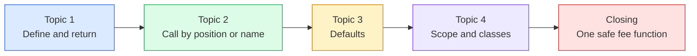
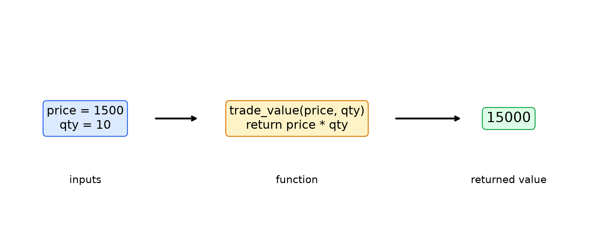
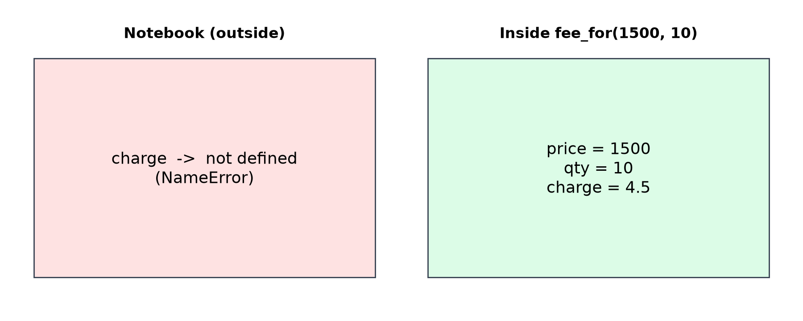
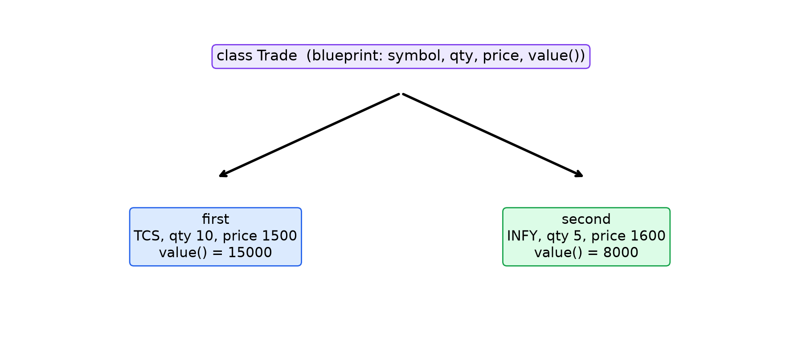
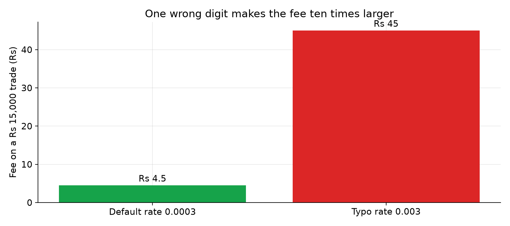

# <font color='#1d4ed8'>Lecture Script: Functions for Reusable Code and Reading Classes</font>

---

## <font color='blue'>Agenda</font>

The lecture runs as four topics. Each topic ends with a quiz.

| Topic | What we do | Learning objectives covered | Minutes |
|:-:|:--|:--|:-:|
| 1 | Write a function that returns a value | Write a function that takes arguments and returns a computed value | 25 |
| 2 | Call a function by position and by name | Call a function using positional and keyword arguments | 25 |
| 3 | Give parameters default values | Write a function with default parameter values | 20 |
| 4 | See why variables stay inside, and read a class | Explain why a variable defined inside a function is not visible outside it<br>Explain the difference between a class definition and an instance created from it | 35 |
| — | Closing: Outcome & Summary | | 15 |
| | **Total** | | **120** |

> <font color="red">**🎯 Instructor Note**</font> Pace: keep default values in Topic 3 short. Give Topic 4 the most time, because scope and the class-versus-instance idea are new.
> Every code block is a Google Colab cell. Run the cells top to bottom in one notebook.

---

## <font color='blue'>Scenario</font>

Ravi works on the back-office team of a Zerodha-style stock-broking app. Every share trade carries a small fee. The same fee formula was typed into three different notebooks.

One copy used 0.003 as the rate. The other two used 0.0003. Nobody noticed until a client trading Rs 15,000 saw a fee of Rs 45 instead of Rs 4.50.

> <font color="red">**🎯 Instructor Note**</font> Zerodha is only the setting. Do not claim it uses these numbers or rules. The prices, quantities and the 0.03% rate are invented for teaching and typed into the notebook, so there is no data file. Use Google Colab with a fresh notebook.

---

## <font color='blue'>Problem Statement</font>

The three copies of the fee formula drifted apart. One had a typo, and a client was charged ten times the right fee. Fixing it meant finding and editing every copy, and someone always missed one.

> <font color='purple'>**How do we write the fee rule once, call it clearly each time, keep its helper values from leaking out, and read the `Trade` class a colleague wrote?**</font>

> <font color="red">**🎯 Instructor Note**</font> Poll: "A formula is copied into 3 notebooks and one copy has a typo. What is the safest fix?" Options: edit each copy by hand, write it once as a function, or ignore it. Give learners 30 seconds to respond in chat. Reveal the answer in the Closing.

---

## <font color='blue'>What We Will Use</font>

Last session you used loops and `if` tests. Today you package that logic in a named block that you write once and call many times. The tool is Google Colab again.

| Topic | Tools | In one line |
|:-:|:--|:--|
| 1 | `def`, `return` | Name a block of code and send a value back |
| 2 | Positional and keyword arguments | Pass values by order or by name |
| 3 | Default parameter values | Let a call leave out a value that rarely changes |
| 4 | Local scope, `class`, instance | Keep helper values inside a function and read a class |

---

## <font color='blue'>How: Walking Through the Brokerage Fee</font>



---

## <font color='blue'>Topic 1: Write a function that returns a value</font> `25 min`

> <font color='purple'>**Ravi needs the trade value in three places. How do we write that maths once?**</font>

### <font color='green'>Example: A function that returns the trade value</font>

> <font color='purple'>**How do we turn price times quantity into a block we can call by name?**</font>

A **function** is a named block of code. `def` creates it, the names in brackets are its **parameters**, and `return` sends a value back to the caller. The code inside runs only when we call the function.

**Predict before running: What will happen?**

> <font color="red">**🎯 Instructor Note**</font> Expected: 15000. Nothing prints when the function is defined. It runs on the call.

```python
def trade_value(price, qty):
    return price * qty

print(trade_value(1500, 10))
```

**Output**

```
15000
```

#### <font color='#c2410c'>Code Explanation</font>

- **Line 1** `def` names the function `trade_value` and lists two parameters, `price` and `qty`.
- **Line 2** `return` sends the product back. The line is indented, so it belongs to the function.
- **Line 4** The call passes 1500 and 10. The returned 15000 goes to `print`.

> <font color='green'>**Result**</font> `trade_value(1500, 10)` returns 15000. We can reuse it for any price and quantity.

<p align="center"></p>

### <font color='green'>Extending it: Return a value or only print it</font>

> <font color='purple'>**What happens if a function prints its answer but does not return it?**</font>

> <font color="red">**🎯 Instructor Note**</font> Ask learners what `result` will hold. Expected: None. `print` shows text but gives nothing back.

```python
def show_value(price, qty):
    print(price * qty)

result = show_value(1500, 10)
print(result)
```

**Output**

```
15000
None
```

#### <font color='#c2410c'>Code Explanation</font>

- **Line 2** `print` shows 15000 on the screen but returns nothing.
- **Lines 4 and 5** `result` holds `None`, Python's value for "nothing".

> <font color='green'>**Result**</font> The 15000 appeared because of `print`, but `result` is `None`. Use `return` when later code needs the number.

### <font color='green'>Extending it: Let one function use another</font>

> <font color='purple'>**How do we build the fee from the trade value?**</font>

> <font color="red">**🎯 Instructor Note**</font> Ask for a prediction. Expected: 4.5, that is 15000 times 0.0003.

```python
def brokerage(price, qty, rate):
    return trade_value(price, qty) * rate

print(brokerage(1500, 10, 0.0003))
```

**Output**

```
4.5
```

#### <font color='#c2410c'>Code Explanation</font>

- **Line 2** The new function calls `trade_value` and multiplies by the rate. The fee rule now lives in one place.

> <font color='green'>**Result**</font> The fee is Rs 4.5 for a Rs 15,000 trade. Fix the rule once and every notebook that calls it is fixed.

### <font color='purple'>Quiz 1</font>

**Question:** What does `return` do inside a function?

**Options:**
- A) Sends a value back to the code that called the function
- B) Prints the value on the screen
- C) Deletes the function
- D) Repeats the function

**Correct Answer:** A

**Explanation:**
- **A)** Correct. The caller can store it, print it or use it in maths.
- **B)** `print` shows a value. `return` hands it back without showing it.
- **C)** `return` does not remove anything.
- **D)** Repeating needs a loop. `return` ends the function.

---

---

## <font color='blue'>Topic 2: Call a function by position and by name</font> `25 min`

> <font color='purple'>**The fee function has three inputs. How do we pass them so the right value lands in the right parameter?**</font>

### <font color='green'>Example: Positional and keyword calls give the same fee</font>

> <font color='purple'>**Can we pass the same three values by order and by name?**</font>

A **positional argument** is matched to a parameter by its place in the call. A **keyword argument** is matched by name, so the order no longer matters.

**Predict before running: What will happen?**

> <font color="red">**🎯 Instructor Note**</font> Expected: both lines print 4.5. Names make the call easy to read.

```python
print(brokerage(1500, 10, 0.0003))
print(brokerage(price=1500, qty=10, rate=0.0003))
print(brokerage(rate=0.0003, qty=10, price=1500))
```

**Output**

```
4.5
4.5
4.5
```

#### <font color='#c2410c'>Code Explanation</font>

- **Line 1** Positional: 1500 goes to `price`, 10 to `qty`, 0.0003 to `rate`.
- **Lines 2 and 3** Keyword: each value names its parameter, so the order can change.

> <font color='green'>**Result**</font> All three calls return 4.5. Keyword calls are easier to check by eye.

### <font color='green'>Extending it: Wrong order gives a wrong answer without an error</font>

> <font color='purple'>**What if we pass positional values in the wrong order?**</font>

> <font color="red">**🎯 Instructor Note**</font> Ask for a prediction. Expected: a number, with no error, but a wrong one. Python cannot know the order was wrong.

```python
def net_amount(price, qty, charges):
    return price * qty - charges

print(net_amount(1500, 10, 4.5))
print(net_amount(1500, 4.5, 10))
```

**Output**

```
14995.5
6740.0
```

#### <font color='#c2410c'>Code Explanation</font>

- **Line 2** The net amount is the trade value minus the charges.
- **Line 4** Correct order. **Line 5** `qty` and `charges` swapped.

> <font color='green'>**Result**</font> The right call gives 14995.5. The swapped call gives 6740.0 and no error. When there are more than 2 or 3 inputs, use keywords.

> <font color='#b45309'>**Common mistake**</font> Trusting position when parameters have the same kind of value. Fix: pass them by name.

### <font color='green'>Extending it: Two errors a call can raise</font>

> <font color='purple'>**What does Python say when a value is missing, or a positional value follows a keyword value?**</font>

> <font color="red">**🎯 Instructor Note**</font> Run each line in its own cell. The error text is the last line Python prints.

```python
brokerage(1500, 10)
```

**Output**

```
TypeError: brokerage() missing 1 required positional argument: 'rate'
```

```python
brokerage(price=1500, 10, 0.0003)
```

**Output**

```
SyntaxError: positional argument follows keyword argument
```

> <font color='green'>**Result**</font> The first error names the missing parameter, `rate`. The second says positional values must come before keyword values.

### <font color='purple'>Quiz 2</font>

**Question:** `def net_amount(price, qty, charges)`. Which call is valid Python?

**Options:**
- A) net_amount(price=1500, 10, 4.5)
- B) net_amount(qty=10, 1500, 4.5)
- C) net_amount(1500, 10)
- D) net_amount(1500, qty=10, charges=4.5)

**Correct Answer:** D

**Explanation:**
- **A)** A positional value cannot follow a keyword value.
- **B)** A positional value follows a keyword value, which is a `SyntaxError`.
- **C)** `charges` is missing, so Python raises a `TypeError`.
- **D)** Correct. One positional value first, then keyword values for the rest.

---

---

## <font color='blue'>Topic 3: Give parameters default values</font> `20 min`

> <font color='purple'>**Almost every trade uses the 0.03% rate. How can a caller skip it unless it really differs?**</font>

### <font color='green'>Example: A default rate</font>

> <font color='purple'>**How do we make `rate` optional?**</font>

A **default value** is written with `=` in the `def` line. If the caller passes nothing for that parameter, Python uses the default. If the caller passes a value, it wins.

**Predict before running: What will happen?**

> <font color="red">**🎯 Instructor Note**</font> Expected: 4.5 for the first call and 7.5 for the second.

```python
def brokerage(price, qty, rate=0.0003):
    return trade_value(price, qty) * rate

print(brokerage(1500, 10))
print(brokerage(1500, 10, rate=0.0005))
```

**Output**

```
4.5
7.5
```

#### <font color='#c2410c'>Code Explanation</font>

- **Line 1** `rate=0.0003` gives the parameter a default.
- **Line 4** No rate is passed, so 0.0003 is used.
- **Line 5** The caller passes 0.0005, which replaces the default.

> <font color='green'>**Result**</font> The default gave 4.5 and the override gave 7.5. One definition serves the usual case and the exception.

### <font color='green'>Extending it: Where a default may sit</font>

> <font color='purple'>**Can a parameter without a default come after one with a default?**</font>

> <font color="red">**🎯 Instructor Note**</font> Ask for a prediction. Expected: an error. Python needs required parameters first.

```python
def brokerage(rate=0.0003, price, qty):
    return trade_value(price, qty) * rate
```

**Output**

```
SyntaxError: parameter without a default follows parameter with a default
```

> <font color='green'>**Result**</font> Parameters with defaults must come last. Required ones come first.

> <font color='#b45309'>**Common mistake**</font> Putting the default parameter first. Fix: `def brokerage(price, qty, rate=0.0003)`.

### <font color='purple'>Quiz 3</font>

**Question:** `def brokerage(price, qty, rate=0.0003)`. What does `brokerage(2000, 5, 0.001)` use as `rate`?

**Options:**
- A) 0.0003
- B) 0.001
- C) 5
- D) An error is raised

**Correct Answer:** B

**Explanation:**
- **A)** The default is used only when no value is passed.
- **B)** Correct. A passed value replaces the default.
- **C)** 5 is the third value for `qty`, not `rate`.
- **D)** The call has 3 values for 3 parameters, so it is valid.

---

---

## <font color='blue'>Topic 4: See why variables stay inside, and read a class</font> `35 min`

> <font color='purple'>**The helper `value` is used inside `trade_value`. Can the rest of the notebook see it?**</font>

### <font color='green'>Example: A variable made inside a function</font>

> <font color='purple'>**If a function creates `charge`, can we print `charge` after the call?**</font>

A **local variable** is created inside a function. It exists only while the function runs. The part of the code where a name can be used is its **scope**.

**Predict before running: What will happen?**

> <font color="red">**🎯 Instructor Note**</font> Expected: 4.5 prints, then an error. `charge` lived only inside the call.

```python
def fee_for(price, qty):
    charge = price * qty * 0.0003
    return charge

print(fee_for(1500, 10))
print(charge)
```

**Output**

```
4.5
NameError: name 'charge' is not defined
```

#### <font color='#c2410c'>Code Explanation</font>

- **Line 2** `charge` is created inside the function.
- **Line 5** The call prints 4.5, because `return` carries the value out.
- **Line 6** The notebook asks for `charge` outside the function. That name does not exist there.

> <font color='green'>**Result**</font> The value left the function through `return`. The name `charge` stayed inside, so printing it fails.

<p align="center"></p>

### <font color='green'>Extending it: A name defined outside is visible inside</font>

> <font color='purple'>**What about the other direction: can a function read a name made in the notebook?**</font>

> <font color="red">**🎯 Instructor Note**</font> Ask for a prediction. Expected: 4.5. A function can read names from outside, but its own names do not leak out.

```python
rate = 0.0003

def fee_with_global(price, qty):
    return price * qty * rate

print(fee_with_global(1500, 10))
```

**Output**

```
4.5
```

#### <font color='#c2410c'>Code Explanation</font>

- **Line 1** `rate` is defined in the notebook, outside any function.
- **Line 4** The function reads `rate`. It was not passed in.

> <font color='green'>**Result**</font> Reading a name from outside works. Writing a new name inside never changes the outside. Passing values as parameters is the clearest habit.

A **class** is a blueprint written once. An **instance** is one object made from the blueprint, with its own values. The class below was written by a colleague. We only read it.

### <font color='green'>Extending it: Read a class and make two instances</font>

> <font color='purple'>**Which part is the class definition and which parts are instances?**</font>

> <font color="red">**🎯 Instructor Note**</font> Do not teach how to write classes. Point at `class` (blueprint), `Trade(...)` (instance) and `.value()` (a function that belongs to the class). `__init__` fills in each new instance.

```python
class Trade:
    def __init__(self, symbol, qty, price):
        self.symbol = symbol
        self.qty = qty
        self.price = price

    def value(self):
        return self.qty * self.price
```

#### <font color='#c2410c'>Code Explanation</font>

- **Line 1** `class Trade` defines the blueprint. It holds no trade yet.
- **Lines 2 to 5** `__init__` runs when an instance is made. It stores the three values on that instance with `self`.
- **Lines 7 and 8** `value` is a function that belongs to the class. It uses the instance's own `qty` and `price`.
- Running this cell prints nothing. It only stores the blueprint.

```python
first = Trade("TCS", 10, 1500)
second = Trade("INFY", 5, 1600)
print(first.value(), second.value())
print(type(first).__name__, first.symbol, second.symbol)
```

**Output**

```
15000 8000
Trade TCS INFY
```

> <font color='green'>**Result**</font> One class made two instances. `first` and `second` hold different values, but both use the same `value` code.

<p align="center"></p>

### <font color='purple'>Quiz 4</font>

**Question:** What is the difference between `class Trade` and `first = Trade("TCS", 10, 1500)`?

**Options:**
- A) There is no difference
- B) The class is one trade, and `first` is the blueprint
- C) The class is the blueprint, and `first` is one instance made from it
- D) `first` is a function

**Correct Answer:** C

**Explanation:**
- **A)** The class defines the shape. The instance holds real values.
- **B)** This reverses the two terms.
- **C)** Correct. One class can make many instances, each with its own values.
- **D)** `first` is an instance, not a function.

---

---

## <font color='blue'>Closing: Outcome & Summary</font> `15 min`

Back to Ravi. One function now replaces the three copied formulas. It uses every topic once.

> <font color='purple'>**1. How do we write the fee rule once? (Topic 1)**</font>

As `trade_value` and `brokerage`, each with a `return`.

> <font color='purple'>**2. How do we call it clearly, with a default rate? (Topics 2 and 3)**</font>

```python
def trade_value(price, qty):
    return price * qty

def brokerage(price, qty, rate=0.0003):
    return trade_value(price, qty) * rate

print(brokerage(price=15000, qty=1))
print(brokerage(1500, 10), brokerage(1500, 10, rate=0.003))
```

**Output**

```
4.5
4.5 45.0
```

#### <font color='#c2410c'>Code Explanation</font>

- **Lines 1 and 2** One function returns the trade value (Topic 1).
- **Line 4** `rate=0.0003` is the default (Topic 3).
- **Line 7** Keyword arguments name each value (Topic 2).
- **Line 8** The last call overrides the default. It shows the typo rate 0.003 would give ten times the fee (Topic 3).

> <font color='purple'>**3. Where do the helper values live, and how do we read the colleague's class? (Topic 4)**</font>

Helper values such as `charge` live and die inside the function. The `Trade` class is the blueprint, and `first` and `second` are instances of it.

<p align="center"></p>

### <font color='green'>Outcome</font>

| | Three copied formulas | One function |
|:--|:-:|:-:|
| Places to fix a rule | 3 | 1 |
| Fee on a Rs 15,000 trade | Rs 4.5 or Rs 45 | Rs 4.5 |
| Typo risk | High, each copy can differ | Low, one definition |

> <font color='green'>**Therefore,**</font> write the rule once as a function with a default rate, call it by name, and keep helper values inside. The typo that cost a client Rs 45 instead of Rs 4.5 can only happen in one place now.

> <font color="red">**🎯 Instructor Note**</font> Reveal the poll: the safest fix is to write the formula once as a function.

### <font color='green'>Summary</font>

| Learning objective | Takeaway |
|:--|:--|
| Function with return | `def` names a block, parameters take inputs and `return` sends the answer back |
| Positional and keyword calls | Position matches by order, keywords match by name. Positional values come first |
| Default values | `rate=0.0003` is used when the caller passes nothing. Defaults come last |
| Scope | A variable made inside a function is not visible outside it |
| Class and instance | The class is the blueprint. An instance is one object made from it |
| **Practical value** | Any rule you copy more than once belongs in a function. Reading a class lets you use code that colleagues and libraries wrote. |

---

# <font color='red'>Launch the Feedback Poll</font>

> <font color="red">**🎯 Instructor Note**</font> Reminder: launch the feedback poll now to collect learner feedback.
