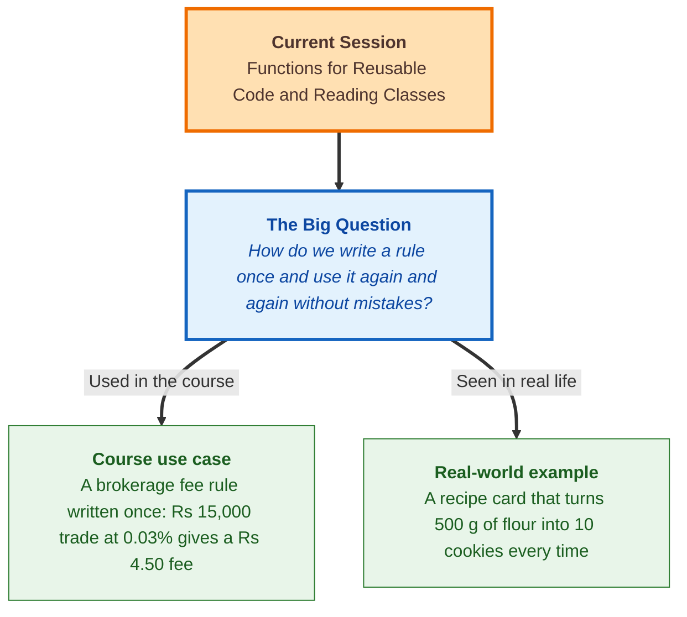

## <span style="color:#2F7DDE">Functions for Reusable Code and Reading Classes</span>

### <span style="color:#2F7DDE">Mental Map</span>



---

### <span style="color:#2F7DDE">What You'll Learn</span>

Have you ever wondered how a recipe card gives the same cookies every time you follow it?

By the end of this session, you will be able to:

- <span style="color:#D9660B">**Name**</span> the card, the ingredients you hand over and the cookies you get back.
- <span style="color:#D9660B">**Explain**</span> why the bowl you use inside the kitchen is not on the shop counter.
- <span style="color:#D9660B">**Describe**</span> the difference between one cookie cutter and the cookies it stamps.
- <span style="color:#D9660B">**Calculate**</span> the cookies from 500 g of flour using a card you call.
- <span style="color:#D9660B">**Compare**</span> listing ingredients in order with listing them by label.
- <span style="color:#D9660B">**Write**</span> a recipe card that assumes 180 degrees unless you say otherwise.

> <span style="color:#2F7DDE">**Topics you will meet:**</span> function with def and return, positional and keyword arguments, default values, variable scope, reading a class.
>
> Join the session to learn each of these in detail.

---

### <span style="color:#2F7DDE">Why You Are Learning This Topic</span>

Meena bakes cookies for her street fair. She copies the recipe onto three cards. One card says 50 g of sugar. Another says 500 g by mistake. Her cookies come out wrong on one tray. She wishes she had one master card.

A <span style="color:#D9660B">**function**</span> means a named set of steps that takes inputs and gives back one result.

In this course, you will turn a formula, such as a fee on a Rs 15,000 trade, into one function.

> <span style="color:#2F7DDE">**Think about it:**</span> What goes wrong when the same recipe is copied onto three cards?

---

### <span style="color:#2F7DDE">The Cookie Kitchen Puzzle</span>

Here is the card and the kitchen for one tray.

| Item | Value |
|:----------:|:----------:|
| Flour | 500 g |
| Flour per cookie | 50 g |
| Oven heat | 180 degrees |
| Cookie cutter | Star shape |

<span style="color:#D9660B">**What you want to happen:**</span>

- One card gives the same number of cookies for any amount of flour.
- You can hand over the oven heat only when it is not 180.
- A bowl used for mixing stays inside the kitchen.

Here is how it might start. You do not need to understand it yet.

```python
def cookies(flour_g):
    return flour_g // 50
print(cookies(500))
```

> <span style="color:#D9660B">**Wonder about this:**</span>
>
> - What would the card return if you hand it 250 g of flour?
> - Can the shop counter see the mixing bowl in the kitchen?

---

### <span style="color:#2F7DDE">Think It Through</span>

There is no wrong first try. Keep your guesses for the session.

**1. You give a card 500 g of flour and 50 g of sugar. Does the order of the two numbers matter?**
Hint: Try swapping them, and think about what each number means.

**2. Most trays bake at 180 degrees. How can the card avoid asking for the heat every time?**
Hint: Think of a value the card already knows.

**3. A star cutter stamps 10 cookies. Which one is the shape and which ones are the cookies?**
Hint: One thing is a template and the others are made from it.

---

### <span style="color:#2F7DDE">One Question to Carry Into the Session</span>

> <span style="color:#2F7DDE">**How can one named block of steps give the right answer each time you call it?**</span>
>
> Which of the three recipe cards would you throw away first?
