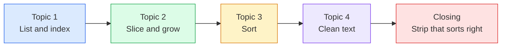
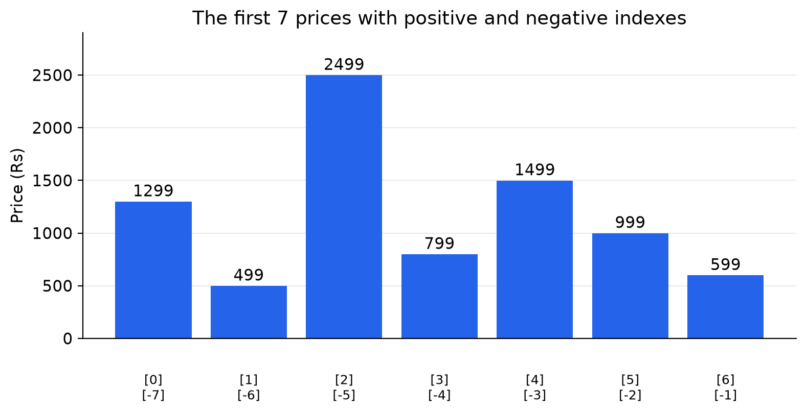
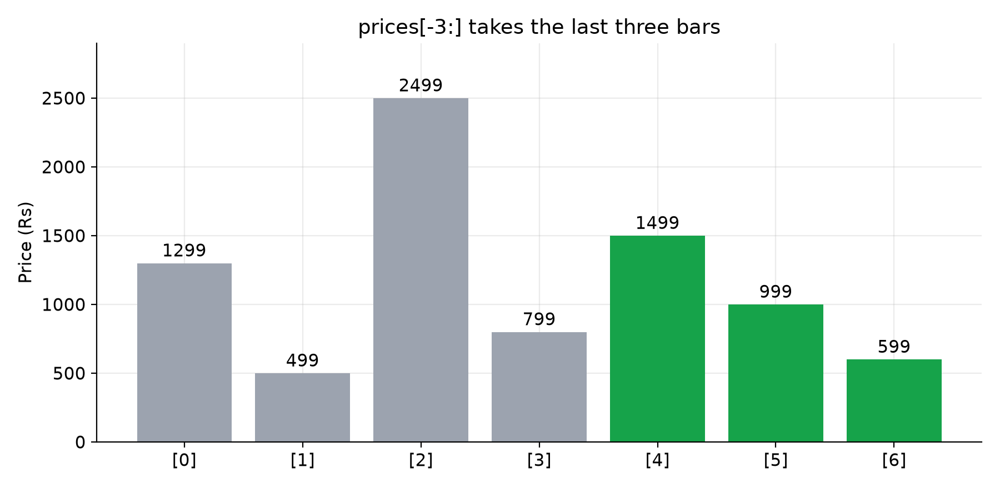
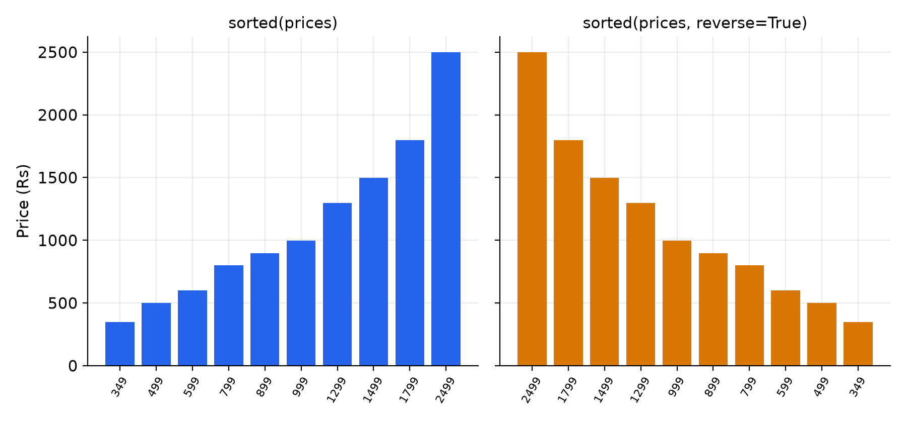
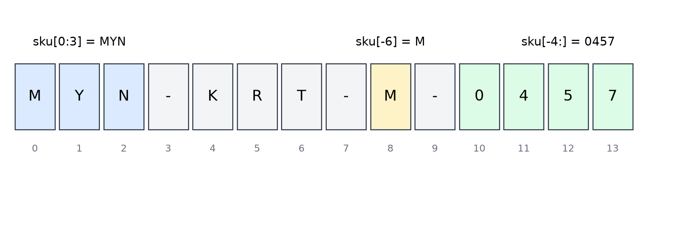
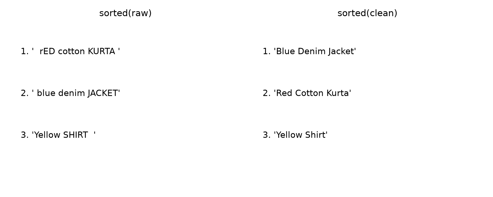

# <font color='#1d4ed8'>Lecture Script: Lists and String Handling</font>

---

## <font color='blue'>Agenda</font>

The lecture runs as four topics. Each topic ends with a quiz.

| Topic | What we do | Learning objectives covered | Minutes |
|:-:|:--|:--|:-:|
| 1 | Hold prices in a list and pick items by position | Write a list and access its elements using positive and negative indexing | 25 |
| 2 | Slice a list and grow it | Extract a sub-list using slice notation with start, stop and step<br>Apply append and extend to add items to the end of a list | 30 |
| 3 | Sort a list in either direction | Apply sorted to order a list, controlling direction with the reverse flag | 20 |
| 4 | Slice and clean a text value | Extract a substring using indexing and slicing<br>Apply string methods to normalise casing and whitespace in a text value | 30 |
| — | Closing: Outcome & Summary | | 15 |
| | **Total** | | **120** |

> <font color="red">**🎯 Instructor Note**</font> Pace: spend the most time on negative indexes and the step in Topic 2, and on the order of string methods in Topic 4. Keep sorted quick.
> Every code block is a Google Colab cell. Run the cells top to bottom in one notebook.

---

## <font color='blue'>Scenario</font>

**A single risk.** A Myntra-style fashion app shows a "New arrivals" strip with the last 3 prices and the product titles in A to Z order.

One careless slice, or one title with a stray space, and the strip shows the wrong items.

> <font color="red">**🎯 Instructor Note**</font> Myntra is only the setting. Do not claim it uses these numbers or rules. The prices, titles and the SKU code are invented for teaching and typed into the notebook, so there is no data file. Use Google Colab with a fresh notebook.

---

## <font color='blue'>Problem Statement</font>

A seller typed the title "  rED cotton KURTA  " with extra spaces and odd capitals. The new-arrivals strip put it at the very top, ahead of "Blue Denim Jacket", because leading spaces sort before any letter. The same strip was meant to show the last 3 prices, but it showed the first 3. Shoppers saw the wrong cheap items first.

> <font color='purple'>**How do we hold prices in a list, pick or slice the right ones, order them, and clean a text title so it sorts correctly?**</font>

> <font color="red">**🎯 Instructor Note**</font> Poll: "Sorting ['Red', 'blue', 'green'] in A to Z order: which word comes first?" Options: Red, blue or green. Give learners 30 seconds to respond in chat. Reveal the answer in the Closing.

---

## <font color='blue'>What We Will Use</font>

Last session you wrote functions and read a class. Today you store many values in one named group and tidy text. The tool is Google Colab.

| Topic | Tools | In one line |
|:-:|:--|:--|
| 1 | `[ ]`, indexing, `for` over a list | Hold values in order and pick one by position |
| 2 | Slices, `append`, `extend` | Take a range of items, then add to the end |
| 3 | `sorted`, `reverse=True` | Order a list without changing the original |
| 4 | String slices, `strip`, `lower`, `upper`, `title` | Cut out part of a text and clean its case and spaces |

---

## <font color='blue'>How: Walking Through the New Arrivals Strip</font>



---

## <font color='blue'>Topic 1: Hold prices in a list and pick items by position</font> `25 min`

> <font color='purple'>**The strip needs several prices at once. How do we keep them in one place and pick one?**</font>

### <font color='green'>Example: Build a list and read items by index</font>

> <font color='purple'>**How do we read the first price, the last price and a price from the middle?**</font>

A **list** holds values in order, inside square brackets. Each value has an **index**, its position. Counting starts at 0 from the front. Negative indexes count from the back, so `-1` is the last item.

**Predict before running: What will happen?**

> <font color="red">**🎯 Instructor Note**</font> Expected: 1299, 599 and 799, one per line. A common wrong guess is that `prices[1]` is the first item.

```python
prices = [1299, 499, 2499, 799, 1499, 999, 599]
print(prices[0])
print(prices[-1])
print(prices[3])
```

**Output**

```
1299
599
799
```

#### <font color='#c2410c'>Code Explanation</font>

- **Line 1** One name holds all 7 prices, in the order typed.
- **Line 2** Index 0 is the first item.
- **Line 3** Index -1 is the last item.
- **Line 4** Index 3 is the fourth item, because counting starts at 0.

> <font color='green'>**Result**</font> `prices[0]` is 1299, `prices[-1]` is 599 and `prices[3]` is 799.

<p align="center"></p>

### <font color='green'>Extending it: Walk through the list with a loop</font>

> <font color='purple'>**How do we add up all 7 prices?**</font>

> <font color="red">**🎯 Instructor Note**</font> Ask learners for the total in chat first. Expected: 8193. Mention `len` gives the number of items.

```python
total = 0
for price in prices:
    total = total + price
print(total, len(prices))
```

**Output**

```
8193 7
```

#### <font color='#c2410c'>Code Explanation</font>

- **Line 2** A for loop takes each price from the list in order.
- **Line 4** `len(prices)` counts the items in the list.

> <font color='green'>**Result**</font> The 7 prices add up to 8193. A for loop over a list gives each item in turn.

### <font color='green'>Extending it: Ask for an index that does not exist</font>

> <font color='purple'>**What happens at `prices[7]` when the last index is 6?**</font>

> <font color="red">**🎯 Instructor Note**</font> Ask for a prediction. Expected: an IndexError. The valid indexes run from 0 to 6, and from -1 to -7.

```python
prices[7]
```

**Output**

```
IndexError: list index out of range
```

> <font color='green'>**Result**</font> The list has 7 items, so index 7 is one past the end. Use `-1` for the last item and avoid counting by hand.

### <font color='purple'>Quiz 1</font>

**Question:** `prices = [1299, 499, 2499, 799]`. What is `prices[-2]`?

**Options:**
- A) 499
- B) 1299
- C) 799
- D) 2499

**Correct Answer:** D

**Explanation:**
- **A)** `499` is `prices[1]`, counted from the front.
- **B)** `1299` is `prices[0]` and `prices[-4]`.
- **C)** `799` is `prices[-1]`, the last item.
- **D)** Correct. Index -1 is 799 and index -2 is 2499.

---

---

## <font color='blue'>Topic 2: Slice a list and grow it</font> `30 min`

> <font color='purple'>**The strip must show the last 3 prices. How do we cut that piece out, and how do new prices join the list?**</font>

### <font color='green'>Example: Slices with start, stop and step</font>

> <font color='purple'>**How do we take items 1 to 3, the last 3, and every second price?**</font>

A **slice** is written `list[start:stop:step]`. It starts at `start`, stops before `stop` and moves by `step`. Any part can be left out. A slice always returns a new list.

**Predict before running: What will happen?**

> <font color="red">**🎯 Instructor Note**</font> Expected: [499, 2499, 799], then [1499, 999, 599], then [1299, 2499, 1499, 599]. The stop index is not included.

```python
print(prices[1:4])
print(prices[-3:])
print(prices[::2])
print(prices[::-1])
```

**Output**

```
[499, 2499, 799]
[1499, 999, 599]
[1299, 2499, 1499, 599]
[599, 999, 1499, 799, 2499, 499, 1299]
```

#### <font color='#c2410c'>Code Explanation</font>

- **Line 1** Indexes 1, 2 and 3. Index 4 is not included.
- **Line 2** From the third item from the back to the end.
- **Line 3** The step 2 takes every second item, starting at index 0.
- **Line 4** A step of -1 reverses the list.

> <font color='green'>**Result**</font> `prices[-3:]` is the last 3 prices, [1499, 999, 599]. That is the slice the strip needed.

<p align="center"></p>

### <font color='green'>Extending it: Add one price with append</font>

> <font color='purple'>**A new price of Rs 899 arrives. How do we add it to the end?**</font>

> <font color="red">**🎯 Instructor Note**</font> Ask for a prediction. Expected: the list grows by one at the end. `append` changes the list itself and returns nothing.

```python
prices.append(899)
print(prices)
```

**Output**

```
[1299, 499, 2499, 799, 1499, 999, 599, 899]
```

#### <font color='#c2410c'>Code Explanation</font>

- **Line 1** `append` adds one item at the end of the same list.

> <font color='green'>**Result**</font> The list now ends with 899. It has 8 prices.

### <font color='green'>Extending it: Add two prices with extend</font>

> <font color='purple'>**Two more prices, 349 and 1799, arrive together. What is the difference between append and extend?**</font>

> <font color="red">**🎯 Instructor Note**</font> Ask learners to predict both lines. Expected: extend adds two items, append adds one list inside the list.

```python
batch = [349, 1799]
a = prices.copy()
a.append(batch)
prices.extend(batch)
print(a[-1], len(a))
print(prices[-3:], len(prices))
```

**Output**

```
[349, 1799] 9
[899, 349, 1799] 10
```

#### <font color='#c2410c'>Code Explanation</font>

- **Line 2** `copy` makes a separate list, so `prices` is not changed by the append test.
- **Line 3** `append` adds the whole list as ONE item.
- **Line 4** `extend` adds each price as its own item.

> <font color='green'>**Result**</font> `append(batch)` put one list inside, giving 9 items. `extend` added 2 prices, giving 10 items.

> <font color='#b45309'>**Common mistake**</font> Using `append` with a list when you want the items one by one. Fix: use `extend`.

### <font color='purple'>Quiz 2</font>

**Question:** `items = [1, 2]`. After `items.extend([3, 4])`, what does `items` hold?

**Options:**
- A) [1, 2, [3, 4]]
- B) [1, 2, 3, 4]
- C) [3, 4]
- D) [1, 2, 3]

**Correct Answer:** B

**Explanation:**
- **A)** That is what `append([3, 4])` gives.
- **B)** Correct. `extend` adds each item of the second list to the end.
- **C)** `extend` keeps the old items and adds new ones.
- **D)** Both 3 and 4 are added, not only 3.

---

---

## <font color='blue'>Topic 3: Sort a list in either direction</font> `20 min`

> <font color='purple'>**Shoppers want the cheapest first, or the dearest first. How do we order the prices?**</font>

### <font color='green'>Example: sorted from low to high and high to low</font>

> <font color='purple'>**How do we order the 10 prices both ways?**</font>

`sorted(list)` returns a new list in order. It never changes the original. The flag `reverse=True` flips it to high to low.

**Predict before running: What will happen?**

> <font color="red">**🎯 Instructor Note**</font> Expected: the low-to-high list starts with 349. The high-to-low list starts with 2499. A common wrong guess is that `prices` itself becomes sorted.

```python
low_first = sorted(prices)
high_first = sorted(prices, reverse=True)
print(low_first[:3])
print(high_first[:3])
print(prices[:3])
```

**Output**

```
[349, 499, 599]
[2499, 1799, 1499]
[1299, 499, 2499]
```

#### <font color='#c2410c'>Code Explanation</font>

- **Line 1** A new list, ascending by default.
- **Line 2** `reverse=True` makes it descending.
- **Lines 3 to 5** We print the first 3 of each. The original `prices` is untouched.

> <font color='green'>**Result**</font> The cheapest three are 349, 499 and 599. The dearest three are 2499, 1799 and 1499. `prices` kept its original order.

<p align="center"></p>

### <font color='green'>Extending it: Sorting words has a catch</font>

> <font color='purple'>**What does sorted do with 'Red', 'blue' and 'green'?**</font>

> <font color="red">**🎯 Instructor Note**</font> This is the opening poll. Ask for a prediction. Expected: Red first, because capital letters sort before lowercase letters.

```python
words = ["Red", "blue", "green"]
print(sorted(words))
```

**Output**

```
['Red', 'blue', 'green']
```

#### <font color='#c2410c'>Code Explanation</font>

- **Line 2** Text is compared letter by letter by its code. Capital letters have smaller codes than lowercase letters.

> <font color='green'>**Result**</font> `Red` comes first even though R is late in the alphabet. Titles must have the same case before they are sorted.

### <font color='purple'>Quiz 3</font>

**Question:** `sorted([30, 10, 20], reverse=True)` returns what, and what happens to the original list?

**Options:**
- A) [10, 20, 30]; the original is sorted
- B) [30, 20, 10]; the original becomes [30, 20, 10]
- C) [30, 20, 10]; the original is unchanged
- D) [10, 20, 30]; the original is unchanged

**Correct Answer:** C

**Explanation:**
- **A)** `reverse=True` gives high to low, and `sorted` does not change the original.
- **B)** `sorted` never changes the original list.
- **C)** Correct. A new list in descending order comes back and the original keeps its order.
- **D)** `reverse=True` means descending, so the list starts with 30.

---

---

## <font color='blue'>Topic 4: Slice and clean a text value</font> `30 min`

> <font color='purple'>**Prices are in order. Now the titles: how do we cut a part out of a text and remove the stray spaces and odd capitals?**</font>

### <font color='green'>Example: Index and slice a product code</font>

> <font color='purple'>**How do we take the brand, the size and the item number out of the SKU code?**</font>

A text value works like a list of characters. Indexes and slices work the same way, and the result is a new text.

**Predict before running: What will happen?**

> <font color="red">**🎯 Instructor Note**</font> Expected: MYN, then M, then 0457. The stop index is not included.

```python
sku = "MYN-KRT-M-0457"
print(sku[0:3])
print(sku[-6])
print(sku[-4:])
```

**Output**

```
MYN
M
0457
```

#### <font color='#c2410c'>Code Explanation</font>

- **Line 2** Characters 0, 1 and 2, the brand code.
- **Line 3** The sixth character from the back is the size.
- **Line 4** The last four characters are the item number.

> <font color='green'>**Result**</font> The brand is MYN, the size is M and the item number is 0457.

<p align="center"></p>

### <font color='green'>Extending it: Clean casing and spaces with string methods</font>

> <font color='purple'>**How do we turn "  rED cotton KURTA  " into "Red Cotton Kurta"?**</font>

> <font color="red">**🎯 Instructor Note**</font> Ask learners which methods to use. Expected: strip, then title. The methods return new text. They never change the original.

```python
title = "  rED cotton KURTA  "
print(title.strip())
print(title.lower())
print(title.upper())
print(title.strip().title())
```

**Output**

```
rED cotton KURTA
  red cotton kurta  
  RED COTTON KURTA  
Red Cotton Kurta
```

#### <font color='#c2410c'>Code Explanation</font>

- **Line 2** `strip` removes spaces at both ends.
- **Lines 3 and 4** `lower` and `upper` change every letter to small or capital letters.
- **Line 5** `title` makes each word start with a capital. The calls chain from left to right.

> <font color='green'>**Result**</font> `title.strip().title()` gives 'Red Cotton Kurta'. The original `title` is unchanged until we store the new text.

> <font color='#b45309'>**Common mistake**</font> Calling `title.strip()` and expecting `title` to change. Text is not changed in place. Store the result: `title = title.strip()`.

### <font color='purple'>Quiz 4</font>

**Question:** `code = "MYN-KRT"`. What is `code[4:]`?

**Options:**
- A) KRT
- B) MYN
- C) -KRT
- D) KR

**Correct Answer:** A

**Explanation:**
- **A)** Correct. Index 3 is the dash, so index 4 starts at K and runs to the end.
- **B)** `code[:3]` gives MYN. `code[4:]` starts at index 4.
- **C)** `-KRT` would need `code[3:]`, which starts at the dash.
- **D)** A slice with no stop runs to the end, so the T is included.

---

---

## <font color='blue'>Closing: Outcome & Summary</font> `15 min`

Back to the New Arrivals strip. One notebook now shows the last 3 prices and sorts clean titles. It uses every topic once.

> <font color='purple'>**1 and 2. How do we show the last 3 prices? (Topics 1 and 2)**</font>

```python
print(prices[-3:])
print(sorted(prices)[:3], sorted(prices, reverse=True)[:3])
```

**Output**

```
[899, 349, 1799]
[349, 499, 599] [2499, 1799, 1499]
```

#### <font color='#c2410c'>Code Explanation</font>

- **Line 1** The slice `[-3:]` takes the last 3 prices (Topic 2). Negative indexing reads from the back (Topic 1).
- **Line 2** `sorted` gives low-first and high-first lists, and `[:3]` takes 3 of them (Topics 2 and 3).

> <font color='purple'>**3. How do we clean the titles and sort them? (Topics 3 and 4)**</font>

```python
raw = ["  rED cotton KURTA ", " blue denim JACKET", "Yellow SHIRT  "]
clean = []
for t in raw:
    clean.append(t.strip().title())
print(clean)
print(sorted(clean))
print(sorted(raw))
```

**Output**

```
['Red Cotton Kurta', 'Blue Denim Jacket', 'Yellow Shirt']
['Blue Denim Jacket', 'Red Cotton Kurta', 'Yellow Shirt']
['  rED cotton KURTA ', ' blue denim JACKET', 'Yellow SHIRT  ']
```

#### <font color='#c2410c'>Code Explanation</font>

- **Line 2** An empty list, then `append` adds each cleaned title (Topic 2).
- **Line 4** `strip` and `title` clean one text (Topic 4).
- **Lines 6 and 7** `sorted` on the clean titles, and on the raw titles for comparison (Topic 3).

<p align="center"></p>

### <font color='green'>Outcome</font>

| | Raw titles | Cleaned titles |
|:--|:-:|:-:|
| First title after sorting | '  rED cotton KURTA ' | 'Blue Denim Jacket' |
| Items in the list | 3 | 3 |
| Order shown to shoppers | Starts with the stray space | A to Z |

> <font color='green'>**Therefore,**</font> clean the text first, then sort. The raw titles sort by their leading spaces and capitals, not by their words. The cleaned titles sort A to Z, and the strip uses `prices[-3:]` for the last 3 prices.

> <font color="red">**🎯 Instructor Note**</font> Reveal the poll: the answer is Red, because capital letters sort before lowercase letters.

### <font color='green'>Summary</font>

| Learning objective | Takeaway |
|:--|:--|
| Lists and indexing | Index 0 is the first item and -1 is the last. A loop gives each item |
| Slicing | `list[start:stop:step]` stops before `stop` and returns a new list |
| append and extend | `append` adds one item, `extend` adds each item of another list |
| sorted | Returns a new list. `reverse=True` gives high to low |
| String indexing and slicing | Text works like a list of characters, so slices cut out a part |
| String methods | `strip`, `lower`, `upper` and `title` return new text. Store the result |
| **Practical value** | Clean text and the right slice of a list are the first steps of any report. The same habits work on names, city lists and product codes. |

---

# <font color='red'>Launch the Feedback Poll</font>

> <font color="red">**🎯 Instructor Note**</font> Reminder: launch the feedback poll now to collect learner feedback.
