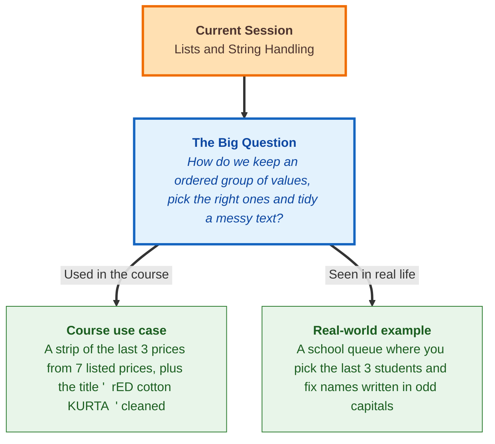

## <span style="color:#2F7DDE">Lists and String Handling</span>

### <span style="color:#2F7DDE">Mental Map</span>



---

### <span style="color:#2F7DDE">What You'll Learn</span>

Have you ever wondered how a teacher finds the last 3 students in a line of 8?

By the end of this session, you will be able to:

- <span style="color:#D9660B">**List**</span> the students in the queue, in order.
- <span style="color:#D9660B">**Describe**</span> how a slice picks students 2 to 4 from the line.
- <span style="color:#D9660B">**Predict**</span> what happens to the line when 2 new students join one by one or together.
- <span style="color:#D9660B">**Use**</span> a position number from the front and a negative number from the back to find a student.
- <span style="color:#D9660B">**Apply**</span> an ordering that lines students up from shortest to tallest.
- <span style="color:#D9660B">**Build**</span> a tidy name, such as Meera Rao, from the text '  mEERA rao '.

> <span style="color:#2F7DDE">**Topics you will meet:**</span> list and indexing, list slicing, append and extend, sort a list, string slicing, string methods.
>
> Join the session to learn each of these in detail.

---

### <span style="color:#2F7DDE">Why You Are Learning This Topic</span>

Mr. Nair lines up 8 students for the school photo. He needs the last 3 for a special row. He also checks the name tags. One tag reads '  mEERA rao  ' with extra spaces and odd capitals. The tags will not sort in A to Z order.

A <span style="color:#D9660B">**list**</span> means a group of values kept in a set order, where each value has a position number.

In this course, you will keep prices, names and codes in lists and clean text the same way.

> <span style="color:#2F7DDE">**Think about it:**</span> What makes it hard to find the last 3 students if you only count from the front?

---

### <span style="color:#2F7DDE">The School Photo Queue Puzzle</span>

Here is the line for the photo.

| Position | Student |
|:----------:|:----------:|
| 1 | Asha |
| 2 | Bilal |
| 3 | Chitra |
| 4 | Dev |

<span style="color:#D9660B">**What you want to happen:**</span>

- The teacher picks students 2 to 3 without calling out names.
- The teacher lines up students from shortest to tallest, and back again.
- The name tags look the same: no extra spaces and neat capitals.

Here is how it might start. You do not need to understand it yet.

```python
queue = ["Asha", "Bilal", "Chitra", "Dev"]
print(queue[-1], queue[1:3])
```

> <span style="color:#D9660B">**Wonder about this:**</span>
>
> - Which position counts from the back, and what number does it carry?
> - Does a tag with extra spaces sort in the same place as a tidy tag?

---

### <span style="color:#2F7DDE">Think It Through</span>

There is no wrong first try. Keep your guesses for the session.

**1. The line has 4 students. Which position number picks Asha, the first student?**
Hint: Think about where counting starts.

**2. Two new students, Esha and Farid, join as a pair. Do they become 2 more places or 1 new place?**
Hint: Picture them stepping in one at a time, or together.

**3. Which tag comes first when sorted: '  mEERA rao  ' or 'Asha Iyer'?**
Hint: Think about what sits before the first letter.

---

### <span style="color:#2F7DDE">One Question to Carry Into the Session</span>

> <span style="color:#2F7DDE">**How do we pick, add, order and tidy items in a group?**</span>
>
> Which part of the photo queue would you fix first?
