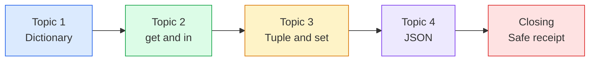
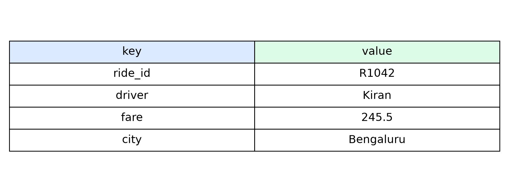
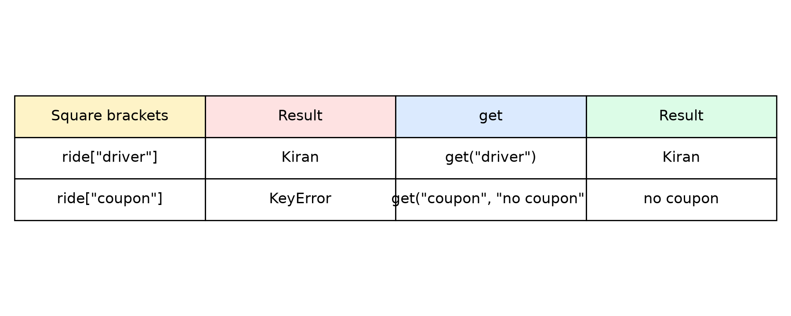
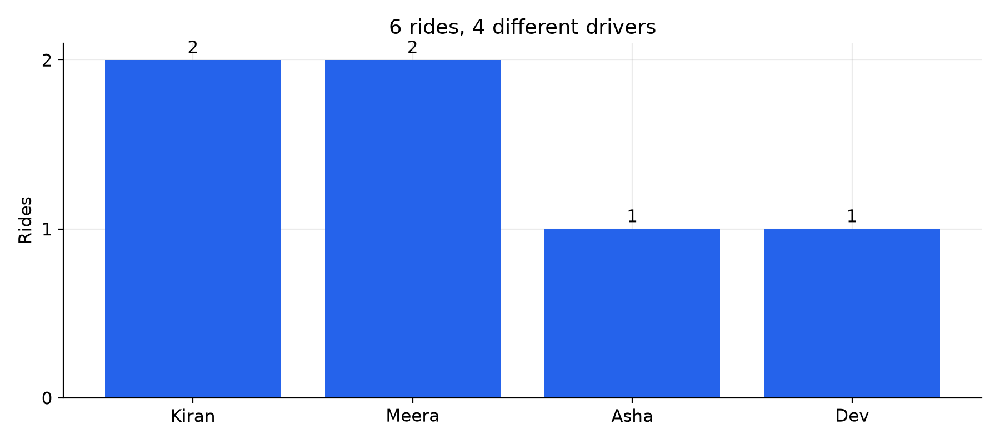
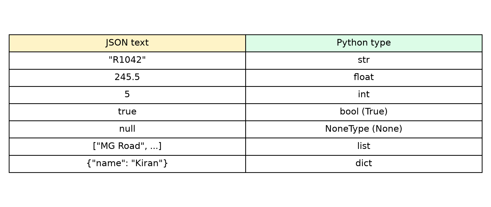
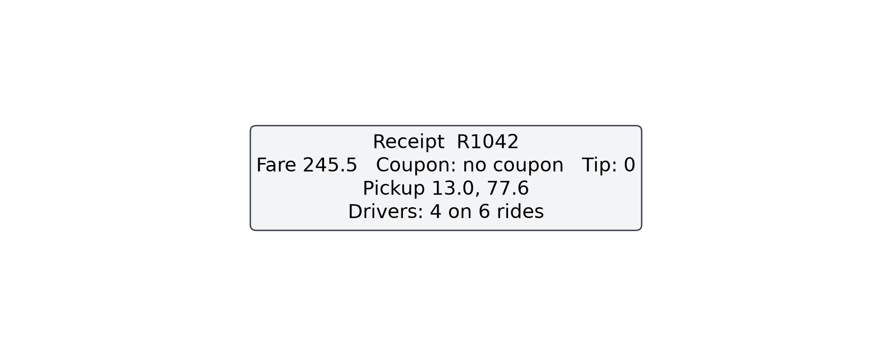

# <font color='#1d4ed8'>Lecture Script: Dictionaries and JSON with Tuples and Sets</font>

---

## <font color='blue'>Agenda</font>

The lecture runs as four topics. Each topic ends with a quiz.

| Topic | What we do | Learning objectives covered | Minutes |
|:-:|:--|:--|:-:|
| 1 | Store a ride record as key and value | Build a dictionary of key-value pairs, retrieving a value by its key | 20 |
| 2 | Look values up safely and test for a key | Retrieve a dictionary value with get, supplying a fallback for a missing key<br>Write a membership test using the in operator on a list and a dictionary | 30 |
| 3 | Unpack a tuple and remove duplicates with a set | Write a tuple and unpack it into named variables<br>Build a set to remove duplicate values from a list | 30 |
| 4 | Read the JSON the server sends | Classify JSON values by the Python types they become when parsed | 25 |
| — | Closing: Outcome & Summary | | 15 |
| | **Total** | | **120** |

> <font color="red">**🎯 Instructor Note**</font> Pace: keep the tuple quick in Topic 3 and spend the time on get and on what in checks on a dictionary in Topic 2.
> Every code block is a Google Colab cell. Run the cells top to bottom in one notebook.

---

## <font color='blue'>Scenario</font>

**A comparison.** An Ola-style cab app keeps one booking in two shapes.

| | On the server | In your notebook |
|:--|:--|:--|
| Shape | One line of JSON text | A Python dictionary |
| Look up the fare | Search the text | `ride["fare"]` |
| A missing coupon | The word `null` | `None` |
| Drivers on 6 rides | A long text | A list with repeats |

> <font color="red">**🎯 Instructor Note**</font> Ola is only the setting. Do not claim it uses this data or format. The ride values and the JSON text are invented for teaching and typed into the notebook, so there is no data file. Use Google Colab with a fresh notebook.

---

## <font color='blue'>Problem Statement</font>

The ride screen looked up `ride["coupon"]` for every booking. Ride R1042 had no coupon, so the code crashed with a KeyError and the receipt never printed. The same morning, a report counted 6 drivers when only 4 different drivers had worked.

> <font color='purple'>**How do we store a ride, look up a value without crashing, check what exists, unpack a location, count distinct drivers and read the JSON text from the server?**</font>

> <font color="red">**🎯 Instructor Note**</font> Poll: "A ride has no `coupon` key. What does `ride["coupon"]` do?" Options: gives None, gives an empty text or raises an error. Give learners 30 seconds to respond in chat. Reveal the answer in the Closing.

---

## <font color='blue'>What We Will Use</font>

Last session you used lists and strings. Today you use four more containers, and one text format called JSON. The tool is Google Colab.

| Topic | Tools | In one line |
|:-:|:--|:--|
| 1 | `{ }`, key, value | Store a record and read a value by its key |
| 2 | `get`, `in` | Look up with a fallback and test whether something exists |
| 3 | Tuple, unpacking, `set` | Fix a small group of values, split it into names, and drop repeats |
| 4 | `json.loads` | Turn JSON text into a dictionary and see each value's type |

---

## <font color='blue'>How: Walking Through the Ride Record</font>



---

## <font color='blue'>Topic 1: Store a ride record as key and value</font> `20 min`

> <font color='purple'>**A ride has a driver, a fare and a city. How do we keep them together and ask for each by name?**</font>

### <font color='green'>Example: A dictionary and a read by key</font>

> <font color='purple'>**How do we store one ride and read the driver and the fare?**</font>

A **dictionary** stores pairs. Each **key** is a label, and each **value** is the data under that label. We read a value by writing its key in square brackets.

**Predict before running: What will happen?**

> <font color="red">**🎯 Instructor Note**</font> Expected: Kiran and 245.5. We use the key, not a position number.

```python
ride = {"ride_id": "R1042", "driver": "Kiran",
        "fare": 245.5, "city": "Bengaluru"}
print(ride["driver"])
print(ride["fare"])
```

**Output**

```
Kiran
245.5
```

#### <font color='#c2410c'>Code Explanation</font>

- **Lines 1 and 2** Curly brackets hold `key: value` pairs separated by commas.
- **Lines 3 and 4** The key in square brackets returns its value.

> <font color='green'>**Result**</font> `ride["driver"]` is Kiran and `ride["fare"]` is 245.5. Keys play the role that index numbers played in a list.

<p align="center"></p>

### <font color='green'>Extending it: Change and add a pair</font>

> <font color='purple'>**How do we add a tip and fix the fare?**</font>

> <font color="red">**🎯 Instructor Note**</font> Ask for a prediction. Expected: the fare changes, and the tip is a new pair.

```python
ride["fare"] = 260.0
ride["tip"] = 20
print(ride)
```

**Output**

```
{'ride_id': 'R1042', 'driver': 'Kiran', 'fare': 260.0, 'city': 'Bengaluru', 'tip': 20}
```

#### <font color='#c2410c'>Code Explanation</font>

- **Line 1** An existing key gets a new value.
- **Line 2** A new key is added to the dictionary.

> <font color='green'>**Result**</font> The fare is now 260.0 and the dictionary has a `tip` pair of 20.

### <font color='green'>Extending it: Ask for a key that is not there</font>

> <font color='purple'>**What does `ride["coupon"]` do?**</font>

> <font color="red">**🎯 Instructor Note**</font> This is the opening poll. Expected: a KeyError that names the missing key.

```python
ride["coupon"]
```

**Output**

```
KeyError: 'coupon'
```

> <font color='green'>**Result**</font> Python stops with a KeyError. A direct lookup on a missing key crashes the cell.

### <font color='purple'>Quiz 1</font>

**Question:** In `ride = {"driver": "Kiran", "fare": 245.5}`, what is `ride["fare"]`?

**Options:**
- A) "fare"
- B) "Kiran"
- C) 1
- D) 245.5

**Correct Answer:** D

**Explanation:**
- **A)** "fare" is the key. The expression returns the value.
- **B)** "Kiran" is the value of the `driver` key.
- **C)** A dictionary has no position numbers by default.
- **D)** Correct. The key in brackets returns the value stored under it.

---

---

## <font color='blue'>Topic 2: Look values up safely and test for a key</font> `30 min`

> <font color='purple'>**The receipt code crashed on a missing coupon. How do we ask without crashing, and check first?**</font>

### <font color='green'>Example: get with a fallback</font>

> <font color='purple'>**How do we read the coupon, and show "no coupon" if the key is missing?**</font>

`get(key)` returns the value, or `None` if the key is missing. `get(key, fallback)` returns your fallback instead. Neither raises an error.

**Predict before running: What will happen?**

> <font color="red">**🎯 Instructor Note**</font> Expected: None, then no coupon, then the driver Kiran. A common wrong guess is that `get` also crashes.

```python
print(ride.get("coupon"))
print(ride.get("coupon", "no coupon"))
print(ride.get("driver", "unknown"))
```

**Output**

```
None
no coupon
Kiran
```

#### <font color='#c2410c'>Code Explanation</font>

- **Line 1** Missing key, no fallback: `None`.
- **Line 2** Missing key, with a fallback: the fallback text.
- **Line 3** The key exists, so the fallback is ignored.

> <font color='green'>**Result**</font> `get` never crashes. It returns the value when the key exists, and the fallback when it does not.

<p align="center"></p>

### <font color='green'>Extending it: Check with in first</font>

> <font color='purple'>**How do we test whether a key, or a driver name, exists?**</font>

> <font color="red">**🎯 Instructor Note**</font> Ask for each prediction. Expected: True, False, True, False. `in` on a dictionary checks keys, not values.

```python
drivers = ["Kiran", "Meera", "Kiran", "Dev", "Asha", "Meera"]
print("fare" in ride)
print("Kiran" in ride)
print("Dev" in drivers)
print("Ravi" in drivers)
```

**Output**

```
True
False
True
False
```

#### <font color='#c2410c'>Code Explanation</font>

- **Line 2** `fare` is a key of `ride`.
- **Line 3** `Kiran` is a value, not a key, so `in ride` is False.
- **Lines 4 and 5** On a list, `in` checks the items.

> <font color='green'>**Result**</font> On a list, `in` looks at the items. On a dictionary, `in` looks at the keys.

> <font color='#b45309'>**Common mistake**</font> Testing `"Kiran" in ride` to find a driver name. It checks keys only. Fix: test `ride["driver"] == "Kiran"`.

### <font color='purple'>Quiz 2</font>

**Question:** `ride = {"driver": "Kiran"}`. What does `ride.get("city", "unknown")` return?

**Options:**
- A) An error
- B) "unknown"
- C) None
- D) "city"

**Correct Answer:** B

**Explanation:**
- **A)** `get` does not raise an error for a missing key.
- **B)** Correct. The key is missing, so the fallback is returned.
- **C)** `None` is returned only when no fallback is given.
- **D)** The key text is never returned as a value.

---

---

## <font color='blue'>Topic 3: Unpack a tuple and remove duplicates with a set</font> `30 min`

> <font color='purple'>**Two more needs: the pickup point is a fixed pair of numbers, and 6 rides listed Kiran and Meera twice. What fits each?**</font>

### <font color='green'>Example: A tuple and its unpacking</font>

> <font color='purple'>**How do we keep latitude and longitude together and split them into two names?**</font>

A **tuple** is a fixed group of values in round brackets. It cannot be changed after it is made. **Unpacking** assigns each value to its own name in one line.

**Predict before running: What will happen?**

> <font color="red">**🎯 Instructor Note**</font> Expected: both numbers on the first line, then the latitude alone. Changing the tuple raises a TypeError.

```python
pickup = (12.9716, 77.5946)
lat, lng = pickup
print(lat, lng)
print(lat)
```

**Output**

```
12.9716 77.5946
12.9716
```

#### <font color='#c2410c'>Code Explanation</font>

- **Line 1** Round brackets make a tuple of two numbers.
- **Line 2** The first value goes to `lat` and the second to `lng`. The count of names must match.

> <font color='green'>**Result**</font> `lat` is 12.9716 and `lng` is 77.5946. The pair stays fixed, so nobody can change it by accident.

### <font color='green'>Extending it: Try to change a tuple</font>

> <font color='purple'>**What happens at `pickup[0] = 13.0`?**</font>

> <font color="red">**🎯 Instructor Note**</font> Ask for a prediction. Expected: a TypeError. Tuples cannot be changed.

```python
pickup[0] = 13.0
```

**Output**

```
TypeError: 'tuple' object does not support item assignment
```

> <font color='green'>**Result**</font> Python refuses. Use a tuple for values that must stay fixed.

### <font color='green'>Extending it: Remove duplicates with a set</font>

> <font color='purple'>**How many different drivers worked the 6 rides?**</font>

A **set** holds each value only once and has no order. We sort it before printing so the output is always the same.

> <font color="red">**🎯 Instructor Note**</font> Ask for a prediction. Expected: 4 drivers: Asha, Dev, Kiran, Meera.

```python
unique = set(drivers)
print(len(drivers), len(unique))
print(sorted(unique))
```

**Output**

```
6 4
['Asha', 'Dev', 'Kiran', 'Meera']
```

#### <font color='#c2410c'>Code Explanation</font>

- **Line 1** `set` removes the repeats from the list.
- **Line 2** 6 rides, 4 distinct drivers.
- **Line 3** `sorted` turns the set into an ordered list for printing.

> <font color='green'>**Result**</font> 6 rides were driven by 4 different drivers. The report that said 6 drivers counted rides, not drivers.

<p align="center"></p>

### <font color='purple'>Quiz 3</font>

**Question:** What does `set([3, 1, 3, 2, 1])` hold?

**Options:**
- A) [3, 1, 3, 2, 1]
- B) (1, 2, 3)
- C) {1, 2, 3}
- D) [1, 2, 3, 3]

**Correct Answer:** C

**Explanation:**
- **A)** That is the original list with its repeats.
- **B)** Round brackets make a tuple, not a set.
- **C)** Correct. A set keeps one copy of each value: 1, 2 and 3.
- **D)** A set never keeps repeats.

---

---

## <font color='blue'>Topic 4: Read the JSON the server sends</font> `25 min`

> <font color='purple'>**The server sends the ride as text. How does that text become a dictionary, and which Python type does each part become?**</font>

### <font color='green'>Example: Parse JSON text and list the types</font>

> <font color='purple'>**What Python type does each JSON value become?**</font>

**JSON** is a text format for records. `json.loads(text)` is a function from Python's `json` module that turns JSON text into Python values. A JSON object becomes a dictionary, and `null` becomes `None`.

**Predict before running: What will happen?**

> <font color="red">**🎯 Instructor Note**</font> Expected: str, float, bool, NoneType, list, dict, int. `true` becomes True and `null` becomes None.

```python
import json
text = '{"ride_id": "R1042", "fare": 245.5, "paid": true, "coupon": null, "stops": ["MG Road", "Indiranagar"], "driver": {"name": "Kiran"}, "rating": 5}'
data = json.loads(text)
for key in data:
    print(key, type(data[key]).__name__)
```

**Output**

```
ride_id str
fare float
paid bool
coupon NoneType
stops list
driver dict
rating int
```

#### <font color='#c2410c'>Code Explanation</font>

- **Line 1** `import json` loads Python's JSON tools.
- **Line 3** `json.loads` parses the text into a dictionary.
- **Lines 4 and 5** Loop over the keys and print the type name of each value.

> <font color='green'>**Result**</font> A JSON string is `str`, a number with a point is `float`, a whole number is `int`, `true` is `bool`, `null` is `NoneType`, an array is `list` and an object is `dict`.

<p align="center"></p>

### <font color='green'>Extending it: Reach into the parsed record</font>

> <font color='purple'>**How do we read the driver's name and a missing tip safely?**</font>

> <font color="red">**🎯 Instructor Note**</font> Ask for a prediction. Expected: Kiran, then 0, then None for the coupon.

```python
print(data["driver"]["name"])
print(data.get("tip", 0))
print(data["coupon"])
print(data["stops"][0])
```

**Output**

```
Kiran
0
None
MG Road
```

#### <font color='#c2410c'>Code Explanation</font>

- **Line 1** A nested object: first the key `driver`, then `name`.
- **Line 2** `get` with a fallback for the missing `tip`.
- **Line 3** `null` arrived as `None`.
- **Line 4** An array is a list, so index 0 is the first stop.

> <font color='green'>**Result**</font> The driver is Kiran, the tip falls back to 0, the coupon is `None` and the first stop is MG Road.

### <font color='purple'>Quiz 4</font>

**Question:** A JSON text contains `"paid": true` and `"coupon": null`. After `json.loads`, what are the Python values?

**Options:**
- A) True and None
- B) "true" and "null" as text
- C) 1 and 0
- D) true and null

**Correct Answer:** A

**Explanation:**
- **A)** Correct. `true` becomes `True` and `null` becomes `None`.
- **B)** They become Python values, not text.
- **C)** They are not numbers.
- **D)** `true` and `null` are JSON words. Python uses `True` and `None`.

---

---

## <font color='blue'>Closing: Outcome & Summary</font> `15 min`

Back to the receipt. One cell now reads the JSON, falls back safely, unpacks the pickup point and counts distinct drivers. It uses every topic once.

> <font color='purple'>**1 and 2. How do we read the ride and handle the missing coupon? (Topics 1 and 2)**</font>

```python
coupon = data.get("coupon") or "no coupon"
print(data["ride_id"], data["fare"], coupon)
print("tip" in data, data.get("tip", 0))
```

**Output**

```
R1042 245.5 no coupon
False 0
```

#### <font color='#c2410c'>Code Explanation</font>

- **Line 1** `get` reads the coupon. The value is `None`, which counts as false, so `or` picks the text "no coupon" (Topic 2).
- **Line 2** Keys read from the parsed dictionary (Topic 1).
- **Line 3** `in` tests for the key, and `get` supplies a fallback of 0 (Topic 2).

> <font color='purple'>**3. How do we unpack the pickup and count the drivers? (Topic 3)**</font>

```python
lat, lng = (12.9716, 77.5946)
print(round(lat, 1), round(lng, 1))
print(len(set(drivers)), "drivers on", len(drivers), "rides")
```

**Output**

```
13.0 77.6
4 drivers on 6 rides
```

#### <font color='#c2410c'>Code Explanation</font>

- **Line 1** Unpack a tuple into two names (Topic 3).
- **Line 2** `round(x, 1)` keeps 1 decimal place.
- **Line 3** A set removes repeats, so the count is the number of different drivers (Topic 3).

> <font color='purple'>**4. What type was each value in the JSON? (Topic 4)**</font>

Text became `str`, `true` became `bool`, `null` became `None`, arrays became `list` and objects became `dict`.

<p align="center"></p>

### <font color='green'>Outcome</font>

| | Direct lookup | Safe receipt cell |
|:--|:-:|:-:|
| Missing coupon | KeyError, no receipt | Shows no coupon |
| Drivers counted | 6 | 4 |
| Pickup | One pair, used whole | lat and lng named |

> <font color='green'>**Therefore,**</font> look values up with `get` or test with `in` before reading them, and use a set to count distinct values. The crash came from a direct lookup on a missing key, and the wrong count came from counting rides, not drivers.

> <font color="red">**🎯 Instructor Note**</font> Reveal the poll: `ride["coupon"]` raises an error, a KeyError.

### <font color='green'>Summary</font>

| Learning objective | Takeaway |
|:--|:--|
| Dictionary | Pairs of key and value. `ride[key]` returns the value, and a missing key raises KeyError |
| get | `get(key, fallback)` never crashes and returns the fallback when the key is missing |
| in operator | On a list it checks items. On a dictionary it checks keys |
| Tuple and unpacking | A fixed group. `lat, lng = pickup` splits it into names |
| Set | Keeps each value once, so `len(set(items))` counts distinct values |
| JSON types | str, int, float, bool, None, list and dict. `true` becomes True and `null` becomes None |
| **Practical value** | Most data you meet at work arrives as JSON or as records with keys. Safe lookups stop a whole report from crashing on one missing field. |

---

# <font color='red'>Launch the Feedback Poll</font>

> <font color="red">**🎯 Instructor Note**</font> Reminder: launch the feedback poll now to collect learner feedback.
