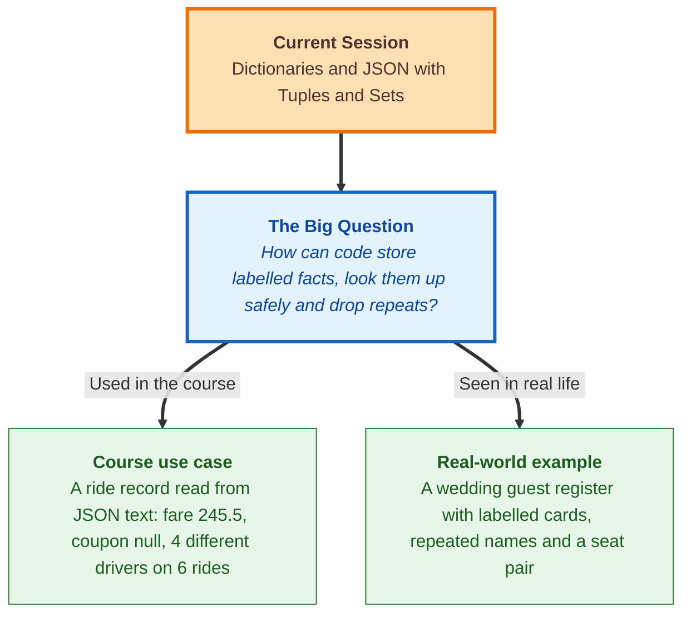

## <span style="color:#2F7DDE">Dictionaries and JSON with Tuples and Sets</span>

### <span style="color:#2F7DDE">Mental Map</span>



---

### <span style="color:#2F7DDE">What You'll Learn</span>

Have you ever wondered how a wedding planner finds one guest's meal choice in seconds?

By the end of this session, you will be able to:

- <span style="color:#D9660B">**List**</span> the labels on one guest card and the fact under each label.
- <span style="color:#D9660B">**Identify**</span> which labels exist on a card before you ask for them.
- <span style="color:#D9660B">**Describe**</span> what a fixed pair, such as row 3 and seat 7, can hold.
- <span style="color:#D9660B">**Classify**</span> each part of the caterer's text as a word, a number, a yes-or-no answer or an empty value.
- <span style="color:#D9660B">**Use**</span> a fallback answer when a guest card has no label for the meal.
- <span style="color:#D9660B">**Build**</span> a count of different guests from an invitation list with repeats.

> <span style="color:#2F7DDE">**Topics you will meet:**</span> dictionary, safe lookup with get, search with in, tuple and unpacking, set, JSON as a dictionary.
>
> Join the session to learn each of these in detail.

---

### <span style="color:#2F7DDE">Why You Are Learning This Topic</span>

Ritu plans a wedding for 120 guests. Each guest has a card with labels: name, meal and table. Nine cards have no meal label. Her helper asked for the meal anyway and gave up. The invitation list also named Asha twice, so the headcount came out wrong.

A <span style="color:#D9660B">**dictionary**</span> means a set of labels, each with one fact stored under it.

In this course, you will read records like these from files and servers and count distinct names.

> <span style="color:#2F7DDE">**Think about it:**</span> What should the helper say when a card has no meal label?

---

### <span style="color:#2F7DDE">The Wedding Guest Register Puzzle</span>

Here is one guest card and the invitation list.

| Label | Fact |
|:----------:|:----------:|
| Name | Asha |
| Meal | veg |
| Table | Row 3, seat 7 |
| Invited by | Ritu, Ritu, Dev |

<span style="color:#D9660B">**What you want to happen:**</span>

- Ritu finds a guest's meal by its label, not by a position number.
- Ritu gets a calm answer when a label is missing.
- Ritu counts each invited guest once.

Here is how it might start. You do not need to understand it yet.

```python
guest = {"name": "Asha", "meal": "veg"}
print(guest["meal"])
```

> <span style="color:#D9660B">**Wonder about this:**</span>
>
> - What would the register do if you ask for a label that does not exist?
> - Does a name that appears 2 times add 1 guest or 2?

---

### <span style="color:#2F7DDE">Think It Through</span>

There is no wrong first try. Keep your guesses for the session.

**1. A card shows name, meal and table. How would you ask for the meal of Asha?**
Hint: Use the label, not the order of the facts.

**2. The seat is row 3, seat 7. Should the pair be changeable by accident?**
Hint: Think about what a fixed pair protects.

**3. The caterer sends 'true' for vegetarian and 'null' for no allergy. What might each become?**
Hint: One is a yes-or-no answer. The other means no value.

---

### <span style="color:#2F7DDE">One Question to Carry Into the Session</span>

> <span style="color:#2F7DDE">**How do we store facts under labels and read them without a crash?**</span>
>
> Which label on a guest card would you check first, and why?
