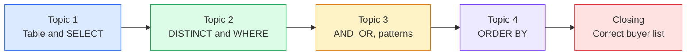
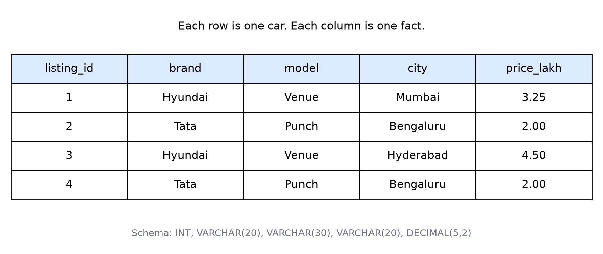
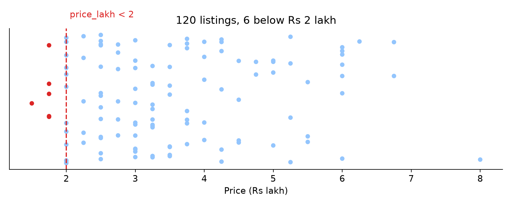
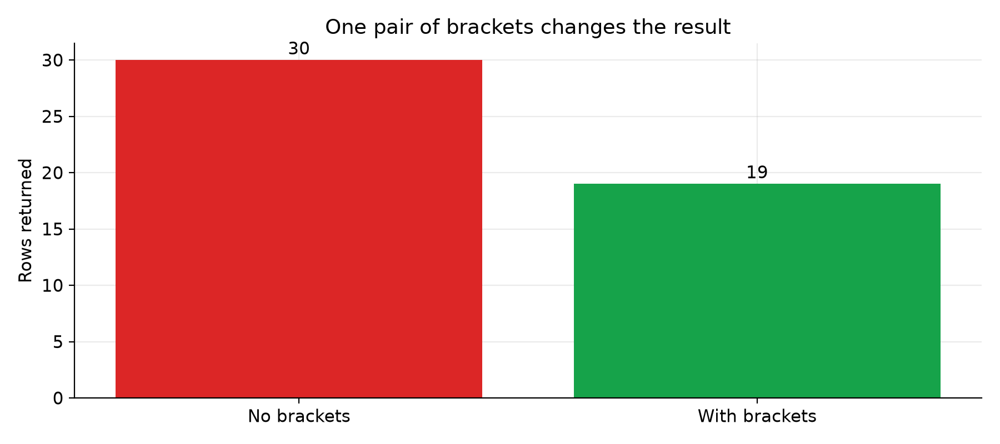
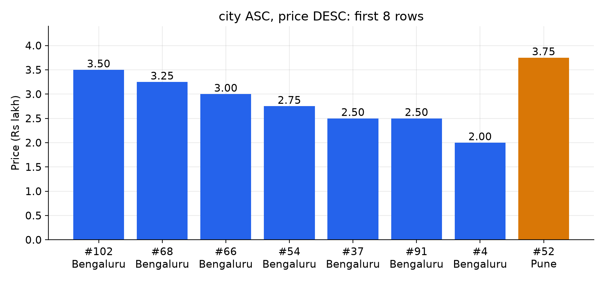
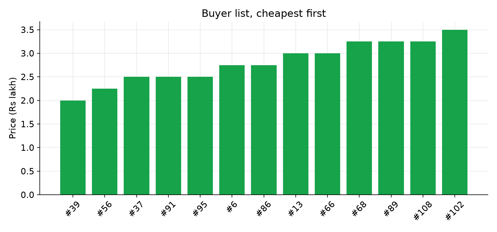

# <font color='#1d4ed8'>Lecture Script: Relational Databases and SELECT Queries (MySQL)</font>

---

## <font color='blue'>Agenda</font>

The lecture runs as four topics. Each topic ends with a quiz.

| Topic | What we do | Learning objectives covered | Minutes |
|:-:|:--|:--|:-:|
| 1 | Describe the table and pick columns | Describe how a relational database stores data as tables, rows and a defined schema<br>Write a SELECT query returning named columns from a single table | 25 |
| 2 | List unique values and filter rows | Retrieve the unique values of a column using DISTINCT<br>Filter rows using comparison operators in a WHERE clause | 25 |
| 3 | Combine conditions and match patterns | Construct a multi-condition WHERE clause using AND, OR, NOT and parentheses<br>Filter rows using IN, BETWEEN and LIKE pattern matching | 35 |
| 4 | Sort the answer | Write a query that sorts results on multiple columns with mixed ASC and DESC | 20 |
| — | Closing: Outcome & Summary | | 15 |
| | **Total** | | **120** |

> <font color="red">**🎯 Instructor Note**</font> Pace: spend the most time on AND, OR and parentheses in Topic 3. Keep DISTINCT and the schema quick.
> The learner opens `data/cars_listings.sql` in the SQL editor and runs it once. Every query runs on the `listings` table.

---

## <font color='blue'>Scenario</font>

A Cars24-style used-car marketplace keeps every car for sale as one row in a table called `listings`.

A buyer fills a filter: **petrol, under Rs 4 lakh, in Bengaluru or Pune**. The app turns it into a query. One wrong word in that query shows the wrong cars.

> <font color="red">**🎯 Instructor Note**</font> Cars24 is only the setting. Do not claim it uses this data. The 120 listings in `data/cars_listings.sql` (CSV copy included) are invented for teaching. Use MySQL 8.0 or later; the outputs here were captured on MySQL 9.7. DB Browser for SQLite users import the CSV instead.

---

## <font color='blue'>Problem Statement</font>

A buyer in Pune asked for petrol cars under Rs 4 lakh in Bengaluru or Pune. The developer wrote the three tests with AND and one OR, and forgot the brackets. The page showed 30 cars instead of 19, and it included diesel cars and cars above Rs 4 lakh. The buyer called support, and trust in the filter dropped.

> <font color='purple'>**How do we describe the table, choose the columns, and filter and sort rows so that a buyer sees exactly the cars they asked for?**</font>

> <font color="red">**🎯 Instructor Note**</font> Poll: "`WHERE fuel = 'Petrol' AND city = 'Bengaluru' OR city = 'Pune'`. Can this return a diesel car in Pune?" Options: yes, no or error. Give learners 30 seconds to respond in chat. Reveal the answer in the Closing.

---

## <font color='blue'>What We Will Use</font>

This is your first SQL session. The tool is MySQL, run from MySQL Workbench or any MySQL editor. Each clause is explained where it first appears.

| Topic | Tools | In one line |
|:-:|:--|:--|
| 1 | `DESCRIBE`, `SELECT`, `FROM` | See the table's columns and pick the ones you want |
| 2 | `DISTINCT`, `WHERE`, `=` `<` `>` `<>` | List unique values and keep rows that pass a test |
| 3 | `AND` `OR` `NOT`, `IN`, `BETWEEN`, `LIKE` | Combine tests and match lists, ranges and text patterns |
| 4 | `ORDER BY`, `ASC`, `DESC` | Sort on more than one column |

---

## <font color='blue'>How: Walking Through the Car Listings Filter</font>



---

## <font color='blue'>Topic 1: Describe the table and pick columns</font> `25 min`

> <font color='purple'>**Before filtering anything, what does the `listings` table hold, and how do we ask for only some columns?**</font>

### <font color='green'>Example: See the schema</font>

> <font color='purple'>**What are the columns, and what type of value does each one hold?**</font>

A **relational database** stores data in **tables**. A table is a grid. Each **row** is one record (one car). Each **column** is one fact (such as `city`). The **schema** is the table's definition: its column names, their types and its rules, such as which column is the key.

**Predict before running: What will happen?**

> <font color="red">**🎯 Instructor Note**</font> Expected: one line per column, 10 lines. `listing_id` is marked PRI, the primary key, so no two cars share an id.

```sql
DESCRIBE listings;
```

**Output**

```
+-------------+--------------+------+-----+---------+-------+
| Field       | Type         | Null | Key | Default | Extra |
+-------------+--------------+------+-----+---------+-------+
| listing_id  | int          | NO   | PRI | NULL    |       |
| brand       | varchar(20)  | NO   |     | NULL    |       |
| model       | varchar(30)  | NO   |     | NULL    |       |
| city        | varchar(20)  | NO   |     | NULL    |       |
| fuel        | varchar(10)  | NO   |     | NULL    |       |
| model_year  | int          | NO   |     | NULL    |       |
| km_driven   | int          | NO   |     | NULL    |       |
| price_lakh  | decimal(5,2) | NO   |     | NULL    |       |
| owner_count | tinyint      | NO   |     | NULL    |       |
| listed_on   | date         | NO   |     | NULL    |       |
+-------------+--------------+------+-----+---------+-------+
```

#### <font color='#c2410c'>Code Explanation</font>

- **Line 1** `DESCRIBE` lists each column with its type. `INT` is a whole number, `VARCHAR(20)` is text up to 20 characters, `DECIMAL(5,2)` is a number with 2 decimals, `DATE` is a calendar date.
- The `Key` column shows `PRI` for `listing_id`. The `Null` column shows NO, so no value is left empty.

> <font color='green'>**Result**</font> The table has 10 columns and 120 rows, one row per listed car. The schema fixes each column's name and type before any row is stored.

<p align="center"></p>

### <font color='green'>Extending it: Pick named columns</font>

> <font color='purple'>**How do we ask for only the id, the model and the price of the first 5 cars?**</font>

`SELECT` names the columns we want. `FROM` names the table. `LIMIT 5` keeps the first 5 rows. `ORDER BY listing_id` keeps them in id order.

> <font color="red">**🎯 Instructor Note**</font> Ask for a prediction. Expected: 5 rows with 3 columns each, in id order.

```sql
SELECT listing_id, model, price_lakh
FROM listings
ORDER BY listing_id
LIMIT 5;
```

**Output**

```
+------------+--------+------------+
| listing_id | model  | price_lakh |
+------------+--------+------------+
|          1 | Venue  |       3.25 |
|          2 | Punch  |       2.00 |
|          3 | Venue  |       4.50 |
|          4 | Punch  |       2.00 |
|          5 | XUV300 |       3.00 |
+------------+--------+------------+
```

#### <font color='#c2410c'>Code Explanation</font>

- **Line 1** The three columns, in the order we want them.
- **Line 2** The table they come from.
- **Lines 3 and 4** The id order, and only the first 5 rows.

> <font color='green'>**Result**</font> Only the three columns we named came back. The order of the names in `SELECT` is the order of the output columns.

### <font color='green'>Extending it: Take every column with a star</font>

> <font color='purple'>**What does `SELECT *` return?**</font>

> <font color="red">**🎯 Instructor Note**</font> Ask for a prediction. Expected: all 10 columns. Use `*` to explore, and named columns in real reports.

```sql
SELECT *
FROM listings
ORDER BY listing_id
LIMIT 3;
```

**Output**

```
+------------+---------+-------+-----------+--------+------------+-----------+------------+-------------+------------+
| listing_id | brand   | model | city      | fuel   | model_year | km_driven | price_lakh | owner_count | listed_on  |
+------------+---------+-------+-----------+--------+------------+-----------+------------+-------------+------------+
|          1 | Hyundai | Venue | Mumbai    | Petrol |       2019 |     97500 |       3.25 |           1 | 2026-03-01 |
|          2 | Tata    | Punch | Bengaluru | Diesel |       2016 |     99500 |       2.00 |           2 | 2026-01-16 |
|          3 | Hyundai | Venue | Hyderabad | Diesel |       2020 |     32500 |       4.50 |           3 | 2026-03-16 |
+------------+---------+-------+-----------+--------+------------+-----------+------------+-------------+------------+
```

> <font color='green'>**Result**</font> The star means every column. It is quick for a look, but a report names its columns so that nothing extra appears.

> <font color='#b45309'>**Common mistake**</font> Misspelling a column name. The server reports it in the error, shown next.

```sql
SELECT listing_id, price FROM listings LIMIT 1;
```

**Output**

```
ERROR 1054 (42S22): Unknown column 'price' in 'field list'
```

> <font color='green'>**Result**</font> MySQL names the column it cannot find. Read the name in the message and compare it with the `DESCRIBE` output.

### <font color='purple'>Quiz 1</font>

**Question:** In a relational table, what is one row?

**Options:**
- A) One column of the table
- B) One record, such as a single car
- C) The table's name
- D) The type of a column

**Correct Answer:** B

**Explanation:**
- **A)** A column is one fact held for every record.
- **B)** Correct. Each row is one record, with a value in every column.
- **C)** The name identifies the table. It is not a row.
- **D)** A column's type belongs to the schema, not to a row.

---

---

## <font color='blue'>Topic 2: List unique values and filter rows</font> `25 min`

> <font color='purple'>**Which fuels exist, and how do we keep only the cars that pass a test?**</font>

### <font color='green'>Example: DISTINCT</font>

> <font color='purple'>**Which fuel types does the table hold, and which brands?**</font>

`DISTINCT` returns each different value once, even if it appears in many rows.

**Predict before running: What will happen?**

> <font color="red">**🎯 Instructor Note**</font> Expected: 3 fuels and 5 brands, with no repeats.

```sql
SELECT DISTINCT fuel FROM listings ORDER BY fuel;
```

**Output**

```
+--------+
| fuel   |
+--------+
| CNG    |
| Diesel |
| Petrol |
+--------+
```

#### <font color='#c2410c'>Code Explanation</font>

- **Line 1** Without `DISTINCT` this query would return 120 rows. With it, each fuel appears once. `ORDER BY fuel` sorts the output.

> <font color='green'>**Result**</font> There are three fuel types: CNG, Diesel and Petrol.

```sql
SELECT DISTINCT brand FROM listings ORDER BY brand;
```

**Output**

```
+----------+
| brand    |
+----------+
| Honda    |
| Hyundai  |
| Mahindra |
| Maruti   |
| Tata     |
+----------+
```

> <font color='green'>**Result**</font> Five brands list the cars. `DISTINCT` shows the choices a filter box can offer.

### <font color='green'>Extending it: Filter with a comparison</font>

> <font color='purple'>**Which cars cost less than Rs 2 lakh?**</font>

`WHERE` keeps only the rows for which the test is true. The comparison operators are `=`, `<>` (not equal), `<`, `<=`, `>` and `>=`. Text values go in single quotes.

> <font color="red">**🎯 Instructor Note**</font> Ask for a prediction. Expected: 6 rows. A common wrong guess includes prices of exactly 2.00; `<` excludes it.

```sql
SELECT listing_id, brand, model, city, price_lakh
FROM listings
WHERE price_lakh < 2
ORDER BY listing_id;
```

**Output**

```
+------------+--------+--------+-----------+------------+
| listing_id | brand  | model  | city      | price_lakh |
+------------+--------+--------+-----------+------------+
|          8 | Maruti | WagonR | Delhi     |       1.50 |
|         20 | Maruti | WagonR | Pune      |       1.75 |
|         25 | Tata   | Altroz | Pune      |       1.75 |
|         35 | Maruti | Swift  | Hyderabad |       1.75 |
|         43 | Maruti | Dzire  | Pune      |       1.75 |
|         65 | Maruti | WagonR | Delhi     |       1.75 |
+------------+--------+--------+-----------+------------+
```

#### <font color='#c2410c'>Code Explanation</font>

- **Line 3** `price_lakh < 2` is tested for every row. Only the rows where it is true appear.

> <font color='green'>**Result**</font> 6 cars cost less than Rs 2 lakh. The cheapest is Rs 1.50 lakh.

<p align="center"></p>

### <font color='green'>Extending it: Filter on text</font>

> <font color='purple'>**Which fuel values are not Petrol, and what if the quotes are missing?**</font>

> <font color="red">**🎯 Instructor Note**</font> Ask for a prediction. Expected: the second query fails, because without quotes Petrol is read as a column name.

```sql
SELECT listing_id, fuel
FROM listings
WHERE fuel <> 'Petrol'
ORDER BY listing_id
LIMIT 3;
```

**Output**

```
+------------+--------+
| listing_id | fuel   |
+------------+--------+
|          2 | Diesel |
|          3 | Diesel |
|          5 | Diesel |
+------------+--------+
```

> <font color='green'>**Result**</font> `<>` keeps every car whose fuel is not Petrol. Text needs single quotes.

> <font color='#b45309'>**Common mistake**</font> Forgetting the quotes, as below. Fix: put the text in single quotes.

```sql
SELECT listing_id FROM listings WHERE fuel = Petrol;
```

**Output**

```
ERROR 1054 (42S22): Unknown column 'Petrol' in 'where clause'
```

> <font color='green'>**Result**</font> Without quotes, MySQL reads `Petrol` as a column name and cannot find it.

### <font color='purple'>Quiz 2</font>

**Question:** `SELECT DISTINCT city FROM listings` returns how many rows if the table holds 5 different cities in 120 rows?

**Options:**
- A) 120
- B) 1
- C) 5
- D) 0

**Correct Answer:** C

**Explanation:**
- **A)** `DISTINCT` removes repeats, so the result is not 120.
- **B)** One row would mean a single city.
- **C)** Correct. One row per different city.
- **D)** There are cities in the table, so the result is not empty.

---

---

## <font color='blue'>Topic 3: Combine conditions and match patterns</font> `35 min`

> <font color='purple'>**The buyer's filter has three tests and two cities. How do AND, OR and brackets decide which cars show?**</font>

### <font color='green'>Example: The buyer's rule, with and without brackets</font>

> <font color='purple'>**Why did the page show 30 cars instead of 19?**</font>

`AND` needs both tests true. `OR` needs one. `NOT` reverses a test. SQL works out every `AND` before any `OR`, so brackets are needed to change that order.

**Predict before running: What will happen?**

> <font color="red">**🎯 Instructor Note**</font> Expected: the version without brackets returns 30 rows and includes non-petrol cars. We sort by fuel to bring them to the top.

```sql
SELECT listing_id, city, fuel, price_lakh
FROM listings
WHERE fuel = 'Petrol' AND price_lakh < 4
  AND city = 'Bengaluru' OR city = 'Pune'
ORDER BY fuel, listing_id
LIMIT 6;
```

**Output**

```
+------------+------+--------+------------+
| listing_id | city | fuel   | price_lakh |
+------------+------+--------+------------+
|         16 | Pune | Diesel |       4.25 |
|         20 | Pune | Diesel |       1.75 |
|         31 | Pune | Diesel |       5.25 |
|         33 | Pune | Diesel |       3.25 |
|         40 | Pune | Diesel |       3.75 |
|         41 | Pune | Diesel |       3.75 |
+------------+------+--------+------------+
```

#### <font color='#c2410c'>Code Explanation</font>

- **Lines 3 and 4** SQL reads this as: (Petrol AND under 4 AND Bengaluru) OR (Pune). Every Pune car passes the second part, whatever its fuel or price.
- **Line 6** The first 6 rows, sorted by fuel, show diesel cars that should not be here.

> <font color='green'>**Result**</font> The rows are diesel cars in Pune, and two cost more than Rs 4 lakh. The `OR` let every Pune car through, which gives 30 rows.

<p align="center"></p>

```sql
SELECT listing_id, city, fuel, price_lakh
FROM listings
WHERE fuel = 'Petrol' AND price_lakh < 4
  AND (city = 'Bengaluru' OR city = 'Pune')
ORDER BY listing_id
LIMIT 6;
```

**Output**

```
+------------+-----------+--------+------------+
| listing_id | city      | fuel   | price_lakh |
+------------+-----------+--------+------------+
|          4 | Bengaluru | Petrol |       2.00 |
|          6 | Pune      | Petrol |       2.75 |
|         13 | Pune      | Petrol |       3.00 |
|         22 | Pune      | Petrol |       2.25 |
|         25 | Pune      | Petrol |       1.75 |
|         37 | Bengaluru | Petrol |       2.50 |
+------------+-----------+--------+------------+
```

> <font color='green'>**Result**</font> With brackets, the city test is worked out first, and the query returns the 19 cars the buyer wanted. The first six are shown.

### <font color='green'>Extending it: IN, BETWEEN and NOT</font>

> <font color='purple'>**How do we write the city test, and a price range, more shortly?**</font>

`IN (...)` is a short form of several `OR` tests on one column. `BETWEEN a AND b` includes both ends. `NOT` reverses a test.

> <font color="red">**🎯 Instructor Note**</font> Ask for a prediction. Expected: the same cars as the bracketed query. BETWEEN includes 6.00.

```sql
SELECT listing_id, model, price_lakh
FROM listings
WHERE city IN ('Bengaluru', 'Pune')
  AND price_lakh BETWEEN 5.75 AND 6
  AND NOT fuel = 'Diesel'
ORDER BY listing_id;
```

**Output**

```
+------------+--------+------------+
| listing_id | model  | price_lakh |
+------------+--------+------------+
|         11 | Baleno |       6.00 |
|         83 | City   |       6.00 |
+------------+--------+------------+
```

#### <font color='#c2410c'>Code Explanation</font>

- **Line 3** City is one of the two.
- **Line 4** A price from 5.75 to 6, ends included.
- **Line 5** `NOT` removes diesel cars.

> <font color='green'>**Result**</font> The rows priced exactly 6.00 are kept, which shows that `BETWEEN` includes its end values.

### <font color='green'>Extending it: Match a pattern with LIKE</font>

> <font color='purple'>**Which models start with W, are one letter then `wift`, or end in `eno`?**</font>

`LIKE` matches text patterns. `%` stands for any run of characters, and `_` stands for exactly one character.

> <font color="red">**🎯 Instructor Note**</font> Ask for a prediction. Expected: Baleno, Swift and WagonR. MySQL ignores upper and lower case here by default, so `%ENO` matches Baleno.

```sql
SELECT DISTINCT model
FROM listings
WHERE model LIKE 'W%'
   OR model LIKE '_wift'
   OR model LIKE '%ENO'
ORDER BY model;
```

**Output**

```
+--------+
| model  |
+--------+
| Baleno |
| Swift  |
| WagonR |
+--------+
```

#### <font color='#c2410c'>Code Explanation</font>

- **Line 3** `'W%'` means starts with W: WagonR.
- **Line 4** `'_wift'` is one unknown character, then wift: Swift.
- **Line 5** `'%ENO'` ends with eno in any case: Baleno.

> <font color='green'>**Result**</font> Three models match. `%` matches any number of characters. `_` matches exactly one. The capital letters in `%ENO` still matched Baleno.

> <font color='#b45309'>**Common mistake**</font> Writing `model = 'S%'`. The `=` test does not use patterns. Use `LIKE`.

### <font color='purple'>Quiz 3</font>

**Question:** `WHERE city = 'Pune' OR city = 'Delhi' AND fuel = 'CNG'` returns which cars?

**Options:**
- A) All cars in Pune, plus CNG cars in Delhi
- B) Only CNG cars in Pune or Delhi
- C) All cars in Delhi, plus CNG cars in Pune
- D) No cars, it is an error

**Correct Answer:** A

**Explanation:**
- **A)** Correct. `AND` is worked out first, so it is `city = 'Pune'` OR (`city = 'Delhi'` AND CNG).
- **B)** That needs brackets: `(city = 'Pune' OR city = 'Delhi') AND fuel = 'CNG'`.
- **C)** The brackets would have to go around the Pune test for that.
- **D)** The query is valid. It only returns surprising rows.

---

---

## <font color='blue'>Topic 4: Sort the answer</font> `20 min`

> <font color='purple'>**The right cars are in the result. How do we show the cheapest first, and the freshest listing first among equals?**</font>

### <font color='green'>Example: Sort on two columns, one ascending and one descending</font>

> <font color='purple'>**How do we sort by city A to Z, and the dearest car first inside each city?**</font>

`ORDER BY` sorts the result. `ASC` is low to high and is the default. `DESC` is high to low. List more than one column, and the next column breaks the ties of the one before it.

**Predict before running: What will happen?**

> <font color="red">**🎯 Instructor Note**</font> Expected: Bengaluru cars first, with the highest price first inside the city. Equal prices are ordered by id.

```sql
SELECT listing_id, city, price_lakh
FROM listings
WHERE city IN ('Bengaluru', 'Pune')
  AND fuel = 'Petrol' AND price_lakh < 4
ORDER BY city ASC, price_lakh DESC, listing_id
LIMIT 8;
```

**Output**

```
+------------+-----------+------------+
| listing_id | city      | price_lakh |
+------------+-----------+------------+
|        102 | Bengaluru |       3.50 |
|         68 | Bengaluru |       3.25 |
|         66 | Bengaluru |       3.00 |
|         54 | Bengaluru |       2.75 |
|         37 | Bengaluru |       2.50 |
|         91 | Bengaluru |       2.50 |
|          4 | Bengaluru |       2.00 |
|         52 | Pune      |       3.75 |
+------------+-----------+------------+
```

#### <font color='#c2410c'>Code Explanation</font>

- **Line 5** Three sort keys: city A to Z, then price high to low, then id to settle ties.
- **Line 6** The first 8 rows.

> <font color='green'>**Result**</font> Bengaluru's dearest petrol car under Rs 4 lakh comes first. Rows with the same city and price stay in id order, so the result is always the same.

<p align="center"></p>

### <font color='green'>Extending it: Why the tie-breaker matters</font>

> <font color='purple'>**What if two cars have the same city and price?**</font>

> <font color="red">**🎯 Instructor Note**</font> Ask for a prediction. Expected: without the id, the order of tied rows is not guaranteed. Add a tie-breaker every time.

```sql
SELECT listing_id, price_lakh
FROM listings
WHERE price_lakh = 1.75
ORDER BY price_lakh DESC, listing_id ASC;
```

**Output**

```
+------------+------------+
| listing_id | price_lakh |
+------------+------------+
|         20 |       1.75 |
|         25 |       1.75 |
|         35 |       1.75 |
|         43 |       1.75 |
|         65 |       1.75 |
+------------+------------+
```

> <font color='green'>**Result**</font> Five cars cost exactly 1.75. The id puts them in a fixed order, so the same query gives the same page every time.

### <font color='purple'>Quiz 4</font>

**Question:** `ORDER BY brand ASC, price_lakh DESC`. Two Hyundai cars cost 3.00 and 5.00 lakh. Which row comes first?

**Options:**
- A) The 3.00 lakh car
- B) Neither, Hyundai rows are hidden
- C) Either one, the order is random
- D) The 5.00 lakh car

**Correct Answer:** D

**Explanation:**
- **A)** `DESC` puts the larger price first.
- **B)** Sorting never hides rows.
- **C)** The second column settles the tie, so the order is fixed.
- **D)** Correct. The brand is the same, so the price decides, high to low.

---

---

## <font color='blue'>Closing: Outcome & Summary</font> `15 min`

Back to the buyer in Pune. One query now returns the right cars, in a clear order. It uses every topic once.

> <font color='purple'>**1 and 2. Which columns and which table? (Topic 1)**</font>

The buyer needs the id, brand, model, city, fuel, year and price from the `listings` table.

> <font color='purple'>**3. Which cars pass every test, in the right order? (Topics 2, 3 and 4)**</font>

```sql
SELECT listing_id, brand, model, city, model_year, price_lakh
FROM listings
WHERE fuel = 'Petrol' AND price_lakh < 4
  AND city IN ('Bengaluru', 'Pune')
  AND model_year >= 2019
ORDER BY price_lakh, listing_id;
```

**Output**

```
+------------+---------+--------+-----------+------------+------------+
| listing_id | brand   | model  | city      | model_year | price_lakh |
+------------+---------+--------+-----------+------------+------------+
|         39 | Maruti  | WagonR | Pune      |       2019 |       2.00 |
|         56 | Hyundai | i20    | Pune      |       2019 |       2.25 |
|         37 | Tata    | Punch  | Bengaluru |       2019 |       2.50 |
|         91 | Maruti  | WagonR | Bengaluru |       2023 |       2.50 |
|         95 | Tata    | Altroz | Pune      |       2019 |       2.50 |
|          6 | Honda   | Amaze  | Pune      |       2020 |       2.75 |
|         86 | Hyundai | i20    | Pune      |       2019 |       2.75 |
|         13 | Maruti  | Swift  | Pune      |       2021 |       3.00 |
|         66 | Maruti  | Swift  | Bengaluru |       2021 |       3.00 |
|         68 | Maruti  | Dzire  | Bengaluru |       2021 |       3.25 |
|         89 | Maruti  | Swift  | Pune      |       2021 |       3.25 |
|        108 | Maruti  | Baleno | Pune      |       2022 |       3.25 |
|        102 | Hyundai | i20    | Bengaluru |       2023 |       3.50 |
+------------+---------+--------+-----------+------------+------------+
```

#### <font color='#c2410c'>Code Explanation</font>

- **Line 1** Named columns (Topic 1).
- **Line 3** Comparison tests with `AND` (Topics 2 and 3).
- **Line 4** `IN` replaces two `OR` tests, and needs no brackets (Topic 3).
- **Line 5** Newer cars only: a comparison (Topic 2).
- **Line 6** Cheapest first, with the id as tie-breaker (Topic 4).

<p align="center"></p>

### <font color='green'>Outcome</font>

| | Without brackets | With brackets and IN |
|:--|:-:|:-:|
| Rows returned | 30 | 19 |
| Non-petrol cars shown | Yes | No |
| Cars over Rs 4 lakh shown | Yes | No |

> <font color='green'>**Therefore,**</font> the buyer's three tests belong together, so the city test needs brackets, or `IN`. The missing brackets let every Pune car through, which gave 30 rows instead of 19. Adding a year test leaves 13 cars in price order.

> <font color="red">**🎯 Instructor Note**</font> Reveal the poll: yes. `AND` binds first, so any Pune car passes, including diesel.

### <font color='green'>Summary</font>

| Learning objective | Takeaway |
|:--|:--|
| Tables, rows, schema | A table is rows of records. The schema fixes column names and types |
| SELECT named columns | `SELECT a, b FROM table` returns only those columns, in that order |
| DISTINCT | Returns each different value once |
| WHERE with comparisons | `=`, `<>`, `<`, `<=`, `>`, `>=`. Text goes in single quotes |
| AND, OR, NOT, brackets | `AND` is worked out before `OR`. Use brackets to say what you mean |
| IN, BETWEEN, LIKE | `IN` is a list, `BETWEEN` includes both ends, `LIKE` uses `%` and `_` |
| ORDER BY | `ASC` or `DESC` per column. Add the id as a tie-breaker |
| **Practical value** | Every report starts as a filter on a table. Writing the tests with brackets and a clear order stops wrong rows reaching customers. |

---

# <font color='red'>Launch the Feedback Poll</font>

> <font color="red">**🎯 Instructor Note**</font> Reminder: launch the feedback poll now to collect learner feedback.
