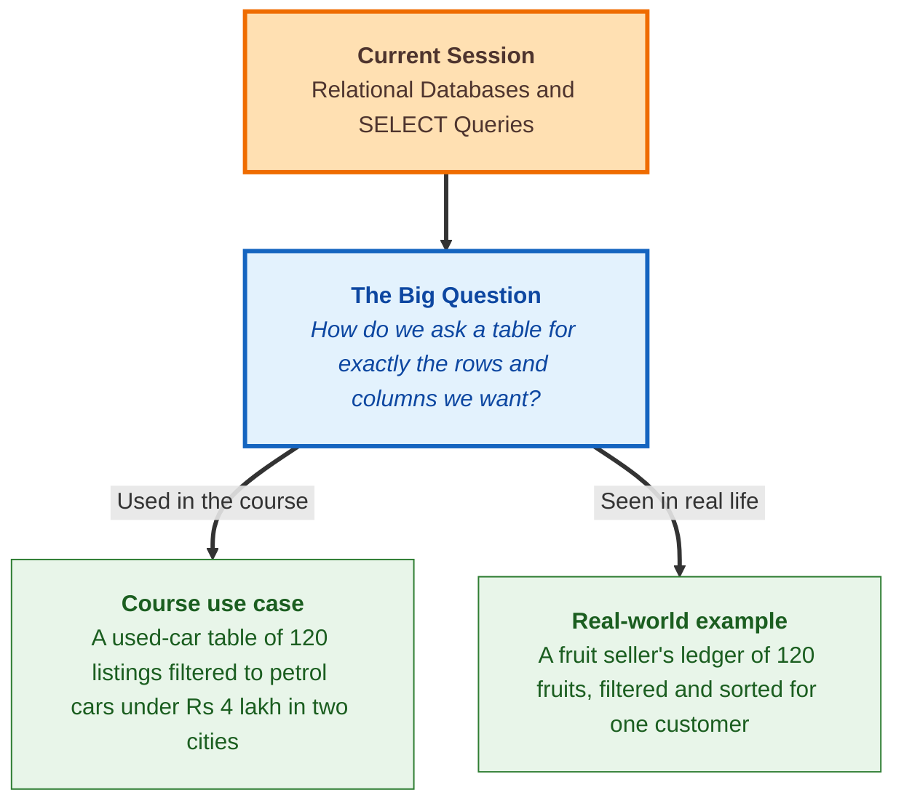

## Relational Databases and SELECT Queries

### Mental Map

---

### What You'll Learn

Have you ever wondered how a shop owner finds every red fruit under Rs 80 in a long ledger?

By the end of this session, you will be able to:

- **Name** the columns you want from a fruit ledger, such as fruit, colour and price.
- **Identify** each different fruit colour once, with no repeats.
- **Describe** how the ledger keeps one fruit in each row and one fact in each column.
- **Apply** price, list, range and name tests to keep only the fruits a customer wants.
- **Design** a rule for red fruits under Rs 80, or any green fruit, with brackets in the right place.
- **Write** a sort that shows the cheapest fruit first and the freshest first when prices match.

> **Topics you will meet:** tables, schema, SELECT, DISTINCT, WHERE, AND OR NOT, IN, LIKE, BETWEEN, ORDER BY.
>
> Join the session to learn each of these in detail.

---

### Why You Are Learning This Topic

Nandini sells fruit at a market stall. Her ledger lists 120 fruits with colour, price per kg and arrival day. A customer asks for red fruits under Rs 80, or any green fruit. Nandini's helper reads the ledger and lists every red fruit and every green fruit. The customer sees costly red fruit and feels cheated.

A **table** means a grid where each row is one record and each column is one fact.

In this course, you will ask tables for exact rows, the way Nandini wants her ledger to answer.

> **Think about it:** Which part of the customer's request did the helper read wrongly?

---

### The Fruit Market Ledger Puzzle

Here are four rows of Nandini's ledger.

| Fruit | Colour | Price per kg |
|:----------:|:----------:|:----------:|
| Apple | Red | Rs 180 |
| Guava | Green | Rs 60 |
| Banana | Yellow | Rs 50 |
| Cherry | Red | Rs 60 |

**What you want to happen:**

- Nandini asks for only the fruit and price columns.
- Nandini sees each colour listed once.
- Nandini lists the cheapest fruit first.

> **Wonder about this:**
>
> - How would Nandini ask for red fruits under Rs 80, or any green fruit, without mixing the two?
> - What should she do when two fruits cost the same?

---

### Think It Through

There is no wrong first try. Keep your guesses for the session.

**1. The ledger has 120 rows and 4 columns. How would you ask for only the fruit names?**
Hint: Name the column you want and the ledger you read from.

**2. A customer wants fruit priced from Rs 50 to Rs 80. Are Rs 50 and Rs 80 inside the range?**
Hint: Decide whether the ends count.

**3. Two fruits cost Rs 60. How should the list order them so it never changes between runs?**
Hint: Think of a second fact that is different for every fruit.

---

### One Question to Carry Into the Session

> **How do we write a request so the table returns only the rows we mean, in the order we want?**
>
> Which part of the customer's request would you write first?
