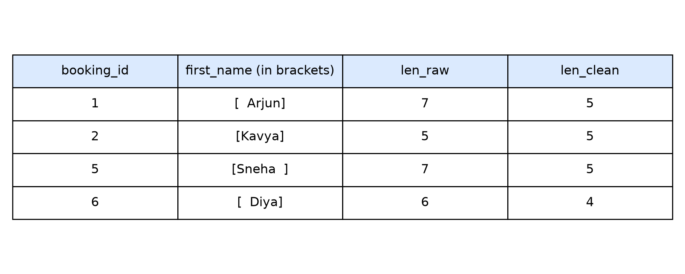
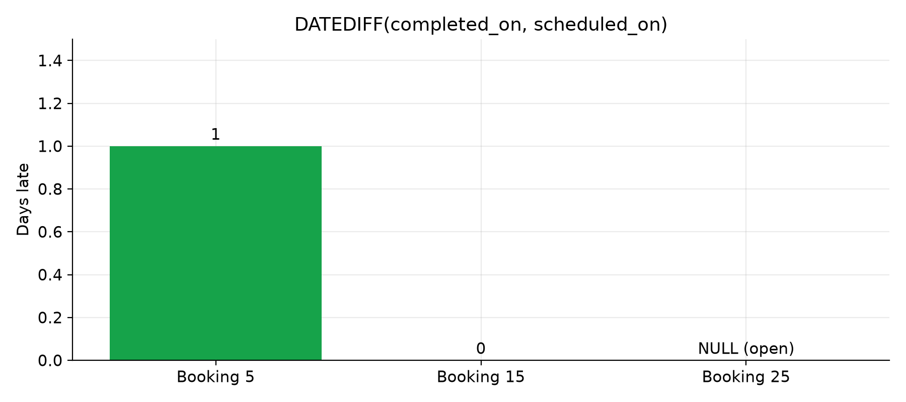
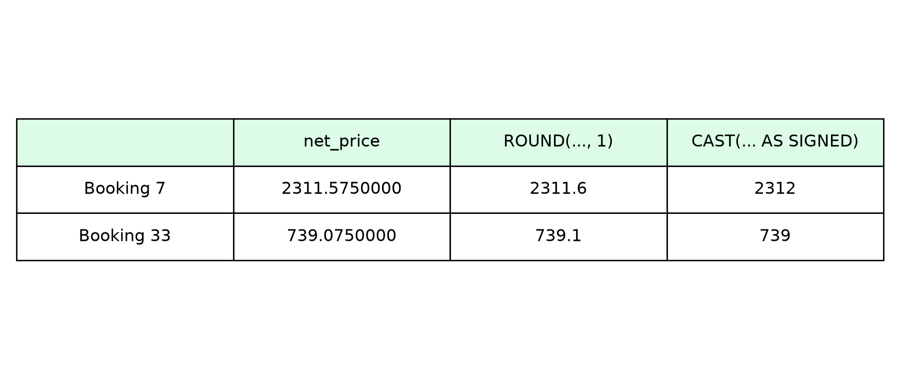
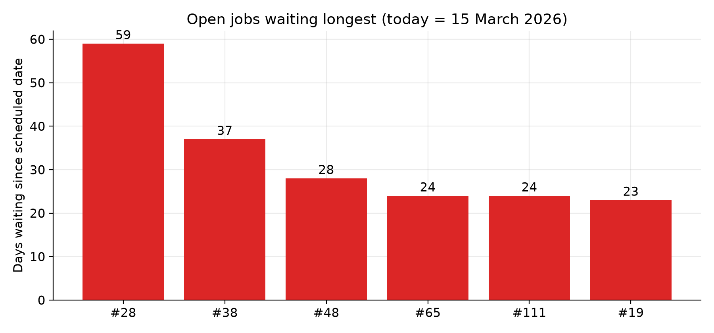

# <font color='#1d4ed8'>Lecture Script: Text and Dates with Calculated Columns (MySQL)</font>

---

## <font color='blue'>Agenda</font>

The lecture runs as four topics. Each topic ends with a quiz.

| Topic | What we do | Learning objectives covered | Minutes |
|:-:|:--|:--|:-:|
| 1 | Clean and join the text columns | Apply string functions to clean and combine text columns | 30 |
| 2 | Pull parts out of dates and count the days between them | Extract year, month and day parts from a date column<br>Compute the interval between two date columns | 25 |
| 3 | Build calculated columns with aliases | Compute a derived column from arithmetic on existing columns<br>Format query output using column and table aliases | 25 |
| 4 | Tidy the numbers and find missing values | Format numeric output using ROUND and an explicit type cast<br>Filter rows on missing values using IS NULL and IS NOT NULL | 25 |
| — | Closing: Outcome & Summary | | 15 |
| | **Total** | | **120** |

> <font color="red">**🎯 Instructor Note**</font> Pace: in Topic 2 keep the date parts quick and spend the time on `DATEDIFF`. In Topic 4 keep `ROUND` and `CAST` quick and spend the time on `IS NULL`.
> Topic 1 is the longest hands-on part. Let learners run each query. Treat 15 March 2026 as "today".

---

## <font color='blue'>Scenario</font>

**Before and after.** An Urban Company-style home-services app stores one row per booking. The same booking looks very different on the table and on the report the coordinator needs.

| | Stored in `bookings` | Wanted on the report |
|:--|:--|:--|
| Customer | `"  Arjun"`, `"NAIR"` | `Arjun NAIR` |
| City | `"hyderabad"` | `Hyderabad` |
| Dates | `scheduled_on` and `completed_on` | Days between them |
| Price | `2499.00` and `7.5` percent | `2311.6` after discount |
| Not done yet | `NULL` in `completed_on` | A clear open-job list |

> <font color="red">**🎯 Instructor Note**</font> Urban Company is only the setting. Do not claim it uses this data. The 120 bookings in `data/service_bookings.sql` (CSV copy included) are invented for teaching. Use MySQL 8.0 or later (outputs captured on MySQL 9.7). Treat 15 March 2026 as today.

---

## <font color='blue'>Problem Statement</font>

Reema, a coordinator, wanted the jobs not yet done. She typed `WHERE completed_on = NULL`. The result was empty, so she told her manager that no job was open. In fact 19 jobs were open, and booking 28 had waited 59 days past its scheduled date. The same report also showed names such as "  Arjun" and cities such as "hyderabad".

> <font color='purple'>**How do we turn raw booking rows into a clean list of open jobs, with tidy names, days waiting and net prices?**</font>

> <font color="red">**🎯 Instructor Note**</font> Poll: "`WHERE completed_on = NULL` returned no rows. Does that mean no job is open?" Options: yes, no or it depends on the data. Give learners 30 seconds to respond in chat. Reveal the answer in the Closing.

---

## <font color='blue'>What We Will Use</font>

Last session you chose columns and filtered rows with `WHERE`. Today you change what each column shows. The tool is MySQL, run from MySQL Workbench or any MySQL editor.

| Topic | Tools | In one line |
|:-:|:--|:--|
| 1 | `TRIM`, `UPPER`, `LOWER`, `LEFT`, `SUBSTRING`, `CONCAT`, `CONCAT_WS` | Clean and join text |
| 2 | `YEAR`, `MONTH`, `DAY`, `DAYNAME`, `DATEDIFF` | Pull a part out of a date and count days between two dates |
| 3 | Arithmetic, `AS`, table alias | Build a new column and give it a name |
| 4 | `ROUND`, `CAST`, `IS NULL`, `IS NOT NULL` | Format numbers and test for missing values |

---

## <font color='blue'>How: Walking Through the Open Jobs List</font>


---

## <font color='blue'>Topic 1: Clean and join the text columns</font> `30 min`

> <font color='purple'>**Names and cities were typed by hand. What is wrong with them, and how do we fix it?**</font>

### <font color='green'>Example: Find the stray spaces</font>

> <font color='purple'>**Which first names carry extra spaces, and how many characters do they waste?**</font>

`TRIM(text)` removes spaces at both ends. `LENGTH(text)` counts characters. `AS` gives a column a name in the output.

**Predict before running: What will happen?**

> <font color="red">**🎯 Instructor Note**</font> Expected: `len_clean` is smaller than `len_raw` for the rows with spaces. Booking 2 has none, so both lengths are 5.

```sql
SELECT booking_id, first_name,
       LENGTH(first_name) AS len_raw,
       LENGTH(TRIM(first_name)) AS len_clean
FROM bookings
WHERE booking_id IN (1, 2, 5, 6)
ORDER BY booking_id;
```

**Output**

```
+------------+------------+---------+-----------+
| booking_id | first_name | len_raw | len_clean |
+------------+------------+---------+-----------+
|          1 |   Arjun    |       7 |         5 |
|          2 | Kavya      |       5 |         5 |
|          5 | Sneha      |       7 |         5 |
|          6 |   Diya     |       6 |         4 |
+------------+------------+---------+-----------+
```

#### <font color='#c2410c'>Code Explanation</font>

- **Line 1** The id and the name as stored.
- **Lines 2 and 3** The size of the stored text, and the size after `TRIM`. The difference is the extra spaces.
- **Lines 5 and 6** Four bookings that show the problem, in id order.

> <font color='green'>**Result**</font> Bookings 1, 5 and 6 have spaces at the ends (7 against 5, 7 against 5, 6 against 4). Booking 2 is clean (5 against 5).

<p align="center"></p>

### <font color='green'>Extending it: Fix the case</font>

> <font color='purple'>**How do we make `hyderabad` and `PUNE` look like `Hyderabad` and `Pune`?**</font>

`UPPER` and `LOWER` change every letter. `LEFT(text, 1)` takes the first letter. `SUBSTRING(text, 2)` takes everything from the 2nd character. `CONCAT` joins pieces.

> <font color="red">**🎯 Instructor Note**</font> Ask for a prediction. Expected: first letter capital, the rest small, spaces gone. A common wrong guess is that `UPPER` alone fixes it.

```sql
SELECT booking_id,
       CONCAT(UPPER(LEFT(TRIM(first_name), 1)),
              LOWER(SUBSTRING(TRIM(first_name), 2))) AS first_clean,
       UPPER(TRIM(last_name)) AS last_upper,
       CONCAT(UPPER(LEFT(TRIM(city), 1)),
              LOWER(SUBSTRING(TRIM(city), 2))) AS city_clean
FROM bookings
WHERE booking_id IN (1, 5, 6, 9)
ORDER BY booking_id;
```

**Output**

```
+------------+-------------+------------+------------+
| booking_id | first_clean | last_upper | city_clean |
+------------+-------------+------------+------------+
|          1 | Arjun       | NAIR       | Hyderabad  |
|          5 | Sneha       | MEHTA      | Pune       |
|          6 | Diya        | SINGH      | Mumbai     |
|          9 | Vikram      | NAIR       | Delhi      |
+------------+-------------+------------+------------+
```

#### <font color='#c2410c'>Code Explanation</font>

- **Lines 2 and 3** Trim, take the first letter in capitals, and join it to the rest in small letters.
- **Line 4** Last names in capitals, with the spaces trimmed.
- **Lines 5 and 6** The same pattern for the city.

> <font color='green'>**Result**</font> Every name and city is now tidy: `Arjun`, `NAIR`, `Hyderabad`. The stored table did not change. Only this output did.

### <font color='green'>Extending it: Join first and last name</font>

> <font color='purple'>**How do we build one full name column?**</font>

`CONCAT_WS(separator, a, b)` joins the values with a separator between them, so we write the space once.

> <font color="red">**🎯 Instructor Note**</font> Ask for a prediction. Expected: `Arjun NAIR`, `Sneha MEHTA` and so on.

```sql
SELECT booking_id,
       CONCAT_WS(' ', TRIM(first_name), UPPER(TRIM(last_name))) AS full_name
FROM bookings
WHERE booking_id IN (1, 5, 6, 9)
ORDER BY booking_id;
```

**Output**

```
+------------+-------------+
| booking_id | full_name   |
+------------+-------------+
|          1 | Arjun NAIR  |
|          5 | Sneha MEHTA |
|          6 | Diya SINGH  |
|          9 | Vikram NAIR |
+------------+-------------+
```

#### <font color='#c2410c'>Code Explanation</font>

- **Line 2** `CONCAT_WS` puts one space between the trimmed first name and the upper-case last name.

> <font color='green'>**Result**</font> One clean `full_name` per booking. The separator is written once instead of in every join.

> <font color='#b45309'>**Common mistake**</font> Using `CONCAT(first_name, last_name)` and getting `ArjunNAIR` with no space. Fix: use `CONCAT_WS(' ', ...)`.

### <font color='purple'>Quiz 1</font>

**Question:** `TRIM('  Diya  ')` returns what?

**Options:**
- A) 'Diya  '
- B) 'Diya'
- C) '  Diya'
- D) 'DIYA'

**Correct Answer:** B

**Explanation:**
- **A)** That removes only the left spaces. `TRIM` removes both ends.
- **B)** Correct. `TRIM` removes the spaces at both ends.
- **C)** That removes only the right spaces. `TRIM` removes both ends.
- **D)** `TRIM` does not change case. `UPPER` does.

---

---

## <font color='blue'>Topic 2: Pull parts out of dates and count the days between them</font> `25 min`

> <font color='purple'>**The report needs to know when each job was due and how late it was. How do we read a date column?**</font>

### <font color='green'>Example: Year, month, day and weekday</font>

> <font color='purple'>**What are the parts of the scheduled date for bookings 1, 5 and 15?**</font>

`YEAR`, `MONTH` and `DAY` return one part of a `DATE`. `DAYNAME` returns the weekday name.

**Predict before running: What will happen?**

> <font color="red">**🎯 Instructor Note**</font> Expected: bookings 5 and 15 are around the month turn, so months 2 and 3. Booking 5's date is 2 February 2026, a Monday.

```sql
SELECT booking_id, scheduled_on,
       YEAR(scheduled_on) AS yr,
       MONTH(scheduled_on) AS mth,
       DAY(scheduled_on) AS dy,
       DAYNAME(scheduled_on) AS weekday
FROM bookings
WHERE booking_id IN (1, 5, 15)
ORDER BY booking_id;
```

**Output**

```
+------------+--------------+------+------+------+---------+
| booking_id | scheduled_on | yr   | mth  | dy   | weekday |
+------------+--------------+------+------+------+---------+
|          1 | 2026-03-06   | 2026 |    3 |    6 | Friday  |
|          5 | 2026-02-02   | 2026 |    2 |    2 | Monday  |
|         15 | 2026-03-01   | 2026 |    3 |    1 | Sunday  |
+------------+--------------+------+------+------+---------+
```

#### <font color='#c2410c'>Code Explanation</font>

- **Lines 2 to 4** Three numbers out of one date.
- **Line 5** The name of the weekday.

> <font color='green'>**Result**</font> Booking 15 is on 1 March 2026, a Sunday. Booking 5 is on 2 February 2026, a Monday. One date column gives four readable parts.

### <font color='green'>Extending it: Days between two dates</font>

> <font color='purple'>**How many days late was each job, and how long has an open job been waiting?**</font>

`DATEDIFF(later, earlier)` returns the number of days from the earlier date to the later one. It counts correctly across month ends.

> <font color="red">**🎯 Instructor Note**</font> Ask for a prediction. Expected: booking 5 was scheduled on 2 Feb and completed on 3 Feb, so 1 day. Booking 25 has no completion date, so `DATEDIFF` gives NULL.

```sql
SELECT booking_id, scheduled_on, completed_on,
       DATEDIFF(completed_on, scheduled_on) AS delay_days
FROM bookings
WHERE booking_id IN (5, 15, 25)
ORDER BY booking_id;
```

**Output**

```
+------------+--------------+--------------+------------+
| booking_id | scheduled_on | completed_on | delay_days |
+------------+--------------+--------------+------------+
|          5 | 2026-02-02   | 2026-02-03   |          1 |
|         15 | 2026-03-01   | 2026-03-01   |          0 |
|         25 | 2026-02-25   | NULL         |       NULL |
+------------+--------------+--------------+------------+
```

#### <font color='#c2410c'>Code Explanation</font>

- **Line 2** The completion date minus the scheduled date, in days.
- **Line 4** Booking 25 is open, so the result is NULL.

> <font color='green'>**Result**</font> Booking 5 was 1 day late, booking 15 was on time (0 days) and booking 25 gives NULL because `completed_on` is empty.

<p align="center"></p>

### <font color='green'>Extending it: Days an open job has waited</font>

> <font color='purple'>**Which open jobs have waited longest since their scheduled date?**</font>

> <font color="red">**🎯 Instructor Note**</font> Ask for a prediction. Expected: booking 28 first, with 59 days, using 15 March 2026 as today. We use a fixed date, not the clock, so the output never changes.

```sql
SELECT booking_id, scheduled_on,
       DATEDIFF('2026-03-15', scheduled_on) AS days_waiting
FROM bookings
WHERE completed_on IS NULL
ORDER BY days_waiting DESC, booking_id
LIMIT 5;
```

**Output**

```
+------------+--------------+--------------+
| booking_id | scheduled_on | days_waiting |
+------------+--------------+--------------+
|         28 | 2026-01-15   |           59 |
|         38 | 2026-02-06   |           37 |
|         48 | 2026-02-15   |           28 |
|         65 | 2026-02-19   |           24 |
|        111 | 2026-02-19   |           24 |
+------------+--------------+--------------+
```

#### <font color='#c2410c'>Code Explanation</font>

- **Line 2** A fixed "today" minus the scheduled date.
- **Line 4** `IS NULL` keeps only jobs with no completion date, which are the open jobs.
- **Line 5** Longest wait first, with the id as tie-breaker.

> <font color='green'>**Result**</font> Booking 28 has waited 59 days. Bookings 65 and 111 tie at 24 days, so the id keeps their order fixed.

### <font color='purple'>Quiz 2</font>

**Question:** `DATEDIFF('2026-03-01', '2026-02-27')` returns what?

**Options:**
- A) 1
- B) -2
- C) 2
- D) 29

**Correct Answer:** C

**Explanation:**
- **A)** That is one day short. February 2026 has 28 days.
- **B)** The first date is the later one, so the result is positive.
- **C)** Correct. 27 Feb to 28 Feb is 1 day and 28 Feb to 1 Mar is 1 more, so 2 days.
- **D)** That counts the days in a month. It is the gap, not the length of the month.

---

---

## <font color='blue'>Topic 3: Build calculated columns with aliases</font> `25 min`

> <font color='purple'>**Prices are stored before discount. How do we calculate what the customer pays, and name it?**</font>

### <font color='green'>Example: A derived column from arithmetic</font>

> <font color='purple'>**What is the net price after the discount?**</font>

A **derived column** is a new column calculated in the `SELECT` from existing columns. The discount is stored as a percent, so `discount_pct / 100` turns 7.5 into 0.075.

**Predict before running: What will happen?**

> <font color="red">**🎯 Instructor Note**</font> Expected: 2499.00 with 7.5 percent off is 2311.575. A common wrong guess is 2499 minus 7.5.

```sql
SELECT booking_id, price, discount_pct,
       price * (1 - discount_pct / 100) AS net_price
FROM bookings
WHERE booking_id IN (7, 26)
ORDER BY booking_id;
```

**Output**

```
+------------+---------+--------------+--------------+
| booking_id | price   | discount_pct | net_price    |
+------------+---------+--------------+--------------+
|          7 | 2499.00 |          7.5 | 2311.5750000 |
|         26 | 1499.00 |          7.5 | 1386.5750000 |
+------------+---------+--------------+--------------+
```

#### <font color='#c2410c'>Code Explanation</font>

- **Line 2** `1 - discount_pct / 100` is the share the customer pays. Multiply by the price.
- The new column exists only in this output. The table is unchanged.

> <font color='green'>**Result**</font> Booking 7: Rs 2,499 less 7.5 percent is 2311.5750000. Booking 26: Rs 1,499 less 7.5 percent is 1386.5750000. The trailing digits come from exact decimal arithmetic.

### <font color='green'>Extending it: Column and table aliases</font>

> <font color='purple'>**How do we give columns readable names and shorten the table name?**</font>

`AS name` after a column gives it a name in the output. A **table alias** after the table name, such as `bookings b`, lets us write `b.price`. A name with spaces needs backticks.

> <font color="red">**🎯 Instructor Note**</font> Ask for a prediction. Expected: the headers show the aliases, not the column names.

```sql
SELECT b.booking_id AS id,
       b.service,
       b.price * (1 - b.discount_pct / 100) AS `Net Price`
FROM bookings AS b
WHERE b.booking_id IN (7, 26)
ORDER BY id;
```

**Output**

```
+----+---------------+--------------+
| id | service       | Net Price    |
+----+---------------+--------------+
|  7 | Deep Cleaning | 2311.5750000 |
| 26 | Salon at Home | 1386.5750000 |
+----+---------------+--------------+
```

#### <font color='#c2410c'>Code Explanation</font>

- **Line 1** `b.booking_id` names the column through the table alias. `AS id` renames it in the output.
- **Line 3** The backticks allow a space in the name.
- **Line 4** `bookings AS b` shortens the table name.
- **Line 6** `ORDER BY` may use the alias.

> <font color='green'>**Result**</font> The output headers read `id`, `service` and `Net Price`. Aliases change the headings only, never the table.

### <font color='green'>Extending it: An alias cannot be used in WHERE</font>

> <font color='purple'>**Can we filter on `net_price` in the same query?**</font>

> <font color="red">**🎯 Instructor Note**</font> Ask for a prediction. Expected: an error, because `WHERE` is worked out before the alias exists.

```sql
SELECT booking_id, price * (1 - discount_pct / 100) AS net_price
FROM bookings
WHERE net_price > 2000;
```

**Output**

```
ERROR 1054 (42S22): Unknown column 'net_price' in 'where clause'
```

> <font color='green'>**Result**</font> MySQL does not know `net_price` in `WHERE`. Repeat the calculation there, or use `ORDER BY`, which does accept an alias.

> <font color='#b45309'>**Common mistake**</font> Filtering on an alias. Fix: write the full expression in `WHERE`.

### <font color='purple'>Quiz 3</font>

**Question:** `SELECT price * 2 AS double_price FROM bookings` changes what in the table?

**Options:**
- A) Nothing, it only changes the output
- B) The table gets a new column
- C) The price column in every row
- D) The table is deleted

**Correct Answer:** A

**Explanation:**
- **A)** Correct. A query reads the table. Calculated columns and aliases live in the output.
- **B)** The new column exists only in the result.
- **C)** `SELECT` never edits the stored values.
- **D)** `SELECT` does not delete anything.

---

---

## <font color='blue'>Topic 4: Tidy the numbers and find missing values</font> `25 min`

> <font color='purple'>**The net price has too many decimals, and the open jobs are still not found. How do we finish?**</font>

### <font color='green'>Example: ROUND and CAST</font>

> <font color='purple'>**How do we show the net price to 1 decimal place, and as a whole number?**</font>

`ROUND(x, 1)` keeps 1 decimal place. `CAST(x AS SIGNED)` changes a value to a whole number. A **type cast** changes the type of a value on purpose.

**Predict before running: What will happen?**

> <font color="red">**🎯 Instructor Note**</font> Expected: 2311.6 and 2312 for booking 7, 739.1 and 739 for booking 33. `CAST ... AS SIGNED` rounds a decimal in MySQL; it does not cut it off.

```sql
SELECT booking_id,
       price * (1 - discount_pct / 100) AS net_price,
       ROUND(price * (1 - discount_pct / 100), 1) AS net_1dp,
       CAST(price * (1 - discount_pct / 100) AS SIGNED) AS net_whole
FROM bookings
WHERE booking_id IN (7, 33)
ORDER BY booking_id;
```

**Output**

```
+------------+--------------+---------+-----------+
| booking_id | net_price    | net_1dp | net_whole |
+------------+--------------+---------+-----------+
|          7 | 2311.5750000 |  2311.6 |      2312 |
|         33 |  739.0750000 |   739.1 |       739 |
+------------+--------------+---------+-----------+
```

#### <font color='#c2410c'>Code Explanation</font>

- **Line 2** The raw calculated value.
- **Line 3** Rounded to 1 decimal place.
- **Line 4** Cast to a whole number. MySQL rounds 2311.575 up to 2312.

> <font color='green'>**Result**</font> Booking 7 shows 2311.6 and 2312. Booking 33 shows 739.1 and 739. `ROUND` controls the decimals, and `CAST` changes the type.

<p align="center"></p>

### <font color='green'>Extending it: The NULL trap</font>

> <font color='purple'>**Why did `WHERE completed_on = NULL` find nothing?**</font>

`NULL` means no value. Comparing anything with `NULL` using `=` gives neither true nor false, so no row passes. `IS NULL` is the correct test. `COUNT(*)` here simply counts the rows that pass the test.

> <font color="red">**🎯 Instructor Note**</font> This is the opening poll. Ask for a prediction. Expected: 0 rows with `= NULL` and 19 with `IS NULL`.

```sql
SELECT COUNT(*) AS rows_found
FROM bookings
WHERE completed_on = NULL;
```

**Output**

```
+------------+
| rows_found |
+------------+
|          0 |
+------------+
```

```sql
SELECT COUNT(*) AS rows_found
FROM bookings
WHERE completed_on IS NULL;
```

**Output**

```
+------------+
| rows_found |
+------------+
|         19 |
+------------+
```

> <font color='green'>**Result**</font> `= NULL` finds 0 rows. `IS NULL` finds the 19 open jobs. The empty result did not mean no job was open.

### <font color='green'>Extending it: IS NOT NULL</font>

> <font color='purple'>**How many bookings have a rating, and which do not?**</font>

> <font color="red">**🎯 Instructor Note**</font> Ask for a prediction. Expected: 78 rated bookings and 42 unrated.

```sql
SELECT COUNT(*) AS rated
FROM bookings
WHERE rating IS NOT NULL;
```

**Output**

```
+-------+
| rated |
+-------+
|    78 |
+-------+
```

```sql
SELECT booking_id, completed_on, rating
FROM bookings
WHERE completed_on IS NOT NULL AND rating IS NULL
ORDER BY booking_id
LIMIT 4;
```

**Output**

```
+------------+--------------+--------+
| booking_id | completed_on | rating |
+------------+--------------+--------+
|          1 | 2026-03-07   |   NULL |
|          3 | 2026-02-09   |   NULL |
|          4 | 2026-02-13   |   NULL |
|         10 | 2026-03-04   |   NULL |
+------------+--------------+--------+
```

> <font color='green'>**Result**</font> 78 bookings have a rating. The second query lists jobs that were completed but never rated.

### <font color='purple'>Quiz 4</font>

**Question:** Which test finds rows where `completed_on` has no value?

**Options:**
- A) completed_on = NULL
- B) completed_on = ''
- C) completed_on == 0
- D) completed_on IS NULL

**Correct Answer:** D

**Explanation:**
- **A)** `= NULL` never matches any row.
- **B)** An empty string is not a missing date value.
- **C)** `==` is not SQL, and a date is not 0.
- **D)** Correct. `IS NULL` is the test for a missing value.

---

---

## <font color='blue'>Closing: Outcome & Summary</font> `15 min`

Back to Reema. One query now gives the open jobs, clean and ready to call. It uses every topic once.

> <font color='purple'>**1 to 4. Which jobs are open, with clean names, days waiting and net price? (Topics 1 to 4)**</font>

```sql
SELECT booking_id AS id,
       CONCAT_WS(' ', CONCAT(UPPER(LEFT(TRIM(first_name), 1)),
                  LOWER(SUBSTRING(TRIM(first_name), 2))),
                  UPPER(TRIM(last_name))) AS customer,
       DATEDIFF('2026-03-15', scheduled_on) AS days_waiting,
       ROUND(price * (1 - discount_pct / 100), 1) AS net_price
FROM bookings
WHERE completed_on IS NULL AND scheduled_on <= '2026-03-15'
ORDER BY days_waiting DESC, id
LIMIT 6;
```

**Output**

```
+-----+-------------+--------------+-----------+
| id  | customer    | days_waiting | net_price |
+-----+-------------+--------------+-----------+
|  28 | Sneha NAIR  |           59 |    2429.1 |
|  38 | Ananya IYER |           37 |    2249.1 |
|  48 | Meera IYER  |           28 |     711.6 |
|  65 | Aarav IYER  |           24 |    1349.1 |
| 111 | Arjun SINGH |           24 |     649.0 |
|  19 | Meera NAIR  |           23 |     749.0 |
+-----+-------------+--------------+-----------+
```

#### <font color='#c2410c'>Code Explanation</font>

- **Lines 2 to 4** A clean customer name: trimmed, first name capitalised, last name in capitals, joined with `CONCAT_WS` (Topic 1).
- **Line 5** Days since the scheduled date (Topic 2).
- **Line 6** A derived column with an alias and `ROUND` (Topics 3 and 4).
- **Line 8** Open jobs only, scheduled on or before today, using `IS NULL` (Topic 4).

<p align="center"></p>

### <font color='green'>Outcome</font>

| | `= NULL` report | Open-job list |
|:--|:-:|:-:|
| Open jobs found | 0 | 14 |
| Customer name | '  Arjun' | Arjun NAIR |
| Longest wait | Not shown | 59 days |

> <font color='green'>**Therefore,**</font> test for missing values with `IS NULL`, and clean the rest of the output in the same query. The old report said 0 open jobs. The new query lists 14 jobs that were due by 15 March, the longest waiting 59 days. Another 5 open jobs are scheduled after today.

> <font color="red">**🎯 Instructor Note**</font> Reveal the poll: no. `= NULL` never matches, so an empty result tells you nothing about open jobs.

### <font color='green'>Summary</font>

| Learning objective | Takeaway |
|:--|:--|
| String functions | `TRIM`, `UPPER`, `LOWER`, `LEFT`, `SUBSTRING` clean text. `CONCAT_WS` joins with a separator |
| Date parts | `YEAR`, `MONTH`, `DAY` and `DAYNAME` pull one part out of a date |
| Interval | `DATEDIFF(later, earlier)` gives days. Use a fixed date for "today" in lessons |
| Derived column | A calculation in `SELECT` creates a new column in the output only |
| Aliases | `AS` names a column. `bookings b` names a table. `WHERE` cannot use a column alias |
| ROUND and CAST | `ROUND(x, 1)` sets decimals. `CAST(x AS SIGNED)` makes a whole number |
| IS NULL | `IS NULL` and `IS NOT NULL` are the only correct tests. `= NULL` matches nothing |
| **Practical value** | Raw data is messy. Cleaning text, counting days and testing for missing values turns any table into a list a team can act on. |

---

# <font color='red'>Launch the Feedback Poll</font>

> <font color="red">**🎯 Instructor Note**</font> Reminder: launch the feedback poll now to collect learner feedback.
