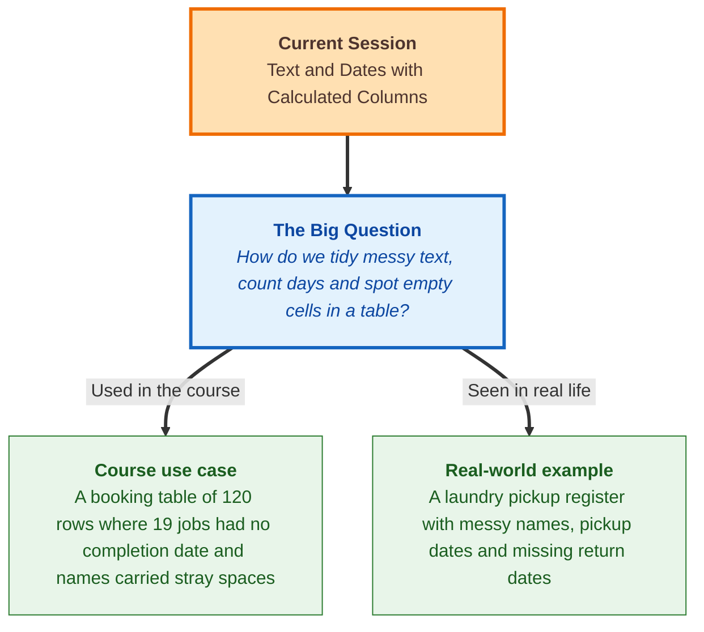

## Text and Dates with Calculated Columns

### Mental Map

---

### What You'll Learn

Have you ever wondered how a laundry shop knows which bags are still waiting after 5 days?

By the end of this session, you will be able to:

- **Name** the day, month and year written on a pickup slip.
- **Identify** the slips that have no return date yet.
- **Apply** text fixes to names written in odd capitals and with extra spaces.
- **Calculate** the price after a 10% discount on a Rs 400 order, and label the new column.
- **Determine** the days between the pickup date and the return date.
- **Use** a rounding rule to show a price in whole rupees.

> **Topics you will meet:** text functions, date parts, date difference, calculated columns with AS, ROUND and CAST, missing values.
>
> Join the session to learn each of these in detail.

---

### Why You Are Learning This Topic

Latha runs a laundry shop. Customers write their own names on the slips, so one reads '  mEERA  nair'. Each slip has a pickup date and a return date. Three bags have no return date yet. Latha wants a clean list of waiting bags and the price after discount.

A **calculated column** means a new column worked out from other columns, such as price minus discount.

In this course, you will tidy and calculate columns in a query before sharing a report.

> **Think about it:** Which slips would Latha miss if she only looked at bags that have a return date?

---

### The Laundry Pickup Register Puzzle

Here are three slips from Latha's register.

| Name on slip | Pickup | Return | Price |
|:----------:|:----------:|:----------:|:----------:|
|   mEERA  nair | 2 March | 5 March | Rs 400 |
| ASHA rao | 28 February | 1 March | Rs 250 |
| dev kapoor  | 10 March | No return date | Rs 320 |

**What you want to happen:**

- Latha shows each name with a capital letter and no extra spaces.
- Latha counts the days each bag stayed in the shop.
- Latha lists every bag with an empty return date.

> **Wonder about this:**
>
> - How would Latha count the days from 28 February to 1 March?
> - What should Latha write for a bag with no return date?

---

### Think It Through

There is no wrong first try. Keep your guesses for the session.

**1. The slip says 10% off Rs 400. What is the price after the discount?**
Hint: Work out the discount first, then subtract.

**2. A bag came in on 28 February and left on 1 March. Does the month change the day count?**
Hint: Count the days of February.

**3. Dev's slip has no return date. Is its return date equal to zero or is it empty?**
Hint: Think of what 'nothing written' means.

---

### One Question to Carry Into the Session

> **How can we turn a messy register into a clean, calculated list?**
>
> Which step would you do first: tidy names, count days or find empty cells?
