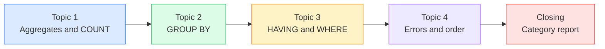
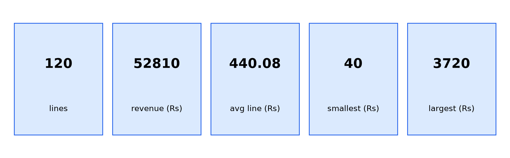
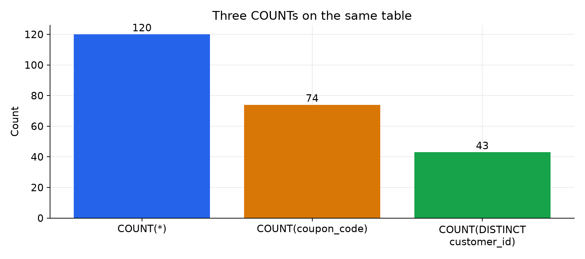
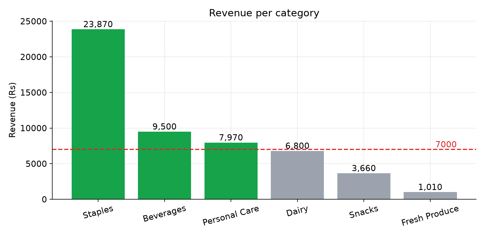
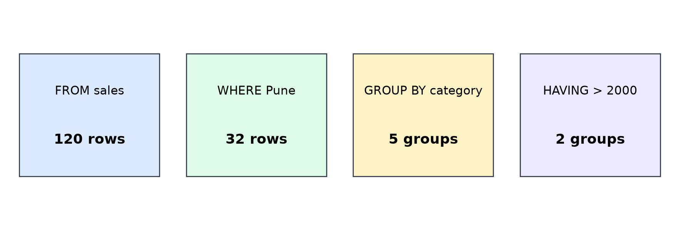
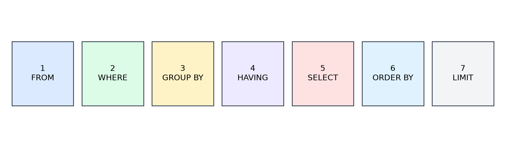
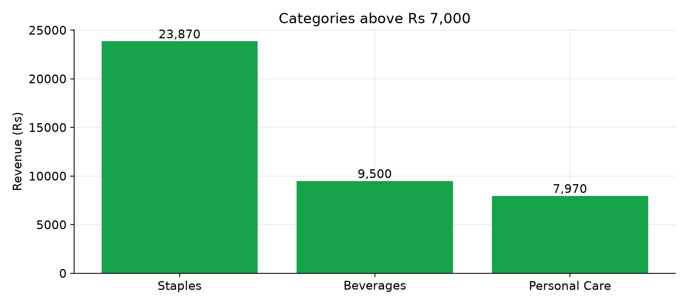

# <font color='#1d4ed8'>Lecture Script: Aggregation and GROUP BY (MySQL)</font>

---

## <font color='blue'>Agenda</font>

The lecture runs as four topics. Each topic ends with a quiz.

| Topic | What we do | Learning objectives covered | Minutes |
|:-:|:--|:--|:-:|
| 1 | Total, average, smallest, largest and the three COUNTs | Aggregate a column using COUNT, SUM, AVG, MIN and MAX<br>Explain the difference between COUNT(*), COUNT(column) and COUNT(DISTINCT column) | 25 |
| 2 | Summarise per category with GROUP BY | Aggregate rows per category using GROUP BY | 25 |
| 3 | Filter groups with HAVING and rows with WHERE | Filter aggregated groups using HAVING<br>Compare WHERE and HAVING by the stage of the query each filters | 30 |
| 4 | Fix a failing GROUP BY and trace the order clauses run | Debug a GROUP BY query that fails on a non-aggregated column<br>Trace the logical execution order of the clauses in a SELECT statement | 25 |
| — | Closing: Outcome & Summary | | 15 |
| | **Total** | | **120** |

> <font color="red">**🎯 Instructor Note**</font> Pace: keep `SUM`, `AVG`, `MIN` and `MAX` quick. Spend the time on the three `COUNT` forms in Topic 1 and on `WHERE` against `HAVING` in Topic 3.
> Load `data/grocery_sales.sql` once. Every query runs on the `sales` table.

---

## <font color='blue'>Scenario</font>

A JioMart-style grocery app records every item sold as one row in `sales`. The category manager asks four questions on Monday.

| Monday question | Needs |
|:--|:--|
| How many lines did we sell, and for how much? | Counts and totals over the whole table |
| Which categories earn the most? | One total per category |
| Which categories earn over Rs 7,000? | A filter on those totals |
| Why does my query say "not in GROUP BY"? | A fix, and the order clauses run in |

> <font color="red">**🎯 Instructor Note**</font> JioMart is only the setting. Do not claim it uses this data. The 120 sale lines in `data/grocery_sales.sql` (CSV copy included) are invented for teaching. 46 of the 120 lines have no coupon. Use MySQL 8.0 or later (outputs captured on MySQL 9.7).

---

## <font color='blue'>Problem Statement</font>

An analyst reported "74 orders this month" because she counted the `coupon_code` column. The table has 120 sale lines, and 46 of them used no coupon, so the count skipped them. She then tried `WHERE SUM(amount) > 7000` to find big categories and MySQL refused. A manager read the wrong order count in the Monday meeting.

> <font color='purple'>**How do we summarise 120 sale lines into counts and totals per category, count the right thing, and keep only the groups that matter?**</font>

> <font color="red">**🎯 Instructor Note**</font> Poll: "The table has 120 rows and 46 of them have no coupon. What does `COUNT(coupon_code)` return?" Options: 120, 74 or 46. Give learners 30 seconds to respond in chat. Reveal the answer in the Closing.

---

## <font color='blue'>What We Will Use</font>

Last session you built columns row by row. Today one value comes from many rows. The tool is MySQL, run from MySQL Workbench or any MySQL editor.

| Topic | Tools | In one line |
|:-:|:--|:--|
| 1 | `COUNT`, `SUM`, `AVG`, `MIN`, `MAX` | Turn many rows into one number |
| 2 | `GROUP BY` | Give one summary row per category |
| 3 | `HAVING`, `WHERE` | Filter groups after summarising, or rows before |
| 4 | `GROUP BY` error, clause order | Fix the non-aggregated column error and read the order of the clauses |

---

## <font color='blue'>How: Walking Through the Monday Questions</font>



---

## <font color='blue'>Topic 1: Total, average, smallest, largest and the three COUNTs</font> `25 min`

> <font color='purple'>**The first Monday question: how many lines, and for how much? How do we reduce 120 rows to one answer?**</font>

### <font color='green'>Example: Five aggregates in one query</font>

> <font color='purple'>**How many lines, what total, average, smallest and largest line amount?**</font>

An **aggregate function** reads many rows and returns one value. `COUNT` counts rows, `SUM` adds, `AVG` averages, `MIN` and `MAX` find the smallest and largest value.

**Predict before running: What will happen?**

> <font color="red">**🎯 Instructor Note**</font> Expected: one row of five values. 120 lines, a total of 52810, an average near 440, a smallest of 40 and a largest of 3720.

```sql
SELECT COUNT(*) AS line_count,
       SUM(amount) AS revenue,
       ROUND(AVG(amount), 2) AS avg_line,
       MIN(amount) AS smallest,
       MAX(amount) AS largest
FROM sales;
```

**Output**

```
+------------+----------+----------+----------+---------+
| line_count | revenue  | avg_line | smallest | largest |
+------------+----------+----------+----------+---------+
|        120 | 52810.00 |   440.08 |    40.00 | 3720.00 |
+------------+----------+----------+----------+---------+
```

#### <font color='#c2410c'>Code Explanation</font>

- **Line 1** `COUNT(*)` counts every row.
- **Lines 2 and 3** The total, and the average rounded to 2 decimals.
- **Lines 4 and 5** The smallest and the largest amount.

> <font color='green'>**Result**</font> The 120 lines earned Rs 52,810. An average line is Rs 440.08, with lines from Rs 40 to Rs 3,720. The result is a single row, not 120 rows.

<p align="center"></p>

### <font color='green'>Extending it: Three kinds of COUNT</font>

> <font color='purple'>**What do `COUNT(*)`, `COUNT(coupon_code)` and `COUNT(DISTINCT customer_id)` each return?**</font>

> <font color="red">**🎯 Instructor Note**</font> Ask for a prediction. Expected: 120, 74 and 43. `COUNT(column)` skips NULL, and `DISTINCT` skips repeats.

```sql
SELECT COUNT(*) AS all_rows,
       COUNT(coupon_code) AS with_coupon,
       COUNT(DISTINCT customer_id) AS customers
FROM sales;
```

**Output**

```
+----------+-------------+-----------+
| all_rows | with_coupon | customers |
+----------+-------------+-----------+
|      120 |          74 |        43 |
+----------+-------------+-----------+
```

#### <font color='#c2410c'>Code Explanation</font>

- **Line 1** Counts every row, whatever the values.
- **Line 2** Counts rows where `coupon_code` is not NULL.
- **Line 3** Counts each different customer once.

> <font color='green'>**Result**</font> 120 lines, 74 lines with a coupon, and 43 different customers. The analyst's "74 orders" was the coupon count, not the line count.

> <font color='#b45309'>**Common mistake**</font> Using `COUNT(column)` to count rows. Fix: use `COUNT(*)`, or choose a column that is never NULL.

<p align="center"></p>

### <font color='purple'>Quiz 1</font>

**Question:** A table has 10 rows, and 4 of them have NULL in `phone`. What does `COUNT(phone)` return?

**Options:**
- A) 10
- B) 4
- C) 0
- D) 6

**Correct Answer:** D

**Explanation:**
- **A)** `COUNT(*)` returns 10. `COUNT(phone)` skips NULL.
- **B)** 4 is the number of NULL rows, which `COUNT(phone)` leaves out.
- **C)** NULL rows are skipped, but the other 6 are counted.
- **D)** Correct. Only the 6 rows with a phone value are counted.

---

---

## <font color='blue'>Topic 2: Summarise per category with GROUP BY</font> `25 min`

> <font color='purple'>**A single total hides which category earns what. How do we get one row per category?**</font>

### <font color='green'>Example: Lines and revenue per category</font>

> <font color='purple'>**How many lines and how much revenue does each category have?**</font>

`GROUP BY category` puts rows with the same category in one group. The aggregates then work on each group. The result has one row per group.

**Predict before running: What will happen?**

> <font color="red">**🎯 Instructor Note**</font> Expected: 6 rows, one per category. Staples is the largest, at Rs 23,870.

```sql
SELECT category,
       COUNT(*) AS line_count,
       SUM(amount) AS revenue
FROM sales
GROUP BY category
ORDER BY revenue DESC;
```

**Output**

```
+---------------+------------+----------+
| category      | line_count | revenue  |
+---------------+------------+----------+
| Staples       |         32 | 23870.00 |
| Beverages     |         18 |  9500.00 |
| Personal Care |          8 |  7970.00 |
| Dairy         |         37 |  6800.00 |
| Snacks        |         18 |  3660.00 |
| Fresh Produce |          7 |  1010.00 |
+---------------+------------+----------+
```

#### <font color='#c2410c'>Code Explanation</font>

- **Line 1** The column we group by.
- **Lines 2 and 3** One count and one total per group.
- **Line 5** The grouping column.
- **Line 6** `ORDER BY` accepts the alias `revenue`.

> <font color='green'>**Result**</font> Staples earns Rs 23,870 from 32 lines. Fresh Produce earns Rs 1,010 from 7. Dairy has the most lines (37), but earns less than Beverages.

<p align="center"></p>

### <font color='green'>Extending it: Group by two columns</font>

> <font color='purple'>**What does each category earn in each store city?**</font>

> <font color="red">**🎯 Instructor Note**</font> Ask for a prediction. Expected: one row for each city and category pair that exists, sorted by the two columns.

```sql
SELECT store_city, category, SUM(amount) AS revenue
FROM sales
GROUP BY store_city, category
ORDER BY store_city, revenue DESC
LIMIT 6;
```

**Output**

```
+------------+---------------+---------+
| store_city | category      | revenue |
+------------+---------------+---------+
| Bengaluru  | Staples       | 5920.00 |
| Bengaluru  | Dairy         | 2639.00 |
| Bengaluru  | Beverages     | 2025.00 |
| Bengaluru  | Snacks        | 1080.00 |
| Bengaluru  | Personal Care |  780.00 |
| Bengaluru  | Fresh Produce |  390.00 |
+------------+---------------+---------+
```

#### <font color='#c2410c'>Code Explanation</font>

- **Line 3** Two grouping columns: one group per city and category pair.
- **Line 5** `LIMIT 6` shows the first 6 rows only.

> <font color='green'>**Result**</font> Each city has its own list of categories. Grouping by two columns splits each total into smaller groups.

### <font color='green'>Extending it: Average per group</font>

> <font color='purple'>**Which category has the largest average line?**</font>

> <font color="red">**🎯 Instructor Note**</font> Ask for a prediction. Expected: Personal Care, because of a bulk order of 12 shampoos.

```sql
SELECT category, ROUND(AVG(amount), 1) AS avg_line
FROM sales
GROUP BY category
ORDER BY avg_line DESC;
```

**Output**

```
+---------------+----------+
| category      | avg_line |
+---------------+----------+
| Personal Care |    996.3 |
| Staples       |    745.9 |
| Beverages     |    527.8 |
| Snacks        |    203.3 |
| Dairy         |    183.8 |
| Fresh Produce |    144.3 |
+---------------+----------+
```

> <font color='green'>**Result**</font> Personal Care has the largest average line, Rs 996.3, pulled up by a single Rs 3,720 bulk order. The average of a group is still affected by one large line.

### <font color='purple'>Quiz 2</font>

**Question:** `SELECT category, SUM(amount) FROM sales GROUP BY category` returns how many rows if the table has 6 different categories?

**Options:**
- A) 120
- B) 6
- C) 1
- D) 12

**Correct Answer:** B

**Explanation:**
- **A)** 120 would be one row per sale line. `GROUP BY` collapses lines.
- **B)** Correct. One row per category.
- **C)** One row would be a total with no `GROUP BY`.
- **D)** There is no reason to get twice the groups.

---

---

## <font color='blue'>Topic 3: Filter groups with HAVING and rows with WHERE</font> `30 min`

> <font color='purple'>**Only categories above Rs 7,000 matter. How do we filter a total, and what is different from WHERE?**</font>

### <font color='green'>Example: HAVING keeps groups</font>

> <font color='purple'>**Which categories earn more than Rs 7,000?**</font>

`HAVING` filters groups after they are summarised. `WHERE` filters rows before they are grouped. A test on an aggregate such as `SUM(...)` belongs in `HAVING`.

**Predict before running: What will happen?**

> <font color="red">**🎯 Instructor Note**</font> Expected: three categories: Staples, Beverages and Personal Care. Trying `WHERE SUM(amount) > 7000` fails.

```sql
SELECT category, SUM(amount) AS revenue
FROM sales
GROUP BY category
HAVING SUM(amount) > 7000
ORDER BY revenue DESC;
```

**Output**

```
+---------------+----------+
| category      | revenue  |
+---------------+----------+
| Staples       | 23870.00 |
| Beverages     |  9500.00 |
| Personal Care |  7970.00 |
+---------------+----------+
```

#### <font color='#c2410c'>Code Explanation</font>

- **Line 4** The test runs on each group's total, after the groups exist.

> <font color='green'>**Result**</font> Three categories remain: Staples, Beverages and Personal Care. Dairy at Rs 6,800 is out.

```sql
SELECT category, SUM(amount) AS revenue
FROM sales
WHERE SUM(amount) > 7000
GROUP BY category;
```

**Output**

```
ERROR 1111 (HY000): Invalid use of group function
```

> <font color='green'>**Result**</font> `WHERE` runs before any group exists, so it cannot test a total. MySQL calls this an invalid use of a group function.

### <font color='green'>Extending it: WHERE and HAVING together</font>

> <font color='purple'>**What are the big categories in the Pune store alone?**</font>

> <font color="red">**🎯 Instructor Note**</font> Ask for a prediction. Expected: first the Pune lines (32) are kept by `WHERE`, then the Pune totals above Rs 2,000 are kept by `HAVING`.

```sql
SELECT category, SUM(amount) AS revenue
FROM sales
WHERE store_city = 'Pune'
GROUP BY category
HAVING SUM(amount) > 2000
ORDER BY revenue DESC;
```

**Output**

```
+-----------+---------+
| category  | revenue |
+-----------+---------+
| Staples   | 6540.00 |
| Beverages | 3740.00 |
+-----------+---------+
```

#### <font color='#c2410c'>Code Explanation</font>

- **Line 3** `WHERE` filters rows first: only Pune lines.
- **Line 5** `HAVING` then filters the Pune groups.

> <font color='green'>**Result**</font> Pune has 32 lines in 5 categories. 2 categories have a Pune total above Rs 2,000.

<p align="center"></p>

### <font color='purple'>Quiz 3</font>

**Question:** Which clause filters individual rows BEFORE they are grouped?

**Options:**
- A) HAVING
- B) ORDER BY
- C) WHERE
- D) LIMIT

**Correct Answer:** C

**Explanation:**
- **A)** `HAVING` filters groups after summarising.
- **B)** `ORDER BY` sorts the result.
- **C)** Correct. `WHERE` filters rows before grouping.
- **D)** `LIMIT` keeps the first rows of the final result.

---

---

## <font color='blue'>Topic 4: Fix a failing GROUP BY and trace the order clauses run</font> `25 min`

> <font color='purple'>**A colleague's query fails with a long error. What is wrong, and in what order does SQL read a query?**</font>

### <font color='green'>Example: The non-aggregated column error</font>

> <font color='purple'>**Why does adding `product` to a grouped query fail?**</font>

With `GROUP BY category`, every column in `SELECT` must either be in the `GROUP BY` or be inside an aggregate. A plain `product` has many values in each group, so MySQL does not know which one to show.

**Predict before running: What will happen?**

> <font color="red">**🎯 Instructor Note**</font> Expected: an error naming `product`. It says the column is not in `GROUP BY` and is not aggregated.

```sql
SELECT category, product, SUM(amount) AS revenue
FROM sales
GROUP BY category;
```

**Output**

```
ERROR 1055 (42000): Expression #2 of SELECT list is not in GROUP BY clause and contains nonaggregated column 'gro_demo.sales.product' which is not functionally dependent on columns in GROUP BY clause; this is incompatible with sql_mode=only_full_group_by
```

> <font color='green'>**Result**</font> MySQL stops and names the column `product`. The error is guarding against a result that could change between runs.

### <font color='green'>Extending it: Two correct fixes</font>

> <font color='purple'>**How do we fix it, and what does each fix mean?**</font>

> <font color="red">**🎯 Instructor Note**</font> Ask learners which fix they want. Expected: adding `product` to GROUP BY gives one row per product, and removing `product` keeps one row per category.

```sql
SELECT category, product, SUM(amount) AS revenue
FROM sales
GROUP BY category, product
ORDER BY revenue DESC, product
LIMIT 5;
```

**Output**

```
+---------------+------------------+----------+
| category      | product          | revenue  |
+---------------+------------------+----------+
| Staples       | Atta 10kg        | 12150.00 |
| Staples       | Basmati Rice 5kg |  8680.00 |
| Beverages     | Tea 500g         |  6160.00 |
| Personal Care | Shampoo 340ml    |  5890.00 |
| Dairy         | Milk 1L          |  3100.00 |
+---------------+------------------+----------+
```

```sql
SELECT category, COUNT(DISTINCT product) AS products, SUM(amount) AS revenue
FROM sales
GROUP BY category
ORDER BY revenue DESC;
```

**Output**

```
+---------------+----------+----------+
| category      | products | revenue  |
+---------------+----------+----------+
| Staples       |        3 | 23870.00 |
| Beverages     |        3 |  9500.00 |
| Personal Care |        2 |  7970.00 |
| Dairy         |        3 |  6800.00 |
| Snacks        |        3 |  3660.00 |
| Fresh Produce |        2 |  1010.00 |
+---------------+----------+----------+
```

> <font color='green'>**Result**</font> The first fix groups by category and product. The second keeps one row per category and counts the products with an aggregate. Pick the fix that matches the question.

### <font color='green'>Extending it: The order the clauses run</font>

> <font color='purple'>**In what order does MySQL work through the clauses of the Pune query?**</font>

> <font color="red">**🎯 Instructor Note**</font> Ask for the order first. Expected: FROM, WHERE, GROUP BY, HAVING, SELECT, ORDER BY, LIMIT. The counts are 32 rows, 5 groups and 2 groups.

#### <font color='#c2410c'>Logic Explanation</font>

- **FROM** `sales` is read: 120 rows.
- **WHERE** `store_city = 'Pune'` keeps 32 rows.
- **GROUP BY** `category` makes 5 groups.
- **HAVING** `SUM(amount) > 2000` keeps 2 groups.
- **SELECT** the columns and aggregates are produced, and aliases such as `revenue` now exist.
- **ORDER BY** sorts the groups. It can use an alias.
- **LIMIT** keeps the first rows.

> <font color='green'>**Result**</font> That is why `WHERE` cannot see a `SUM` (groups do not exist yet) and why `WHERE` cannot see an alias (`SELECT` has not run yet).

<p align="center"></p>

### <font color='purple'>Quiz 4</font>

**Question:** Which order do these clauses run in?

**Options:**
- A) FROM, WHERE, GROUP BY, HAVING, SELECT, ORDER BY
- B) SELECT, FROM, WHERE, GROUP BY
- C) WHERE, FROM, HAVING, GROUP BY
- D) GROUP BY, WHERE, FROM, SELECT

**Correct Answer:** A

**Explanation:**
- **A)** Correct. Rows are read, filtered, grouped, the groups are filtered, then the output is built and sorted.
- **B)** `SELECT` is written first but runs after grouping.
- **C)** `FROM` must run before `WHERE`, and `GROUP BY` before `HAVING`.
- **D)** Grouping cannot happen before rows are read and filtered.

---

---

## <font color='blue'>Closing: Outcome & Summary</font> `15 min`

Back to the Monday meeting. One report answers all four questions. It uses every topic once.

> <font color='purple'>**1. How many lines, which customers and which revenue? (Topic 1)**</font>

There were 120 lines (`COUNT(*)`), 74 with a coupon (`COUNT(coupon_code)`) and 43 different customers. The revenue was Rs 52,810.

> <font color='purple'>**2, 3 and 4. Which categories earn over Rs 7,000, and what are their counts? (Topics 2, 3 and 4)**</font>

```sql
SELECT category,
       COUNT(*) AS line_count,
       COUNT(DISTINCT customer_id) AS customers,
       SUM(amount) AS revenue
FROM sales
GROUP BY category
HAVING SUM(amount) > 7000
ORDER BY revenue DESC;
```

**Output**

```
+---------------+------------+-----------+----------+
| category      | line_count | customers | revenue  |
+---------------+------------+-----------+----------+
| Staples       |         32 |        22 | 23870.00 |
| Beverages     |         18 |        14 |  9500.00 |
| Personal Care |          8 |         7 |  7970.00 |
+---------------+------------+-----------+----------+
```

#### <font color='#c2410c'>Code Explanation</font>

- **Line 1** Every `SELECT` column is the grouping column or an aggregate (Topic 4).
- **Lines 2 and 3** Two different counts per group (Topic 1).
- **Line 6** One row per category (Topic 2).
- **Line 7** Keep groups above Rs 7,000 (Topic 3).
- **Line 8** Sorted by the alias `revenue`, which exists after `SELECT` runs (Topic 4).

<p align="center"></p>

### <font color='green'>Outcome</font>

| | The analyst's report | The new report |
|:--|:-:|:-:|
| Order count shown | 74 | 120 |
| Big categories | Error, none listed | Staples, Beverages, Personal Care |
| Customers counted | Not shown | 43 |

> <font color='green'>**Therefore,**</font> count rows with `COUNT(*)`, group with `GROUP BY` and filter totals with `HAVING`. The "74 orders" figure was `COUNT(coupon_code)`, which skips the 46 lines with no coupon. The correct count is 120 lines from 43 customers, and three categories earn over Rs 7,000.

> <font color="red">**🎯 Instructor Note**</font> Reveal the poll: 74. `COUNT(coupon_code)` skips NULL values.

### <font color='green'>Summary</font>

| Learning objective | Takeaway |
|:--|:--|
| Aggregates | `COUNT`, `SUM`, `AVG`, `MIN`, `MAX` turn many rows into one value |
| Three COUNTs | `COUNT(*)` counts rows. `COUNT(col)` skips NULL. `COUNT(DISTINCT col)` counts different values |
| GROUP BY | One summary row per group of equal values |
| HAVING | Filters groups after they are summarised. It can use aggregates |
| WHERE against HAVING | `WHERE` filters rows before grouping. `HAVING` filters groups after |
| GROUP BY error | Every `SELECT` column is in `GROUP BY` or inside an aggregate |
| Clause order | FROM, WHERE, GROUP BY, HAVING, SELECT, ORDER BY, LIMIT |
| **Practical value** | Every dashboard number is an aggregate. Knowing which COUNT and which filter to use keeps the numbers in meetings honest. |

---

# <font color='red'>Launch the Feedback Poll</font>

> <font color="red">**🎯 Instructor Note**</font> Reminder: launch the feedback poll now to collect learner feedback.
