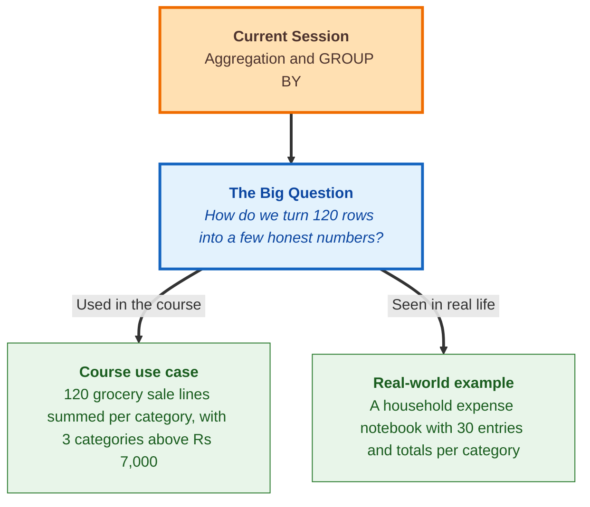

## Aggregation and GROUP BY

### Mental Map

---

### What You'll Learn

Have you ever wondered how a family finds the total spent on vegetables from 30 scribbled entries?

By the end of this session, you will be able to:

- **Explain** why counting all entries, entries with a shop note and different shops give 3 answers.
- **Calculate** the total, average, smallest and largest of 30 expenses.
- **Determine** the total spent on each category in the notebook.
- **Compare** removing small expenses before totalling with removing small totals after totalling.
- **Trace** the order in which the notebook reads one request, step by step.
- **Check** why a request that mixes single entries with category totals is refused.

> **Topics you will meet:** COUNT, SUM, AVG, MIN, MAX, GROUP BY, HAVING, clause order.
>
> Join the session to learn each of these in detail.

---

### Why You Are Learning This Topic

Kavita keeps a notebook of the family's expenses for March. It has 30 entries, each with a category and an amount. Eighteen entries name a shop. Her husband asks, 'How often did we shop?' Kavita counts only the entries with a shop name. She says 18. The real count is 30.

A **total** means the sum of all the entries in one group.

In this course, you will summarise rows of a table into counts, totals and averages per group.

> **Think about it:** Which count would you give the family, and why?

---

### The Household Expense Notebook Puzzle

Here are four entries from Kavita's notebook.

| Category | Amount | Shop name |
|:----------:|:----------:|:----------:|
| Vegetables | Rs 220 | Fresh Mart |
| Vegetables | Rs 140 | Not written |
| Travel | Rs 600 | Not written |
| Milk | Rs 90 | Dairy Point |

**What you want to happen:**

- Kavita finds the total for each category.
- Kavita keeps only the categories above Rs 1,000.
- Kavita counts entries in a way that matches the question.

> **Wonder about this:**
>
> - What does the count become if empty shop names are left out?
> - Would a category total change if Kavita first removed all entries below Rs 100?

---

### Think It Through

There is no wrong first try. Keep your guesses for the session.

**1. The notebook has 30 entries and 12 have no shop name. How can you count all 30?**
Hint: Count the rows, not one filled column.

**2. Vegetables total Rs 1,400 across 5 entries. Is Rs 1,400 one entry or a group total?**
Hint: Think about the number of entries it combines.

**3. Kavita wants 'categories above Rs 1,000'. Should she filter entries or totals?**
Hint: Ask which numbers exist before and after adding.

---

### One Question to Carry Into the Session

> **How do we summarise rows into one number per group and keep only the groups that matter?**
>
> Which count would you trust for the family's shopping trips?
