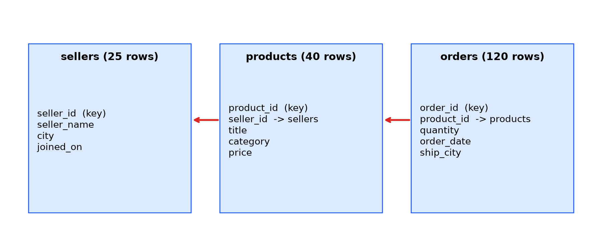
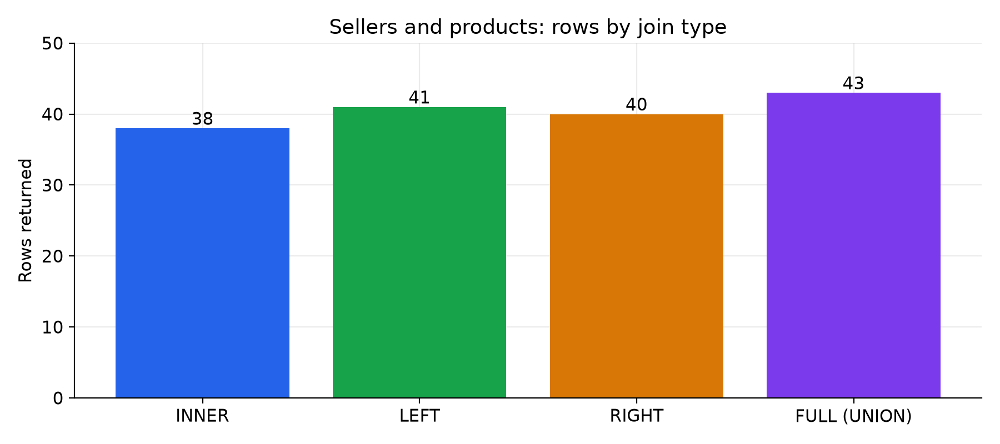
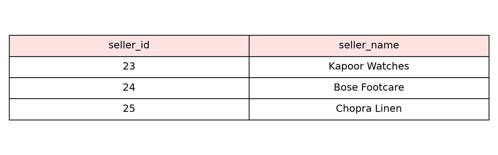
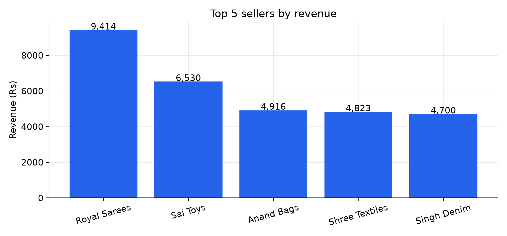
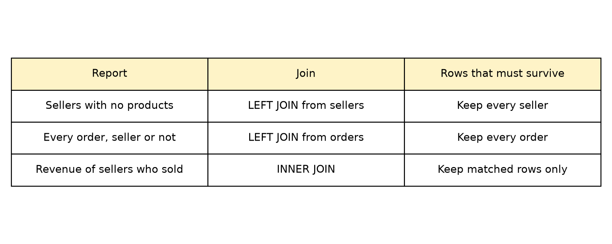
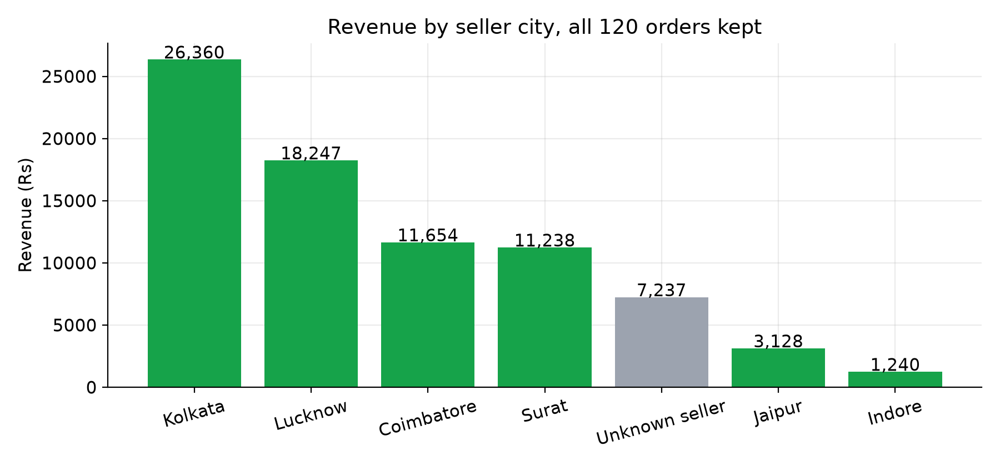

# <font color='#1d4ed8'>Lecture Script: Joins: Combining Multiple Tables (MySQL)</font>

---

## <font color='blue'>Agenda</font>

The lecture runs as four topics. Each topic ends with a quiz.

| Topic | What we do | Learning objectives covered | Minutes |
|:-:|:--|:--|:-:|
| 1 | Join two tables with INNER JOIN | Join two tables on a matching key using INNER JOIN | 25 |
| 2 | See which rows survive in each join, and find the unmatched | Compare INNER, LEFT, RIGHT and FULL OUTER joins by which unmatched rows survive<br>Retrieve rows present in one table but absent from another using LEFT JOIN | 30 |
| 3 | Predict row counts and join three tables | Predict the row count of a join when the key repeats on one side<br>Write a query joining three tables through a shared key | 30 |
| 4 | Choose the join and read the schema diagram | Select the join type for a stated reporting requirement, justifying by which rows must survive<br>Analyze a schema diagram for the tables, join keys and columns a question needs | 20 |
| — | Closing: Outcome & Summary | | 15 |
| | **Total** | | **120** |

> <font color="red">**🎯 Instructor Note**</font> Pace: spend the most time on the survivor rules in Topic 2 and on row counts in Topic 3. MySQL has no `FULL JOIN`, so show the error and the `UNION` fix quickly.
> Load `data/meesho_marketplace.sql` once. It creates three tables: `sellers`, `products` and `orders`.

---

## <font color='blue'>Scenario</font>

A Meesho-style reselling marketplace keeps its data in three tables. The diagram below is what the data team hands you.

| Table | Rows | Holds | Key |
|:--|:-:|:--|:--|
| `sellers` | 25 | Seller name, city, join date | `seller_id` |
| `products` | 40 | Title, category, price, and the seller who lists it | `product_id`, with `seller_id` pointing to `sellers` |
| `orders` | 120 | One order of one product, with quantity and date | `order_id`, with `product_id` pointing to `products` |

> <font color="red">**🎯 Instructor Note**</font> Meesho is only the setting. Do not claim it uses this data. The three tables in `data/meesho_marketplace.sql` (CSV copies included) are invented for teaching. Three sellers have no products, three products have no orders, and two products have no known seller. Use MySQL 8.0 or later (outputs captured on MySQL 9.7).

<p align="center"></p>

---

## <font color='blue'>Problem Statement</font>

The onboarding team asked for "every seller and their products." The analyst joined `sellers` to `products` with an `INNER JOIN` and reported 22 sellers. The marketplace has 25. Three new sellers had listed nothing, so they never appeared, and nobody called them. A later revenue report also dropped 8 orders whose products had no seller on record.

> <font color='purple'>**How do we join sellers, products and orders so that every row that must appear does, and the row counts make sense?**</font>

> <font color="red">**🎯 Instructor Note**</font> Poll: "There are 25 sellers, and 3 of them have no products. How many sellers does an INNER JOIN with `products` show?" Options: 25, 22 or 3. Give learners 30 seconds to respond in chat. Reveal the answer in the Closing.

---

## <font color='blue'>What We Will Use</font>

Last session you summarised one table with `GROUP BY`. Today you combine tables first. The tool is MySQL, run from MySQL Workbench or any MySQL editor.

| Topic | Tools | In one line |
|:-:|:--|:--|
| 1 | `INNER JOIN`, `ON`, `table.column` | Match rows of two tables on a key |
| 2 | `LEFT`, `RIGHT` and `FULL` joins, `IS NULL` | Choose which unmatched rows survive, and find what is missing |
| 3 | Row counts, a third `JOIN` | Predict how many rows a join returns, and chain three tables |
| 4 | The schema diagram | Pick the join type and the tables a question needs |

---

## <font color='blue'>How: Walking Through the Marketplace Tables</font>


---

## <font color='blue'>Topic 1: Join two tables with INNER JOIN</font> `25 min`

> <font color='purple'>**The seller names live in `sellers` and the product titles in `products`. How do we see them side by side?**</font>

### <font color='green'>Example: Match sellers to products on seller_id</font>

> <font color='purple'>**Which products does each seller list?**</font>

A **join** combines rows of two tables. `ON` states the match. A **key** is the column that links the tables: `seller_id` in `sellers` is the primary key, and `seller_id` in `products` points to it. `table.column` names a column in one table, such as `p.seller_id`. `INNER JOIN` keeps only the rows that match on both sides.

**Predict before running: What will happen?**

> <font color="red">**🎯 Instructor Note**</font> Expected: 5 rows, each pairing a seller name with a product title. Both tables have a `seller_id` column, so we write `s.` or `p.`.

```sql
SELECT s.seller_id, s.seller_name, p.product_id, p.title
FROM sellers s
INNER JOIN products p ON p.seller_id = s.seller_id
ORDER BY p.product_id
LIMIT 5;
```

**Output**

```
+-----------+----------------+------------+----------------+
| seller_id | seller_name    | product_id | title          |
+-----------+----------------+------------+----------------+
|         1 | Shree Textiles |          1 | Soft Toy 1     |
|         2 | Rani Fashions  |          2 | Steel Tiffin 2 |
|         3 | Gupta Handloom |          3 | Wall Hanging 3 |
|         4 | Lakshmi Crafts |          4 | Mixer Jar 4    |
|         5 | Om Footwear    |          5 | Steel Tiffin 5 |
+-----------+----------------+------------+----------------+
```

#### <font color='#c2410c'>Code Explanation</font>

- **Line 2** `sellers s` is the first table with the alias `s`.
- **Line 3** `INNER JOIN products p ON ...` brings in the second table. The `ON` clause matches each product to its seller.
- **Line 4 and 5** Sorted by product, the first 5 rows.

> <font color='green'>**Result**</font> Each product row now carries its seller's name. The first five products belong to sellers 1 to 5.

### <font color='green'>Extending it: How many rows came back?</font>

> <font color='purple'>**How many rows does the whole inner join return?**</font>

> <font color="red">**🎯 Instructor Note**</font> Ask for a prediction. Expected: 38. Products 39 and 40 have no seller in the table, so they drop out.

```sql
SELECT COUNT(*) AS joined_rows
FROM sellers s
INNER JOIN products p ON p.seller_id = s.seller_id;
```

**Output**

```
+-------------+
| joined_rows |
+-------------+
|          38 |
+-------------+
```

> <font color='green'>**Result**</font> 38 rows. The `products` table has 40 rows, and 2 of them have no seller in `sellers`. An inner join keeps only matched rows.

### <font color='green'>Extending it: An ambiguous column</font>

> <font color='purple'>**What happens if we write `seller_id` without `s.` or `p.`?**</font>

> <font color="red">**🎯 Instructor Note**</font> Ask for a prediction. Expected: an error, because both tables have a `seller_id`.

```sql
SELECT seller_id, title
FROM sellers s
INNER JOIN products p ON p.seller_id = s.seller_id;
```

**Output**

```
ERROR 1052 (23000): Column 'seller_id' in field list is ambiguous
```

> <font color='green'>**Result**</font> MySQL cannot tell which `seller_id` we mean. Add the table name or alias in front.

> <font color='#b45309'>**Common mistake**</font> Leaving a shared column name unqualified. Fix: write `s.seller_id`.

### <font color='purple'>Quiz 1</font>

**Question:** In `FROM sellers s INNER JOIN products p ON p.seller_id = s.seller_id`, what does `ON` do?

**Options:**
- A) States which columns must match for two rows to pair
- B) Sorts the rows
- C) Counts the rows
- D) Picks the columns to show

**Correct Answer:** A

**Explanation:**
- **A)** Correct. A row of `sellers` pairs with a row of `products` when the two seller ids are equal.
- **B)** Sorting is `ORDER BY`.
- **C)** Counting is `COUNT`.
- **D)** Columns to show are in `SELECT`.

---

---

## <font color='blue'>Topic 2: See which rows survive in each join, and find the unmatched</font> `30 min`

> <font color='purple'>**Three sellers and two products found no partner. Which join keeps them?**</font>

### <font color='green'>Example: Row counts of INNER, LEFT and RIGHT</font>

> <font color='purple'>**How many rows does each join type return for sellers and products?**</font>

`LEFT JOIN` keeps every row of the left table (`sellers`), with NULLs where there is no match. `RIGHT JOIN` keeps every row of the right table (`products`). `INNER JOIN` keeps matched rows only.

**Predict before running: What will happen?**

> <font color="red">**🎯 Instructor Note**</font> Expected: inner 38, left 41 (38 plus 3 sellers with no products), right 40 (38 plus 2 products with no seller).

```sql
SELECT COUNT(*) AS inner_rows FROM sellers s INNER JOIN products p ON p.seller_id = s.seller_id;
```

**Output**

```
+------------+
| inner_rows |
+------------+
|         38 |
+------------+
```

```sql
SELECT COUNT(*) AS left_rows FROM sellers s LEFT JOIN products p ON p.seller_id = s.seller_id;
```

**Output**

```
+-----------+
| left_rows |
+-----------+
|        41 |
+-----------+
```

```sql
SELECT COUNT(*) AS right_rows FROM sellers s RIGHT JOIN products p ON p.seller_id = s.seller_id;
```

**Output**

```
+------------+
| right_rows |
+------------+
|         40 |
+------------+
```

> <font color='green'>**Result**</font> Inner 38, left 41, right 40. The left join added the 3 sellers without products. The right join added the 2 products without a seller.

<p align="center"></p>

### <font color='green'>Extending it: There is no FULL JOIN in MySQL</font>

> <font color='purple'>**How do we keep unmatched rows from both sides, which a FULL OUTER JOIN does?**</font>

A **full outer join** keeps unmatched rows from both tables. MySQL has no `FULL JOIN` keyword, so we join twice and stack the results with `UNION`, which joins two result sets into one and removes exact duplicate rows.

> <font color="red">**🎯 Instructor Note**</font> Ask for a prediction. Expected: an error for `FULL JOIN`. The UNION below lists only the 5 unmatched rows; with the 38 matched rows a full join has 43.

```sql
SELECT s.seller_id, p.product_id
FROM sellers s
FULL JOIN products p ON p.seller_id = s.seller_id;
```

**Output**

```
ERROR 1064 (42000): You have an error in your SQL syntax; check the manual that corresponds to your MySQL server version for the right syntax to use near 'FULL JOIN products p ON p.seller_id = s.seller_id'
```

```sql
SELECT s.seller_id, s.seller_name, p.product_id, p.title
FROM sellers s LEFT JOIN products p ON p.seller_id = s.seller_id
WHERE p.product_id IS NULL
UNION
SELECT s.seller_id, s.seller_name, p.product_id, p.title
FROM sellers s RIGHT JOIN products p ON p.seller_id = s.seller_id
WHERE s.seller_id IS NULL
ORDER BY seller_id, product_id;
```

**Output**

```
+-----------+----------------+------------+------------------+
| seller_id | seller_name    | product_id | title            |
+-----------+----------------+------------+------------------+
|      NULL | NULL           |         39 | Table Lamp 39    |
|      NULL | NULL           |         40 | Wooden Puzzle 40 |
|        23 | Kapoor Watches |       NULL | NULL             |
|        24 | Bose Footcare  |       NULL | NULL             |
|        25 | Chopra Linen   |       NULL | NULL             |
+-----------+----------------+------------+------------------+
```

> <font color='green'>**Result**</font> The five unmatched rows are three sellers with no products and two products with no seller. Together with the 38 matched rows, a full join has 43 rows.

### <font color='green'>Extending it: Sellers who have not listed anything</font>

> <font color='purple'>**Which sellers have no products?**</font>

> <font color="red">**🎯 Instructor Note**</font> Ask for a prediction. Expected: sellers 23, 24 and 25. Keep the LEFT JOIN, then keep only the rows where the right side is NULL.

```sql
SELECT s.seller_id, s.seller_name
FROM sellers s
LEFT JOIN products p ON p.seller_id = s.seller_id
WHERE p.product_id IS NULL
ORDER BY s.seller_id;
```

**Output**

```
+-----------+----------------+
| seller_id | seller_name    |
+-----------+----------------+
|        23 | Kapoor Watches |
|        24 | Bose Footcare  |
|        25 | Chopra Linen   |
+-----------+----------------+
```

#### <font color='#c2410c'>Code Explanation</font>

- **Line 3** Every seller stays, with NULL product columns where there is no match.
- **Line 4** Keep the rows where the product is NULL. These are the sellers with no match.

> <font color='green'>**Result**</font> Three sellers have no products: 23, 24 and 25. This is the list the onboarding team needed.

<p align="center"></p>

### <font color='purple'>Quiz 2</font>

**Question:** Which join returns every row of the left table, with NULLs where the right table has no match?

**Options:**
- A) INNER JOIN
- B) CROSS JOIN
- C) RIGHT JOIN
- D) LEFT JOIN

**Correct Answer:** D

**Explanation:**
- **A)** `INNER JOIN` drops rows with no match.
- **B)** `CROSS JOIN` pairs every row with every row. It is not a matching join.
- **C)** `RIGHT JOIN` keeps every right row instead.
- **D)** Correct. `LEFT JOIN` keeps every left row.

---

---

## <font color='blue'>Topic 3: Predict row counts and join three tables</font> `30 min`

> <font color='purple'>**Sellers have 2 products each in places. How many rows should a join return, and how do we add `orders`?**</font>

### <font color='green'>Example: When the key repeats on one side</font>

> <font color='purple'>**Seller 1 lists 2 products. How many rows does seller 1 give in the join?**</font>

A join returns one row for each matching pair. If one seller matches 2 products, that seller appears 2 times. So the row count is the number of matching pairs, not the number of sellers.

**Predict before running: What will happen?**

> <font color="red">**🎯 Instructor Note**</font> Expected: 2 rows for each of sellers 1 to 4, and 38 rows in total across 22 sellers.

```sql
SELECT s.seller_id, COUNT(*) AS rows_in_join
FROM sellers s
INNER JOIN products p ON p.seller_id = s.seller_id
GROUP BY s.seller_id
ORDER BY s.seller_id
LIMIT 4;
```

**Output**

```
+-----------+--------------+
| seller_id | rows_in_join |
+-----------+--------------+
|         1 |            2 |
|         2 |            2 |
|         3 |            2 |
|         4 |            2 |
+-----------+--------------+
```

#### <font color='#c2410c'>Code Explanation</font>

- **Line 4** `GROUP BY` counts the join rows per seller (last session).

> <font color='green'>**Result**</font> Sellers 1 to 4 each appear 2 times because each lists 2 products. Sellers 17 to 22 list 1 product, so the 22 sellers produce 38 rows.

### <font color='green'>Extending it: Add the third table</font>

> <font color='purple'>**What is the revenue of each seller, through orders and products?**</font>

To join three tables, add a second `JOIN`. The chain is `orders` to `products` through `product_id`, then `products` to `sellers` through `seller_id`.

> <font color="red">**🎯 Instructor Note**</font> Ask for a prediction. Expected: the top seller by quantity times price. The inner joins return 112 of the 120 orders.

```sql
SELECT s.seller_name, SUM(o.quantity * p.price) AS revenue
FROM orders o
JOIN products p ON p.product_id = o.product_id
JOIN sellers s ON s.seller_id = p.seller_id
GROUP BY s.seller_id, s.seller_name
ORDER BY revenue DESC, s.seller_id
LIMIT 5;
```

**Output**

```
+----------------+---------+
| seller_name    | revenue |
+----------------+---------+
| Royal Sarees   | 9414.00 |
| Sai Toys       | 6530.00 |
| Anand Bags     | 4916.00 |
| Shree Textiles | 4823.00 |
| Singh Denim    | 4700.00 |
+----------------+---------+
```

#### <font color='#c2410c'>Code Explanation</font>

- **Line 3** Orders to products. `JOIN` alone means `INNER JOIN`.
- **Line 4** Products to sellers.
- **Line 5** One row per seller, with the total of quantity times price.

> <font color='green'>**Result**</font> Five sellers lead the revenue ranking. The chain gives every order a seller name through the product.

<p align="center"></p>

### <font color='green'>Extending it: Count the rows after joining three tables</font>

> <font color='purple'>**Did all 120 orders survive?**</font>

> <font color="red">**🎯 Instructor Note**</font> Ask for a prediction. Expected: 112. Eight orders belong to products 39 and 40, which have no seller.

```sql
SELECT COUNT(*) AS orders_in_join
FROM orders o
JOIN products p ON p.product_id = o.product_id
JOIN sellers s ON s.seller_id = p.seller_id;
```

**Output**

```
+----------------+
| orders_in_join |
+----------------+
|            112 |
+----------------+
```

> <font color='green'>**Result**</font> 112 of 120 orders survive. The 8 missing orders sold products with no seller on record, so the inner join dropped them.

### <font color='purple'>Quiz 3</font>

**Question:** Table A has 3 rows with key 1. Table B has 2 rows with key 1. How many rows does `A INNER JOIN B` on that key return for key 1?

**Options:**
- A) 2
- B) 6
- C) 5
- D) 3

**Correct Answer:** B

**Explanation:**
- **A)** That counts only the rows of B.
- **B)** Correct. Each of the 3 A rows pairs with each of the 2 B rows: 3 times 2 is 6.
- **C)** That adds the rows. A join pairs them.
- **D)** That counts only the rows of A.

---

---

## <font color='blue'>Topic 4: Choose the join and read the schema diagram</font> `20 min`

> <font color='purple'>**Which join fits which report, and how do we know which tables a question needs?**</font>

### <font color='green'>Example: Pick the join by the rows that must survive</font>

> <font color='purple'>**A report must list every order, with the seller name when it exists. Which join, and why?**</font>

Ask: which rows must survive? Orders must all appear, so `orders` is the table to keep. Start from `orders` and use `LEFT JOIN` for the tables beside it.

**Predict before running: What will happen?**

> <font color="red">**🎯 Instructor Note**</font> Expected: 120 rows with LEFT JOINs against 112 with inner joins. The 8 orders with no seller keep a NULL seller name.

```sql
SELECT o.order_id, p.title, s.seller_name
FROM orders o
LEFT JOIN products p ON p.product_id = o.product_id
LEFT JOIN sellers s ON s.seller_id = p.seller_id
WHERE s.seller_id IS NULL
ORDER BY o.order_id
LIMIT 4;
```

**Output**

```
+----------+------------------+-------------+
| order_id | title            | seller_name |
+----------+------------------+-------------+
|        4 | Wooden Puzzle 40 | NULL        |
|       14 | Table Lamp 39    | NULL        |
|       22 | Table Lamp 39    | NULL        |
|       35 | Table Lamp 39    | NULL        |
+----------+------------------+-------------+
```

#### <font color='#c2410c'>Code Explanation</font>

- **Lines 3 and 4** Both joins are `LEFT`, so every order stays.
- **Line 5** Show only the orders where no seller was found.

> <font color='green'>**Result**</font> The left joins keep all 120 orders. The 8 orders without a seller appear with a NULL name, instead of vanishing.

<p align="center"></p>

### <font color='green'>Extending it: Match three requirements to a join</font>

> <font color='purple'>**Which join does each report need?**</font>

> <font color="red">**🎯 Instructor Note**</font> Ask learners to answer each in chat. Expected: LEFT from `sellers` for the onboarding list; LEFT from `orders` for the orders report; INNER for revenue by seller, because only sold products count.

#### <font color='#c2410c'>Logic Explanation</font>

- **"Sellers who have not listed anything"** keep every seller, so `sellers LEFT JOIN products`, then `IS NULL`.
- **"Every order, even if the seller is unknown"** keeps every order, so `orders LEFT JOIN ...`.
- **"Revenue by seller, only for sellers who sold something"** needs matches only, so `INNER JOIN`.

> <font color='green'>**Result**</font> The join type comes from the rows that must survive. Name those rows first, then pick the join.

### <font color='green'>Extending it: Read the schema for a new question</font>

> <font color='purple'>**To report revenue by the seller's city, which tables, keys and columns do we need?**</font>

> <font color="red">**🎯 Instructor Note**</font> Ask learners to trace the path on the diagram. Expected: `orders` to `products` on `product_id`, then `products` to `sellers` on `seller_id`. `city` is in `sellers`, quantity is in `orders`, price is in `products`.

```sql
SELECT s.city, SUM(o.quantity * p.price) AS revenue
FROM orders o
JOIN products p ON p.product_id = o.product_id
JOIN sellers s ON s.seller_id = p.seller_id
GROUP BY s.city
ORDER BY revenue DESC;
```

**Output**

```
+------------+----------+
| city       | revenue  |
+------------+----------+
| Kolkata    | 26360.00 |
| Lucknow    | 18247.00 |
| Coimbatore | 11654.00 |
| Surat      | 11238.00 |
| Jaipur     |  3128.00 |
| Indore     |  1240.00 |
+------------+----------+
```

> <font color='green'>**Result**</font> The diagram told us the three tables and two keys before we wrote a line. Read the diagram first, and the query follows.

### <font color='purple'>Quiz 4</font>

**Question:** A report must list every seller, including sellers with no orders. Which join from `sellers` fits?

**Options:**
- A) INNER JOIN
- B) No join is needed
- C) LEFT JOIN
- D) A join that drops unmatched rows

**Correct Answer:** C

**Explanation:**
- **A)** `INNER JOIN` would drop sellers with no orders.
- **B)** The orders live in another table, so a join is needed.
- **C)** Correct. `LEFT JOIN` from `sellers` keeps every seller.
- **D)** That is what the inner join does, which would hide the sellers.

---

---

## <font color='blue'>Closing: Outcome & Summary</font> `15 min`

Back to the onboarding team. One set of joins now keeps every row that must appear. It uses every topic once.

> <font color='purple'>**1 and 2. Which sellers did the report miss? (Topics 1 and 2)**</font>

```sql
SELECT s.seller_id, s.seller_name, s.city
FROM sellers s
LEFT JOIN products p ON p.seller_id = s.seller_id
WHERE p.product_id IS NULL
ORDER BY s.seller_id;
```

**Output**

```
+-----------+----------------+------------+
| seller_id | seller_name    | city       |
+-----------+----------------+------------+
|        23 | Kapoor Watches | Coimbatore |
|        24 | Bose Footcare  | Jaipur     |
|        25 | Chopra Linen   | Lucknow    |
+-----------+----------------+------------+
```

#### <font color='#c2410c'>Code Explanation</font>

- **Line 3** `LEFT JOIN` keeps every seller (Topic 2).
- **Line 4** `IS NULL` keeps the sellers with no matching product (Topic 2).

> <font color='purple'>**3 and 4. What is the revenue by seller city, with every order kept? (Topics 3 and 4)**</font>

```sql
SELECT COALESCE(s.city, 'Unknown seller') AS seller_city,
       COUNT(*) AS order_rows,
       SUM(o.quantity * p.price) AS revenue
FROM orders o
LEFT JOIN products p ON p.product_id = o.product_id
LEFT JOIN sellers s ON s.seller_id = p.seller_id
GROUP BY s.city
ORDER BY revenue DESC;
```

**Output**

```
+----------------+------------+----------+
| seller_city    | order_rows | revenue  |
+----------------+------------+----------+
| Kolkata        |         41 | 26360.00 |
| Lucknow        |         24 | 18247.00 |
| Coimbatore     |         19 | 11654.00 |
| Surat          |         20 | 11238.00 |
| Unknown seller |          8 |  7237.00 |
| Jaipur         |          6 |  3128.00 |
| Indore         |          2 |  1240.00 |
+----------------+------------+----------+
```

#### <font color='#c2410c'>Code Explanation</font>

- **Line 1** `COALESCE(x, 'text')` shows the text where `x` is NULL. It labels the orders with no seller.
- **Line 2** `order_rows` adds up to 120 (Topic 3).
- **Lines 5 and 6** Two `LEFT JOIN`s from `orders` keep every order (Topics 3 and 4).
- **Line 7** One row per seller city, and one row for the unknown seller.

<p align="center"></p>

### <font color='green'>Outcome</font>

| | The analyst's report | The new reports |
|:--|:-:|:-:|
| Sellers listed | 22 of 25 | All 25, with 3 flagged |
| Orders in the revenue report | 112 of 120 | All 120 |
| Join used | INNER JOIN | LEFT JOIN from the table to keep |

> <font color='green'>**Therefore,**</font> choose the join by the rows that must survive. An `INNER JOIN` hid 3 sellers and 8 orders. A `LEFT JOIN` from the table to keep, followed by `IS NULL`, finds the 3 unlisted sellers, and keeps all 120 orders.

> <font color="red">**🎯 Instructor Note**</font> Reveal the poll: 22. An INNER JOIN shows only the sellers that match a product.

### <font color='green'>Summary</font>

| Learning objective | Takeaway |
|:--|:--|
| INNER JOIN | Matches rows on a key with `ON`. Only rows with a partner survive |
| INNER, LEFT, RIGHT, FULL | LEFT keeps all left rows, RIGHT keeps all right rows, FULL keeps both. MySQL needs `UNION` for FULL |
| Unmatched rows | `LEFT JOIN` then `WHERE right_key IS NULL` finds rows with no match |
| Row counts | A join returns one row per matching pair. A repeated key multiplies rows |
| Three tables | Add a second `JOIN` that follows the keys: orders to products to sellers |
| Choosing the join | Name the rows that must survive, then pick the join |
| Schema diagram | Read tables, keys and columns before writing the query |
| **Practical value** | Almost every real question spans tables. Choosing the join by the rows that must survive stops reports from quietly losing sellers, customers or orders. |

---

# <font color='red'>Launch the Feedback Poll</font>

> <font color="red">**🎯 Instructor Note**</font> Reminder: launch the feedback poll now to collect learner feedback.
